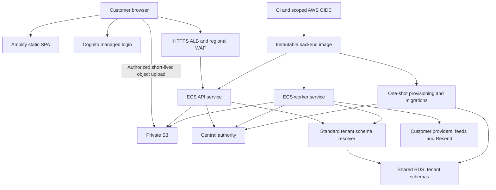

# ScoutGrid — AWS master migration plan

**Revision** November 7, 2026. Clarifies Standard implementation scope and the Dedicated entry conditions. **Status** Planning baseline with implementation and release qualification open. **Source inspected** `f9426447e18c6f3c4c836e3f1c14e0943fb93a22`, including existing workspace changes. Live environment identifiers still need verification during implementation.

This is the single authoritative execution plan for application prerequisites, AWS implementation, configurable tenant isolation, qualification and production cutover. It consolidates the November 1/2 migration plan and November 5/6 architecture reviews. Earlier plans and closure ledgers are supporting evidence, not competing execution instructions. The [previous full plan](Archive/AWS_FINAL_MIGRATION_PLAN_2026-11-02.md) is preserved unchanged for historical detail.

**Latest execution update — November 12, 2026:** PR #69 was manually merged as
`4678580ab0a84c6cd2dfd96a02cfedc168e0a9cf`. All four required main workflows and
the full browser sweep on its identical PR source tree passed. Retain and verify
that exact SHA's backend/frontend pair; a configured lab frontend is separate.
The owner authorized one replacement PR for the subsequent budget records/guard.
After any new merge, qualify that exact new main SHA and its new artifacts.

The owner authorized **$50 inclusive monthly Sydney lab spend**, superseding older
$20/pending-approval statements. Allocate **$25 inclusive** to the application run;
November 12's conservative prior-run bound is about $4.59, with $20.41 unallocated
monthly contingency. Target four hours and finish cleanup by eight. See the
[current execution authorization](release-evidence/postmerge-20261111/EXECUTION_AUTHORIZATION_20261111.md)
and [reproducible budget](release-evidence/postmerge-20261111/authorized-budget-20261111.json).
The application lab remains undeployed. Release/access/secret prerequisites and
all remaining live qualification gates remain open. Older entries are historical.

## 1. Objective and release structure

Prepare and release ScoutGrid on AWS with one codebase, one schema release track and a platform-managed choice of **Standard** or **Dedicated** tenant storage. Preserve tenant isolation, accepted work, authorized identity, safe upgrades and recoverability throughout onboarding and operation.

| Release | Finish line |
|---|---|
| [Part 1 — Prerequisites and Standard on AWS](#part-1--prerequisites-and-standard-on-aws) | Launch and stabilize Standard on AWS. Qualify **ten Standard customer tenants plus SG Internal**. G07b is the default launch capacity gate. An explicitly selected G07a pilot can enroll up to three customers while G07b remains open. |
| [Part 2 — Dedicated on AWS](#part-2--dedicated-on-aws) | Select the topology, qualify new Dedicated onboarding, and prove safe upgrades for live Standard customers and the agreed mix of ten customer tenants plus SG Internal. Publish Dedicated after its gates pass. |

Part 1 has its own release decision and stabilization period. Its ten-customer capacity objective closes when G07b passes. The full configurable-tenancy programme closes after both releases meet their acceptance conditions. Local prerequisites and the Standard AWS laboratory can proceed in parallel after scope and environment selection.

**Standard launch dependencies.** After G00, network and Terraform work (A02/A03) enables the database and ECS services (A04/A07). Cognito (A06) and S3 (A05) feed identity and import integration (P03/P04). Those streams join schema provisioning (P09/P15 → P10 → A10), durable worker and schedule work (P05/P17) and candidate checks (Q01) at Q02. Both capacity qualification (Q04) and recovery rehearsal (Q05, using the A09 controls) feed the G08 launch decision. At M0, assign owners and estimate durations to identify the critical path.

No implementation task or production gate is marked complete by this document. Existing source foundations are identified below; their presence and historical test results do not certify today's candidate.

## 2. Decisions, assumptions and scope

### Settled direction

| Area | Execution baseline |
|---|---|
| Product | One ScoutGrid application and common business contracts across Standard/Dedicated; no permanent customer code forks |
| Standard | Tenant schema with RLS on shared PostgreSQL infrastructure |
| Dedicated | Part 2 will provide a tenant-only RDS PostgreSQL resource. Its application and worker isolation, scoped credentials, storage encryption, availability, maintenance and recovery policy follow the topology decision. |
| Shared services | Part 1 shares API and worker capacity, central authority and global intelligence. Part 2 defines which services stay shared under the selected topology. |
| Frontend | AWS Amplify Hosting replaces Vercel after a qualified frontend cutover; static React/Vite SPA |
| Backend | ECS Fargate API and worker services using the same immutable image; privileged database work in exit-once tasks |
| Browser origins | Separate Amplify frontend and HTTPS API origins. The public ALB and regional WAF serve API traffic to private ECS tasks. |
| Outbound access | Standard production baseline uses two zonal public NAT gateways, each with a stable Elastic IP, for internet-bound traffic from private tasks. |
| Database | Fresh private RDS PostgreSQL with exactly one SG Internal default workspace at bootstrap. Qualify the engine minor and parameters against candidate SQL. |
| Identity | Cognito managed identity plus complete application/session integration; current authority remains in ScoutGrid |
| Files | Private S3 imports/exports; durable job records carry object references, not large payloads |
| Jobs | Retain existing PostgreSQL queues, leases and fencing; fix admission/execution gaps and measure before introducing a new broker |
| Provisioning | Parameterized IaC plus a repeatable, durable provisioning job and runbook; Step Functions and self-service infrastructure UI deferred |
| Reference data | Standard keeps the current reference access. Part 2 selects any additional reference mechanism alongside the topology. |
| Application email | Retain Resend; Cognito identity email is a separate integration/cost concern |

The Dedicated offer will state the database and application isolation it provides, including worker capacity, key ownership and recovery. A separate logical database on shared RDS remains a potential later commercial profile.

### Dedicated decision parameters

P11 opens the Part 2 architecture decision with these parameters. Compare tenant-only RDS with shared application capacity against a dedicated deployment cell with a tenant-only database. A12, G06 and G07d validate the selected service offer.

| Parameter | Decision or evidence needed |
|---|---|
| Customer need and entitlement | Identify the isolation, residency, availability, workload or contractual need that calls for a tenant-only database. Record who can request and approve the profile. |
| Isolation boundary | State which database resources belong to the customer and which application, worker, identity, reference, file and support services are shared. |
| Region, network and access | Select the region and approved data flows, private connectivity, customer egress and scoped credentials. |
| Encryption and key control | Identify the key owner, who can rotate or disable it, and how backups and encrypted data can be restored. |
| Workload, capacity and tenant mix | Size the largest offered customer from assets, scans, imports, data growth and reference corpus. Use Standard telemetry to set the maximum Dedicated mix within the ten-customer target and the worker limits for the selected topology. |
| Availability, maintenance and recovery | Select availability zone coverage, maintenance window, backup retention, acceptable data loss and downtime, and whether relocation is offered. Verify restoration before making commitments. |
| Reference information | Use P11 to select permitted data, freshness limits, behavior during lag, and a practical failover and rebuild procedure. Measure source database overhead. |
| Operating cost and ownership | Record the incremental resource and support cost, commercial price, provisioning and upgrade procedures, and accountable operator. |

### Confirmed inputs and remaining P01/P02 decisions

- The owner confirmed on November 7 that there are **no active customers** and that existing data, tenants and their schemas are disposable test material. Production starts with a fresh database and carries over no existing tenant records. The owner authorized disposal of verified test data, tenants and schemas. P01 identifies the exact targets and P16 tracks the reset and its evidence.
- Create exactly one **SG Internal** default workspace at fresh bootstrap. Use the reserved `tenant_default` schema and `default-workspace` slug. Authorize its use through internal membership and keep customer routing fail-closed when placement is missing. [Bootstrap CLI](../../backend/src/main/java/com/prototype/vulnwatch/migration/ProductionBootstrapCli.java#L299)
- The original 1–3 pilot organisations meant 1–3 customer tenants. The Standard qualification target is **10 customer tenants plus SG Internal**, or 11 active tenants. P02 records Standard workload limits and the launch capacity gate. Part 2 records the maximum Dedicated mix before mixed-cohort testing.
- Confirm exact live database and hosting identifiers, team capacity, and current cutover state. The owner's fresh-start decision settles data retention for the existing test environment.
- The owner selected TeamSG Management (`560246495987`) for production. Use Northern Virginia (`us-east-1`) based on the core-service price comparison and existing regional configuration. The disposable lab remains in Sydney (`ap-southeast-2`) in account `736486260824`. Verify customer data location requirements and provider access before cutover. [Region comparison and placement record](STANDARD_IMPLEMENTATION_READINESS.md#production-region-comparison--november-8-2026)
- Initial proposed availability/recovery objectives are engineering targets, not contractual promises. Validate them before publishing them.
- Every task needs a named accountable owner at kickoff. Role labels below do not assert that a staffed team exists.

### Capability scope

| Capability | Treatment |
|---|---|
| Tenant/platform access, managed identity, tenant switching, provisioning, imports, findings | Common release scope; complete relevant gates |
| AWS/GitHub discovery, shared intelligence, deterministic correlation and static AI posture | Candidate pilot workflows; qualify each actually offered path |
| GCP, ServiceNow, ticketing, patch integrations and private SCCM/MECM connectivity | Conditional on explicit launch need, endpoint/network access and provider/external-effect qualification |
| Customer-private references and credentials | Remain tenant-bound; never enter a global replication allowlist by default |
| Generic Azure, runtime AI telemetry, local archive operations and destructive purge | Preserve effective containment until separately reviewed and qualified; verify actual feature flags rather than relying on old labels |
| Generative assistance | Retain current production/preproduction disablement; re-enablement is a separate product/privacy/spend decision |
| Dedicated deployment cell | Evaluated in P11. Define which components the cell isolates and which services it shares. |
| CDC/zero-downtime relocation, automatic rebalancing, multi-region active-active, BYO account | Deferred |

## 3. Current source baseline and evidence

| Area | Observed source fact | Planning consequence |
|---|---|---|
| Backend | Java 17, Spring Boot 3.5.16; Docker build/runtime use Java 17 | Remove historical JDK26/JRE24 claims; pin and verify candidate toolchain/image digests |
| Frontend | React 18.3.1, Vite 8.3.5, Node 24.x declaration | Reproduce build and frontend security/routing behavior on Amplify |
| Migrations | Platform V1–V10 and tenant V1–V19. The binary supports exactly tenant V19. | Use the current chain for a fresh bootstrap by default. P15 evaluates consolidation and records the selected release baseline. Re-read packaged heads at each release. |
| Tenant model | Unique schema name and one Hikari pool; tenant session/search-path routing | Placement and separate database routing are new work |
| SG Internal | Bootstrap creates or validates the reserved internal `tenant_default` workspace | Seed one internal tenant and verify its grants, entitlements, and separation from customer access |
| Isolation | Tenant context, RLS, reset/discard and transaction-switch safeguards exist | Retain and qualify across the selected connection paths |
| Durable work | Connector queue admission, expiring leases, heartbeats, fencing and stale recovery exist | Extend/verify rather than rebuilding; reserve execution capacity before starting claims |
| Runtime roles | Explicit roles reject invalid configuration; shutdown stops background admission | Verify every startup/scheduled/handler path and old/new deployment overlap |
| Readiness | Tenant failures are reported without automatically draining healthy instances; central query failure still makes readiness fail | Preserve per-tenant eligibility; correct stale reported `5..5` health detail |
| Auth | Explicit LOCAL/EXTERNAL token modes exist; complete Cognito browser session flow is not implemented | P03 is application integration, not an issuer environment-variable change |
| Upload | Multipart BOM endpoint buffers bytes and ingests synchronously | P04 must move processing off API request threads |
| Capacity | Production Hikari defaults 30 maximum/5 idle per JVM; some rate/admission controls remain local | Establish fleet-aware budgets, including deployment surge and heartbeats |
| Secrets | Customer AWS binding/default credentials and versioned application encryption keys exist | Validate task credentials, scoped AssumeRole, rotation and decryptable recovery |
| Infrastructure | Reviewed hosting directory contains a discovery fixture, not the application AWS stack | Hosting IaC and promotion workflow remain implementation deliverables |

Primary source links: [backend manifest](../../backend/pom.xml), [container](../../backend/Dockerfile), [frontend manifest](../../frontend/package.json), [migration heads](../../backend/src/main/resources/db/migration/), [compatibility](../../backend/src/main/java/com/prototype/vulnwatch/service/TenantSchemaCompatibility.java), [datasources](../../backend/src/main/java/com/prototype/vulnwatch/config/TenantIsolationConfig.java), [upload](../../backend/src/main/java/com/prototype/vulnwatch/controller/BomController.java), [worker](../../backend/src/main/java/com/prototype/vulnwatch/service/IngestionJobWorkerService.java), [production settings](../../backend/src/main/resources/application-prod.yml).

### Migration cleanup for the fresh launch

The disposable test environment makes a consolidated migration baseline possible. The default is to run the current V1–V10 and V1–V19 chains against empty production RDS. Each historical file may contribute schema, security policy or required seed data. P15 evaluates whether consolidation gives a measurable benefit and records the decision before the production bootstrap candidate is selected.

Evaluate cumulative Flyway baseline migrations as the first consolidation option. They can initialize empty databases from a cumulative script while preserving versioned history for environments that still use it. A Flyway baseline marker only records a starting version and cannot create the required schema. The repo's migration validator and packaged catalog currently recognize `V` files. Any cumulative baseline or consolidated release line needs coordinated changes to the catalog, CI guards, bootstrap and tests. [Flyway baseline migrations](https://documentation.red-gate.com/flyway/reference/tutorials/tutorial-baseline-migrations) · [Migration validator](../../../.github/scripts/validate-migrations.py) · [Packaged catalog](../../backend/src/main/java/com/prototype/vulnwatch/migration/PackagedMigrationCatalog.java)

Remove old SQL from the packaged release path only as part of a deliberately consolidated line. Preserve the old files and release digests in history, and verify that any database using their recorded checksums is retired or supported. A full squash requires a coordinated reset record and CI validation. The existing reset exception expects both tracks to collapse to V1 and a record at its configured path. Compare both paths on disposable PostgreSQL for equivalent schema, constraints, grants, RLS, triggers, sequences and required seeds. Test SG Internal, a new customer tenant, retry, and the next versioned migration. Retain the full chain if the comparison fails or consolidation offers little benefit. [Integrity guard](../../../.github/scripts/check-migration-integrity.py) · [Previous development reset](../Archive/development-v1-baseline-reset.md)

## Part 1 — Prerequisites and Standard on AWS

### 4. Standard topology and trust boundaries

- Use separate production and nonproduction accounts and credentials. TeamSG Management is the owner-selected production placement exception. Qualify scoped workload roles independently of organization administration because SCPs do not restrict the management account. Record management, billing, audit, backup and break-glass ownership. Use MFA/Identity Center and scoped CI OIDC. [AWS management account guidance](https://docs.aws.amazon.com/organizations/latest/userguide/orgs_best-practices_mgmt-acct.html)
- Standard uses separate browser origins for the Amplify frontend and the public HTTPS API. A02 and A08 record the exact DNS names, trusted CORS origins and Cognito callback/logout URLs. The API routes through the public ALB and regional WAF to private ECS tasks.
- Use one selected region, two Availability Zones, private API/worker subnets, private RDS and an S3 gateway endpoint. For internet-bound traffic, route each private task subnet through its own zone's public NAT gateway and stable Elastic IP. Where providers require allowlisting, register both addresses. Test the surviving zone's egress and record recovery behavior for affected tasks when a zone or egress path is lost. Validate any lower-cost lab configuration separately. [AWS NAT gateway availability guidance](https://docs.aws.amazon.com/vpc/latest/userguide/nat-gateway-basics.html)
- API inbound is restricted to ALB; workers/provisioners have no public ingress. Runtime DB roles have no owner, BYPASSRLS or DDL privilege. Provisioning role is separate from both task execution and ordinary runtime roles.
- Use verified JDBC TLS/hostname trust and current CA material. Keep management endpoints restricted apart from minimal health. Validate trusted proxy chains, exact CORS and security headers.
- Central authority, Standard storage and reference data can share the Standard RDS resource with explicit access boundaries. Route tenant work through the Standard resolver and keep platform and migration paths explicit.
- Use the compatible shared pool for Standard tenant schemas. Set per-process and fleet connection ceilings that account for rolling replacements and maintenance.

### 5. Standard execution register

**Status at consolidation:** all rows are **OPEN for implementation and/or current qualification**. Existing code may satisfy part of a row; only candidate-specific evidence can close it. Dependencies describe completion/qualification order; design and laboratory work can overlap. B = backend, UI = frontend, P = platform, Q = quality/security reviewer, F = product/operating owner.

Task and gate IDs are retained across the split. Q03 and G06 are in Part 2.

#### Application and architecture prerequisites

| ID | Business outcome (plain language) | Work and required output | Dependencies | Owner | Completion evidence |
|---|---|---|---|---|---|
| P01 | Confirm where ScoutGrid runs today and identify the test data and workspaces to clear for a fresh start. | Record the confirmed zero-customer baseline, fresh-production decision, one SG Internal default tenant, and authorized test disposal. Inventory exact environments, database and schema targets, test tenants, external accounts, flags and toolchain. Hand verified cleanup targets to P16. | None | B/P/F | Dated baseline with verified cleanup targets, zero legacy customer datasets to migrate, candidate SHA and packaged migration heads |
| P02 | Agree what ten Standard customers will receive and when enrollment can begin. | Define workload, region, availability and recovery targets, staffing and budget. Scope production GuardDuty and AWS Config, and decide separately whether recovery needs cross-account backup copies. Record G07b as the default and any later choice to use G07a. | P01 | F/P/Q | Approved scope for ten customers plus SG Internal, capacity gate and limit, and budgeted security and recovery controls |
| P03 | Let the approved tenant administrator set a password and enter their workspace. Keep platform-owner workspace access scoped to authorized memberships and grants. | Integrate Cognito authorization code with PKCE, the backend session cookie, issuer-and-subject user mapping, first-admin password setup after A10 activation, and separate member invitation binding. Reuse the platform owner's Authorized Workspaces page and the existing membership, support grant and revocation model. Preserve the separate service-identity contract. | P02, A06. P14 before affected UI work. | B/UI/Q | Direct entry for a single-workspace admin, independent workspace selection in two authorized platform-owner tabs, revocation checks, and denial of incompatible LOCAL issuance in EXTERNAL mode |
| P04 | Let customers upload large files in BOM Management and follow processing in the existing Connectors views. | Wire the existing form to S3-backed upload and show job status in Run History. Implement bounded worker parsing and orphan cleanup. | P02, A05, P05. P14 before affected UI work. | B/UI | Browser-to-result journey, duplicate/replayed completion, size/checksum/tenant rejection and interrupted processing |
| P05 | Start background work when capacity is available and give each customer a fair chance to have it processed. | Reserve execution capacity before leasing jobs, bound in-memory queueing, rotate tenant claim order and bound time spent per tenant in ingestion and finding sweeps. Preserve heartbeat, fencing, retry and shutdown behavior. | P01 | B/Q | Saturation and noisy-neighbor tests show no executor-wait lease churn or tenant starvation. Killed and stale owner tests pass. |
| P06 | Set limits and size shared services so ten customers can work alongside each other. | Budget pools, worker capacity, persistent tenant and provider allowances, and deployment overlap for ten customer tenants plus SG Internal. Instrument per-tenant queue age, sweep duration, empty claims, DB waits, provider throttles and resource saturation. Q04 tests those budgets at the selected enrollment limit and at ten. | P02, P05 | B/P | Documented ten-customer budgets, enforceable multi-replica limits and measurements at the workload under test |
| P09 | Send each customer's requests and background jobs to the right Standard workspace. | Use one fail-closed tenant resolver for API and worker database access before transactions. Keep the existing tenant UUID-to-schema mapping and explicit platform and migration paths. Record stable UUID use in jobs, file ownership, logs and audit records. Review new SQL that crosses tenant and platform boundaries. | P01, P02 | B | Standard routing and isolation tests cover unknown or suspended tenants, SG Internal, requests and background work. New cross-schema dependencies receive review. |
| P10 | Set up and update Standard customer workspaces and open access when they are ready. | Qualify Standard schema provisioning, retry, activation, tenant eligibility, release compatibility and health version reporting. | P09, P15 | B/P | Fresh bootstrap, per-tenant migration status, canary and retry, and safe upgrade or rollback on Standard |
| P12 | Reduce duplicate tickets, emails, or other external actions when connections fail or work is retried. | Qualify external-effect workflows and offered providers: stable operation IDs, durable intent, UNKNOWN reconciliation | P02, P05 | B/Q | Remote-success/local-failure, retries/concurrency and denied account/endpoint cases; unsupported providers contained |
| P13 | Check that customers see only permitted information, sensitive credentials stay protected, and purchased features are correctly enforced. | Verify existing platform authority and Standard tenant authorization, session caches, credential rotation, key custody, privacy, retention and product entitlements. | P01, P02, P03, P09 | B/P/Q | Current membership/support checks; safe authority outage; encrypted recovery; approved capability enforcement |
| P14 | Review how the existing screens work on Standard before changing them. | Reuse onboarding, Authorized Workspaces, Connectors, and BOM Management. Show the integration changes within those pages and record the verification cases for workspace access and import progress. Incorporate owner feedback and resubmit for approval. | P02 | UI/F | Owner approval of the revised Standard mock and a feedback record before affected UI work |
| P15 | Decide whether simplifying the migration scripts makes a fresh database easier to set up and verify. | Timebox the initial baseline decision to one working day. Retain the existing chain by default. If consolidation is selected, verify catalog, permissions, seeds and repeatable bootstrap as described in section 3. | P01 | B/Q | Baseline decision and evidence for the chosen path, including schema and seed parity for any consolidation and preserved migration history |
| P16 | Clear disposable test records and workspaces so any reused test environment starts clean. | Apply the authorized reset to the verified test targets from P01. Stop writers, remove test records and tenant schemas together or recreate the verified disposable database, then bootstrap SG Internal and check access. Use the retirement task for disposable environments being taken out of service. | P01, P15 | P/B | Exact target and cleanup results, no remaining old test tenants or schemas in reset environments, and one correctly seeded SG Internal in any reused environment |
| P17 | Keep scheduled scans and updates reliable when workers restart or are replaced. | Inventory enabled Standard schedules. Qualify durable occurrence deduplication, job ownership and safe retry across overlapping old and new workers and forced failure. Extend existing safeguards for uncovered launch schedules. | P01, P02, P05 | B/Q | One durable job per scheduled occurrence under overlap, safe retry or recovery, and no duplicate customer or provider effects in the tested cases |

P09 establishes a narrow Standard routing contract. Standard preserves the existing transactions that use platform and tenant schemas in the same database. Part 2 decides how far to extend routing and split those transactions for its selected topology.

P14 gates affected UI changes in P03, P04, A08 and the customer and operator workflow in A10. Backend, infrastructure and mock work can proceed in parallel. P15 gates the production bootstrap candidate. P16 gates reuse of a disposable test environment selected for reset. New RDS can be built in parallel with cleanup of old environments.

Inventory setup and manual BOM import both start at **Connectors → Sources** (`/connect/sources`) in the existing left navigation. Use the existing **Inventory** cards and connector detail pages for AWS and GitHub. Use **BOM Management → Ingest Now** for manual file upload and its existing result area for the import outcome. Limit UI work to integration and status changes within these pages, including showing accepted manual import jobs in the existing **Connectors → Run History** view. In Q02, start each workflow from Sources, verify job status in Run History, and check the outcome in the existing Inventory, BOM Inventory, and Findings views as applicable.

#### AWS implementation

| ID | Business outcome (plain language) | Work and required output | Dependencies | Owner | Completion evidence |
|---|---|---|---|---|---|
| A01 | Establish who can manage the cloud environment, where customer data will be hosted, and how spending will be controlled. | Select accounts/region; establish MFA, scoped roles/OIDC, tags, quotas and environment budgets | P01, P02 | P/F | Account/region/role inventory, access checks and cost ownership |
| A02 | Provide protected connections between the website, application, databases, and approved external services. | Build network, private DB paths, API ingress through ALB/WAF with ACM and DNS, zonal NAT routes and Elastic IPs, and the S3 endpoint. | A01 | P | Reviewed IaC, exact origins, private reachability and denial tests, verified egress addresses and evidence from an egress failure test |
| A03 | Set up cloud environments and release software in a repeatable way, with a record of what changed and who approved it. | Establish reviewed Terraform modules, protected state, CI checks and immutable artifact promotion. On GitHub Free, a scoped AWS operator publishes the exact scanned image after independent candidate approval. Parameterize RDS, ECS and secrets so a future topology can reuse them. | A01 | P/B | Rebuildable lab, pinned tools/images, scoped deployment roles and candidate manifests |
| A04 | Provide the Standard service's shared database, with customer access controls and backups. | Create Standard RDS, parameters, secrets, grants, TLS and backup retention. Run exit-once bootstrap on an empty database with the selected migration path and one SG Internal tenant. | A02, A03. P15 before production bootstrap. | P/B | Verified empty-database bootstrap, one reserved internal tenant, restricted runtime behavior and backup configuration |
| A05 | Store uploaded and exported files privately, with clear access, retention, and recovery arrangements. | Create private S3 import/export buckets, encryption, lifecycle/holds, permissions and object-version policy | A02, A03 | P/B | Cross-tenant denial, retention cleanup, restricted signatures and object recovery |
| A06 | Prepare managed customer sign-in and account emails for integration with ScoutGrid. | Configure Cognito app clients/login/callbacks, key/token contract and identity email | A01, A03 | P/B/UI | Qualified settings with P03; exact domains and approved identity mapping |
| A07 | Run customer requests and background processing separately, with controlled growth and checks for service problems. | Deploy API/worker roles, task definitions, health, autoscaling ceilings, drain/stop and secret loading | A02, A03, A04 | P/B | Effective environment manifest; role isolation; replacement and deployment-surge tests |
| A08 | Publish the ScoutGrid website through a controlled process, with tested navigation and a recovery option for failed releases. | Implement Amplify monorepo build, headers/routes/caches, trusted previews, gated production release and domains | A03. P14 before affected UI work. | P/UI | Candidate artifact/job/SHA pairing; deep links, missing assets, CSP, browser origins and rollback |
| A09 | Alert the operating team to threats, configuration changes, service problems and spending, and give them the access needed to respond and recover. | Implement protected CloudTrail logging, operator alerts, bounded per-tenant telemetry, backup and key custody and spend controls. Enable production GuardDuty foundational detection and scoped AWS Config recording and rules. Configure the selected backup copy policy separately. | P02, A01, A03, A04, A05 | P/Q/F | Audit, GuardDuty finding and Config evaluation evidence, verified alert delivery and ownership, tested restore access, and usage-based budget estimates |
| A10 | Set up and activate Standard customer workspaces after platform-owner approval. | Provision and activate the workspace for the approved request, then hand off to P03 for administrator password setup. Enforce the approved enrollment limit at reservation and activation, counting each active or reserved customer slot once and excluding SG Internal. | P09, P10, A04, A07. P14 before affected UI work. | B/P | Partial-failure recovery and single activation. With G07a selected, concurrent requests cannot reserve or activate a fourth customer slot. |

#### Qualification, cutover and stabilization

| ID | Business outcome (plain language) | Work and required output | Dependencies | Owner | Completion evidence |
|---|---|---|---|---|---|
| Q01 | Check the exact software release for defects and security issues before it is considered for customer use. | Run required candidate CI, PostgreSQL integration, frontend/browser, migration/policy/secret/image checks | A03; all candidate changes | B/UI/Q | Exact SHA, toolchain, image digest, frontend hash/config and required check results |
| Q02 | Demonstrate that Standard customers can complete their main workflows while their information remains separated. | Qualify Standard workflows, routing, lifecycle and scheduled work. Verify the approved Standard UI and SG Internal separation. | P03–P06, P09, P10, P12–P15, P17, A04–A10, Q01. P16 if using a reset environment. | Q/B/P | Dated Standard evidence for G02–G05, including mock comparison, isolation and scheduling |
| Q04 | Show how many Standard customers the launch configuration can support within the agreed service limits. | Test the intended Stage B configuration from one to three to ten customers plus SG Internal. Include concurrent imports, heavy-tenant and failure tests, rollout overlap and a 24-hour run at ten. Record results separately for G07a and G07b. | P06, P17, A07, Q02 | Q/B/P | Results at the selected capacity gate meet approved latency, freshness, fairness and resource limits. Record measured capacity and spend. |
| Q05 | Demonstrate how to restore Standard customer data and recover from a failed release. | Rehearse database, object and key restoration, tenant extraction or recovery, and compatible rollback or roll-forward on the launch configuration. Test a cross-account restore if that control is selected. | A09, Q02 | P/B/Q | Timed recovery and integrity evidence meeting the agreed targets, including reconciled external effects |
| R01 | Bring together test results, operating arrangements, and release risks so the business can decide whether to launch Standard. | Assemble the Standard scope, candidate, rollback and configuration manifests. Record the selected capacity gate and any enforced enrollment cap. | Q01, Q02, Q04 evidence for the selected gate, Q05 | F/P/Q | G08 decision record, applicable gate results and accountable release owner |
| R02 | Move customer access to the approved AWS service and begin with a limited customer group. | Execute controlled backend/frontend domain cutover and bounded enrollment. | R01 and G08 | P/B/UI/F | Recorded changes, working production journey, durable scheduling during worker replacement and one authoritative production data path |
| R03 | Watch the new service closely after launch and confirm reliability, capacity, and running costs before expanding. | Observe/stabilize for proposed 7–14 days; inspect actual usage, alarms, errors, jobs and costs | R02 | P/B/F | Observation record and approved supported limits; expansion paused on unresolved failures |
| R04 | Close old hosting services only after the new service is accepted and required data and recovery access are preserved. | Retire obsolete Render/Vercel resources and credentials after acceptance/retention review | R03 | P/F | Separately authorized retirement inventory, retained recoverability and billing confirmation |

### 6. Standard implementation contracts

#### Identity, sessions and tenant authority

Use the selected Cognito authorization-code/PKCE integration and backend session contract. The proposed browser model is a Secure/HttpOnly host-only API cookie backed by hashed opaque session records, inactivity/absolute expiry, revocation and CSRF protection. Qualify exact frontend/API domains and cross-origin credentials; a temporary preview domain must not cause weakened production controls.

Validate issuer/signature/expiry, access-token purpose, intended app client/resource and scopes against real Cognito tokens. Default Cognito access tokens commonly identify the client with `client_id`; do not silently bypass audience checks. Keep human and service identities distinct. Map `(issuer, subject)` to current users; do not elevate based solely on email.

Reuse the existing selected-tenant, membership and support-grant resolution and revalidation paths. Verify those checks and entitlement checks against authoritative policy on requests and jobs. Two tabs must retain explicit independent workspace context. Specify revocation latency, permission-cache invalidation, in-flight work and authority-outage behavior. Separate invitations for additional members must bind identity, tenant, role, expiry and single-use acceptance. Qualify recovery, logout and denied-token and denied-tenant paths. Cognito MFA is off in every environment by owner decision; the risk is accepted in the [G08 decision record](release-evidence/standard-g08/G08_RELEASE_DECISION.md) (AR-01). [Existing JWT tenant authorization](../../backend/src/main/java/com/prototype/vulnwatch/service/JwtTenantAuthenticationService.java#L178)

After Cognito sign-in, a tenant administrator with one authorized workspace enters it directly. Keep the active workspace visible in the existing header. For platform owners, reuse **Settings → Authorized Workspaces** (`/authorized-workspaces`) with its current role restriction and membership and support-grant checks. Q02 verifies that switching one authorized tab leaves the other tab's workspace and data intact, SG Internal requires explicit internal membership, and expired or revoked access is denied. [Existing route guard](../../frontend/src/App.tsx#L664)

Reuse **Request a demo** (`/demo/contact`) and **Platform → Demo Requests** (`/platform/demo-requests`) for first-admin onboarding. The platform owner's approval queues Standard provisioning under the request ID. After activation, the operator links the approved administrator and submits the Cognito setup email. The message links to the existing `/login` page and supplies an expiring temporary password. Cognito prompts the administrator to choose a password before managed sign-in grants their workspace access. Q02 must verify pending or declined requests, interrupted provisioning, expired temporary credentials, and email retry without duplicating the workspace or membership. [Standard onboarding runbook](STANDARD_IMPLEMENTATION_READINESS.md#a10p10--standard-customer-provisioning)

#### Durable imports and execution

Upload flow: authorize and reserve tenant quota → persist PENDING intent/random immutable key → issue short-lived S3 upload authorization → verify object ownership/version/size/checksum/format → persist executable intent → worker streams/bounds parsing → publish durable result/status → retention/hold-aware cleanup. Revalidate at execution, reject overwrite/replay/cross-tenant use and reconcile orphaned objects or partial finalization. Do not claim atomicity between S3 and PostgreSQL.

Preserve the current 50 MB cap and component/decompression/depth limits until measured. Queue claims must match available execution slots; do not start an attempt lease that can expire while waiting in a long in-memory queue. Preserve lease renewal, transaction fencing, durable payloads, bounded retry and terminal state. Test SIGTERM/forced kill at admission, claim, provider effect, commit and publication.

Use durable operation IDs/outboxes or equivalent state machines for actual cross-resource effects. A remote ticket/patch/email success cannot be undone by a local rollback. Reconcile UNKNOWN outcomes before replay; provider acceptance is not confirmed delivery. Moving genuinely tenant-owned state locally can remove some distributed writes; use an outbox where a real boundary remains.

P17 verifies each enabled schedule against deployment overlap, worker loss and retry. The existing scheduled-sync uniqueness check is a starting point for the inventory. [Scheduled sync migration](../../backend/src/main/resources/db/migration/postgres_reset/V5__scheduled_sync_occurrences.sql#L3)

#### Routing, provisioning and schema lifecycle

The Standard resolver accepts an authorized tenant UUID and resolves its existing schema and connection identity before the API or worker opens a transaction. Exports and support follow the same tenant path. An unknown, suspended or unresolved tenant fails closed. SG Internal is available through explicit internal authority. Platform and migration operations keep separate, explicit paths. Store stable tenant UUIDs in durable jobs, file ownership and audit records. Workspace URLs can continue to use slugs. Review new queries that cross tenant and platform schemas and record their transaction needs for Part 2.

Standard provisioning persists intent, reserves a customer slot, reconciles retries, migrates the schema under privileged exit-once credentials, validates runtime behavior, and activates the tenant. Use a transaction-safe cap on active and reserved customer slots when G07a applies. Track resources owned by the operation for cleanup. Preserve the existing same-database transaction for connector runs and jobs during Part 1.

Current packaged heads are platform V10 and tenant V19. The current binary supports exactly V19. Use new versioned migrations and tested compatibility windows for subsequent changes. P15 governs any consolidated baseline and preserves the provenance of applied histories. Correct the stale health display, deny incompatible tenants while keeping healthy tenants ready, and record Standard tenant migration status and canary, batch and stop conditions.

For ECS qualify the standalone bootstrap/migration invocation as exit-once. Verify the exact bootstrap command, environment and successful exit. Setting `schema-migrator` alone must not leave a privileged web-listener wrapper running. Use `/app/scripts/run-schema-migration.sh --run-once` only after its candidate behavior is verified.

#### Credentials, product controls and privacy

Retain ECS task credentials and customer AssumeRole with validated account/role/ExternalId binding. No platform-account fallback for customer discovery. Runtime roles cannot obtain owner credentials or arbitrary PassRole. Preserve encryption key IDs and required previous versions for backups, outboxes and rotation. Qualify failure/denied/revoked provider paths and private customer connectivity separately.

Production configuration explicitly sets EXTERNAL auth, approved tenant context, ENFORCE for actual enrolled tenants, proxy origins and feature scope. Keep local API-key/header/test-persona shortcuts disabled. Retain currently contained surfaces until their separate acceptance passes. Minimize Sentry/log payloads and metric cardinality. Record actual customer/provider data flows, consent/terms, sender ownership and email domain setup; retain Resend and use controlled delivery tests.

### 7. Standard AWS build and release details

- **Infrastructure definitions** use reviewed Terraform with reusable RDS, ECS and secrets modules. Record protected state, scoped roles, rebuild procedures and resource ownership. Part 2 adds the modules its selected topology requires.
- **RDS** uses a supported PostgreSQL 16 minor or another version that is explicitly qualified. Baseline CI uses PostgreSQL 16. Encrypt, disable public access, and configure deletion protection, reviewed parameters and maintenance, controlled storage growth and automated backups. P02 selects the policy from the proposed 7-day lab, 14-day pilot and 35-day larger-fleet backup periods.
- **ECS:** separate API/worker/task-execution/provisioning identities. API scheduling off; worker no public ingress; provisioner no ordinary jobs. Pin image digest, inject least-privilege secrets, capture effective flags, set DB-aware autoscaling ceilings and include replacement surge. Align Spring/executor drain, ALB deregistration and Fargate stop timeout; qualify the proposed 120-second container stop budget. Use circuit breaker/alarm rollback only with a compatible prior candidate. [ECS circuit breaker](https://aws.amazon.com/blogs/containers/announcing-amazon-ecs-deployment-circuit-breaker/).
- **Frontend:** Amplify app root `prototype-app/frontend`, pinned Node/tool versions, `npm ci`, required checks and `dist` artifact. Port CSP/security headers, canonical redirects, SPA fallback excluding real assets, short-lived HTML and immutable hashed assets. Verify deep links, missing asset 404s, invite flows, cache transitions and old tabs.
- **Promotion:** production frontend auto-builds off; promote only an approved SHA through a protected release workflow and verify actual Amplify job revision/artifact. Capture frontend/backend pair and exact public API/callback/logout/email/CORS/Turnstile/S3 origins. Nonproduction previews use nonproduction authority/data. Retain last-known-good artifacts and compatible frontend/API behavior. Native Git integration does not establish external CI approval.
- **Observability and security** record protected account audit events and alert on service errors, pool waits, queue age, feed freshness, storage, provider failures, backup failures and spend. Collect per-tenant usage and performance data with bounded metric volume. A09 defines GuardDuty account and region coverage and any extra protection plans, and AWS Config resource types, recording frequency and rules. Demonstrate delivery of test findings and actionable rule results to a named operator. [GuardDuty foundational data sources](https://docs.aws.amazon.com/guardduty/latest/ug/guardduty_data-sources.html) · [AWS Config rules](https://docs.aws.amazon.com/config/latest/developerguide/evaluate-config_components.html)
- **Cross-account backup copies** follow the P02 recovery decision. If selected, test restoration from the copy and retain primary point-in-time recovery. [AWS Backup copy and recovery guidance](https://docs.aws.amazon.com/aws-backup/latest/devguide/recov-point-create-a-copy.html)
- **Secrets/recovery:** preserve required key versions and restricted restore access; changing a secret reference is not proof running tasks loaded it. Rehearse rotation and backup decryptability. S3 lifecycle respects holds, object versions and replay requirements; the proposed 30-day raw upload/7-day failed object/24-hour abandoned-intent periods require explicit policy selection.

### 8. Standard workload, connection and cost baseline

#### Design assessment at ten customer tenants

Ten Standard customers plus SG Internal is a reasonable design target, subject to workload qualification. The first constraints as load grows are background work, shared database resources and provider limits. Test the intended Stage B configuration at ten and size from measured bottlenecks. Stage C provides a larger sizing reference. [AWS PostgreSQL tenancy comparison](https://docs.aws.amazon.com/prescriptive-guidance/latest/saas-multitenant-managed-postgresql/matrix.html)

| Area | What can become constrained beyond the early cohort | Modification and evidence |
|---|---|---|
| Worker claims and scheduling | The ingestion poller rotates through active tenants and admits up to ten tenant probes per poll by default. An admitted probe can check several job types. Claims and expired-attempt recovery skip a tenant when its database admission lock is busy. | Measure claim and sweep duration, empty work, oldest job age and lease expiry. Add a ready-work index if empty polling materially consumes the database budget. |
| Findings and shared intelligence | The finding poller processes one batch per tenant per round and resumes after its last visit when the sweep budget is reached. A slow in-flight batch can extend a sweep. Initial reference imports and feed catch-up still contend with customer work. | P06 measures per-tenant finding and feed freshness and verifies the timeout and sweep defaults against the Standard workload. Separate heavy job capacity if the measured results warrant it. |
| Database connections and rollout | The Stage B task definitions allow 20 steady runtime pool connections and 40 during full overlap across two API tasks and one worker. The restricted PostgreSQL login limit includes one verification slot. | Budget migration owner, administrative and recovery connections separately. Measure memory, pool waits, heartbeats and rollout ceilings on the actual configuration. |
| Storage, writes and interactive queries | More tenant schemas add migration and catalog work. Corpus size, indexes, correlation writes, retained evidence and concurrent imports drive storage and I/O pressure. | P06/A04 measure locks, queries, storage, WAL and I/O under load. Bound imports and review query plans before resizing. Verify P10 lifecycle behavior across the cohort in Q04. |
| Provider and tenant fairness | Per-process limits multiply with replicas. Concurrent scans can exhaust shared workers, connector quotas or outbound bandwidth. | P06/P12 enforce provider and tenant allowances across the fleet and validate a heavy customer alongside normal usage, throttling, backoff and continued progress for other customers. |

The worker code and production configuration define the current scheduling and pool defaults. [Ingestion worker](../../backend/src/main/java/com/prototype/vulnwatch/service/IngestionJobWorkerService.java#L87) · [Finding queue](../../backend/src/main/java/com/prototype/vulnwatch/service/FindingDeltaQueueService.java#L313) · [Production configuration](../../backend/src/main/resources/application-prod.yml#L1)

#### Ten-customer workload and qualification

Use ten customer tenants at up to 1,000 assets and 100,000 installed software associations each as the proposed starting test envelope. That gives one million customer associations, plus representative SG Internal activity and the shared reference corpus. P02 approves the exact fixtures, concurrency, largest offered tenant and workloads. The prior 10–20 million association scenario remains a separate heavier workload to qualify if included in the offer.

Run Q04 at one, three and ten Standard customer tenants with SG Internal active throughout. At ten, exercise concurrent imports and scans, a heavy tenant alongside ordinary activity, feed catch-up, provider throttling, forced worker replacement, database recovery, deployment overlap and a 24-hour soak. Match the intended production configuration. If it falls short, use measured bottlenecks to choose a change and repeat the affected tests. Requalify after material changes to resources, workload or limits.

G07b is the default capacity gate for first launch. If the owner chooses earlier enrollment, qualify G07a at three customers plus SG Internal with the same isolation, recovery and rollback requirements. A10 enforces the three-customer cap until G07b passes. Refine the ten-customer test workload with early usage data when available.

P02 selects Standard pass targets before Q04/Q05. Starting proposals are p95 ordinary interactive reads below 1 second, p95 asynchronous job acknowledgement below 2 seconds, shared intelligence freshness within 24 hours, and same-region recovery RPO at most 15 minutes and RTO at most 4 hours. Set provider-limited scan completion and fairness bounds from fixtures. Measure the proposed 99.9% internal availability objective over an agreed observation window. Revise the offer explicitly if evidence shows the initial proposals cannot be met.

| Input | A: validation lab | B: Standard launch candidate | C: larger sizing reference |
|---|---|---|---|
| Customer tenants / human MAU | Controlled fixtures / 10–25 | Test at ten plus SG Internal. The dated cost model assumed 1–3 customers and up to 100 monthly active users. | Ten plus SG Internal, using the P02-approved activity envelope |
| Assets | 100–1,000 fixture | Up to 1,000 per customer in the starting test | Same starting test, with a separate larger workload if offered |
| Installed associations | Up to 100,000 total | One million customer associations at ten, plus SG Internal | Same starting test, with a separate larger workload if offered |
| API test load | 1 RPS typical | 2 sustained / 10 burst | 10 sustained / 50 burst |
| API tasks | 1 × 0.5 vCPU / 2 GiB | 2 × 0.5 vCPU / 2 GiB | 2 × 1 vCPU / 4 GiB; measured ceiling |
| Worker tasks | 1 × 1 vCPU / 4 GiB | 1 × 1 vCPU / 4 GiB | 2 × 2 vCPU / 8 GiB; measured ceiling |
| Shared RDS | t4g.medium Single-AZ | m7g.large Multi-AZ | m7g.xlarge Multi-AZ |
| Shared DB allocated/growth cap | 100/200 GiB | 100/400 GiB | 400/1,000 GiB |
| Heavy work | One at a time | One heavy import globally; bounded scans | Begin with two heavy imports; measured provider/DB ceilings |

Measure full reference corpus, indexes, installed associations, retained evidence, WAL and temporary bytes. Bound parsers and transactions. Validate sustained throughput and CPU credits before sizing correlation work on a burstable T4g instance. Budget read capacity on the primary for the proposed Multi-AZ DB instance. Verify RDS storage, I/O and class limits before purchase.

Retained initial Hikari hypotheses are 6 per API, 6 per pilot worker, 8 per larger worker, idle 1–2, and a separately bounded provisioner. Count every Standard datasource, pool and heartbeat consumer. Budget peak replicas, deployment surge and administrative and recovery connections. Test against actual RDS memory and connection limits. Add Proxy or PgBouncer only when measured benefits and session and RLS semantics justify it.

#### Cost scope and freshness

The [cost model](AWS_COST_MODEL.json), [line-item table](AWS_COST_TABLE.md) and [calculator](calculate_costs.py) retain November 1/2 shared-platform assumptions. The calculator writes those model/table files; run it intentionally to reproduce that baseline, not to fetch current prices. This consolidation does not refresh all rates or introduce new numerical sizing promises.

| Stage | Retained AWS/month | With 20% contingency | Meaning |
|---|---:|---:|---|
| A | $210.85 | $253.02 | Validation only; no customer SLA |
| B | $627.55 | $753.05 | Historical early shared cohort, with staging and retained services separate |
| C | $1,456.69 | $1,748.03 | Historical larger Standard sizing reference. Consider and reprice it if Stage B misses its targets and measurements support resizing. |

The prior whole-operation pilot planning envelope was **$900–1,100/month**, including contingency/staging/retained services, excluding tax and labor. Preserve it as a dated allowance, not a current quote. Reconfirm support-plan/account treatment and actual provider tiers. Avoid double-counting Amplify/frontend staging, and account for temporary Render/Vercel overlap.

The retained Stage B estimate already includes two zonal NAT gateways with 100 GB of monthly processing and separately budgets public IPv4 addresses for the ALB and both NAT gateways. A02 and A09 reprice the selected network and forecast actual traffic. A09 updates the historical GuardDuty allowance from the scoped usage estimate and adds AWS Config to the production forecast. Config charges depend on resource recording and rule evaluations, while GuardDuty charges depend on sources, volumes and protection plans. [Cost table](AWS_COST_TABLE.md) · [GuardDuty pricing](https://aws.amazon.com/guardduty/pricing/) · [AWS Config pricing](https://aws.amazon.com/config/pricing/)

Billing owner, alerts, actual 7/30-day forecast, environment scheduling, approved retention, growth caps and per-tenant attribution are A01/A09/Q04 outputs. No reservations/Savings Plans, enterprise capacity purchase or full-regional DR commitment is required by this plan. Re-estimate after measured stable usage and signed requirements.

### 9. Standard release gates

Every gate starts **NOT EVALUATED**. Evidence must identify candidate SHA/image/frontend artifact, environment/topology, date/operator, procedure, actual result and unresolved findings. Tests on historical bytes or a different profile do not pass a current gate. Stop expansion or keep the affected capability unavailable when evidence is missing or failing.

| Gate | Boundary | Pass evidence | Failure action |
|---|---|---|---|
| G00 | Scope and laboratory entry | P01, P02 and A01 record fresh launch, verified test reset targets, the Standard workload at ten, lab region, accounts, budget and owners. | Resolve outstanding scope decisions before billable lab work. Local prerequisites can proceed. |
| G01 | Candidate quality | Q01: required backend/PostgreSQL/frontend/browser, migration/architecture/policy/security checks and pinned artifacts | Repair candidate; preserve required checks and containment |
| G02 | Identity and application readiness | P03–P06, P12–P14 and P17 cover the approved Standard mock, implemented UI, Cognito sessions, bounded imports, fair admission, durable scheduling, fleet limits and safe provider retries. | Keep affected workflows closed until they pass. |
| G03 | AWS foundation | A02–A09 demonstrate a reproducible environment, private database access, scoped credentials, controlled deployment, frontend security and tested egress. Qualify protected audit logging, scoped GuardDuty and Config, operator alert delivery and budget controls in the lab before production promotion. | Fix the lab and hold production infrastructure promotion. |
| G04 | Standard routing and lifecycle | P09, P10, P15 and A10 demonstrate fail-closed schema routing, partial provisioning retry, the selected migration path and fresh bootstrap with exactly one SG Internal. Verify P16 for reused reset environments. | Hold rollout until routing, migration and bootstrap checks pass. |
| G05 | Standard profile | Q02: alternating tenants across API/jobs/objects/support, cold/warm pooled connections, authority revocation and failure containment | Standard remains unavailable for customer enrollment |
| G07a | Optional capped launch at three customers | Q04 and Q05 meet the P02 workload and recovery targets at three Standard customers plus SG Internal on the intended launch configuration. All common isolation, recovery and rollback checks pass. A10 proves that concurrent requests cannot take a fourth active or reserved customer slot. | Hold capped launch until the tests and cap enforcement pass. |
| G07b | Default launch capacity at ten customers | Q04 and Q05 pass at ten Standard customers plus SG Internal on the intended production configuration. Evidence includes the 24-hour soak, deployment overlap, timed recovery and agreed service targets. | Resolve measured bottlenecks and retest. An approved G07a launch can remain capped at three while G07b stays open. |
| G08 | Standard production go/no-go | G00–G05 must pass whichever capacity path is selected. R01 records a pass at the selected gate, G07b by default or G07a with owner approval and the enforced cap. Verify release and rollback artifacts, domains, providers, keys, runbook and operator. The approver acknowledges each accepted risk in the [G08 decision record](release-evidence/standard-g08/G08_RELEASE_DECISION.md). | Hold cutover until the common gates and selected capacity gate pass. |

Record results for G07a and G07b separately. A passing G07b supports staged enrollment beginning at one to three customers. If G08 authorizes a G07a launch, keep the cap in place until G07b passes on the production configuration and the owner records the enrollment expansion. Part 2 uses its own gates in the Dedicated charter.

The integrated journey starts with owner bootstrap and managed login. It covers direct entry for a single-workspace admin, platform-owner workspace selection in two authorized tabs, an import or discovery job through findings, any offered ticket or campaign action, revocation and recovery. Include wrong-tenant inputs, provider failure, retries, overlapping workers, exhausted pools, incompatible schemas and unavailable authority.

### 10. Standard execution and milestones

| Milestone | Work | Exit |
|---|---|---|
| M0 — reconcile baseline | P01/P02 and A01. Record the confirmed fresh start, exact reset targets, region and ten-customer scope. | G00 |
| M1 — application foundation | P03–P06, P09, P10, P12–P15 and P17. Review the Standard mock, select the migration path, and integrate identity and storage as the lab components arrive. | Approved Standard mock, baseline decision and component evidence ready for integrated tests |
| M2 — AWS laboratory | A02–A09 in parallel with M1. Run P16 before reusing selected disposable test environments. | G03 plus lab candidate available |
| M3 — Standard integration | A10, Q01 and Q02. Qualify the shared-schema lifecycle, Standard routing and approved workflows. | G01/G02/G04/G05 |
| M4 — Standard qualification | Q04 and Q05 qualify the selected launch limit on Stage B or the measured replacement. R01 records the launch decision. If the owner selects G07a, M6 closes the ten-customer qualification. | G07b and G08 by default, or approved G07a and G08 |
| M5 — Standard cutover and stabilization | R02 and R03. Enroll the initial cohort and observe service and recovery signals. | Standard is live and stable within its qualified limit |
| M6 — Standard capacity and retirement | If launched under G07a, pass G07b before expanding enrollment. Complete R04 after Standard acceptance and the applicable retention review. | Ten-customer objective verified, recovery retained and old environment disposition recorded |

M1 and M2 overlap after G00. Identity integration depends on A06 and storage integration on A05. Standard stabilization and retirement follow Standard acceptance. The Dedicated charter records its own entry conditions and release decision.

Estimate Part 1 from this Standard register after M0, using named owners and verified prerequisites. Estimate Dedicated after P11 selects its topology and confirms the affected work. The historical combined estimate remains archived.

### 11. Standard cutover, rollback and retirement

#### Fresh production entry

Create a new empty production database and run the P15-selected migration path through the exit-once bootstrap task. Seed approved reference, catalogue, policy, plan and owner configuration. At initial bootstrap there must be exactly one tenant, SG Internal, using `tenant_default` and `default-workspace`. Verify its grants and entitlements, repeat bootstrap to prove idempotency, and test that external users and unresolved customer requests cannot access it. Customer tenants are created through approved onboarding after qualification.

P01 records the owner's authorization to discard existing test data, test tenants and their schemas. P16 verifies the exact database, tenant IDs and schemas before executing cleanup in any test environment selected for reuse. Pause API, workers and scheduled writers against that target. Recreate the disposable database or clean the scoped tenant and schema records together through the operator runbook. Bootstrap SG Internal and verify the resulting inventory, then resume test writers. A wholly retired test environment can be disposed of through R04. Record the disposition in P16. Existing fixtures and secrets stay out of the fresh production database.

#### Production cutover

Select the G08-approved artifacts, configuration, enrollment cap and rollback or roll-forward procedure. Confirm backups, keys, quotas, DNS, certificates, provider access and operator availability. Keep enrollment closed initially. Apply the reviewed production infrastructure and bootstrap, start the API and workers, then validate readiness and scheduling during replacement. Deploy the paired frontend and verify domains, sessions, browser access and email links. Confirm production audit logging, GuardDuty and Config coverage and alert routing. Enroll the initial cohort after the integrated journey passes and record the authoritative data locations.

Frontend may move independently if its exact API pairing and fallback are qualified; requalify when API changes. Current source-host configuration is not proof of actual domain ownership or deployment state.

#### Recovery and rollback

The proposed same-region Standard objectives are RPO at most 15 minutes and RTO at most 4 hours. Confirm them with timed recovery on the launch configuration. Qualify the availability setup, database backups and restoration procedures separately.

Standard tenant recovery may require an isolated full restore and tenant extraction and reconciliation. Verify provider-secret decryptability, membership and session implications, jobs, findings, object versions and retained keys. Protect backup and audit custody from runtime roles.

Pause affected admissions/effects, stop unhealthy claimers, and roll to the prior qualified AWS image only when schema/behavior compatibility is proven. Otherwise use the rehearsed roll-forward. Keep authoritative RDS/S3/identity locations. Returning customer traffic to an old Render database or historical frontend API URL is not an application rollback. PITR is an explicit data-recovery decision with write-stop/reconciliation and possible data loss; it is not a routine deploy undo.

#### Stabilization and offboarding

Observe closely at cutover, then daily during proposed 7–14-day stabilization. Pause expansion on authorization anomalies, rising errors/lag, stalled work, failed recovery or unexpected spend. Retire old environments only after the acceptance window, retention review and separately authorized inventory-based action; retain required artifacts, backups, keys and billing evidence. Review quarterly restores and access/rotation procedures after launch.

Export/deletion policies must cover DB data, central records, objects, logs, copies, backups and legal holds. A dedicated KMS key supports erasure only for covered ciphertext; ordinary KMS deletion waits 7–30 days and does not erase other copies. Destructive purge stays unavailable until its own policy and tests pass.

### 12. Standard deliverables and remaining decisions

Part 1 delivers the Standard UI mock and feedback record, test reset disposition, migration decision, tenant routing contract, AWS infrastructure and release configuration, and the capacity and recovery evidence for G08. Retain a separate G07b result if the launch uses G07a.

Store execution evidence under `release-evidence/<release-id>/` in this folder or link a protected artifact store. Do not place secrets/customer payloads in repository evidence. Each record names task/gate ID, artifact identity, environment, test/procedure, result/date/operator, failure action and reviewer. Until evidence exists, the status remains OPEN/NOT EVALUATED. Later source/config changes require rerunning affected checks and preserving prior evidence identity.

| Decision still to record | Recommended working default | Blocking boundary |
|---|---|---|
| Exact test reset targets and schedule | Owner confirmed zero active customers and disposal of the existing test data, tenants and schemas. Verify resource identities and record P16 execution. | Any reset and reuse of the identified test environment |
| Fresh database migration baseline | Retain the current chain unless P15 demonstrates a worthwhile consolidation with equivalent schema and seeds. | Production bootstrap candidate and G04 |
| Standard launch and workload | Test Stage B at ten plus SG Internal. Use G07b by default. A capped G07a launch requires a recorded choice and enforced limit. | G08 and enrollment beyond three |
| Standard UI mock and feedback | Owner approved the revised workflow review on November 8, 2026. Retain the approval record and qualify the implementation under Q02. | P14 review complete. G02 qualification remains open. |
| Region/residency and approved data processors | TeamSG Management in Northern Virginia for production. Verify customer data location requirements and quantify external flows. | Account/resource provisioning and customer contract |
| Production security coverage | Scope GuardDuty foundational detection and AWS Config resource types and rules. Name the alert owner and estimate costs. Decide cross-account backup copies separately. | G03 qualification and production enrollment |
| Retention, holds and export or deletion policy | Preserve existing holds and approve new object periods separately. | Cleanup, offboarding and recovery qualification |
| Named owners, staffing, budget and delivery dates | Assign Standard owners and estimate Part 1 at M0. Record the Dedicated charter review date or customer milestone. | Billable execution, release and support commitments |

## Part 2 — Dedicated on AWS

### 13. Dedicated release charter

**Early desk study.** After G00, P11 may run a timeboxed comparison using existing evidence and any documented prospect requirements. Record open questions and rough cost and effort drivers. The study uses existing staff time, with no AWS spend or dependency for the Standard release.

**Implementation entry.** Start topology approval, any AWS experiment and implementation after Standard stabilizes in R03 and the owner records a customer requirement or an approved product investment. P02 records a review date or customer milestone. Sales may describe Dedicated as planned. Confirm availability and delivery commitments after the Dedicated release passes G08d.

**First decision.** P11 compares a tenant-only database with shared API and worker capacity against a dedicated deployment cell with its own tenant-only database. Apply the decision parameters in section 2 to both, including isolation, identity, workload, reference-data freshness, operations, recovery, cost and delivery effort. If evidence is missing after implementation entry, use a bounded A11 experiment. Revisit the desk study with Standard operating evidence and estimate implementation once the owner approves a topology.

**Initial offer.** Provision new Dedicated tenants using the same product code and release track. Protect existing Standard data during upgrades. Qualify relocation separately if it becomes part of the offer. Use a tenant-specific maintenance window, validate a consistent copy, fence the old writers and verify the destination before resuming service. After destination writes begin, recovery must preserve or reconcile those writes before switching storage again.

#### Dedicated decision and delivery tasks

P11 and any required A11 experiment inform the topology decision. Downstream design and delivery tasks use the approved P11 decision. The earlier reviews contain the detailed alternatives and replication proof criteria. [Configurable tenancy proposal](configurable-tenant-isolation-review-2026-11-06.md) · [Convergence notes](tenant-isolation-convergence-notes-2026-11-06.md)

| ID | Business outcome (plain language) | Work and required output | Dependencies | Owner | Completion evidence |
|---|---|---|---|---|---|
| P11 | Choose a Dedicated setup that meets customer needs and can be operated safely. | Optionally run a timeboxed desk study after G00. After implementation entry, approve the Dedicated offer, topology and reference-data approach using the decision parameters and any needed prototype evidence. | G00 for desk study. R03 and recorded business trigger for approval, plus A11 if needed. | B/P/F/Q | Approved decision with requirements, evidence, cost and revised delivery scope |
| A11 | Test the uncertain parts of Dedicated in a temporary environment. | Create bounded disposable resources with scoped identities for the agreed P11 experiment. | A03, R03, recorded business trigger and approved experiment scope | P/B | Prototype results, spend and cleanup record |
| P07 | Identify which shared information the selected Dedicated setup needs and who can access it. | Classify affected authority, reference and tenant-owned data. Inventory affected SQL, transactions, constraints, background work and recovery paths. | P11 | B/Q | Ownership and transaction matrix for the selected topology |
| P08 | Keep customer jobs and their history consistent when they run in a separate database. | Split tenant run state from global feed state where needed to preserve local atomicity. Scope changes to the selected topology and keep global feed behavior qualified. | P07, if the decision requires a split | B | Tenant-local admission and recovery evidence or recorded rationale for retaining the existing transaction |
| P18 | Direct each Dedicated customer to its own approved environment and manage its setup safely. | Extend P09 and P10 for the chosen topology. Add the required placement registry or deployment routing, credentials, per-resource migrations, status and activation. Qualify cache invalidation and protection from stale writers where placement can change. | P07, P09, P10. P08 where required. | B/P | Verified placement, access, lifecycle and upgrade behavior across both profiles |
| P19 | Agree how staff and customers will request and track a Dedicated workspace before building those screens. | Present a quick mock of the offered Dedicated selection, provisioning status and error flows. Incorporate owner feedback and resubmit for approval. | P11 | UI/F | Approved Dedicated mock and feedback record before affected UI work |
| A12 | Prepare each Dedicated customer's environment and give authorized people a way to request it and track setup. | Build reusable infrastructure and provisioning for the selected topology. Implement the approved P19 screens and enforce Dedicated entitlement on the server. | P11, P18. P19 before affected UI work. | P/B/UI | Repeatable provisioning and recovery, private connectivity, scoped roles and verified entitlement checks |
| A13 | Keep the shared information used by Dedicated customers current and recoverable. | Implement the selected reference contract and any required adapter or replication. Qualify permissions, freshness, identity visibility, retirement, rebuild and failure behavior. | P07, P11, A12 | B/P | Reference behavior verified under normal operation, lag and recovery |
| Q03 | Prove that Dedicated customers can use the service and that existing Standard customers can continue safely. | Test Dedicated requests, status, denied access and new onboarding end to end. Qualify Standard upgrade and rollback, both profiles under the agreed ten-customer mix, and restoration of affected data and services. Re-run candidate checks from Q01. | A12, A13, P19, Q02 and the Standard recovery evidence from Q05 | Q/B/P/UI | Candidate-specific evidence for G06 and G07d, including Standard regression and upgrade tests |
| R05 | Open Dedicated enrollment once the new service and its support arrangements pass review. | Assemble the Dedicated release record, obtain G08d, open the approved cohort and monitor stabilization. | Q03, G07b and G08d before enrollment | F/P/B/Q | Recorded release decision, verified initial onboarding and stabilization evidence |

If P11 selects native replication, scope RDS replication parameters and required restarts to that design. Publish only approved reference tables and columns. Keep subscription targets read-only for application roles and verify new-reference visibility during lag. Rehearse reference retirement, compatible schema changes, retained WAL limits, failover and subscriber recovery. The research notes record the failure cases and alternative service or projection approaches. [Replication assessment](claude-tenant-isolation-review-response-2026-11-06.md) · [PostgreSQL replication restrictions](https://www.postgresql.org/docs/16/logical-replication-restrictions.html)

#### Dedicated cost and sizing

Budget Dedicated incrementally to Standard after P11 selects the topology. The November 6 pricing check calculated `db.t4g.medium` instance compute in `us-east-1` at $47.45 Single-AZ or $94.17 Multi-AZ for 730 hours. These dated figures cover compute only. Test sustained CPU credit and I/O needs, including the reference subscriber if selected. Include tenant data, reference corpus and indexes, source database overhead, storage, backups, traffic, keys, secrets, monitoring, operations and any isolated application or worker capacity in the selected-region estimate. [November 6 pricing evidence](pricing-evidence/dedicated-rds-compute-check-2026-11-06.json)

#### Dedicated release gates

| Gate | Boundary | Pass evidence | Failure action |
|---|---|---|---|
| G06 | Dedicated qualification | Approved topology and service terms, owner-approved UI, new Dedicated onboarding, scoped database access and tested reference behavior. Include relocation evidence only if offered. | Hold Dedicated enrollment. |
| G07d | Mixed capacity and recovery | The agreed mix of ten customer tenants plus SG Internal meets workload, isolation, cost and recovery targets on the intended configuration. Rehearse resource restoration and shared-service failure. | Address the measured limit and requalify the selected mix. |
| G08d | Dedicated production go/no-go | G06, G07d and Standard G07b pass. Rehearse upgrade and recovery or roll-forward using representative Standard data in an isolated environment. Record the exact artifacts, controlled production rollout and rollback procedures, supported Dedicated count and operating owner. | Hold the Dedicated rollout and preserve the Standard service. |

## Supporting research and provider references

- [November 5 source architecture review](architecture-review-2026-11-05.md).
- [Configurable tenancy proposal](configurable-tenant-isolation-review-2026-11-06.md), [assessment of Claude's review](claude-tenant-isolation-review-response-2026-11-06.md), [convergence notes](tenant-isolation-convergence-notes-2026-11-06.md). These explain alternatives and evidence; this master owns task/scope/gate decisions.
- [Historical task register](AWS_production-migration-backlog.md), [application prerequisite ledger](AWS_APPLICATION_PREREQUISITES.md), [historical qualification](PHASE_3_RELEASE_QUALIFICATION.md). Reconcile evidence against current candidate; do not infer completion from dated closure claims.
- [AWS SaaS bridge model](https://docs.aws.amazon.com/wellarchitected/latest/saas-lens/bridge-model.html), [PostgreSQL tenancy comparison](https://docs.aws.amazon.com/prescriptive-guidance/latest/saas-multitenant-managed-postgresql/matrix.html), [tenant recovery](https://aws.amazon.com/blogs/database/managed-database-backup-and-recovery-in-a-multi-tenant-saas-application/).
- [Cognito access tokens](https://docs.aws.amazon.com/cognito/latest/developerguide/amazon-cognito-user-pools-using-the-access-token.html), [S3 signed uploads](https://docs.aws.amazon.com/AmazonS3/latest/userguide/using-presigned-url.html), [Amplify monorepo](https://docs.aws.amazon.com/amplify/latest/userguide/monorepo-configuration.html).
- [RDS logical replication](https://docs.aws.amazon.com/AmazonRDS/latest/UserGuide/PostgreSQL.Concepts.General.FeatureSupport.LogicalReplication.html), [PostgreSQL conflicts](https://www.postgresql.org/docs/16/logical-replication-conflicts.html), [restrictions](https://www.postgresql.org/docs/16/logical-replication-restrictions.html), [WAL retention](https://www.postgresql.org/docs/16/runtime-config-replication.html).

Consolidation verification covers document links, current source/migration references, execution-register dependencies, gate coverage, preserved prior-plan hash and retained cost-model arithmetic. It does not execute application tests, provision AWS, send email, rotate secrets or certify capacity. Maven was unavailable during the source reviews; no passing Java-test claim is made.
