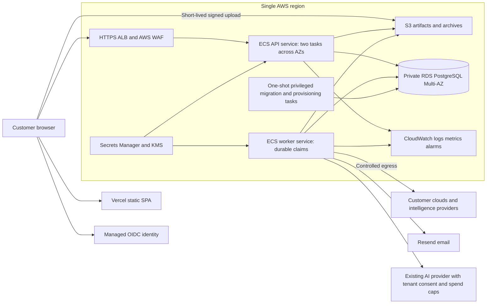

# ScoutGrid production architecture and migration recommendation

**Prepared:** October 14, 2026. **Reviewed revision:** `bd8ecf60cf21cbc56ed7de29fa23237e04d89bbc` and the current workspace. **Decision status:** recommended baseline, subject to staging measurements and first-customer requirements.

ScoutGrid can move to a scalable production platform without replacing its Java backend or PostgreSQL tenancy model. It is **not ready for an infrastructure-only cutover**: job recovery, durable dispatch, identity integration, shared storage, and production operations need work first. The complete, sequenced task register is in [production-migration-backlog.md](</Users/gowrikarthik.gadela/Desktop/AI Projects/NoScan/prototype-app/docs/production-migration-backlog.md>).

## 1. Recommendation and startup strategy

Use **AWS ECS on Fargate for API and worker containers, RDS PostgreSQL for data, and S3 for artifacts and archives**. Keep **Vercel for the static frontend**, **Resend for transactional email**, **Turnstile for public-form protection**, and **Sentry for frontend errors** initially, after configuring their production privacy and account controls. Evaluate **Cognito Essentials** as the first identity implementation; validate its login, tenant switching, and enterprise federation flow before committing. Cognito supports federating customer SAML providers into its OIDC token model; customer-specific configuration and application authorization still need implementation. [Cognito federation documentation](https://docs.aws.amazon.com/cognito/latest/developerguide/cognito-user-pools-saml-idp.html).

Preserve the modular monolith and deploy the same immutable image in separate API and worker roles. Keep and harden the existing PostgreSQL queues initially. Introduce SQS, specialized worker fleets, caching, or search infrastructure only when measured contention or a customer requirement justifies them. A cloud migration alone will not correct the application execution model.

For a supervised design-partner pilot, a paid Render backend/worker/Postgres deployment remains a credible lower-operations alternative. Given the stated goal of establishing an enterprise platform, I recommend moving the core to AWS once the launch gates below pass, while avoiding a simultaneous frontend/email/AI-provider migration. The cost of engineering and operating several new systems can exceed the hosting savings.

### Confirmed inputs and planning assumptions

| Item | Baseline |
| --- | --- |
| Current hosting, confirmed by founder | Backend and PostgreSQL on Render; frontend on Vercel. |
| Existing data, confirmed by founder | Production may start with a **fresh database**. No customer-data transfer is required. Do not apply the development reset to the old Render database. |
| Initial market, proposed | Invite-only B2B design partners with AWS/GitHub/SBOM exposure-management needs. Prove inventory, findings, static AI posture, onboarding, and remediation workflows before expanding integrations. |
| First 90 days, proposed | 5–10 organizations, 100–200 monthly active users total, 10–20 concurrent users. These are test and budget inputs, not a demand forecast. |
| Initial tenant workload, proposed | Representative test of 1,000 assets and 25,000 software components per tenant; separately test a 10,000-asset/250,000-component tenant before accepting that tier. Also size the shared vulnerability corpus. These numbers are not demonstrated capacity. |
| Launch model, proposed | Shared SaaS using existing tenant schemas and RLS; manual commercial approval, bounded usage, and assisted connector setup. Dedicated customer deployments are a later priced offering. |
| Region, proposed | One US region across two availability zones. Select the actual region before provisioning; US residency is an assumption. Cost examples use `us-east-1`, not a region commitment. |
| Reliability, proposed | Internal API availability objective 99.9%; p95 ordinary interactive reads under 1 second at tested load. Agree separate queue, scan freshness, and large-import objectives. Do not make contractual promises until measured. |
| Recovery, proposed | Initial engineering targets: RPO at most 15 minutes and RTO at most 4 hours; prove by restore. Multi-AZ failover is an availability mechanism, not the recovery test. |
| Customer security, proposed | Managed identity; MFA for privileged users; tenant RBAC; auditable support grants; encrypted transport/storage; backups; tested isolation; documented incident response. Be SSO-capable and build SOC 2 evidence habits. Certification, HIPAA, SCIM, customer-managed keys, and non-US residency need a specific commercial requirement. |

The founder has delegated unknown scale and compliance choices to expert judgment. These assumptions let work proceed; they should be revised after the first three customer discovery/onboarding conversations rather than adding every enterprise feature preemptively.

## 2. Current application and reusable foundations

The actual backend manifest specifies **Java 17 and Spring Boot 3.5.16**; several architecture documents still say 3.3.2. The frontend is a **React 18/TypeScript/Vite static SPA**. Business processing includes SBOM/BOM ingestion, shared vulnerability intelligence, deterministic correlation and finding projections, AWS/Azure and CMDB discovery, remediation campaigns, and static AI discovery/posture governance. Hosting on AWS does not require building or hosting a foundation model: the AI functions currently call external services.

PostgreSQL contains shared platform/reference data and a schema per tenant. The recent development baseline describes 74 platform/public tables and 145 tenant tables before subsequent tenant migration changes; schema count, migration duration, catalog size, and polling load will matter as customers grow. The current packaged migration lines are **platform V1; tenant V1 plus V2**. Older V5/V11 references are stale. [Reset record](</Users/gowrikarthik.gadela/Desktop/AI Projects/NoScan/prototype-app/docs/development-v1-baseline-reset.md:3>).

Retain these existing strengths:

- Non-root, multi-stage backend container; bounded JVM heap; graceful HTTP shutdown.
- Tenant-aware pooled connections, connection cleanup, forced RLS, restricted runtime-role validation, and server-side membership/support-grant checks.
- Standalone privileged bootstrap/migration CLI, tenant canary/batch migration mechanisms, schema fingerprints, and provisioning lifecycle.
- PostgreSQL job queues, row claims, deduplication, finding delta queue, and an AI assessment outbox that already demonstrates lease, heartbeat, and fenced completion.
- HTTP timeouts/retries/host validation, encrypted connector secrets, provider-call ceilings, and production configuration safety checks.
- CI migration guards, secret scanning, frontend quality gates, backend tests/coverage/SpotBugs, PostgreSQL integration tests, CodeQL, and container scanning.
- Actuator, Micrometer, request/trace identifiers, and frontend Sentry integration.

These are source-level foundations. Their presence does not establish that the current deployed version passes all production gates.

## 3. Findings that change the migration plan

| Evidence ID | Verified current behavior | Required production outcome |
| --- | --- | --- |
| E01 | Ingestion worker startup marks every active tenant's RUNNING ingestion jobs failed; vulnerability sync startup similarly fails queued/running syncs. Neither recovery path checks an expiring worker ownership lease. | Starting a replica or rolling deployment must leave healthy jobs intact. Add ownership, heartbeat, safe expiry/reclaim, fencing, bounded retries, and recovery tests. |
| E02 | AWS/Azure/ServiceNow/SCCM trigger paths persist run history, then dispatch executable work through an in-memory executor. Some EOL/manual work uses the same pattern. | Persist executable intent and request parameters transactionally. API acknowledgement must survive process death; workers must recover and report results. |
| E03 | API/worker roles exist, but several schedulers bypass the role guard, unknown roles fall back to `all`, and an assessment after-commit handler dispatches on the caller thread. Some governance/demo tasks can remain PROCESSING/SEEDING after a crash. | Complete role isolation, durable after-commit delivery, schedule leadership, and stale-claim recovery. Use `APP_SCHEDULING_ENABLED=false` on API tasks as an interim control, not the entire fix. |
| E04 | BOM upload reads the complete file into memory and ingests synchronously; configuration allows 50 MB and the orchestrator allows 100,000 components. | Bound memory/transaction duration. Prefer signed S3 upload plus persistent import job/status, with file/type/checksum limits and tenant authorization. Verify the entire browser-to-result path. |
| E05 | Vulnerability archive reads/writes local filesystem files. Archive references can therefore outlive an ephemeral task or be unavailable to another replica. | Implement shared S3 storage or explicitly disable this surface for launch. Fresh production needs no old-archive backfill unless development content is intentionally retained. |
| E06 | Login/setup/context-switch code issues HS256 application tokens, while the configured external decoder takes precedence over HMAC. Audience validation is optional; JWKS-only setup does not bind issuer in this configuration. | Implement a coherent production identity/session contract. Setting a Cognito issuer environment variable alone will break current local-token flows. |
| E07 | Generic AWS discovery explicitly uses an EC2 instance-profile credential provider; the AI connector uses the default chain. Customer ExternalId is optional and the AI connector can fall back to platform credentials without a role. | Validate ECS task credentials, require customer account/role/external-ID binding, and prevent accidental platform-account scans. |
| E08 | Production Hikari default permits 30 connections per JVM; several admission/rate limits are process-local. | Budget total fleet connections and provider/tenant limits. Three JVMs can permit 90 DB connections before administrative/migration reserve; replicas also multiply local call limits. |
| E09 | Any active tenant behind the packaged schema target can mark the whole service unready. | Separate instance readiness from tenant eligibility, preserving per-tenant denial and schema safety. One failed tenant rollout must not accidentally drain the fleet. |
| E10 | Default entitlement mode is LEGACY; preprod uses SHADOW. Both retain historical always-enabled behavior. | Seed real plans and enable corrected entitlement enforcement through a tested canary. Add actual metering/usage caps; an entitlement flag alone is not a spend limit. |
| E11 | Fix Intelligence is public and returns synthetic demo data; the reviewed OSV tenant correlation method is a TODO returning false. Runtime AI execution telemetry is explicitly disabled and guarded out of scope. | Certify and publish a precise launch capability matrix; hide or complete unfinished surfaces. This review does not establish customer-data disclosure through the synthetic Fix Intelligence controller. |
| E12 | Hosting IaC for the app and AWS artifact promotion/rollback are absent from tracked files. The CloudFormation template is a discovery fixture. Sentry sends default PII. Operational backup/restore, paging, and runbooks are not demonstrated by source review. | Build reproducible infrastructure and production delivery/operations, configure telemetry minimization, and collect launch evidence. Documentation mentioning an earlier AWS validation environment is not a live resource inventory. |

Source locations for these findings are listed in section 8. Queue findings are inferred directly from control flow; kill/restart/concurrency tests are required to verify the repairs.

## 4. Target architecture and scaling path

The diagram shows logical data flow; customer API requests go directly to the API hostname, while the browser downloads static assets from Vercel. Core application traffic and data stay together in AWS. The DB queue carries job intent; S3 carries large bytes. API and ordinary scan workers never receive schema-owner credentials.

### Initial production configuration

| Function | Proposed starting point | Scaling/reliability rule |
| --- | --- | --- |
| API | Two Fargate tasks, each 1 vCPU/2 GiB, across two AZs; `prod` profile, API role, scheduling disabled. | Sizes are hypotheses. Scale from tested CPU/request load with latency alarms and a hard DB-aware ceiling. Validate two replicas and rolling deploy before launch. ECS supports CPU/memory and request-based scaling. [ECS scaling](https://docs.aws.amazon.com/AmazonECS/latest/developerguide/service-auto-scaling.html), [target metrics](https://docs.aws.amazon.com/AmazonECS/latest/developerguide/target-tracking-create-policy.html). |
| Worker | One continuously running 1 vCPU/4 GiB task to start; durable jobs resume after replacement. | A single worker can be acceptable when queue recovery meets the job SLO. More workers require repaired leases, atomic per-tenant admission, schedule coordination, and fairness tests. Use two if the job availability target requires it. |
| Database | RDS PostgreSQL, approximately 4 GiB initial class, gp3 storage sized from corpus/import tests, Multi-AZ for enterprise GA. | Load-test sustained CPU/IO and burst credits; resize before saturation. Standby provides failover, not a read-scaling copy. [RDS deployment choices](https://aws.amazon.com/rds/postgresql/pricing/). |
| Connection pools | Start testing API pool 8 each, worker pool 8, low minimum-idle, plus explicit migration/admin reserve. | These are initial experiment values. Enforce `sum(max replicas × pool size) + other sessions < usable DB connection budget`; increase only with measured benefit. |
| Storage | Private encrypted S3 bucket(s), tenant-scoped authorization/object keys, checksums, lifecycle, versioning where useful. | Never treat a task's local disk as persistent. Quarantine/validate uploads before parsing; align deletion and backups with retention policy. |
| Scheduler | Worker-owned schedules with DB-backed leadership/unique occurrence keys. | Keep scheduling separate from claiming jobs. EventBridge is optional later; it does not replace idempotency. |
| Provisioning | Standalone bootstrap/provisioner run as a controlled, one-shot ECS task. | Automatically reconcile pending tenants with retry/status/alerts. Use a narrow invoker and short-lived privileged task; do not expose owner SQL credentials to the API. |
| Ingress/egress | Public HTTPS ALB; private API/worker subnets; private DB. NAT egress in both active AZs for the recommended baseline. | Security groups restrict task ingress to ALB; scan workers need no public ingress. Use S3 gateway endpoints where appropriate. Customer IP allowlists need stable egress. |
| Observability | CloudWatch logs/metrics/alarms, protected management endpoints, frontend Sentry with PII minimization. | Measure fleet and tenant/job health, provider freshness, and spend. Limit log retention and metric cardinality. |

Do not add RDS Proxy by default: this application changes tenant `search_path` and session variables. PostgreSQL session changes can cause proxy pinning, reducing pooling benefits; test isolation, cleanup, and benefit before adopting any proxy or transaction pooler. [AWS proxy pinning guidance](https://docs.aws.amazon.com/AmazonRDS/latest/UserGuide/rds-proxy-pinning.html).

For identity, the preferred model is an external OIDC access token for identity plus a server-side active-workspace/support grant tied to that session/subject. Switching workspace changes the authorized selection, not the JWT issuer. Preserve revalidation of membership, suspension, support expiry, and role revocation. Define cross-tab/session behavior explicitly. An application-controlled asymmetric session issuer is a viable alternative, but must be a deliberate design with a controlled token exchange, key rotation, and one clear API trust contract.

### Enterprise capability sequencing

Launch with shared SaaS, AWS cross-account read-only discovery, SBOM/GitHub ingestion, selected static AI posture controls, and certified vulnerability/finding workflows. Add Azure and SaaS ServiceNow only when their complete workflows are qualified and the first customer needs them. Retain existing code behind explicit capability gates if a connector is not yet qualified.

For private SCCM/SQL Server or private CMDB endpoints, prefer a later **customer-side outbound collector** that submits bounded, authenticated inventory. Hosting the backend in AWS does not grant network access to customer infrastructure. Build a collector or a separately priced customer network connection before promising these integrations; keep SSRF protections in place. Customer AWS onboarding should issue a unique account/tenant-bound external ID and a customer-owned least-privilege role template. [AWS third-party role guidance](https://docs.aws.amazon.com/IAM/latest/UserGuide/id_roles_common-scenarios_third-party.html).

SOC 2 preparation starts with access reviews, change evidence, incident handling, recovery tests, vendor/data records, and clear ownership. A certification purchase should follow customer demand and operating readiness. A provider's certification does not certify ScoutGrid. Do not advertise unverified compliance or a contractual uptime level based only on these design choices.

## 5. Cost model and alternatives

These are **planning estimates**, not quotes or tested workload costs. Assumptions: 730 hours/month, low initial traffic, one US region, on-demand pricing, small shared fleet, bounded retention, one Vercel developer seat, and existing provider integrations. No AWS credits or long-term discounts are assumed. Exact RDS region/class/storage pricing must be captured in an AWS calculator estimate before purchase. Baseline ranges exclude staging, tax, engineering/on-call labor, certification, premium support, large transfers, and variable AI consumption.

| Option | Estimated monthly baseline | Decision |
| --- | --- | --- |
| Paid Render pilot + Vercel | **$125–220** | Fastest lower-operations pilot: two 2 GiB services for API/worker, small paid PostgreSQL, S3, and basic telemetry/email. Single DB/no proven AZ availability. App durability and identity fixes still required. |
| Render with HA DB + replicated API + Vercel | **$250–450+** | Valid alternative where vendor networking, workspace features, contracts, and availability satisfy customers. Confirm actual SLA and private-connectivity/egress costs. |
| Lean AWS pilot + Vercel | **$200–350** | One API and one worker, Single-AZ DB, tightly restricted public-IP tasks to avoid NAT. Reduced redundancy and changing outbound IPs; use only for an explicitly supervised pilot. Stable/private egress adds cost. |
| Recommended AWS production + Vercel | **$375–650** | Two API tasks, one durable worker, Multi-AZ DB, private task subnets/two-AZ NAT, WAF, backups, and basic operations. Appropriate initial target for enterprise GA after qualification. |

Render's official published examples price 2 GiB API/worker services at $25 each and 2 GiB Postgres at $40, before storage/workspace/add-ons. Thus **$110** covers two such services, that DB, and one $20 Vercel seat; the pilot range adds storage/telemetry/email and sizing headroom. HA requires a qualifying database and bills a matching standby; it is not included in the pilot. [Render compute cost example](https://render.com/articles/production-rails-hosting-guide), [Render HA prerequisites](https://render.com/docs/postgresql-high-availability), [Vercel pricing](https://vercel.com/pricing). The committed Render free plan is unsuitable for this workload's production baseline: it can spin down, has no horizontal scaling, and uses ephemeral local storage. [Render free-service limits](https://render.com/docs/free).

### Recommended AWS monthly components

| Component | Budget / calculation |
| --- | --- |
| Fargate API/worker compute | **$114.61**: two 1-vCPU/2-GiB API tasks plus one 1-vCPU/4-GiB worker, Linux x86, 730h; derived from published N. Virginia example rates. ARM can reduce compute after image/dependency validation. [Fargate rates](https://aws.amazon.com/fargate/pricing/). |
| RDS Multi-AZ compute/storage/backups allowance | **$100–220**, placeholder pending region/class/storage quote and load test. Higher sustained ingestion may need a larger non-burstable class. [RDS pricing dimensions](https://aws.amazon.com/rds/postgresql/pricing/). |
| ALB + modest capacity usage + two public IPv4 addresses | Approximately **$25–35**: $16.43 base at $0.0225/h, plus LCUs and IPv4. [ALB pricing](https://aws.amazon.com/elasticloadbalancing/pricing/), [IPv4 pricing](https://aws.amazon.com/vpc/pricing/). |
| Two NAT gateways plus their public IPv4 addresses | Approximately **$73** fixed at $0.045/h/AZ plus $0.005/h/IP; add processed GB and transfer. Current AWS examples identify these NAT rates in US East (Ohio); confirm the selected region's quote. [NAT and IP pricing](https://aws.amazon.com/vpc/pricing/). |
| S3/ECR/secrets/KMS/DNS/WAF/basic logs and alarms | **$40–90** allowance at initial usage; log volume, object operations, managed security options, and retention change this materially. Secrets Manager example rate is $0.40/secret/month plus API calls. [Secrets pricing](https://aws.amazon.com/secrets-manager/pricing/), [S3 pricing](https://aws.amazon.com/s3/pricing/), [WAF pricing](https://aws.amazon.com/waf/pricing/). |
| Vercel and transactional email | **$20–40** for one Vercel Pro seat and initial Resend usage. Resend Free currently allows 3,000/month with a daily cap; Pro is $20/month for 50,000. Do not design customer onboarding around a free daily cap. [Vercel](https://vercel.com/pricing), [Resend](https://resend.com/pricing). |
| Managed identity | Allow **$0–20** initially, dependent on tier/federation/MFA usage. Cognito federation currently charges $0.015 per MAU above 50 federated MAUs, so 200 such MAUs is $2.25 before other applicable charges. [Cognito pricing](https://aws.amazon.com/cognito/pricing/). |

The components imply roughly $373–593 before contingency; **$375–650** is the planning envelope. Add approximately **$50–150/month for lean staging**, with exact topology/schedule priced separately. Reserve a separate **$25–100/month experimental AI budget** with hard application limits; that is a management cap, not a prediction of model consumption. A second always-on worker of the example size adds about $43/month plus related effects.

The biggest early cost mistakes would be an oversized database, unbounded retained evidence/logs, frequent redundant scans, provider retries without fleet-wide limits, and buying infrastructure before fixing durable work. Track cost per tenant, completed scan, imported component volume, retained GB, and AI action. Set budget alerts at 50/80/100%; AWS budget alerts alone do not stop spend. Enforce actual usage/admission caps in the app, and give customers visible limits and upgrade paths.

Keep Resend initially because integration already exists. SES is worth revisiting at meaningful email volume or an AWS-only procurement requirement, Account for domain verification and approval for production use. Assign an operational owner to handle bounced messages and complaints. Keep the current AI provider unless customer data policy or a measured quality/cost requirement favors Bedrock; evaluate with representative outputs and data-processing terms before switching.

### What to postpone

EKS/Kubernetes, a microservice rewrite, active-active multi-region, Kafka/MSK, graph/search databases, Aurora migration, Redis, dedicated infrastructure per small tenant, custom foundation-model hosting, and AI runtime telemetry are not supported as launch necessities by this review. The current runtime exclusion is explicit. [Release scope](</Users/gowrikarthik.gadela/Desktop/AI Projects/NoScan/prototype-app/docs/runtime-telemetry-exclusion.md:3>).

## 6. Delivery sequence and go-live gates

The backlog contains 70 launch/migration tasks plus 6 conditional expansion tasks, each with priority, owner, dependencies, and completion evidence. P0 blocks the recommended enterprise GA; P1 is required in the migration program but may follow a tightly supervised pilot where its stated condition does not apply. Dependencies form workstreams, not one long serial queue.

| Stage | Work | Exit evidence |
| --- | --- | --- |
| 1: decisions and baseline | Inventory real services/accounts, choose region/release/scope, record limits/SLOs, choose identity model, adopt fresh DB path. | Reviewed architecture decisions, release manifest, workload/cost assumptions, named operators. |
| 2: correctness and foundation, parallel | Repair queues/leases/scheduling; implement identity/storage/entitlements; build AWS IaC, image promotion, and privileged control plane. | Focused tests demonstrate durability, authorization, and tenant safety; fresh staging rebuild is reproducible. |
| 3: qualification | Production-auth browser journeys, concurrent tenant load, deployment/task-kill tests, provider failures, DB failover, and full recovery. | All P0 acceptance criteria pass on the release digest; no unresolved cross-tenant or data-loss defect; measured capacity/cost and recovery results. |
| 4: assisted pilot and GA | Internal tenant, one design partner, then 5–10; inspect freshness, false positives, queue age, errors, support load, and cost for 7–14 days. | Stable usage at stated limits, usable findings, working support, agreed GA sign-off. Increase quotas only with evidence. |
| 5: measured expansion | Add capacity/connectors/enterprise controls against customer contracts and observed bottlenecks. | New tier/load/connector qualification before selling it. |

Planning estimate: **8–12 calendar weeks for two experienced engineers**, with part-time platform/security help, for the recommended scope; **12–20 weeks with one engineer**. These are broad planning ranges, not a delivery commitment or a sum of independent estimates. Identity integration, queue refactoring, and full-workload qualification dominate uncertainty. A paid Render pilot can reduce infrastructure work but does not eliminate these application gates. Re-estimate after the first week of implementation spikes.

Before any customer production cutover, require:

1. Fresh RDS bootstrap, restricted runtime grants, tenant provisioning, and append-only migrations pass on the exact release.
2. OIDC login/invites/recovery/logout, workspace switching, support grant expiry, and revoked membership work through the real browser/API topology.
3. A second worker, rolling deploy, and forced task kill do not fail another worker's healthy job, lose acknowledged work, or produce duplicate external effects.
4. Two-tenant negative access tests pass under concurrent workload and after pool reuse; upload/download/job IDs and exports are tenant-authorized.
5. Representative ingestion/discovery/feed activity meets interactive, queue, and freshness SLOs within measured DB/JVM/provider limits.
6. Backup restore recovers DB, tenant schemas/RLS, durable object references, secrets/key access, and jobs within the chosen RPO/RTO. RDS automated retention is configurable up to 35 days; choose 14–35 days based on customer policy and rehearse restoration. [RDS backup retention](https://docs.aws.amazon.com/AmazonRDS/latest/UserGuide/USER_WorkingWithAutomatedBackups.BackupRetention.html).
7. Deployment rollback, failed migration/tenant quarantine, provider outage, email failure, and cost/abuse response have a named operator and tested runbook.
8. Unsupported/demo surfaces are hidden, runtime telemetry stays disabled, entitlement enforcement works, and alert delivery is tested.

Since there is no customer data to retain, create production users/tenants and re-onboard connectors explicitly. Bootstrap shared intelligence through controlled feed jobs. Do not clone the development playground, local accounts, old Flyway history, or arbitrary test data. Generate a new production connector-encryption key and keep it durable from that point onward. Retain the old Render environment as development/reference until stable production acceptance. After production writes begin, application rollback uses the previous compatible image/frontend release against the **same authoritative production RDS/S3/identity configuration**; switching traffic to the old Render database would fork customer state. Data recovery instead follows a separately tested restore/reconciliation procedure within the stated RPO. Retirement is a later cleanup step.

## 7. Scope and confidence

This is a principal-architect **static source/configuration review**, with parallel runtime, identity/data, and deployment reviews plus current primary-provider pricing/documentation research. No app code or cloud configuration was changed. No live AWS/Render/Vercel inventory, bill, DB content, full test suite, production load test, penetration test, or restore drill was performed. The founder confirmed current hosting and that a fresh DB is acceptable; actual service sizes/settings remain to be inventoried. Work in this document is proposed, not completed migration work.

The first decisions are already resolved well enough to proceed: fresh database, retain Vercel, launch shared SaaS with bounded design partners, and use AWS core services for the enterprise target. Outstanding customer-specific requirements belong in discovery and the conditional backlog, rather than blocking all useful work now.

## 8. Source evidence index

Links use the reviewed workspace; line numbers identify the relevant implementation at review time.

| IDs | Source |
| --- | --- |
| Stack | [Backend manifest](</Users/gowrikarthik.gadela/Desktop/AI Projects/NoScan/prototype-app/backend/pom.xml:9>), [frontend manifest](</Users/gowrikarthik.gadela/Desktop/AI Projects/NoScan/prototype-app/frontend/package.json:1>), [container](</Users/gowrikarthik.gadela/Desktop/AI Projects/NoScan/prototype-app/backend/Dockerfile:1>). |
| E01 | [Ingestion startup](</Users/gowrikarthik.gadela/Desktop/AI Projects/NoScan/prototype-app/backend/src/main/java/com/prototype/vulnwatch/service/IngestionJobWorkerService.java:66>), [ingestion recovery](</Users/gowrikarthik.gadela/Desktop/AI Projects/NoScan/prototype-app/backend/src/main/java/com/prototype/vulnwatch/service/IngestionJobService.java:376>), [sync recovery](</Users/gowrikarthik.gadela/Desktop/AI Projects/NoScan/prototype-app/backend/src/main/java/com/prototype/vulnwatch/service/vulningestion/VulnerabilitySyncRunService.java:181>). |
| E02 | [AWS run dispatch](</Users/gowrikarthik.gadela/Desktop/AI Projects/NoScan/prototype-app/backend/src/main/java/com/prototype/vulnwatch/service/AwsDiscoverySyncService.java:99>), [integration executor](</Users/gowrikarthik.gadela/Desktop/AI Projects/NoScan/prototype-app/backend/src/main/java/com/prototype/vulnwatch/config/HttpClientConfig.java:93>). |
| E03 | [Role policy](</Users/gowrikarthik.gadela/Desktop/AI Projects/NoScan/prototype-app/backend/src/main/java/com/prototype/vulnwatch/service/BackgroundTaskExecutionPolicy.java:40>), [assessment dispatch and lease model](</Users/gowrikarthik.gadela/Desktop/AI Projects/NoScan/prototype-app/backend/src/main/java/com/prototype/vulnwatch/aisecurity/service/AiGridAssessmentWorker.java:112>), [rollout claims](</Users/gowrikarthik.gadela/Desktop/AI Projects/NoScan/prototype-app/backend/src/main/java/com/prototype/vulnwatch/aisecurity/service/AiGridPolicyRolloutService.java:81>), [demo claims](</Users/gowrikarthik.gadela/Desktop/AI Projects/NoScan/prototype-app/backend/src/main/java/com/prototype/vulnwatch/service/DemoDatasetProvisioningService.java:77>). |
| E04–E05 | [Upload](</Users/gowrikarthik.gadela/Desktop/AI Projects/NoScan/prototype-app/backend/src/main/java/com/prototype/vulnwatch/controller/BomController.java:98>), [orchestrator](</Users/gowrikarthik.gadela/Desktop/AI Projects/NoScan/prototype-app/backend/src/main/java/com/prototype/vulnwatch/service/BomIngestionOrchestrator.java:184>), [local archive](</Users/gowrikarthik.gadela/Desktop/AI Projects/NoScan/prototype-app/backend/src/main/java/com/prototype/vulnwatch/service/VulnerabilityArchiveService.java:163>). |
| E06 | [Token issuing](</Users/gowrikarthik.gadela/Desktop/AI Projects/NoScan/prototype-app/backend/src/main/java/com/prototype/vulnwatch/service/AuthTokenService.java:83>), [token validation](</Users/gowrikarthik.gadela/Desktop/AI Projects/NoScan/prototype-app/backend/src/main/java/com/prototype/vulnwatch/config/JwtDecoderConfig.java:28>), [browser token storage](</Users/gowrikarthik.gadela/Desktop/AI Projects/NoScan/prototype-app/frontend/src/api/client.ts:787>). |
| E07 | [Generic AWS credentials](</Users/gowrikarthik.gadela/Desktop/AI Projects/NoScan/prototype-app/backend/src/main/java/com/prototype/vulnwatch/client/AwsCredentialProvider.java:36>), [AI AWS connector credentials](</Users/gowrikarthik.gadela/Desktop/AI Projects/NoScan/prototype-app/backend/src/main/java/com/prototype/vulnwatch/aisecurity/service/AiSecurityAwsConnectorService.java:152>). |
| E08–E09 | [Production profile/pools/readiness](</Users/gowrikarthik.gadela/Desktop/AI Projects/NoScan/prototype-app/backend/src/main/resources/application-prod.yml:1>), [public throttle](</Users/gowrikarthik.gadela/Desktop/AI Projects/NoScan/prototype-app/backend/src/main/java/com/prototype/vulnwatch/security/PublicEndpointRateLimiter.java:17>), [tenant readiness](</Users/gowrikarthik.gadela/Desktop/AI Projects/NoScan/prototype-app/backend/src/main/java/com/prototype/vulnwatch/config/TenantSchemaReadinessHealthIndicator.java:28>). |
| E10 | [Entitlement defaults](</Users/gowrikarthik.gadela/Desktop/AI Projects/NoScan/prototype-app/backend/src/main/resources/application.yml:66>), [resolver](</Users/gowrikarthik.gadela/Desktop/AI Projects/NoScan/prototype-app/backend/src/main/java/com/prototype/vulnwatch/service/TenantEntitlementService.java:157>). |
| E11 | [Public Fix Intelligence rule](</Users/gowrikarthik.gadela/Desktop/AI Projects/NoScan/prototype-app/backend/src/main/java/com/prototype/vulnwatch/config/SecurityConfig.java:81>), [synthetic controller](</Users/gowrikarthik.gadela/Desktop/AI Projects/NoScan/prototype-app/backend/src/main/java/com/prototype/vulnwatch/controller/FixIntelligenceController.java:28>), [OSV placeholder](</Users/gowrikarthik.gadela/Desktop/AI Projects/NoScan/prototype-app/backend/src/main/java/com/prototype/vulnwatch/service/vulningestion/OsvTenantService.java:97>). |
| E12 | [Render declaration](</Users/gowrikarthik.gadela/Desktop/AI Projects/NoScan/render.yaml:1>), [Vercel declaration](</Users/gowrikarthik.gadela/Desktop/AI Projects/NoScan/prototype-app/frontend/vercel.json:1>), [fixture-only CloudFormation](</Users/gowrikarthik.gadela/Desktop/AI Projects/NoScan/prototype-app/infrastructure/cloudformation/README.md:1>), [Sentry initialization](</Users/gowrikarthik.gadela/Desktop/AI Projects/NoScan/prototype-app/frontend/src/main.tsx:9>), [CI](</Users/gowrikarthik.gadela/Desktop/AI Projects/NoScan/.github/workflows/quality.yml:12>). |
| Migration/tenancy foundations | [Bootstrap CLI](</Users/gowrikarthik.gadela/Desktop/AI Projects/NoScan/prototype-app/backend/src/main/java/com/prototype/vulnwatch/migration/ProductionBootstrapCli.java:543>), [restricted role SQL](</Users/gowrikarthik.gadela/Desktop/AI Projects/NoScan/prototype-app/backend/scripts/provision-runtime-role.sql:3>), [tenant connection cleanup](</Users/gowrikarthik.gadela/Desktop/AI Projects/NoScan/prototype-app/backend/src/main/java/com/prototype/vulnwatch/config/TenantAwareDataSource.java:87>), [Render-specific migration lifecycle](</Users/gowrikarthik.gadela/Desktop/AI Projects/NoScan/prototype-app/backend/scripts/run-render-migration.sh:73>). |
