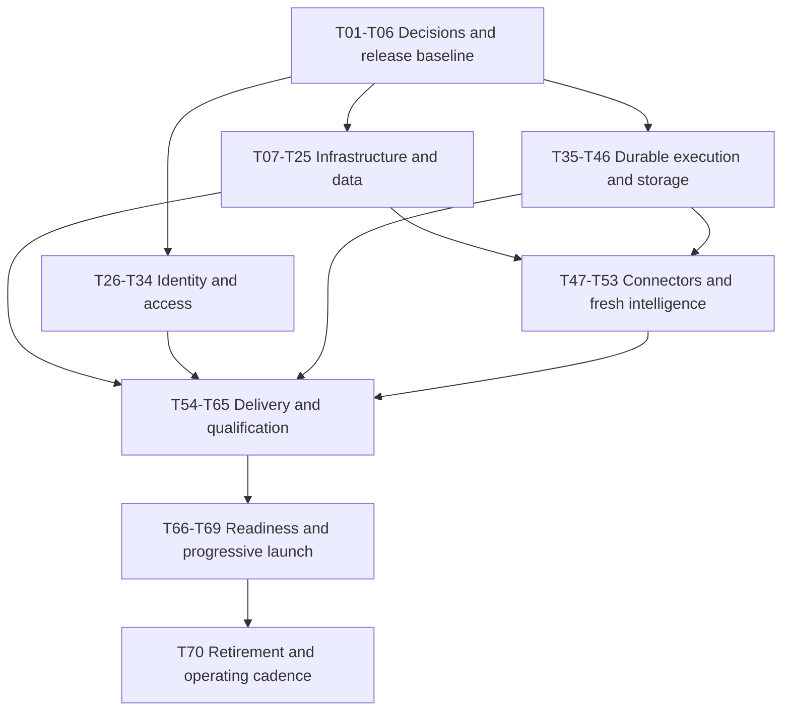

# ScoutGrid production migration task register

**Date:** October 14, 2026. **Status:** proposed work, not an implementation completion report. **Target:** AWS core platform with Vercel frontend; fresh production PostgreSQL database. Read the rationale, costs, assumptions, and evidence in [production-architecture-review.md](</Users/gowrikarthik.gadela/Desktop/AI Projects/NoScan/prototype-app/docs/production-architecture-review.md>).

This register covers **70 launch/migration tasks and 6 conditional expansion tasks** discovered through source review. Each row is a work package that can be split into engineering tickets. It is a comprehensive initial migration register, not a guarantee that unknown customer or live-account requirements cannot add work.

**P0** blocks the recommended enterprise GA. **P1** belongs in the migration program, but can follow a supervised pilot where applicable and explicitly scheduled. **Conditional** means implement only when the stated trigger applies; a customer contract can elevate it to P0. Owners are proposed responsibilities, not named staffing assignments. **F** = founder/product, **B** = backend, **UI** = frontend, **P** = platform/DevOps, **S** = security/privacy, **Q** = quality/reliability. Dependencies reference task IDs; parallel work is expected. Evidence IDs E01–E12 refer to the architecture review.

## A. Decisions, inventory, and release baseline

| ID | Priority / owner | Depends on | Task | Completion evidence |
| --- | --- | --- | --- | --- |
| T01 | P0 · P/F | — | Inventory actual Render backend/Postgres, Vercel project, DNS, domains, provider accounts, integrations, service sizes, regions, active costs, backups, and any earlier AWS resources. Record owner and environment without exporting secret values. | Resource/configuration register and baseline bill. Founder-confirmed current hosting is verified; undocumented resources are identified for reuse or later retirement. |
| T02 | P0 · F/B/Q | T01 | Freeze launch capabilities and design-partner offer: shared SaaS, supported AWS/GitHub/BOM workflows, static AI posture, findings/remediation, tenant quotas, assisted onboarding, and support hours. Certify or hide every customer-visible surface. | Capability matrix ties each offered feature to acceptance evidence; OSV placeholder/Fix Intelligence demo/runtime telemetry are handled explicitly (E11). |
| T03 | P0 · B/UI/S | T02 | Record the identity decision: Cognito trial, external OIDC token contract, application roles, session/workspace/support handling, user migration/setup, MFA, and future customer federation. | Identity architecture decision and a small end-to-end login/switch prototype; one coherent trusted token strategy (E06). |
| T04 | P0 · F/P/S | T01–T03 | Select region, production/nonproduction boundaries, data-processing vendors, single/shared SaaS model, operator access, and policy for customer-specific enterprise requirements. | Reviewed region/residency/vendor/tenancy record. No unsupported compliance promise. Additional contractual requirements are promoted from conditional tasks. |
| T05 | P0 · F/P/Q | T02/T04 | Adopt launch workload assumptions, upload/account/tenant limits, internal availability/latency/job/freshness SLOs, RPO/RTO, budget envelope, scaling ceilings, and commercial upgrade rules. | Workload and stress profiles, test thresholds, $375–650 AWS baseline plus separately priced staging/AI, and owner for each reliability/cost objective. |
| T06 | P0 · B/UI/Q | T02 | Freeze a release revision; run all relevant existing quality/security/migration/Postgres gates. Resolve the known AWS collector-certification mismatch mentioned in historical reset evidence or record a justified, specifically reviewed exclusion. Refresh stale deployment/version documents. | Relevant clean CI evidence attached to source revision and image digest. Historical passing tests or existence of tests are not substituted for current results. |

## B. AWS accounts, infrastructure, networking, and secrets

| ID | Priority / owner | Depends on | Task | Completion evidence |
| --- | --- | --- | --- | --- |
| T07 | P0 · P/S | T04/T05 | Establish separate production/nonproduction AWS accounts with a lightweight organization setup, human SSO/MFA, root recovery, break-glass access, billing ownership, tags, budget notifications, and appropriate service quotas. | Access test, recovery ownership, account boundary test, budget alert test, and checked quotas for ECS/IP/RDS/SES if used. Avoid a large landing-zone program at this size. |
| T08 | P0 · P/S | T07 | Define separate GitHub deployment, ECS execution, API, worker, and migration/provisioning roles. Use GitHub OIDC and workload credentials; scope customer AssumeRole permission. Restrict who can invoke/pass privileged task roles. | No long-lived AWS deployment keys; denied-role tests; API/scan roles cannot retrieve owner DB secret or assume unapproved customer roles. |
| T09 | P0 · P | T07/T08 | Choose one hosting IaC approach, preferably Terraform for cross-provider ownership or CDK if the team already owns it. Version VPC/ECS/ECR/ALB/RDS/S3/secrets/logs/alarms/DNS resources, encrypted state/locking where relevant, environment variables, drift checks, and destructive-change protection. | Empty staging can be rebuilt from code; reviewed plan and drift output. Existing discovery-fixture CloudFormation is not treated as hosting IaC (E12). |
| T10 | P0 · P/S | T09 | Build two-AZ network: public ingress subnets, private runtime/data subnets, private RDS access, least-privilege security groups, routes, and S3 gateway endpoint where useful. | Public internet cannot connect directly to DB or private task ports; only approved ALB/app/migrator paths succeed. Worker has no public ingress. |
| T11 | P0 · P/UI/S | T10 | Configure ALB HTTPS, certificates/renewal, API domain, HTTP redirect, WAF initial rules/rate limits, request/body behavior, and DNS ownership. Decide health/readiness paths and management access. | HTTPS/browser preflight pass; origin/auth/health responses behave correctly; legitimate uploads survive tuned WAF/body rules; unauthenticated management access is denied. |
| T12 | P0 · P/B | T10/T05 | Provide outbound Internet/provider access with a priced NAT/static-egress design. Recommended baseline: egress in both AZs. Inventory hosts/IP allowlists, DNS/certificates, timeouts, and external transfer fees. Document reduced-cost pilot exceptions separately. | All required feed/cloud/email/AI endpoints reachable from actual tasks; selected-region NAT/IP estimate; customer allowlist instructions; no broad SSRF-policy bypass. |
| T13 | P0 · P/B | T08/T09/T06 | Create ECR and immutable release image policy; reuse Java container, pin/test base image, validate JVM/native dependencies and startup memory, and define API/worker task definitions with explicit resources/prod environment. | Exact digest runs as non-root; API/worker roles configured; no dev files or credentials in image; ARM variant only adopted after validation. |
| T14 | P0 · P/B/S | T08/T09 | Build production secret inventory, Secrets Manager/KMS access, rotation/reload procedure, and recovery custody. Fresh DB gets a new durable connector-encryption key. Assess legacy plaintext and design versioned decrypt/re-encrypt for future rotations. | Runtime and migrator use only their authorized secrets; key rotation/recovery/decryption verified; no automatic key regeneration during redeploy. Provider keys are scoped and audited. |
| T15 | P0 · P/S | T07–T14 | Enable CloudTrail/control-plane audit retention, encryption defaults, public-access checks, security alert ownership, and appropriately priced threat detection. Define infrastructure/security patch response and expiring exception policy. | Critical account exposure/access alerts reach an operator; no publicly exposed DB/storage; reviewed baseline and costs. Formal certification work remains conditional. |

## C. PostgreSQL, tenant control plane, and recovery policy

| ID | Priority / owner | Depends on | Task | Completion evidence |
| --- | --- | --- | --- | --- |
| T16 | P0 · P/B | T09/T10/T05 | Provision managed PostgreSQL with tested engine compatibility, approximately 4 GiB starting class, Multi-AZ for recommended GA, gp3 sizing/autoscaling, maintenance windows, deletion protection, and storage/IO monitoring. | Selected-region RDS quote and working staging DB. Final class/storage based on corpus and workload tests, not old validation size. |
| T17 | P0 · P/B/S | T16 | Require verified TLS for runtime/migration JDBC connections with current RDS CA and credential hygiene; avoid publicly accessible DB and ad hoc Internet admin access. | Non-TLS/untrusted-certificate connection fails; approved runtime/migration connections succeed; operational DB access is controlled and audited. |
| T18 | P0 · B/P/S | T14/T16/T17 | Apply/validate separate runtime DML and owner/migration roles using existing tooling on RDS. Verify current/new tenant grants, FORCE RLS, no BYPASSRLS/superuser/ownership/DDL, and connection context reset. | Restricted-role and tenant-isolation integration suites pass on RDS; API and normal worker cannot create/drop/own schemas (existing strengths retained). |
| T19 | P0 · B/P | T06/T18 | Bootstrap a completely fresh database using current platform V1 and tenant V1/V2 through ProductionBootstrapCli. Seed approved platform catalogs, production owner identity, plans, and minimum reference data. | Fresh bootstrap/parity tests and report; no old Flyway repair, overlay, test personas, demo identities, or development snapshot copied. |
| T20 | P0 · B/P | T19/T08 | Adapt the Render migration wrapper to an exit-once ECS task and automate tenant provisioning/retry/deletion through a durable privileged control plane. Persist requests/status and reconcile pending tenants. | New tenant progresses PROVISIONING → ACTIVE; failed task retries safely; duplicate invocations are idempotent; task exits with reliable status/report; owner secret stays off API/scan workers. |
| T21 | P0 · B/P/Q | T20 | Define append-only expand/contract migrations, template/canary/batch rollout, compatibility floor, structural drift checks, and safe readiness semantics. Separate unhealthy instance dependencies from an isolated unready tenant (E09). | Failed canary stops rollout; incompatible tenant is denied; healthy tenants remain served; old/new binaries are compatible during rolling deployment. |
| T22 | P0 · P/B | T16/T14 | Enable encrypted automatic backups/PITR and explicit 14–35-day initial retention, pre-change snapshots, recovery permissions, and independently protected recovery material. Price cross-account backup copies according to threat/recovery needs. | Backup/PITR settings and retention evidence; restore roles/key access documented. Multi-AZ is not substituted for backup. Validate by T64. |
| T23 | P0 · F/S/B/P | T02/T04 | Set retention/deletion/data-classification policy for BOMs, inventory, evidence, shared intel, audit, exports, logs, backups, and third-party AI/telemetry. Minimize Sentry PII; record vendor data flows and customer disclosure/consent. | Approved policy mapped to cleanup/lifecycle jobs; credentials/tokens/raw customer content redacted; tenant deletion/export behavior is clear. No regulatory claim inferred from hosting choice. |
| T24 | P0 · B/P/Q | T16/T18/T05 | Budget aggregate connections across max API/worker/provisioner replicas; tune Hikari, transaction length, SQL/indexes/autovacuum, tenant polling, and reference-corpus growth. Validate any future proxy against tenant session semantics. | Measured connection/lock/CPU/IO headroom and explicit replica ceiling; starting pools tested around 8/API and 8/worker, adjusted from evidence (E08). |
| T25 | P1 · B/S/Q | T22/T23 | Verify tenant export/offboarding/deletion and a tenant-specific logical restore procedure from an isolated full DB recovery. Handle shared reference links, object permissions, identity/membership/audit obligations, and retained backups. | Export/deletion test; one tenant can be recovered without overwriting other tenants; retention limitations communicated. Never advertise tenant PITR merely because instance PITR exists. |

## D. Identity, authorization, release exposure, and entitlement controls

| ID | Priority / owner | Depends on | Task | Completion evidence |
| --- | --- | --- | --- | --- |
| T26 | P0 · B/UI/P | T03/T14 | Integrate managed OIDC authentication into SPA and API; configure redirect/logout URLs and PKCE or chosen secure session flow; retire preprod HMAC exception from production login/setup paths. | Real login/invite/recovery/logout/expiry pass against actual provider and API. Current local HS256 issue/decoder mismatch removed (E06). |
| T27 | P0 · B/UI/S | T26 | Implement session-specific active-workspace and support-grant selection without minting incompatible local JWTs. Revalidate membership, tenant status, roles, grant expiry, and cross-tab isolation. | Switch/support entry/exit tests pass; one session/tab cannot accidentally change another's tenant; expired/revoked support access immediately fails. |
| T28 | P0 · B/UI/S/F | T26/T27 | Implement privileged MFA, tenant/user invite/acceptance, password/account recovery through IdP, user disable/removal, platform-owner bootstrap, and emergency access procedure. | MFA and recovery demonstrated; role removal disables privilege in both app and IdP; invitations cannot elevate unauthorized users. |
| T29 | P0 · B/S | T26 | Enforce provider-specific issuer, intended API/client, token type, expiry, key rotation, and required scopes/role mapping. Account for Cognito access-token semantics rather than assuming every token has an `aud`. | Negative tests for wrong issuer/client/token type/audience where applicable, stale keys, expired token, and unauthorized role; JWKS-only setup cannot omit required trust binding. |
| T30 | P0 · B/S/Q | T27–T29 | Review all endpoint/method/service authorization with tenant roles, service accounts, platform operations, break-glass support, uploads/jobs/downloads, exports, and role revocation. Retain existing server-side access revalidation. | Role matrix and negative tests; no ordinary tenant user becomes platform owner or accesses another tenant; actions are audited. |
| T31 | P0 · UI/B/S | T26/T11 | Choose reviewed browser token/session storage, renewal/logout and CSRF/XSS behavior; exclude static auth/creator/API keys from build; update CSP, CORS, cookies, and production URLs. | Bundle guard and browser security tests pass; no VITE_AUTH_TOKEN/VITE_API_KEY/VITE_CREATOR_KEY in production; all auth errors render correctly through CORS. |
| T32 | P0 · B/P/S | T11/T26 | Make public login/invite/demo/email limits effective across replicas; define trusted client-IP extraction for ALB/CloudFront/Cloudflare topology. Keep Turnstile server verification and origin restrictions. | Same user/IP/account budget holds across replicas/restarts; spoofed proxy header rejected; valid public onboarding works; rate-limited email cannot exhaust provider allowance. |
| T33 | P0 · F/B/UI/Q | T02/T30 | Remove/hide demo-only Fix Intelligence and patch scaffolds, complete or disable OSV tenant correlation, keep runtime telemetry and retired endpoints out of launch, and validate feature flags/personas/mock modes. | UI/API exposure matches certified capability matrix; synthetic demo access is deliberate and segregated; no unsupported customer feature is enabled by default (E11). |
| T34 | P0 · B/UI/F/Q | T19/T02 | Seed plans and real entitlement rules; review SHADOW mismatch evidence, canary ENFORCE, then enforce for all production tenants. Add tenant usage metering/admission limits and commercial/manual upgrade controls. | LEGACY/SHADOW behavior cannot leave all features enabled in production; denied entitlements tested; caps bound scans/uploads/storage/AI costs and report useful upgrade messages (E10). |

## E. Durable work, concurrency, uploads, and provider limits

| ID | Priority / owner | Depends on | Task | Completion evidence |
| --- | --- | --- | --- | --- |
| T35 | P0 · B/Q | T06 | Repair ingestion recovery: durable owner/lease/heartbeat, fenced state/domain writes, attempt cap/backoff, safe expired claim recovery, and replay/checkpoint behavior. | Starting a second worker never fails another's healthy RUNNING job; killed job is reclaimed safely; stale owner cannot complete/overwrite it (E01). |
| T36 | P0 · B/Q | T35 | Apply safe ownership/recovery/checkpoint logic to global vulnerability/feed syncs. Keep acknowledged queued work across deploys; coordinate shared platform feed ownership. | Startup does not mark every queued/running sync failed; feed interruption resumes/retries without corrupting corpus or findings (E01). |
| T37 | P0 · B/Q | T35 | Replace executor-only AWS/Azure/CMDB/manual-EOL and other accepted async intent with transactional persistent jobs/outbox. Store necessary request parameters and expose job status/error/retry. | Process kill after DB commit before dispatch preserves runnable work; executor rejection is observable/retryable; acknowledgement always identifies durable job (E02). |
| T38 | P0 · B/Q | T35 | Add stale claim recovery/fencing to policy rollout/deprecation and demo seeding; reuse assessment outbox lease model where appropriate. | Crash in PROCESSING/SEEDING is recoverable; old worker cannot finalize reclaimed task; poison tasks surface an actionable terminal status (E03). |
| T39 | P0 · B/P/Q | T35–T38 | Complete API/worker/privileged-role boundaries for every startup/scheduler/after-commit path. Fail closed on unknown roles; API only enqueues durable work. Disable API scheduling globally during rollout. | Two API tasks do no worker scans/pollers; after-commit processing survives caller death; invalid role fails configuration validation (E03). |
| T40 | P0 · B/Q | T39 | Add leader lock or durable unique schedule occurrence keys for recurring NVD/KEV/GHSA/EPSS/EOL/cloud/policy jobs; use explicit time zone and missed-run detection. | Two workers generate one logical run per occurrence; schedule recovery after outage works; duplicate trigger is harmless. EventBridge optional, not necessary. |
| T41 | P0 · B/Q | T35–T40/T34 | Make per-tenant/job/provider admission atomic across replicas; define idempotency boundaries, fair ordering, retry caps and poison-job quarantine. Avoid duplicate external incidents/notifications. | Concurrent workers respect tenant limits; one large tenant does not starve others; retries do not duplicate external effects; failed jobs can be safely replayed. |
| T42 | P0 · B/P/Q | T35–T41 | Define coordinated SIGTERM/stop-claim/graceful HTTP drain, ECS stop timeout, ALB deregistration, health grace, lease extension/release, and resumable long transactions/jobs. | Rolling deployment/forced task kill meets request/job recovery targets; no lost acknowledged work or permanently stranded claim. Use On-Demand until interruption safety passes. |
| T43 | P0 · B/UI/P/Q | T35/T18/T23 | Add private S3 upload/storage permissions and signed-upload contract, size/type/checksum/tenant validation, quarantine/admission, durable import job/status, bounded parsing and transaction chunks, and cleanup of abandoned objects. | Largest supported document and concurrency profile complete through browser/S3/worker; memory bounded; invalid/unauthorized upload rejected; job/object consistency and retries tested (E04). |
| T44 | P0 · B/P/Q | T23/T14 | Implement vulnerability archive storage adapter backed by S3 with checksum/object metadata, encrypted access, reconciliation and lifecycle, or explicitly disable archive surface. No development backfill needed for fresh DB unless deliberately selected. | References survive replacement and are readable from every replica; failed object write cannot leave misleading DB state; tenant/global archive authorization tested (E05). |
| T45 | P0 · B/P/Q | T41/T34 | Make provider pacing/concurrency/quota/retry budgets meaningful across fleet; per-account/region subscription limits; bounded scans and AI actions; distinguish transient/permanent failures and stale evidence. | Adding replicas does not multiply allowed provider spend/calls unexpectedly; throttling/outage yields clear degraded freshness and retry status, not false PASS (E08). |
| T46 | P0 · B/P/Q | T37/T41/T14 | Validate Resend production domain/from address, delivery volume, SPF/DKIM/DMARC, durable notification intent/retries/idempotency, bounce/complaint handling, and setup/invite URL/expiry semantics. | Login/onboarding/alerts deliver reliably; provider error or timeout does not silently lose or repeatedly send an invite; daily/monthly caps and notification costs are enforced. SES switch is optional. |

## F. Customer connectors, intelligence, and optional AI functions

| ID | Priority / owner | Depends on | Task | Completion evidence |
| --- | --- | --- | --- | --- |
| T47 | P0 · B/P/Q | T08/T12 | Update generic AWS credentials to ECS-compatible default/workload credentials; verify both generic and AI discovery from actual Fargate tasks. Remove production reliance on EC2 metadata, local AWS_PROFILE, or static base keys. | AWS connector succeeds through task role and bounded AssumeRole; denial is clear; no implicit EC2 credentials dependency remains (E07). |
| T48 | P0 · B/P/S/UI | T47/T30 | Build customer-owned read-only AWS role onboarding template and preflight: exact SaaS principal, unique tenant/account external ID, account/role/region binding, permission/resource coverage, revoke/rotation instructions, and credential expiry. | Wrong tenant/ID/account fails; missing customer role cannot scan SaaS platform account; limited role discovers only advertised resource coverage. |
| T49 | P0 · B/UI/Q | T02/T37/T48 | Qualify offered AWS/GitHub/GHCR/SBOM and selected AI static controls on realistic fixtures and a controlled customer-like account. Gate unsupported resource families; do not imply broad inventory coverage from EC2-only generic discovery. | Connector coverage/permissions/pagination/provider rate-limit matrix, expected asset/finding counts, retry/deletion/re-scan evidence, and useful setup errors. Azure is offered only after equivalent qualification. |
| T50 | P1 · B/UI/Q/F | T02/T12/T37 | Decide whether public SaaS ServiceNow/other CMDB is in first customer scope. Qualify tenant-specific host allowlists, credentials, field mappings, ownership/asset deduplication, API limits, and outbound write authorization; otherwise hide it for pilot. | Complete approved SaaS flow or explicit deferred capability. No broad outbound host-policy disablement to make onboarding work. |
| T51 | P1 · F/B/P/S | T02/T04 | Define private/on-premises connector offer and feasibility: outbound customer collector preferred, or separately priced VPN/private connection. Document SCCM SQL Server and private CMDB reachability limitations now. | Scope/pricing/network contract; no promise of unreachable private integrations. Collector implementation is X02 if a customer requires it. |
| T52 | P0 · B/Q/P | T19/T36/T40/T45 | Bootstrap shared vulnerability intelligence with controlled full/incremental sync, checkpoints, corpus validation, freshness/status, licenses/terms, deduplication, and safe re-correlation/rebuild of projections. Choose scan cadence consistent with evidence freshness and customer SLOs. | Fresh DB yields correct corpus/findings; interrupted feed resumes; outage/stale evidence is visible; cadence/freshness changes do not make stale evidence appear current. |
| T53 | P0 · B/UI/S/F | T23/T34/T45 | Keep optional AI enrichment/investigation/campaign assistance behind consent and tenant budget/rate caps; document payload redaction/provider retention, evaluation quality, caching, timeout/fallback and per-action cost. | Core deterministic findings work with AI unavailable; no uncontrolled raw customer metadata transmission; cap trips gracefully and usage is attributable. No Bedrock migration unless justified. |

## G. Deployment, monitoring, verification, and operations

| ID | Priority / owner | Depends on | Task | Completion evidence |
| --- | --- | --- | --- | --- |
| T54 | P0 · P/B/UI | T06/T08/T13 | Build once, scan, push immutable ECR image, store release manifest, deploy staging then promote the same digest with GitHub OIDC. Protect required checks/environments according to team policy; manage Vercel production promotion explicitly. | Reproducible source-to-digest provenance and deployment history; no untested rebuild/different image between stages; no embedded deploy secrets. |
| T55 | P0 · P/B/Q | T20/T21/T54 | Wire privileged migration validation before compatible application rollout, separate owner credentials, failed-migration stop, ECS deployment health/circuit breaker, and postdeploy production-auth smoke. | Failed migration/deploy prevents promotion; report retained; health judged per compatible tenant/instance; API restart never auto-runs privileged DDL. |
| T56 | P0 · P/B/UI/Q | T55/T42 | Implement and rehearse image/frontend rollback, feature kill switches, compatible DB rollback policy, API backward compatibility, and release artifact retention. Use the same authoritative production RDS/S3/IdP after production writes begin. | Prior digest restores service without switching to the old development DB; newer schema remains compatible or documented restore/reconciliation/forward-fix path is executed within RPO; rollback cannot re-enable deferred runtime telemetry. |
| T57 | P0 · P/B/UI | T13/T23/T24 | Configure centralized structured logs, secure metrics collection, request-to-job trace context, Sentry release/source maps with PII minimization, dashboards and bounded metric cardinality/retention. | Operator sees fleet API/JVM/DB/queue/provider/tenant-health and cost trends; tokens/credentials/raw customer content absent from logs; metrics protected from public access. |
| T58 | P0 · P/Q/F | T57/T05 | Set actionable alerts and external synthetic workflows for auth/API errors/latency, DB space/connections/CPU/IO, queue oldest age/failure, schema provisioning, stale projections/connectors, key failure, email delivery, and spend. Name primary/backup responders. | Alert routing tested; synthetic login → tenant read → accepted job → result detects failures that Actuator UP misses; escalation has coverage during offered support hours. |
| T59 | P0 · P/S/B/UI | T06/T54 | Define image/dependency SBOM/provenance retention, patch cadence, critical/high vulnerability policy, exception expiry, base image/action pinning, dependency maintenance, and secrets incident response. | Reviewed release scan/exception evidence; existing Trivy critical-only gate supplemented by a deliberate HIGH response policy. Signing/attestations added when procurement requires them. |
| T60 | P0 · Q/B/UI | T26–T34/T43/T46/T48/T52/T55 | Run real browser acceptance in staging under production auth/profile: signup/invite/MFA/recovery, tenant provisioning, connector/import, finding details/triage, report/export, support grants, plans/limits, logout. | Critical customer journeys pass using OIDC and restricted DB roles, with no local API-key/tenant bypass; exact release digest recorded. |
| T61 | P0 · Q/B/S | T18/T27/T30/T43/T60 | Run parallel tenant isolation and authorization tests over pooled connections, tasks, object links, job IDs, exports, support grants, role revocation, and suspended/provisioning tenants. | Wrong-tenant/role requests denied; no context leakage after pool/executor reuse; support access is explicit/audited/time-bounded. Independent security review scoped to launch paths. |
| T62 | P0 · Q/B/P | T24/T41/T43/T49/T52/T57 | Load/soak/burst test realistic concurrent reads plus imports, intelligence sync, discovery, AI assessments, projections and exports. Profile heap/GC/query plans; test largest accepted tenant/document and provider throttles. | Meets T05 SLOs with measured memory/IO/connection/cost headroom; documented tenant limits; tune API/worker sizes and hard autoscale caps. No fabricated capacity guarantee. |
| T63 | P0 · Q/B/P | T42/T55/T56/T57 | Exercise second-worker startup, multiple claims, rolling deploy, task kill, lost network/provider dependency, single-AZ/API loss, DB failover and secret rotation during work. | No acknowledged job loss, healthy-worker interference, duplicate external effect or stuck tenant; measured recovery/availability and actionable alerts. |
| T64 | P0 · Q/P/B/S | T22/T43/T44/T57 | Restore full database to isolation; validate schemas/grants/RLS, identity/app memberships, connector decryption, S3 references, pending jobs/entitlements, and compatible release. Reconstruct service from IaC. | Measured RPO/RTO at or better than T05; actual operator runbook; backup plus keys plus objects form a coherent recoverable state. |
| T65 | P0 · P/B/S/F | T55–T64 | Commit production runbooks for onboarding/provisioning, deploy/rollback, migrations/drift, failed jobs/feeds, DB restore/failover, key rotation, abuse/spend/provider outage, security incident and customer support. Define ownership and response coverage. | Another operator can execute tested runbooks; security incident and recovery tabletop; support requests cannot bypass tenant-granted access. |

## H. Fresh launch, progressive cutover, and retirement

| ID | Priority / owner | Depends on | Task | Completion evidence |
| --- | --- | --- | --- | --- |
| T66 | P0 · F/B/P/S/Q | All applicable P0 tasks above | Review launch evidence, residual risks, exact costs/quotas, vendor/data terms, capability matrix, support coverage, and contractual commitments. Decide enterprise GA versus a narrower supervised pilot. | Signed release readiness record with unresolved risks/conditions and rollback criteria. No deployment/availability/compliance promise unsupported by evidence. |
| T67 | P0 · B/P/UI/F | T19/T20/T26/T34/T48/T52/T66 | Create new production owner/users/tenants; reconnect customer/source credentials explicitly; seed shared intelligence and approved policy catalogs. Keep demo/playground data separate from customer production. | Internal production tenant and one customer-like tenant complete all offered workflows; no development users/personas/connectors/Flyway history imported. |
| T68 | P0 · P/UI/B/Q | T67/T11/T31/T46/T56 | Execute rehearsed DNS/API/frontend configuration cutover: API base URL, HTTPS, CSP/CORS, IdP callbacks, signed-object CORS, invite/setup links, health, monitoring, and cache behavior. Retain Render only as development/reference or pre-cutover fallback; post-write rollback follows T56 against production data. | Browser acceptance on actual public domains; rollout/rollback timestamps and operator record; no development fallback URL, split customer data, or cross-environment identity. |
| T69 | P0 · F/Q/P/B | T68 | Launch internal tenant, then one assisted design partner, then 5–10. Observe 7–14 days of workload/cost/freshness/false-positive/support data; use stated quotas; adjust limits with tests. | Pilot scorecard, customer feedback and usage economics; GA approval only after stable launch evidence; expansion limits explicitly approved. |
| T70 | P1 · P/F | T69/T56/T22 | After agreed rollback/retention window, retire unused Render backend/DB and earlier validation AWS resources, preserve required development/reference backups, reconcile DNS/secrets/billing, and schedule ongoing cost/capacity/access/recovery reviews. | No orphan bill/resources/old exposed endpoints; retained data policy met; recurring ownership documented. Destructive retirement is executed as a deliberate later operation. |

## I. Conditional investments after a validated customer trigger

| ID | Trigger / owner | Depends on | Task | Completion evidence |
| --- | --- | --- | --- | --- |
| X01 | Customer SSO/SCIM contract · B/UI/S | T26–T30 | Add customer-specific SAML/OIDC federation, domain/identity linking and optional SCIM provisioning/deprovisioning. Price/manage IdP onboarding and role lifecycle; certify the customer's actual IdP. | Federation/disable/revocation/account linking tests; customer identities cannot cross tenant/domain boundary; requirement promoted before affected customer's go-live. |
| X02 | First private/on-prem customer · B/P/S/UI | T51/T37/T30 | Implement outbound customer collector or isolated private connection: inventory extraction, short-lived workload auth, signed/bounded batches, upgrade/revocation, buffering/retry, tenant binding and health. | Real private SCCM/CMDB works without opening customer SQL to Internet or disabling SSRF controls; customer deployment/support guide and commercial cost. |
| X03 | Regulated/dedicated/CMEK requirement · F/P/B/S | T04/T23/T64 | Engineer a priced dedicated tenant stack and/or customer-managed encryption/residency/regulated processing controls. Separate governance and support model; verify contracts and provider support before promising certification. | Customer-specific isolation/data/recovery/operational evidence and support costs; no unsupported promise of HIPAA/SOC 2 certification. |
| X04 | Queue polling/DB contention or independent scale · B/P/Q | T35–T45/T62 | Introduce SQS through transactional outbox, DLQ, idempotent consumption, object references, visibility/lease management and backlog autoscale. Split import versus discovery workers when measured resource contention warrants it. | No DB+queue dual-write loss; duplicate/poison/redrive tests pass; reduced contention and measured economic benefit. PostgreSQL remains domain source of truth. |
| X05 | Contractual regional recovery/residency · P/B/S/Q | T64/T04 | Add cross-region recovery/pilot-light or a separate regional stack; address DB/object/key/identity recovery, tenant routing, replication lag, conflict policy and regional runbooks. | Regional-loss drill meets contracted RPO/RTO; full duplicate-service/transfer/support budget. Avoid active-active without a stronger need. |
| X06 | Measured query/catalog scale · B/P/Q | T24/T62 | Evaluate query/index/partition tuning first, then dedicated intel store/read replicas/cache/search or database sharding. Review schema-per-tenant migration overhead and noisy-tenant placement. | Benchmarked latency/cost improvement with fresh/stale semantics and tenant isolation; do not add Redis/Aurora/search/graph infrastructure solely for anticipated prestige. |

## Critical path, estimates, and execution notes

Workstreams can run in parallel:

Suggested staffing: one backend engineer leads durable execution/control plane; another backend/full-stack engineer leads identity/storage/customer flows; a part-time platform engineer builds AWS/IaC/delivery; quality/security work is shared with explicit owners. Some backend work remains serial because multiple workstreams touch the same auth/job/schema contracts.

Budget **8–12 weeks with two experienced engineers plus part-time platform/security help**, or **12–20 weeks with one**, subject to first-week spikes and scope. Main uncertainty: identity/context conversion, lease-fenced domain writes and external side effects, maximum import/corpus resource usage, and connector qualification. Buying hosting can take days; producing this evidence takes longer.

Complete P0 tasks as acceptance gates rather than equating ticket closure with proof. Reuse existing tests and controls; add meaningful restart/concurrency/browser/recovery tests for changed behavior. Current tests were inspected, not run by this architecture review. T50/T51/X tasks can be satisfied for a pilot by clearly deferring capabilities, but must become implementation gates before selling them. P1 tasks have an owner/date in the launch operating plan and are not silently dropped.

This register describes the next implementation phase. The review created documentation only; application tests, deployments, cloud purchases, and resource deletions have not been performed.
