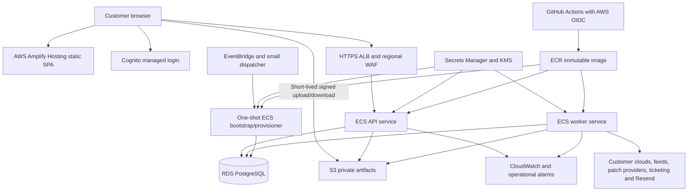

# ScoutGrid — complete AWS migration and capacity plan

Prepared November 1, 2026; revised November 2, 2026 to adopt AWS Amplify Hosting and retire Vercel after a qualified frontend cutover. Planning baseline: current local source at `8635baebb0e29dbffb3642dece354258f440a4e0`, branch `ci/trim-pr-browser-checks`, including the existing working changes inspected on this date. **There are no active customers.** This is an implementation and operating plan, not evidence that AWS resources, application changes, capacity tests or recovery drills already exist.

**Frontend decision (November 2, 2026): the user selected AWS Amplify Hosting to replace Vercel.** This update records that choice and its implementation/cost consequences; the hosted frontend has not yet moved.

This is the current planning document for the AWS migration. It updates the architecture, economics and sequence of the October 14/17 research. Preserve the earlier prerequisite ledgers as dated evidence; their October 21 tests do not certify today's branch. The original [70-task migration register](../AWS_production-migration-backlog.md) remains the detailed historical task inventory; the execution packages and acceptance gates below define the revised sequence.

## 1. Recommended decision

Prepare the application and infrastructure now; purchase production redundancy when a pilot customer is ready to use it. Retain the Java modular monolith, PostgreSQL tenancy model, existing durable database queues and Resend application email. Move the static React frontend from Vercel to **AWS Amplify Hosting**. Move the backend to ECS Fargate, the database to RDS PostgreSQL, and durable files to private S3. Use separate API, worker and privileged provisioning tasks built from the same immutable backend image. Adopt Cognito for customer identity after a complete integration spike, before opening customer access.

Do not provision the enterprise configuration merely because the customers being targeted are mid-sized enterprises. Employee count does not predict this product's scan volume or analyst concurrency. The proposed enterprise tier models the actual inventory, scans and users described in section 4, and must be measured before it is sold as supported capacity.

| Stage | When to use it | AWS/month, modeled | AWS budget including 20% contingency | Separate recurring costs |
|---|---|---:|---:|---|
| Existing development hosting | No external pilot date; continue product work | No new always-on AWS stack required | Current Render/Vercel bill must be inventoried | Existing providers; actual bill unknown |
| A: AWS validation | Migration rehearsals and founder demos; no customer availability commitment | **$211** always on | **$253** | Resend, Sentry, CI overages; optional scheduled staging; Amplify frontend included in AWS |
| B: initial customer pilot | 1–3 bounded customer organizations | **$628** | **$753** | Add staging and retained SaaS, approximately $100–235/month planning allowance; no ongoing Vercel allowance |
| C: enterprise workload | Qualified 5–10-tenant workload; upgrade by measurements | **$1,457** | **$1,748** | Add staging and retained SaaS, approximately $180–335/month planning allowance; Amplify included in AWS |

Figures use US East (N. Virginia), USD, 730 hours/month, Linux x86 Fargate, On-Demand RDS, and no promotional credits or reserved commitments. Stage A deliberately has one API, one worker and a Single-AZ database; it is not the customer availability configuration. Stages B/C include paid AWS support. Cost assumptions, formulas, exclusions and sources are in sections 6–8. These figures are planning estimates, not a quote or capacity certification.

**Practical choice today:** prepare the Amplify frontend migration now, retaining the current frontend only until its cutover gates pass; keep the current backend hosting while closing backend release blockers; create a scheduled AWS validation environment only when an engineer is actively rehearsing. Promote to B shortly before the first customer, then grow individual bottlenecks toward C. A continuously running B stack with scheduled staging and retained SaaS is roughly **$730–865/month before contingency and tax**. Use **$900–1,100/month** as its initial operating budget. For C, allow approximately **$1,950–2,150/month** including AWS contingency, staging and modest retained SaaS, excluding labor and optional model inference.

## 2. What the current application needs

Source and configuration were inspected; no customer workload, live cloud inventory or benchmark was available. The current worktree has existing email/bootstrap/configuration edits; this planning work does not certify or modify those edits.

| Capability present in current source | Execution and state | Infrastructure and capacity consequence |
|---|---|---|
| React/TypeScript/Vite UI 2.0, tenant/platform consoles, dashboards | Static browser assets calling Java APIs | AWS Amplify Hosting for the static SPA; no Node application server or frontend ECS fleet needed |
| CycloneDX/SPDX SBOM, general BOM, AI-BOM, CBOM, vendor BOM, URL/GitHub/GHCR import | Parsing, normalization, CPE joins, database writes and durable ingestion jobs | Worker memory/CPU and RDS write/IO capacity matter more than website visits; private S3 upload/import path needs implementation |
| AWS discovery, GCP discovery, ServiceNow inventory, SCCM/MECM | Customer API/JDBC connections; current GCP uses durable `GCP_DISCOVERY` jobs | Controlled outbound connectivity, tenant credential isolation, provider budgets; private customer systems may require a separately scoped collector/network project |
| Shared NVD/KEV/GHSA/CSAF/VEX/EPSS/EOL intelligence and additional on-demand sources | Scheduled shared feed imports, continuity watermarks, tenant fanout | One shared corpus, not a full duplicate per tenant; measure initial corpus/storage and catch-up processing |
| Vulnerability correlation, finding projection, suppression, EOL, risk and workflow | PostgreSQL joins/read models and recurring/delta work | RDS memory/indexes/locks are a primary constraint; keep heavy correlation off request threads |
| Static AI Grid AWS/Azure discovery, AI-BOM mapping, posture/exposure/governance | Immutable snapshots/facts, assessments and tenant findings | Worker/DB/S3 retention budgets; scanning customer Bedrock resources does not require hosting a foundation model |
| Fix Intelligence and SCCM/BigFix/Tanium/Intune patch integrations | Current tenant V9 tables, real provider classes, durable `PATCH_SYNC` work and status history | Include provider fixtures, external-effect reconciliation and event retention in acceptance; these are no longer the retired October 21 mock forms |
| Jira/ServiceNow ticketing and remediation campaigns | Remote writes plus local finding links; email outboxes | External idempotency and uncertain-result handling needed. Current `TicketingService` invokes a provider inside a DB transaction; a remote success followed by local failure must be reconciled |
| LOCAL/EXTERNAL auth, membership/support/service accounts, entitlements | Current stored authority plus signed tokens; LOCAL password/setup flows | Cognito integration requires code and browser-flow work; changing an issuer environment variable is insufficient |
| Tenant provisioning, migrations, lifecycle and audit | Restricted runtime roles; privileged bootstrap/control plane | Separate one-shot ECS provisioner, request status/retries and audited invocation; no owner credential in API/scan workers |
| Generic Azure, runtime AI telemetry, local vulnerability archives, destructive tenant deletion | Currently contained/deferred in the inspected source/guidance | Keep contained unless separately qualified; no streaming cluster, GPU, runtime log lake or archive backfill budget is required |
| Generative assistance | `GenerativeAssistancePolicy` hard-disables production/preproduction model calls | Baseline inference cost is $0. Re-enablement is a separate reviewed product/privacy/cost decision |

Current source packages **platform V8 / tenant V9**, with required/supported tenant range **9–9**. Older AWS-folder documents still describe platform V6 / tenant V5. The current container uses a Maven/JDK 26 build stage and JRE 24 runtime while `pom.xml` targets Java 17. Preserve its security fixes; qualify a supported, pinned JDK/runtime combination and clean build before promoting an AWS image. Documentation labels are not evidence of the executing runtime.

Source anchors: [architecture](../../../docs/architecture.md), [business flows](../../../docs/business-logic-guide.md), [migration catalog test](../../../backend/src/test/java/com/prototype/vulnwatch/migration/MigrationCatalogTest.java), [tenant compatibility](../../../backend/src/main/java/com/prototype/vulnwatch/service/TenantSchemaCompatibility.java), [runtime role policy](../../../backend/src/main/java/com/prototype/vulnwatch/service/BackgroundTaskExecutionPolicy.java), [GCP jobs](../../../backend/src/main/java/com/prototype/vulnwatch/service/GcpDiscoverySyncService.java), [patch jobs](../../../backend/src/main/java/com/prototype/vulnwatch/service/patch/PatchSyncService.java), [ticket effects](../../../backend/src/main/java/com/prototype/vulnwatch/ticketing/TicketingService.java), [JWT decoder](../../../backend/src/main/java/com/prototype/vulnwatch/config/JwtDecoderConfig.java), [generative gate](../../../backend/src/main/java/com/prototype/vulnwatch/service/GenerativeAssistancePolicy.java), [container](../../../backend/Dockerfile), [production settings](../../../backend/src/main/resources/application-prod.yml). Some existing prose disagrees on schema targets; packaged migrations and compatibility code take precedence.

## 3. Target architecture and boundaries

1. Use one AWS region and two AZs. Quote `us-east-1` as a comparison baseline; choose the real region before provisioning based on customer residency, provider coverage and latency. For India-resident requirements reprice `ap-south-1`; do not apply a guessed global price multiplier or imply that Amplify edge delivery, Sentry, Resend and Cognito data flows automatically meet residency requirements. Current Render Oregon location is historical configuration, not a required destination.
2. Separate production and nonproduction accounts under Organizations, plus a lightly used management account. Keep customer payloads out of the management account. Centralize recovery/audit custody independently; add a dedicated log/backup account as production grows. IAM Identity Center/MFA, root recovery, break-glass process, billing owner and resource tags start immediately.
3. Stage B/C: public ALB subnets, private API/worker subnets, isolated private RDS subnet group. One zonal NAT per AZ gives stable egress EIPs; register both with customers. S3 gateway endpoint avoids sending same-region S3 traffic through NAT. No worker load balancer, public database or standing bastion.
4. Stage A exception: API/worker Fargate ENIs can use public IPv4 for outbound access with **no public inbound worker rules** and API inbound restricted to the ALB security group. RDS remains private. Task IPs change on replacement, so this is unsuitable for customer egress allowlists. Move to private tasks before customer pilot. AWS documents both [public-task and NAT networking](https://docs.aws.amazon.com/AmazonECS/latest/developerguide/networking-outbound.html).
5. ALB allows HTTPS; redirect HTTP. API port 8080 accepts traffic only from ALB SG. DB port 5432 accepts runtime/provisioner SGs only. Keep actuator management private/restricted apart from minimal health endpoints. Use verified JDBC TLS with current RDS CA trust and hostname verification.
6. Move the existing production frontend domain to Amplify and retain `api.scoutgrid.io` on ALB. Confirm whether the current canonical frontend is `scoutgrid.io`, `app.scoutgrid.io` or another existing hostname before changing DNS; keep established canonical URLs and intentional aliases. Browser API traffic goes directly to the API; Amplify serves static files and SPA routes, rather than proxying 50 MB imports. Configure exact CORS origins, CSP, cookie/session policy and trusted ALB forwarding behavior. ALB health uses instance readiness; container liveness is separate. A failed tenant is denied without draining healthy tenants.
7. Terraform owns VPC, IAM, ECR, ECS, RDS, S3, secrets references, ALB/WAF, Amplify app/branches/domain association, DNS and alarms. Use encrypted remote state, supported locking, scoped OIDC roles, reviewed plans and deletion protection. Historical Terraform can inform modules but must not be restored with obsolete credentials/identity assumptions.

### Deployment configuration and role contract

| Setting / permission | API | Worker | One-shot provisioner |
|---|---|---|---|
| `APP_ENVIRONMENT` / `SPRING_PROFILES_ACTIVE` | `production` / `prod` | Same | Standalone CLI; do not start Spring as a privileged service |
| `APP_RUNTIME_ROLE` | `api` | `worker` | `schema-migrator` |
| `APP_SCHEDULING_ENABLED` | `false` | `true`, with reviewed individual path flags | `false` |
| Application startup platform/tenant migrations | Disabled | Disabled | Bootstrap CLI explicitly owns platform/template/tenant DDL |
| Database identity | Restricted DML, no owner/bypass/DDL | Restricted DML, no owner/bypass/DDL | Scoped owner/migration identity from its dedicated secret |
| `DB_MAX_POOL_SIZE` / minimum idle | Start 6 / 1–2 | Start 6 B, 8 C / 1–2 | Bounded CLI connections; limit simultaneous tasks |
| `APP_ALLOW_API_KEY_AUTH`, `APP_ALLOW_HEADER_TENANT_SELECTION`, test personas/playground | `false`; no creator key/default tenant compatibility | Same | No ordinary HTTP authentication surface |
| `APP_ENFORCE_TENANT_SCHEMA_VERSION` | `true`; candidate range currently 9–9 | Same | Verify post-bootstrap histories/fingerprints |
| `APP_ENTITLEMENTS_MODE` / cohort | ENFORCE with every approved production tenant enrolled | Same policy | Seed reviewed plans/cohort; no implicit feature activation |
| Production auth | Qualified Cognito/session contract; current EXTERNAL mode alone is insufficient | Verified service identity only where necessary | Controlled administrative invocation, not browser sessions |
| Encryption material | Stable versioned application keys; only needed secrets | Same retained versions for work/outboxes | Same application key only where CLI encrypts retained intent |
| Network | ALB ingress; private RDS and bounded outbound | No public ingress; private RDS and approved provider egress | No public ingress; private RDS; no ordinary scans |
| AWS permissions | Exact S3 signed-object operations; no owner DB secret or arbitrary `PassRole` | Needed S3, approved customer AssumeRole; no owner DB secret | Only migration secret/KMS and required reporting resources |
| Trusted forwarding/CORS | Verified ALB peer/header chain and exact frontend origins | No browser ingress | Not applicable |

Capture actual task-definition revisions, effective configuration, all datasource pools and secret version IDs in the release record. Inject secrets through approved task/execution-role access; an environment-reference declaration is not proof that the effective value is correct. Secrets injected at launch require a replacement task to reload unless an explicit refresh mechanism is implemented. Test rotation and retained key recovery on staging before changing production credentials.

### Amplify frontend migration and release contract

This is a hosting migration of the existing static SPA. The frontend can move before the backend if it is qualified against the current approved API origin; record that exact pairing and requalify the browser build when the API later moves to AWS. The final target keeps the Java API on ECS, RDS, Cognito identity and S3 artifacts as designed. Use Amplify Hosting only; do not scaffold an Amplify backend, AppSync, DynamoDB or a second identity pool for this frontend move.

1. **App and repository:** create reviewed Amplify resources in the intended AWS environment, scope the GitHub app to this repository, and configure `prototype-app/frontend` as the monorepo app root. Commit the eventual `amplify.yml` with matching `AMPLIFY_MONOREPO_APP_ROOT`, pinned Node 24/tool versions, `npm ci`, the approved frontend gates and `npm run build`; publish `dist`. Preserve the production static-credential/bundle guard. These files are implementation deliverables, not added by this planning update. [Monorepo settings](https://docs.aws.amazon.com/amplify/latest/userguide/monorepo-configuration.html).
2. **Branches:** use distinct production and nonproduction branch configuration, URLs and API endpoints. Enable previews only for trusted/reviewed code; preview deployments are not a place for real customer datasets or production credentials. Delete closed previews and cap build concurrency/retained versions. Native Git integration can deploy nonproduction branches automatically. [Preview configuration](https://docs.aws.amazon.com/amplify/latest/userguide/pr-previews.html).
3. **Production gate:** turn off Amplify automatic builds for the production branch. After required GitHub checks and the protected-environment review pass, a scoped OIDC workflow may trigger only the approved branch/revision. Check the job's actual commit against the approved SHA, prevent races with newer branch commits, and fail promotion on mismatch. Capture app/branch/job IDs, build environment and artifact hash. A Git connection alone does not wait for all external CI checks. [Disable auto builds](https://docs.aws.amazon.com/amplify/latest/userguide/edit-build-settings.html).
4. **Build inputs:** set the explicit public `VITE_API_BASE` for each environment, approved public Sentry/Turnstile settings and release ID. Values compiled into Vite are public. Keep AWS/provider/signing/encryption secrets out of frontend variables and build artifacts. Preserve source-map privacy and bundle checks. Frontend branch credentials must not inherit owner DB or backend runtime access.
5. **Routes:** translate the intent of the existing `frontend/vercel.json` SPA rewrite into Amplify's HTTP 200 SPA fallback, while excluding real JS/CSS/fonts/images/manifest/source-map files. Direct/deep links, refresh, invitation fragments and query strings must work; missing assets must return an actual 404, not HTML disguised as JavaScript. API/auth routes continue to the intended API origin, rather than being swallowed by the SPA fallback. [Rewrite reference](https://docs.aws.amazon.com/amplify/latest/userguide/redirect-rewrite-examples.html).
6. **Headers and caches:** port the existing CSP, Referrer-Policy, X-Content-Type-Options, frame restrictions and Permissions-Policy to Amplify custom headers. Carry over required API, Turnstile and Sentry origins; qualify any new Cognito/S3/browser connections against the policy. Use short/no-cache HTML and long-lived immutable caching for content-hashed assets; verify stale tabs across releases. Configure the canonical HTTPS/domain redirect policy explicitly. [Custom headers](https://docs.aws.amazon.com/amplify/latest/userguide/custom-headers.html).
7. **Domain and browser authority:** keep the established frontend hostname and attach it to Amplify using the correct DNS/certificate flow. Verify domain ownership, CAA/certificate issuance where applicable, apex/alias behavior and HTTPS before enabling traffic. Update exact API CORS, Cognito callback/logout URLs, Turnstile approved hostname and Resend invitation/setup links. The temporary `amplifyapp.com` preview is cross-site to the API: do not weaken cookie/CSRF/CORS policy to make it behave like the final same-site custom domain. Use a controlled staging custom domain for the full session journey.
8. **Qualification:** on the Amplify staging custom domain, run direct tenant/platform/auth deep links, asset-miss behavior, header/cache checks, login/logout/setup/invite, uploads, API errors, Turnstile and Sentry release attribution. Then verify the same approved frontend build/config on the production custom domain. Record frontend revision separately from backend image digest and prove their compatibility.
9. **Frontend rollback:** preserve the last-known-good release artifact/configuration and rehearse Amplify rollback/redeployment before cutover. If the chosen Amplify operation rebuilds a historical revision, treat the new output as a new candidate and verify it; do not assume byte-identical replay. Keep the previous API contract supported during the window. Frontend rollback stays on the authoritative API/RDS/Cognito environment. An initial DNS return to Vercel is permitted only during a rehearsed hosting fallback window where its bundle/config targets the same approved backend; never restore an old development API URL or database.
10. **Cutover and retirement:** inventory existing Vercel deployment/domain settings read-only, prepare DNS rollback records, switch frontend DNS only after Amplify is qualified, and observe 7–14 days. Then remove the Vercel domain association/build integration, revoke unused deployment tokens/webhooks, cancel/downgrade the unused plan and confirm billing. Preserve any registrar/DNS service or other Vercel-hosted project that has a separate purpose. These are future release/retirement actions, not live changes performed by this document.

## 4. Workload and capacity assumptions

All numbers below are **proposed test profiles**, not measured demand or guaranteed throughput. Count installed component associations separately from distinct software identities and from findings. A 10,000-asset customer with 200 installed components per asset means **2 million associations**, not 10,000 database rows. Analyst MAU is independent of the enterprise's employee count.

| Sizing input | A: validation | B: pilot | C: modeled enterprise fleet |
|---|---|---|---|
| Organizations / human MAU | Founder/internal fixtures; 10–25 users | 1–3 / up to 100 | 5–10 / up to 1,000 |
| Assets per organization | 100–1,000 | Up to 1,000 initially | Up to 10,000 after qualification |
| Installed component associations | Up to 100,000 total fixture | Up to 300,000 fleet total | 10–20 million fleet total; model 200/asset |
| Active analysts / API test traffic | 1–5 / 1 RPS typical | 10–20 / 2 RPS sustained, 10 burst | 50–100 / 10 RPS sustained, 50 burst |
| Heavy imports / scan admission | One at a time | One heavy import globally; one cloud scan per tenant | Start with two heavy imports globally; one scan per tenant, bounded provider concurrency |
| Cloud scopes | Small controlled account/project fixtures | 1–3 accounts/projects per organization | Test up to 10 scopes per organization plus pagination/throttling |
| API tasks | 1 × 0.5 vCPU / 2 GiB | 2 × 0.5 vCPU / 2 GiB | 2 × 1 vCPU / 4 GiB; scale ceiling 4 initially |
| Worker tasks | 1 × 1 vCPU / 4 GiB | 1 × 1 vCPU / 4 GiB | 2 × 2 vCPU / 8 GiB; scale ceiling 4 initially |
| RDS PostgreSQL | `db.t4g.medium`, 2 vCPU / 4 GiB, Single-AZ | `db.m7g.large`, 2 vCPU / 8 GiB, Multi-AZ instance deployment | `db.m7g.xlarge`, 4 vCPU / 16 GiB, Multi-AZ instance deployment |
| Allocated DB storage / growth cap | 100 / 200 GiB | 100 / 400 GiB | 400 / 1,000 GiB |
| S3 billed object storage including versions | 25 GB | 100 GB | 1,000 GB |
| Amplify builds / retained CDN storage / frontend delivery per month | 200 min / 1 GB / 10 GB | 400 min / 5 GB / 100 GB | 1,000 min / 20 GB / 500 GB |
| API requests / NAT bytes per month | 0.5M / no NAT | 2M / 100 GB | 10M / 500 GB |
| Logs ingested per month | About 5 GB | About 20 GB | About 60 GB |

The shared vulnerability corpus, indexes, raw JSON, snapshots, patch history and schema catalogs can dominate the early database. Start at 100 GiB to leave room for corpus qualification; 20 GiB is not a proven safe launch size. Measure `pg_total_relation_size`, index bytes, WAL/temporary usage and 30/90-day history growth after ingesting representative feeds and fixtures. Derive capacity as shared corpus + tenant data/indexes + retained history + operating headroom. A preliminary 1–3 KB per installed association implies 20–60 GB for 20 million associations alone; this is a sizing hypothesis and excludes several other tables. Never multiply that hypothesis into a promised storage footprint.

RDS gp3 below 400 GiB has a published 3,000 IOPS/125 MiB/s baseline; at 400 GiB PostgreSQL uses a higher 12,000 IOPS/500 MiB/s storage baseline, subject to DB instance limits. Additional provisioned performance is not included in the model. See [RDS storage specifications](https://docs.aws.amazon.com/AmazonRDS/latest/UserGuide/CHAP_Storage.html). Multi-AZ here means a primary plus non-readable standby; it does not add read capacity.

The 4 GiB validation DB is burstable. Track CPU credit balance/surplus and sustained utilization; a full feed import can exhaust credits. Use the non-burstable m7g pilot size when processing becomes continuous. If C fails its workload test, optimize SQL/chunking first, then quote the next DB size or reduce the accepted tenant tier. Do not compensate for DB lock contention by blindly adding workers.

## 5. Runtime capacity, connection and growth controls

**API:** start with modest JVM heaps and explicit total memory limits; production parsing must not buffer unbounded uploads. With 2 GiB tasks and the current 60% heap policy, reserve the remainder for metaspace, thread stacks, native libraries and direct buffers. Set worker concurrency from measured heap/transaction cost, not CPU count alone. Use 20 GiB included Fargate ephemeral storage for transient scratch; it is not durable storage. Clean temporary files and cap concurrency.

**Database pools:** override the current production maximum of 30 connections per JVM. Start with 6 per API and 6 per pilot worker, 8 per enterprise worker, minimum idle 1–2, and a separate bounded provisioner pool. Inventory every additional datasource/pool; the following assumes one effective configured pool per process and must be corrected if source/configuration creates more.

| Fleet condition | Proposed runtime connection budget before reserve |
|---|---:|
| B steady: 2 APIs + 1 worker + provisioner capped at 2 | 2×6 + 1×6 + 2 = **20** |
| B rolling replacement, up to double API/worker count | 4×6 + 2×6 + 2 = **38** |
| C steady: 2 APIs + 2 workers + provisioner 2 | 2×6 + 2×8 + 2 = **30** |
| C configured max: 4 APIs + 4 workers + provisioner 2 | 4×6 + 4×8 + 2 = **58** |
| C max with 200% deployment overlap | 8×6 + 8×8 + 2 = **114** |

Reserve at least 20 connections for administration, health, migration and recovery above those calculations; verify against actual configured `max_connections` and memory. Do not infer support for 134 simultaneous sessions from instance RAM alone. Limit deployment overlap or replica ceilings if necessary. Transaction-pooling proxies can break `search_path`/tenant session semantics; add RDS Proxy/PgBouncer only after isolation and context-reset tests justify the extra cost.

**Scaling triggers:** investigate API CPU >60% or p95 latency >750 ms for 15 minutes; heap >75%/sustained GC; oldest accepted job >5 minutes; rising job age across two scheduling cycles; DB CPU >65%, memory pressure, pool waits, persistent lock waits or read/write latency >10–20 ms; free storage <25% or <30 days growth runway. These are initial operational thresholds requiring calibration. Separate provider throttling from compute saturation. Scale API by requests/CPU and workers by backlog age plus DB/provider headroom, with scale-in disabled while unrecoverable owned work exists.

**Ingestion and fairness:** preserve the current 50 MB request/file cap and existing parser/component bounds until measured otherwise. Count decompressed sizes, pagination, XML/JSON depth and URL response bytes. Set per-tenant accepted-work limits and fair queue selection; a single organization's full rescan cannot starve feed freshness or interactive users. Persist quota reservations with admission. Shared rate limits, email budgets and provider budgets must remain effective across APIs/workers and restarts; WAF IP limits do not replace per-account/tenant limits.

## 6. Monthly AWS bill by service

The linked [cost table](AWS_COST_TABLE.md) and [machine-readable model](AWS_COST_MODEL.json) contain all line items. Run `python3 calculate_costs.py` to reproduce them without AWS access. Monetary sums use unrounded inputs; displayed row rounding may differ by a cent.

| Service | Validation | Pilot | Enterprise |
|---|---:|---:|---:|
| Amplify Hosting static frontend | $3.52 | $19.12 | $85.46 |
| ECS Fargate API | $21.26 | $42.53 | $85.06 |
| ECS Fargate workers | $42.53 | $42.53 | $170.12 |
| One-shot provisioning/migration tasks | $1.00 | $2.00 | $5.00 |
| RDS PostgreSQL compute | $47.45 | $246.01 | $492.02 |
| RDS gp3 allocated storage | $11.50 | $23.00 | $92.00 |
| RDS extra backup storage and copies | $5.00 | $15.00 | $50.00 |
| Application Load Balancer | $17.01 | $19.34 | $28.11 |
| NAT gateway hours and processing | $0.00 | $70.20 | $88.20 |
| Public IPv4 | $14.60 | $14.60 | $14.60 |
| WAF | $8.30 | $9.20 | $14.00 |
| S3 Standard storage | $0.57 | $2.30 | $23.00 |
| S3 requests/lifecycle | $1.00 | $2.00 | $5.00 |
| Secrets Manager | $4.90 | $4.90 | $6.60 |
| KMS keys and API usage | $2.50 | $3.50 | $5.00 |
| ECR storage | $2.00 | $3.00 | $5.00 |
| CloudWatch logs/metrics/alarms | $12.00 | $25.00 | $65.00 |
| CloudTrail delivery/storage | $2.00 | $4.00 | $8.00 |
| GuardDuty | $5.00 | $10.00 | $25.00 |
| Inspector enhanced image scanning | $1.00 | $3.00 | $5.00 |
| Route 53 DNS | $1.50 | $1.50 | $2.00 |
| Internet/cross-AZ transfer | $5.00 | $10.00 | $40.00 |
| Cognito Essentials human identities | $0.00 | $0.00 | $14.25 |
| SES for Cognito identity email | $0.20 | $1.00 | $3.00 |
| EventBridge/Lambda/SNS orchestration | $1.00 | $2.00 | $5.00 |
| AWS subtotal | $210.85 | $575.73 | $1,336.41 |
| AWS support | $0.00 | $51.82 | $120.28 |
| AWS monthly total | $210.85 | $627.55 | $1,456.69 |
| With 20% contingency | $253.02 | $753.05 | $1,748.03 |

**Unit-rate evidence:** ECS, RDS and S3 extracted public AWS catalogs are retained in `pricing-evidence/`, including SKU, unit, description and publication date. Amplify page-derived unit rates, workload assumptions and source links are separately recorded in `pricing-evidence/AmplifyHosting-pricing.json`, checked November 2, 2026. RDS Multi-AZ compute/storage prices already include the standby; do not double them again. NAT excludes public IPv4, which has its own row. ALB IPv4 is also charged separately. Both current- and old-task overlap consume additional resources during deployment and belong in contingency.

Key formulas:

- Amplify static hosting = standard build minutes × $0.01 + retained CDN GB × $0.023 + frontend GB served × $0.15. A uses 200 minutes/1 GB/10 GB = **$3.52**; B 400/5/100 = **$19.12**; C 1,000/20/500 = **$85.46**. Builds/storage include bounded staging/preview branches; account for retained deployment versions. No SSR compute, promotional credits or frontend WAF is assumed. [Amplify pricing](https://aws.amazon.com/amplify/pricing/).

- Fargate task/month = 730 × (vCPU × $0.04048 + GiB × $0.004445). ARM can lower this after a separate build/native-library qualification; no ARM saving is assumed.
- RDS compute: validation $0.065/hour; pilot $0.337/hour; enterprise $0.674/hour. gp3 storage: $0.115/GiB-month Single-AZ or $0.23 Multi-AZ. [RDS prices](https://aws.amazon.com/rds/postgresql/pricing/) and retained catalog evidence.
- Two zonal NAT gateways: 2 × 730 × $0.045 + processed GB × $0.045. Four steady-state public IPv4 addresses add 4 × 730 × $0.005 = $14.60. [VPC pricing](https://aws.amazon.com/vpc/pricing/).
- ALB: 730 × ($0.0225 + average LCUs × $0.008). Use measured maximum LCU dimension, not request count alone. [ALB pricing](https://aws.amazon.com/elasticloadbalancing/pricing/).
- WAF: $5 ACL + three ordinary rule/group entries at $1 + $0.60/million requests. Paid bot/fraud/marketplace rules, excess capacity and enhanced inspection are excluded. [WAF pricing](https://aws.amazon.com/waf/pricing/).
- S3 Standard: $0.023/GB-month first tier, plus requests, retained versions, downloads and any retrieval/replication. [S3 pricing](https://aws.amazon.com/s3/pricing/) and extracted catalog.
- Secrets Manager: $0.40/secret-month plus calls; 12/12/16 infrastructure secrets modeled. Retain encrypted tenant connector secrets in the DB with durable versioned application key custody, rather than automatically creating a Secrets Manager object per credential. [Secrets pricing](https://aws.amazon.com/secrets-manager/pricing/).
- KMS: small explicit key count and request allowance. Key rotation/replicas can add charges. KMS protection of a secret does not replace the application's existing AES-GCM key/version logic. [KMS pricing](https://aws.amazon.com/kms/pricing/).
- Cognito Essentials: direct users remain below the eligible 10,000-MAU allowance. C deliberately models 1,000 enterprise-federated MAU: (1,000 − 50) × $0.015 = $14.25. SMS, advanced tiers, M2M tokens and identity email are different meters; check account/organization eligibility. [Cognito pricing](https://aws.amazon.com/cognito/pricing/).
- Support: Basic at A; Business Support+ at B/C, modeled as max($29/account, 9% of AWS usage below $10,000). Other paid-support accounts add their own charges. [Current support pricing](https://aws.amazon.com/premiumsupport/pricing/).

CloudWatch, CloudTrail storage/data events, GuardDuty, Inspector, backup overage, requests, transfer and orchestration are **planning allowances**, not measured bills. Their basis is in the model. Watch 7/30-day actuals and reforecast them; feature switches, event volume, image rescans, high-cardinality metrics, log queries, cross-AZ traffic and backup churn can dominate. See [CloudWatch](https://aws.amazon.com/cloudwatch/pricing/), [CloudTrail](https://aws.amazon.com/cloudtrail/pricing/), [GuardDuty](https://aws.amazon.com/guardduty/pricing/), [Inspector](https://aws.amazon.com/inspector/pricing/) and [ECR](https://aws.amazon.com/ecr/pricing/).

No separate hourly service fee is budgeted for the ECS Fargate control plane, VPC/subnets/security groups, IAM/Organizations, or an S3 gateway endpoint; their resource usage can still cost money. Non-exportable public ACM certificates on integrated services have no certificate charge; exporting certificates/private CA is different. [ACM pricing](https://aws.amazon.com/certificate-manager/pricing/).

## 7. Complete operating cost and cheaper alternatives

### Frontend hosting, retained external services and staging

| Item | Initial allowance/month | Enterprise allowance/month | Treatment |
|---|---:|---:|---|
| Amplify static frontend | $19.12 at B | $85.46 at C | Already included in the AWS totals; do not add it again here. Vercel recurring allowance is removed after retirement. [Pricing](https://aws.amazon.com/amplify/pricing/) |
| Resend application email | $0–20 | $20–50 | Free currently 3,000/month and 100/day; Pro $20 for 50,000/month. Respect daily caps; provider acceptance is not inbox delivery. [Pricing](https://resend.com/pricing) |
| Frontend errors and GitHub CI | $0–55 combined allowance | $10–85 allowance | Retain Sentry/minimize payloads; inspect actual account and CI minutes. These are budget allowances, not vendor quotes |
| Scheduled nonproduction AWS environment | $100–160 | $150–200 | Nonproduction t4g.medium DB, one small API/worker, about 160 running hours/month; storage and often ALB remain charged |
| Always-on independent staging alternative | Approximately $207 backend infrastructure plus any paid support | $207+ before extra load | A backend baseline without duplicating Amplify frontend charges; preview builds/storage/delivery already share the Amplify row. Do not add both always-on and scheduled staging |
| Generative inference | $0 baseline | $0 baseline | Production gate remains off; see optional case below |

Amplify Hosting is usage-based and needs no daily server stop/start; its retained deployment storage remains billable. The separate staging allowance is primarily ECS/RDS/network infrastructure. Amplify usage includes production plus bounded preview/staging activity; avoid counting their builds/storage twice. Any temporary Vercel overlap is a migration expense and ends after the acceptance window.

Frontend WAF is optional: Amplify currently charges **$15 per app/month plus AWS WAF charges** for that integration. The model retains regional WAF on the API ALB and excludes this additional frontend charge. If enabled for an affected app, add that fee, ACL/rule/request charges and applicable support; do not count the API ACL as protecting the Amplify distribution. Native static hosting requires no extra customer-managed frontend CloudFront distribution or S3 website bucket. Private S3 import/export buckets remain in the backend plan.

Scheduled staging savings require automation and recovery time, not just a promise to switch it off. RDS automatically restarts after seven stopped days and storage/backups remain billable; see [RDS stop behavior](https://docs.aws.amazon.com/AmazonRDS/latest/UserGuide/USER_StopInstance.html). Stop workers/API after drain and start DB first. Keeping a NAT gateway or interface endpoints alive preserves their fixed bill. Destroy disposable environments through reviewed IaC only after preserving required evidence; never apply that policy to production data.

Excluded from infrastructure totals: tax/GST, foreign exchange, domain registration, labor/on-call, customer software licenses/API fees, compliance/auditor/penetration-test costs, private network links, larger DR deployments, premium security add-ons, large transfer spikes and old Render overlap. Price customer-specific services before committing them. Promotional credits/Activate can offset eligible usage but are conditional, temporary and not part of sustainable unit economics. [Activate guidance](https://aws.amazon.com/startups/credits).

### Options and adoption triggers

| Option | Cost/benefit | Recommendation |
|---|---|---|
| Remain on current hosting during preparation | Avoid paying for two continuous platforms while there are no customers; actual Render bill unknown | Default until migration rehearsals or a customer need justify AWS spend |
| Schedule A for business-hour use | Approximately $100–160/month AWS backend laboratory plus measured Amplify usage instead of $211 always on, subject to retained resources and actual runtime | Preferred migration laboratory; do not advertise continuous availability |
| Pilot with t4g.medium Multi-AZ instead of m7g.large | Compute falls from $246.01 to $94.17, saving $151.84/month before support | Optional constrained pilot only after full corpus/load test passes and CPU credits remain healthy; not the default for intensive correlation |
| One NAT instead of two | Saves about $36.50/month fixed gateway+IPv4 before traffic/cross-AZ differences | Internal validation exception; avoid adding an egress AZ dependency to the customer tier |
| API/worker Fargate ARM | Main Linux CPU/memory rates are roughly 20% lower in this region | Test native dependencies/images and compare total bill; savings affect compute, not RDS/NAT/security |
| EC2/Lightsail single host | Can have a lower cash bill but adds patching, host recovery and shared failure domain | Valid founder sandbox choice; current plan prefers Fargate to keep operating burden bounded |
| Customer-managed CloudFront + private S3 frontend | Future alternative to Amplify if measured delivery costs or configuration needs justify it | Amplify is the selected host. Revisit a separately operated distribution/bucket only with a new decision and browser/release qualification; no parallel frontend stack is budgeted. [CloudFront pricing](https://aws.amazon.com/cloudfront/pricing/) |
| SES for application email | Base sends may be cheaper than a paid application email plan | Keep Resend initially. SES needs provider adapter, domain reputation, sandbox exit, bounce/complaint/suppression and reconciliation tests; Cognito identity email can use SES separately. [SES pricing](https://aws.amazon.com/ses/pricing/) |
| SQS/EventBridge per business workflow | Useful for independently scaling/bursting workers | Keep existing Postgres queues until queue-table IO/locks or independent delivery requirements justify migration; no duplicate scheduler for the same path |
| Redis/ElastiCache, OpenSearch, read replicas | Extra fixed services and operational state | Add only for a measured cache/search/read bottleneck after SQL/projection/index fixes; validate tenant context and consistency |
| EKS, MSK/Kafka, GPU/SageMaker | Adds cost/complexity without a current application requirement | No initial deployment |
| Aurora Serverless, full regional failover | Potential future workload/recovery choices with new cost and compatibility assumptions | Quote and test only for a demonstrated requirement; do not assume pause-to-zero suits persistent polling |
| VPN/private collector/Direct Connect | Per-customer network and operating cost | Separate paid scope for private SCCM/CMDB access; do not open customer SQL Server to the internet to fit this plan |

If generative assistance is later enabled, estimate monthly inference as `(calls × input tokens ÷ 1M × selected input price) + (calls × output tokens ÷ 1M × output price)`, then include retry amplification and tool costs. For example, 10,000 calls at 4,000 input/1,000 output tokens means **40M input + 10M output tokens**; insert the chosen provider's then-current prices. Apply per-tenant consent, purpose limits, redaction and a hard spend cap before rollout. Switching to Bedrock is a model/privacy/quality decision, not a prerequisite for scanning AWS AI resources.

## 8. Efficient adoption and cost governance

Start with On-Demand pricing and scale ceilings. Tag every billable resource with application, environment, owner and purpose; enable Cost Explorer/anomaly detection and budgets at 50/80/100% of the approved envelope. Budget notifications do not cap spend. Enforce quotas, maximum tasks, upload bytes, scan cadence, per-provider concurrency and hard model caps in the product/control plane.

At no customers, heavy feeds can run only during scheduled validation with explicit freshness shown in demos. Before customer access, keep the worker online and verify catch-up continuity after scheduled outages. Avoid running a full shared corpus refresh per tenant or on every container restart. Stagger cloud/patch scans and preserve provider checkpoints. Use S3 gateway endpoints; avoid adding four interface endpoints across two AZs without comparing their hourly price to the NAT bill they would actually reduce. Third-party feeds still need internet egress.

Expire untagged ECR images while retaining the exact known-good rollback digests; keep 30-day application logs initially and longer security/audit retention only under an approved policy. Bound metric dimensions, especially tenant/job/asset IDs; do not enable every enhanced observability product by default. Configure S3 noncurrent-version and failed-multipart cleanup. Respect legal holds independently of lifecycle expiration.

After 60–90 days of stable measured base load, evaluate a conservative Compute Savings Plan and RDS reservation against expected continued use. Reserve only the steady floor; retain burst capacity On-Demand. Use Spot later for tested replayable batch work, never as an excuse to omit ownership/lease recovery. Review cost per tenant, per 1,000 assets, per million associations, per completed scan and gross margin monthly; do not assume shared costs divide linearly at low tenant count.

## 9. Identity, authorization and customer onboarding

**Target choice:** Cognito Essentials managed login, authorization-code flow with PKCE, and a small backend session layer for human browser sessions. Use a Secure/HttpOnly host-only API cookie, persistent hashed opaque session records in PostgreSQL, explicit inactivity/absolute expiry, server-side revocation and CSRF on state changes. Keep frontend/API on the same registrable domain, with exact cross-origin credential/CORS settings. This is planned new application work; current LOCAL/EXTERNAL bearer handling and setup cookies do not implement this session architecture. No Redis is required initially.

Implementation must cover state/nonce/PKCE, callback validation, code exchange, session fixation/rotation, logout/refresh/recovery, redirect allowlists and MFA for privileged staff. Map `(issuer, subject)` to a current application user; do not auto-link privileged identities solely by email. Validate access-token issuer/signature/key rotation, token use, intended client/resource and scopes. Current `JwtDecoderConfig` always requires `aud`; Cognito's default access token commonly uses `client_id`, so use its documented token contract and negative tests, not an unchecked audience bypass. [Cognito access-token contract](https://docs.aws.amazon.com/cognito/latest/developerguide/amazon-cognito-user-pools-using-the-access-token.html).

Keep membership/support/tenant lifecycle authority in ScoutGrid. The verified identity selects a workspace through a newly implemented authenticated selector checked against current DB authority on every request. Make workspace selection explicit per request/tab so two tabs cannot silently change each other's tenant. Do not re-enable the local `X-Tenant-ID` or API-key fallback. Store platform owner authority separately from tenant membership. Require approval/audit for support elevation and test immediate revocation.

Invitations must bind the authenticated identity, tenant, intended role, expiry and single-use acceptance; adapt the existing hash/fragment exchange instead of issuing incompatible local tokens in EXTERNAL mode. Fresh production users receive new managed-identity invitations; there is no customer password migration. Service-account JWTs remain a separate explicitly trusted machine contract with tenant/principal binding; do not grant machine authority from human cookies or silently replace the issuer without a migration plan. Add M2M client/token fees if Cognito client credentials are selected.

Go/no-go spike: founder bootstrap → invitation → managed login/MFA → tenant entry → two-tab tenant selection → support entry/revocation → recovery/logout; wrong issuer/client/token type/tenant and revoked membership must fail. If the spike exposes blockers, finish it before customer pilot rather than shipping LOCAL HMAC as an unreviewed production shortcut. Existing controlled LOCAL mode can remain in isolated validation.

## 10. Database, fresh production and tenant control plane

There are no active customers and production is allowed to start fresh. **Default migration path is a new RDS database**, not conversion of the old Render history. DMS/CDC, live customer data transfer and a zero-downtime old-database cutover are unnecessary. Retain the existing development/demo database under its owner until explicitly approved for retirement.

1. Create a current, supported RDS PostgreSQL 16 minor after testing the exact version/parameter group. Current SQL requires PostgreSQL 15+ features; version 16 matches the earlier fixture target but still needs fresh RDS qualification.
2. Enable encryption, deletion protection, no public access, controlled maintenance window, automated backup retention (7 days A, 14 B, 35 C proposed) and storage autoscaling caps. Use explicit runtime DML and privileged owner/migration identities, forced RLS, TLS trust verification and least-privilege shared/public-table grants.
3. Build the exact candidate image; run the standalone `ProductionBootstrapCli` as an **exit-once ECS task**. The current Render wrapper already supports `--run-once`; override the task command to `/app/scripts/run-render-migration.sh --run-once` and qualify its required environment/result handling. The default image CMD does not pass this argument, so simply setting `schema-migrator` is insufficient. Do not keep its temporary web-listener mode alive on ECS. Apply all packaged platform V1–V8 and tenant V1–V9 on the new empty DB, then record resulting histories/fingerprints and image digest. Re-evaluate heads if source changes.
4. Seed only reviewed policies/catalogs, plans, owner authority and production configuration. Do not copy demo personas, local owner aliases, fixture connector secrets, synthetic findings or old encryption keys without an explicit retained-data reason. Generate new durable production signing/connector-encryption material and document recovery custody.
5. Run template → canary → batches for tenant creation/upgrades. Tenant creation persists PROVISIONING intent; a small audited dispatcher claims requests and invokes the privileged ECS task. Scope `RunTask`/`PassRole` to that task and role only. It should not have the DB owner password. Record invocation/task ARN, exit/result and retry status; reconcile task timeout or lost stop events, use bounded retries and an observable failed state.
6. API/normal workers receive only restricted credentials. Startup/readiness validate required structures and tenant compatibility read-only; they do not run DDL. Verify one failed tenant stays excluded while compatible tenants remain usable. Configure ENFORCE for every enrolled production tenant explicitly; the current internal-only allowlist must not leave customer tenants unintentionally outside enforcement.
7. For future migrations, preserve applied SQL and use expand/contract with a tested compatibility range. The current binary accepts exactly tenant V9, so rolling schema upgrades need new compatibility design/tests rather than merely toggling a flag. Capture prechange snapshots and candidate/rollback digests before applying new versions.

If any existing data is later designated for retention, stop the fresh-only assumption for that dataset: inventory actual histories/catalogs read-only, agree data/key/link preservation, and rehearse a separate forward transition on an authorized clone. Never reset a shared database or use `flyway:repair` to conceal the older history. The historical Render binary is not an established fallback for the fresh V8/V9 system.

## 11. Storage, uploads and retained evidence

Implement a storage abstraction for private S3 import objects and exports. Buckets use Block Public Access, encryption, versioning where recovery requires it, least-privilege API/worker prefixes and no credentials embedded in URLs/logs. Use KMS bucket keys where suitable and price actual requests; a tenant prefix alone is not authorization.

Proposed import flow: authenticate/authorize → reserve tenant quota and create PENDING upload with random immutable key → issue short-lived signed POST/URL → browser uploads directly → complete endpoint verifies object key/version/size/checksum/content constraints → transaction commits durable ingestion intent → worker streams and parses → atomic job/result publication → retention/quarantine cleanup. Validate again at execution; prevent overwrite/replay and cross-tenant object use. A signature is a bearer capability; keep it short lived and redact it. [S3 signed-upload behavior](https://docs.aws.amazon.com/AmazonS3/latest/userguide/using-presigned-url.html).

S3 event delivery can be duplicate/out of order. Start with the explicit completion endpoint plus a reconciliation sweep; add event-driven hints only with idempotency. Admission failure must not create an unbounded orphan object bill. Downloads use freshly authorized short-lived links, not permanent public URLs. For uploaded archives, apply malware/quarantine controls appropriate to accepted formats and benchmark any paid scanning before enabling it broadly.

Keep canonical inline vulnerability data readable. The existing local vulnerability archive surface stays disabled until its adapter, checksums, key custody, round-trip recovery and legal-hold rules are separately implemented. Suggested new raw-upload retention is 30 days, failed/quarantine objects 7 days and abandoned upload intent 24 hours, subject to product/security approval. These are **proposals**, not changes to the existing evidence/hold/patch-history retention policies. Never let a generic S3 expiration bypass an active hold or required replay object.

## 12. Jobs, provider integrations and external side effects

Reuse durable ingestion/delta/assessment/email work and database schedule-occurrence coordination. Extend the schedule/cleanup inventory to GCP, patch status retention and ticketing; the October 21 matrix is incomplete for current source. Audit startup runners, scheduled functions, HTTP handlers and after-commit callbacks under API/worker/migrator roles. `APP_RUNTIME_ROLE=api` must not run scans or recurring jobs; worker has no public ingress; migrator runs no ordinary business jobs. One worker task does not prevent old/new overlap during deployment.

Claims need leases/heartbeats, fenced attempts, atomic domain/result updates, bounded retries, stale recovery and operator-visible exhaustion. Test two processes plus a killed/stale owner for every offered new work type. Preserve NVD successful-window watermarks and bounded catch-up after outages. Shared feed success cannot falsely imply successful publication to every tenant; replay failed fanout safely.

For customer AWS, use Fargate task credentials through the supported default/container credential chain and customer AssumeRole with server-issued ExternalId/account binding; never reuse platform credentials as customer fallback. Verify customer least-privilege CloudFormation/onboarding and denied roles/accounts. Azure/GCP/GitHub/ServiceNow/patch credentials must stay tenant-bound, version-encrypted and redacted. Validate outbound DNS/destination at connection, pagination/redirect hosts, byte/time limits and exact provider domains. Keep generic Azure contained until separately qualified.

Qualify live SCCM and patch SQL/REST only for approved endpoints and network paths. Current SCCM policy and real providers supersede the earlier blanket disabled assumption, but do not establish customer reachability or release qualification. Use a private collector/tunnel project for private customer systems with distinct credentials/tenancy controls; do not broadly disable SSRF policy or publicize JDBC ports.

Ticket/patch/email external effects are not made exactly once by a DB transaction. Introduce stable operation IDs and a durable outbox or equivalent intent/state machine for ticket creation, provider idempotency where supported and UNKNOWN reconciliation where it is not. The inspected ticket call inside a transaction can succeed remotely and then roll back locally; repeat requests/concurrent clicks need explicit duplicate tests. Retain invitation/campaign encrypted payload keys for uncertain results and respect resend windows. Provider acceptance and delivery are separate states.

Verify production sender/domain ownership, SPF/DKIM/DMARC alignment, approved From addresses, invitation/setup links and volume caps. Reconcile bounces, complaints and suppressed recipients through the supported provider/operator path; add authenticated, replay-safe delivery webhooks only if selected as implementation scope. Test controlled delivery and failure without treating a send API success as inbox proof. Record feed license/usage terms and vendor/customer data flows, including Amplify, Cognito, Sentry, Resend and any future model provider; remove Vercel from active processing/vendor records after retirement.

## 13. Delivery pipeline and release process

Use GitHub Actions OIDC, separate build/deploy/provision roles, ECR immutable digests and reusable Terraform modules. API/worker task role is not the ECS execution role. Scope secret access and customer AssumeRole independently; prevent ordinary deploy actors from passing arbitrary privileged roles. Do not store static AWS deployment keys in CI.

For each candidate: clean build → default backend verification → full PostgreSQL integration verification → frontend lint/typecheck/build/bundle/coverage and appropriate browser journeys → migration integrity/catalog/tenant boundaries and shell checks → policy/secret/security/image gates → ECR digest → staging bootstrap/upgrade → environment journeys/load/recovery → explicit production approval → canary/pilot rollout. Current workflows include Quality, Trivy, Semgrep, Performance Governance and the frontend sweep; honor current branch protection rather than assuming the historical CodeQL workflow still exists. Resolve failures without lowering coverage/security gates.

The Amplify production branch follows the approved CI-triggered process above; preview success is not production approval. Record the frontend artifact hash/job/revision beside the backend image digest and test the intended pair. Frontend API/public environment changes produce a new browser bundle that needs qualification.

On ECS use tested rolling service deployments, circuit breaker and alarm rollback, initially minimum healthy 100% / maximum 200% where database and quota headroom permit. Use at least two API tasks in B/C and AZ spreading. One pilot worker is recoverable but has replacement delay; C has two. Set Fargate `stopTimeout` to 120 seconds, stop claims on SIGTERM, drain accepted work and use leases for anything longer. Align Spring executor waits, HTTP graceful timeout, ALB deregistration and client timeouts; long jobs must recover from forced kill. [ECS deployment semantics](https://docs.aws.amazon.com/AmazonECS/latest/developerguide/service-options.html), [circuit breaker](https://docs.aws.amazon.com/AmazonECS/latest/developerguide/deployment-circuit-breaker.html), [Fargate timeout](https://docs.aws.amazon.com/AmazonECS/latest/developerguide/task_definition_parameters.html).

Retain source revision, image digest/SBOM, migration histories, IaC plan, secret version identifiers (not values), configuration flags, workload results, test reports, cost estimate and named reviewer in a durable release record. Old local `/private/tmp` evidence is not a substitute for CI artifacts on today's candidate.

Assign dependency/base-image patch ownership and response targets for critical/high vulnerabilities, expiring exceptions and secrets incidents. Pin actions/images and retain source maps privately with release IDs. Corporate MFA, access reviews, managed devices, incident reporting, vendor oversight and tested recovery support enterprise readiness; purchasing a cloud stack does not establish SOC 2 or another compliance commitment. Price audit/customer-specific requirements separately.

## 14. Availability, monitoring, backup and recovery

Proposed internal objectives: B 99.5% monthly API availability and C 99.9% after recovery/load evidence; these are not contractual SLAs. Target p95 ordinary list/read API latency <750 ms at the defined profile, p99 <2 seconds, accepted-job acknowledgement <2 seconds, no lost acknowledged work, and shared daily intelligence fresh within 24 hours. Define separate provider-limited scan completion targets from fixture measurements. Exclude heavy exports/import processing from interactive request latency by using jobs.

Monitor API error/latency, readiness/liveness, task restarts/OOM, ALB healthy targets, RDS CPU/free memory/storage/IO/locks, pool waits, oldest queue age/heartbeat, repeated terminal failures, feed watermark age, projection lag, outbox UNKNOWN, provisioning age, provider throttling, object orphans, certificate expiry and spend. Use structured redacted logs with request/tenant/attempt IDs; never bearer strings, secret URLs, raw credentials or full customer payloads. Test alarms reaching a named operator, escalation and backup contact.

Proposed recovery objectives: same-region logical-loss RPO ≤15 minutes and RTO ≤4 hours, only after actual PITR restore/journey rehearsal; AZ failover must reconnect/recover jobs and will still cause interruptions. A/C validation has no customer availability promise. Backups, key versions and restore permissions are part of the recovery system. Multi-AZ is not a backup, tenant-level PITR or regional DR.

Run initial and quarterly isolated restores; verify tenant isolation, memberships, provider-secret decryptability, invitation/outbox state, jobs, findings and referenced S3 objects. Test DB point-in-time plus object-version consistency. Restore one tenant by extracting/reconciling it from an isolated full restore, not overwriting the live multi-tenant DB. Record actual RPO/RTO and update promises if the target fails.

Protect audit/backup custody from routine runtime/deploy roles. B/C backup allowance covers modest extra copies/storage, not a continuously running secondary region. If contracts require region-outage recovery, quote a complete regional plan covering DB/S3 copies, identity/session/email, key material, images/IaC, DNS and egress allowlists; specify how much data can be lost. Daily copies do not meet a 15-minute regional RPO. Customer deletion/export/backup-retention and legal holds require explicit policy; destructive tenant purge remains contained until implemented and verified.

## 15. Implementation sequence, ownership and deliverables

Owners below are responsibilities, not a claim that a staffed team exists. F = founder/product, B = backend, UI = frontend, P = platform, Q = quality/security reviewer. One person can hold several roles, but production authorization and review must still be explicit. Estimates are engineering-day planning ranges, not a fixed bid; existing accepted work can reduce them after review.

| Package / order | Work and deliverable | Owners | Depends on | Estimate | Historical tasks |
|---|---|---|---|---:|---|
| M0: baseline and launch scope | Current branch review, preserve existing changes, actual provider/account inventory, capability matrix, region/residency/SLO/budget decision, review prerequisite evidence against current source | F/B/P/Q | — | 3–5 days | T01–T06 |
| M1: identity and durability spikes | Cognito/session journey; ticket external-effect recovery; current GCP/patch/SCCM role/claim/tenant tests; provider/tenant admission budgets | B/UI/Q | M0 | 8–15 | T03, T26–T42, T47–T53 |
| M2: AWS foundation and deploy laboratory | Accounts/OIDC/IAM/Terraform, networks, ECR, ALB/WAF/DNS, Amplify app/branches/build/header/routing configuration, secrets, A tasks, RDS, alarms and cost controls; rebuild lab from IaC | P/B/Q | M0; identity contract fixed before final auth wiring | 6–10 | T07–T18, T55–T59 |
| M3: fresh bootstrap and provisioning | V8/V9 fresh RDS bootstrap, runtime grants/TLS, owner setup, tenant async dispatcher/retry, schema compatibility/rollback checks, shared feeds | B/P/Q | M1/M2 | 5–8 | T19–T24, T52 |
| M4: storage and integration qualification | S3 import/export abstraction and browser flow, limits/cleanup, credential/account binding, ticket/patch/email controlled journeys, maintain exclusions | B/UI/P/Q | M1/M3 | 6–10 | T23, T33, T43–T53 |
| M5: full staging qualification | Current CI/image/security, Amplify public-domain/header/deep-link/asset/cache tests and frontend rollback, workload A/B/C as applicable, two-worker/killed-owner/tenant isolation, host drain, failure injection, PITR/object restore, actual cost measurement | Q/B/P/UI | M2–M4 | 7–12 | T06, T60–T66 |
| M6: pilot release | Promote B infrastructure, gate Amplify production deployment and frontend domain cutover, approve exact artifacts/config, enroll bounded cohort, validate domain/identity/email/provider journeys, observe acceptance window | F/P/B/Q | M5 | 2–4 | T67–T69 |
| M7: stabilize and retire | 7–14-day observation, cost forecast/quotas/runbooks, retire obsolete Render resources and Vercel hosting/integration after the qualified acceptance window; expand toward C by measurements | F/P/B/Q | M6 | 2–4 active days plus observation | T70; conditional expansion tasks |

Total indicative active effort **39–68 engineering days**, plus discovery, external approvals and observation. With two experienced engineers and part-time review/platform help, plan roughly **8–12 calendar weeks** with overlap; a solo implementation is more plausibly **10–16+ weeks**, depending on identity/storage/recovery findings. This does not include customer-specific private collectors, enterprise SSO onboarding, compliance audits or regional DR. Re-estimate after M1/M2. If staffing is limited, reduce offered launch capabilities and keep them contained; do not remove identity, tenant isolation, durable work or restore gates.

Suggested deliverables: `infra/aws/terraform/` modules and environment plans, reviewed Amplify `amplify.yml` and `customHttp.yml`/routing configuration, frontend release/rollback manifest, qualified task definitions and image digests, fresh-bootstrap/provisioning runbook, identity/session ADR, capability/provider matrix, S3 data-flow/retention record, test workload generator/fixtures, backup/restore and incident runbooks, per-stage AWS Calculator export, release evidence manifest and signed go/no-go record. These are implementation outputs still to be produced; this document does not imply they were generated by planning.

## 16. Qualification matrix and go/no-go criteria

| Boundary | Evidence required before customer access | Failure action |
|---|---|---|
| Source/image | Exact candidate CI, scan results and digest; supported JVM/container; no static frontend credentials | Repair/rebuild candidate; old tests do not certify new bytes |
| Amplify frontend | Exact frontend revision/job/artifact hash; production build guard; CSP/security headers; SPA direct routes and missing-asset 404; API/Cognito/Turnstile/Sentry domain behavior; no production credentials in previews; production release gate, DNS cutover and rollback rehearsal | Hold frontend domain cutover and fix deployment configuration |
| Identity/session | Real Cognito invite/login/MFA/recovery/logout, CSRF/CORS, negative token tests, current authority and two-tab isolation | Keep customer access closed |
| Tenant/database | Restricted non-owner/no-BYPASSRLS/no-DDL identity, TLS hostname/trust, alternating pooled tenants, denied cross-tenant APIs/jobs/objects | Block release and preserve evidence |
| Migration/provisioning | Fresh empty RDS V8/V9 bootstrap, canary/batch, failure/retry/grants/activation, tested compatible rollback or roll-forward | Stop rollout; never disguise history with repair/reset |
| Runtime roles | All startup/scheduler/API/worker paths, current GCP/patch and feed schedules inventoried; effective flags/UTC/pools/replicas captured | Disable affected feature or fix role boundary |
| Durable work | Two workers, SIGTERM at admission/claim/effect/commit, forced kill beyond timeout, stale fencing, replay/backoff/terminal recovery | Keep affected workflow contained |
| Providers | Cross-account AWS denial; GCP/Azure/GitHub scopes; approved SCCM/patch hosts; ticket/email uncertain-result reconciliation; zero unintended live writes | Repair or remove provider from launch offer |
| Storage/import | Browser signed upload, checksum/size/tenant checks, bounded parsing, duplicate completion, orphan cleanup, download authorization and object recovery | Keep unsupported import path disabled or retain a specifically qualified smaller path |
| Capacity | B target and largest offered tenant, cold/warm feed corpus, 24-hour soak; C requires its own fleet test before promotion | Optimize, resize/reprice or lower accepted limits |
| Recovery/operations | Alarm paging, runbooks, actual PITR/object/key restore, measured objectives, safe config/rollback rehearsal | No availability/recovery promise until passed |
| Product truth | ENFORCE for actual enrolled tenants, supported connector statuses/UI, hidden/deferred features remain denied server-side | Correct exposure/configuration before onboarding |
| Cost | Approved selected-region estimate, 7/30-day forecast, quotas/alerts, operator ownership | Correct runaway/default settings before expansion |

Capacity procedure: seed shared corpus once, then realistic distinct identities/asset associations/snapshots/findings/patch history; record SQL plans and table/index/WAL/temp sizes. Exercise login, dashboard, filter/search, findings, ticket creation, scans and imports together. Test 50 MB boundary/invalid files, provider throttles and page interruption, one large tenant beside small tenants, full feed catch-up and simultaneous worker replacement. Record p50/p95/p99, errors, throughput, job age, memory/GC, locks, connections, IO and billed usage. Run B before pilot; run C before selling C limits. A short HTTP-only test is insufficient for a scan/correlation product.

## 17. Cutover, rollback and retirement runbook

**Before release:** select approved B configuration and exact candidate/rollback artifacts; complete matrix above; create fresh production catalogs/owner identity; obtain backup/restore proof and key custody; verify DNS ownership/ACM, egress EIPs and provider quotas. Set enrollment closed and all production flags explicitly. Record every target service and effective environment without dumping secrets. Lower relevant DNS TTL ahead of the change when changing existing records.

**Cutover:** apply reviewed production IaC; bootstrap fresh RDS with the one-shot task; start worker and API on the same qualified digest; confirm readiness and no unexpected privileged/background paths. Deploy the qualified frontend to Amplify, finish its custom-domain verification/certificate and switch the existing frontend DNS from Vercel under the Amplify frontend migration and release contract in section 3. Configure production frontend API URL, exact CORS, callback/logout and email invitation domains. Use controlled test identities and operator-approved mail/remote-write targets; verify user → session → tenant → upload/scan → findings → ticket/campaign journey. Open a small named customer cohort only after successful checks. No customer data synchronization from Render is needed for this fresh launch.

**Observe:** watch API/DB/queue/provider alarms and audit for at least the first hour, then daily during a 7–14-day stabilization period. Freeze expansion while findings or backlog worsen. Candidate failure, rising errors, stalled jobs, authorization anomalies or restore defects trigger enrollment pause and the recorded recovery path. Log actual costs and update this model before increasing limits.

**Rollback:** pause new admissions/provider dispatch as needed; stop unhealthy candidate workers safely; deploy the tested previous AWS image against the authoritative production RDS and retained object/key state only if its schema/behavior compatibility was proven. Keep local/external provider operations reconciled. If schema compatibility is absent, use the rehearsed roll-forward instead. PITR restores a new isolated database and requires an explicit write-stop/reconciliation/data-loss decision; restoring blindly can discard accepted work and duplicate external effects. Do not switch customers to the old Render DB or assume the historical Render image is compatible.

**Retirement:** after the acceptance window and explicit owner approval, suspend obsolete Render schedulers/migrator, then retire unused services/database backups under the retention policy. Remove obsolete DNS/provider allowlists and revoke unused deployment/provider access without losing retained-backup decryptability. Confirm no hidden second worker/cron is running and that the bill actually falls. Retire Vercel frontend hosting, automatic production builds and obsolete integration credentials after the frontend acceptance/rollback window, while preserving required release evidence and any separately used domains. Keep Resend for application email. Record final Vercel billing/cancellation so migration overlap does not become an ongoing cost. Record resource IDs, backup disposition, retained keys, dates and owner. There is no automatic deletion authorization in this plan.

## 18. Decisions to record before implementation

| Decision | Recommended default | Evidence that can change it |
|---|---|---|
| Customer stage | No active customers; A only during rehearsals, B for first pilot | Signed pilot/start date or a requirement for continuous demos |
| Region | `us-east-1` is the pricing baseline, not a residency commitment | Customer geography/data terms and measured latency; quote actual chosen region |
| Fresh data | New empty production DB; approved reference-data seeding only | Explicitly retained dataset requiring a separately rehearsed transition |
| Identity | Cognito Essentials + complete backend browser session integration | Failed end-to-end spike or a customer-mandated IdP; reprice equivalent design |
| Launch integrations | Certify AWS/GitHub/BOM/static AI first; add current GCP/patch/ticket/SCCM only when their gates pass | Actual design-partner workflows and private-network constraints |
| Availability/recovery | B redundancy and proven same-region restore; no full regional SLA | Contract requiring regional DR or stricter objectives, separately priced |
| Frontend | **AWS Amplify Hosting, replacing Vercel — user decision November 2, 2026** | A later explicit decision based on measured limits, cost or required features |
| Application email | Keep Resend | Measured provider cost/limits or a documented single-provider requirement |
| Retention/AI | Existing holds/containment; approve proposed new S3 retention separately; inference off | Explicit product/privacy decision and measured unit economics |
| Budget | B approximately $900–1,100/month complete initial envelope; no savings commitments yet | Actual selected-region estimate, staffing, usage or customer requirements |

The next concrete work is M0/M1: reconcile today's candidate and release evidence, define the offered pilot capabilities, complete the managed-identity and external-effect spikes, and provision the scheduled laboratory through reviewed IaC. The detailed older register is useful for completeness; do not treat its historical migration versions or cost figures as current deployment instructions.

## 19. Research and evidence register

Core catalog sources checked November 1, 2026; Amplify pricing and migration guidance checked November 2, 2026. Sources are official AWS/vendor material; estimates and operational choices above are this plan's proposals. Public catalog subsets were retrieved directly, not inferred from third-party instance-comparison sites.

| Evidence | Location / meaning |
|---|---|
| Current source identity | HEAD `8635baebb0e29dbffb3642dece354258f440a4e0`; existing dirty email/bootstrap/configuration work included in inspection; no live environment checked |
| Earlier research | [Architecture](../AWS_production-architecture-review.md), [second review](../AWS_second-plan-review.md), [backlog](../AWS_production-migration-backlog.md), [prerequisites](../AWS_APPLICATION_PREREQUISITES.md), [release qualification](../PHASE_3_RELEASE_QUALIFICATION.md) |
| Compute/catalog evidence | `pricing-evidence/AmazonECS-us-east-1.json`, publication October 19, 2026; [official catalog](https://pricing.us-east-1.amazonaws.com/offers/v1.0/aws/AmazonECS/current/us-east-1/index.json), [pricing page](https://aws.amazon.com/fargate/pricing/) |
| Database/catalog evidence | `pricing-evidence/AmazonRDS-us-east-1.json`, publication October 29, 2026; [official catalog](https://pricing.us-east-1.amazonaws.com/offers/v1.0/aws/AmazonRDS/current/us-east-1/index.json) |
| Object/catalog evidence | `pricing-evidence/AmazonS3-us-east-1.json`, publication October 15, 2026; [official catalog](https://pricing.us-east-1.amazonaws.com/offers/v1.0/aws/AmazonS3/current/us-east-1/index.json) |
| Amplify pricing/decision | `pricing-evidence/AmplifyHosting-pricing.json`; [official pricing](https://aws.amazon.com/amplify/pricing/), checked November 2, 2026; user selected Amplify and Vercel retirement |
| Arithmetic | [Cost model](AWS_COST_MODEL.json), [table](AWS_COST_TABLE.md), [calculator](calculate_costs.py); contains both formula-based rows and clearly identified allowances |
| Remaining external evidence | Selected-region Calculator export, actual provider/resource inventory, benchmarks, hosted candidate checks, staging journeys, restore results and approval remain implementation deliverables |

This research changes planning artifacts only. It does not provision AWS, deploy code, mutate a database, rotate credentials, send email, enable contained features or claim a tested enterprise capacity.
