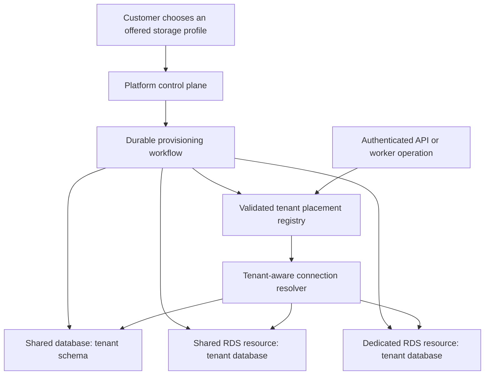

# Configurable tenant database isolation — architecture review

Prepared November 6, 2026. Source reviewed: `f9426447e18c6f3c4c836e3f1c14e0943fb93a22` plus the existing workspace. Status: proposed architecture responding to the requirement that customer needs determine shared versus separate database placement. This document does not implement or provision the capability.

**Planning status.** This review is evidence for Part 2. Part 1 launches Standard with the existing tenant-to-schema mapping behind a shared routing interface. Part 2 compares a tenant-only database with shared application capacity and a dedicated deployment cell with its own database. The master defines the start trigger and qualification sequence for new Dedicated tenants. [AWS master migration plan](AWS_MASTER_MIGRATION_PLAN.md)

## Recommendation

Support multiple tenant storage profiles through one platform control plane, one product codebase and one release process. The customer selects an offered isolation profile; platform policy provisions and operates the corresponding resources. AWS describes architectures combining shared and isolated components as a bridge model. [AWS SaaS Lens](https://docs.aws.amazon.com/wellarchitected/latest/saas-lens/bridge-model.html).

This requirement changes the design target from choosing a single tenancy model to operating several models consistently. Build that abstraction now. Release each profile only after its complete provisioning, runtime, recovery and migration paths are qualified. Avoid permanent customer-specific schemas, application forks or manually maintained deployments.

## Define the offer precisely

| Proposed profile | Tenant data placement | Customer-facing meaning |
|---|---|---|
| Shared database | Tenant schema inside a shared PostgreSQL database | Logically separated customer data on shared database infrastructure |
| Separate database | Tenant-only PostgreSQL database on shared RDS infrastructure | A distinct database and restricted database access; server resources remain shared |
| Dedicated database infrastructure | Tenant-only database on a tenant-only RDS instance or cluster | Independent database resource capacity and a separate database failure/recovery boundary |

These are product profiles proposed for ScoutGrid. The database distinctions follow [AWS's PostgreSQL tenancy comparison](https://docs.aws.amazon.com/prescriptive-guidance/latest/saas-multitenant-managed-postgresql/matrix.html).

For the shared profile, retain current schema-per-tenant initially. Shared tables with `tenant_id` are another possible implementation, but would be a separate data-layout migration, not a prerequisite for configurable isolation. Both schema-per-tenant and database-per-tenant continue to replicate tenant table definitions.

Do not describe a logical tenant database on a shared instance as independent compute or a dedicated environment. If customers need their own database storage KMS key, resource sizing or maintenance/failure isolation, evaluate the dedicated infrastructure profile. Define whether a customer requires a provider-managed key, a customer-controlled key, or simply encryption; those are different commitments.

Dedicated database infrastructure can still use shared application workers, identity, control plane and global intelligence services. It does not establish full-stack isolation, independent end-to-end availability, customer-account hosting, or a compliance certification. Treat those as additional requirements.

## Control plane and routing

Keep tenant identity and commercial entitlements distinct from physical placement. Introduce a versioned placement record rather than a single boolean such as `dedicated_db=true`.

Suggested fields, representing a design rather than an applied database schema:

```text
tenant_id                     stable customer UUID
requested_storage_profile     selected, entitled service profile
effective_storage_profile     currently active profile
placement_id / generation     versioned routing identity
region / cell_id              approved location and deployment group
resource_id                   AWS instance/cluster identifier
connection_target_ref         managed connection endpoint reference
database_name / schema_name   data location within the resource
runtime_secret_ref            secret identifier, not plaintext credentials
schema_version                observed tenant migration version
provisioning_operation_id     idempotent operation identity
provisioning_state            requested/provisioning/validating/active/failed
backup_policy_ref             supported recovery/retention configuration
```

Internally distinguish data layout from resource placement: a tenant schema on a shared database, a tenant database on shared infrastructure, and a tenant database on dedicated infrastructure. A profile translates customer needs into an approved combination. Add approved region, availability and capacity choices instead of arbitrary database engines, versions and networking entered by customers.



Resolve the authenticated tenant's active placement before opening its transaction. Use the same resolver for API calls, background jobs, imports, exports, scheduled processing, support access and tenant administration. Do not trust a request-supplied database name or endpoint. Missing, stale, unavailable or incompatible placement must produce a controlled failure, never fallback to another tenant or the default database.

Keep platform-management repositories on an explicit platform datasource. Route tenant repositories to their placement. Prevent tenant/placement changes inside an existing transaction. Include tenant/placement identity in relevant cache and ORM isolation boundaries; identical table names in separate databases must not cause shared cache entries.

Use bounded, lazily created connection pools keyed by placement and credential version, with idle eviction and total fleet caps. Include deployment surge, workers and privileged maintenance in budgets. RDS Proxy cannot be assumed to share connections freely across distinct database identities or custom session state. Qualify the actual driver/session behavior. [AWS proxy workload guidance](https://docs.aws.amazon.com/AmazonRDS/latest/UserGuide/rds-proxy-best-practices.workload-considerations.html).

## Automated provisioning lifecycle

New-tenant approval should record intent and start an asynchronous operation. It should not wait for RDS creation in an HTTP request.

1. Validate the chosen profile, entitlement, approved region, capacity and cost policy. Reserve a stable operation and tenant identity.
2. For shared database placement, create the tenant schema and access configuration. For a separate logical database, create the tenant database and restricted access on an eligible shared resource. For dedicated infrastructure, provision an approved RDS resource, networking, secret and recovery configuration through versioned infrastructure definitions.
3. Wait for required infrastructure readiness; then run versioned schema migrations with a privileged one-shot task.
4. Initialize required tenant settings and versioned shared-reference projections. Do not copy another customer's data.
5. Verify runtime credentials, tenant isolation, migration compatibility, backups/alarms and representative application queries.
6. Atomically publish the validated placement and mark the tenant active. Expose operation progress and actionable failure status.

Use a durable orchestrator such as Step Functions Standard for long-running infrastructure steps, plus ECS one-shot tasks for database work. This is a recommendation, not a need to replace the platform's existing application job queues. AWS documents control-plane lifecycle workflows using Step Functions and infrastructure templates. [AWS tenant lifecycle pattern](https://docs.aws.amazon.com/prescriptive-guidance/latest/patterns/manage-tenants-across-multiple-saas-products-on-a-single-control-plane.html).

Each step must tolerate retries and reconcile its recorded state with AWS/database state. Record resource ownership and operation IDs so partial failures do not create duplicate resources. Handle regional quota/capacity failures explicitly. Cleanup may remove only verified resources belonging to the failed operation and must respect retained data/backups. Runtime API and ordinary workers must not have infrastructure-provisioning or database-owner permissions.

## Changes required in the current application

| Current implementation | Required evolution |
|---|---|
| Tenant stores one globally unique `schema_name` | Introduce explicit tenant placement; namespace database/schema names within resource placement rather than assuming schema name is the entire identity |
| One Hikari pool with session `search_path` changes | Placement-aware tenant datasource resolution alongside a separate platform datasource |
| Provisioning creates a schema and migrates it | Profile-specific provisioners under one lifecycle contract |
| Tenant Flyway migration uses the one injected datasource | Select the correct target and track migration state per placement; preserve one supported schema/release track |
| Queries and foreign keys span tenant and platform schemas | Establish explicit shared-data access and consistency boundaries that work across databases |
| Workers sweep tenant schemas | Resolve placement consistently and measure connection/polling overhead across databases |

Evidence: [Tenant entity](/Users/karthik/Desktop/SG/prototype-app/backend/src/main/java/com/prototype/vulnwatch/domain/Tenant.java:26), [datasource configuration](/Users/karthik/Desktop/SG/prototype-app/backend/src/main/java/com/prototype/vulnwatch/config/TenantIsolationConfig.java:40), [session routing](/Users/karthik/Desktop/SG/prototype-app/backend/src/main/java/com/prototype/vulnwatch/config/TenantAwareDataSource.java:91), [provisioning](/Users/karthik/Desktop/SG/prototype-app/backend/src/main/java/com/prototype/vulnwatch/service/TenantSchemaMigrationService.java:118), [migration target](/Users/karthik/Desktop/SG/prototype-app/backend/src/main/java/com/prototype/vulnwatch/service/TenantSchemaMigrationService.java:175).

The tenant V1 baseline contains 145 table definitions and 157 foreign-key references to `platform.*`. These are source counts, not a live catalog inventory. A representative query finds shared vulnerability summaries without matching tenant records by joining across those boundaries. [Cross-schema query](/Users/karthik/Desktop/SG/prototype-app/backend/src/main/java/com/prototype/vulnwatch/repo/VulnerabilityIntelSummaryRepository.java:43).

Keep global vulnerability/software intelligence authoritative centrally. Use explicit service interfaces and selected versioned local projections where a local join is needed. Global identity/tenant references also need local reference records or application-owned integrity rules after cross-database foreign keys are removed. Define freshness, reconciliation, missing-reference behavior and recovery for those projections. Preserve ordinary foreign keys within each tenant database. Do not replicate the complete platform control plane and global corpus into every tenant just to preserve existing SQL.

To keep behavior uniform, use the shared-data interface in both shared and dedicated modes. Avoid two permanent business implementations, one with cross-schema SQL and another with remote calls. Cross-tenant reporting should use an explicitly authorized reporting/read model rather than depend on arbitrary joins across all production tenant databases.

## Existing customers changing profiles

A profile change for a tenant with data is a migration request, not an immediate configuration toggle. Retain the same tenant UUID and URLs.

For the first implementation, prefer a planned tenant-specific maintenance window over an unproven zero-downtime promise:

1. Provision and validate the destination without routing customer traffic to it.
2. Pause that tenant's new writes and job dispatch; drain or fence its in-flight work and reconcile external effects.
3. Copy a consistent dataset, preserve identifiers, rebuild/validate projections and check schema compatibility, counts and referential integrity.
4. Switch the authoritative placement atomically, increasing its generation. Invalidate stale routing caches and retire old pool entries. Prevent old requests/workers from committing against the retired placement; changing a registry row alone cannot stop already-open connections.
5. Resume operations and verify end-to-end behavior. Retain the old placement according to a controlled retention policy.

Once the destination accepts new writes, returning to the old database can lose accepted work. Recovery must retain the destination or use a separately designed reverse migration/reconciliation procedure. Later, add change-data-capture migration only when measured downtime requirements justify the complexity. Do not introduce uncoordinated dual writes.

## Operating and commercial consequences

- Apply the same code, schema compatibility policy, isolation checks and release process across profiles. Roll migrations out in canaries/batches with tenant-specific status and recovery.
- Define database recovery promises by profile. Native RDS/Aurora backup boundaries cover an instance/cluster; a logical database alone does not supply independent native tenant PITR. Shared placement needs extraction/import or another designed tenant recovery process. Dedicated database recovery still requires reconciling shared-control-plane state, projections and external effects. [AWS tenant backup/recovery guidance](https://aws.amazon.com/blogs/database/managed-database-backup-and-recovery-in-a-multi-tenant-saas-application/).
- Monitor tenant latency, oldest-job age, database capacity, pool pressure, provisioning failures and cost attribution. Add cells or redistribute placements when measured capacity warrants it.
- Price dedicated resources for ongoing availability, backups, monitoring, migration and support, including idle capacity. Show the profile's included guarantees and provisioning status. Obtain the required commercial commitment before starting billable customer-selected resources. No current pricing quote or cost model revision is included here.
- Database isolation is only one layer. Keep tenant boundaries in S3 artifacts, caches, queues, search, logs, credentials and support authorization. Full dedicated hosting and bring-your-own-account require separate scope and qualification.

## Delivery and acceptance

1. Finalize the supported profile contract and desired/effective placement model. At minimum, implement shared database and separate database provisioning; decide whether the separate offering promises shared or tenant-only RDS resources.
2. Refactor shared-data access, tenant routing, migrations and bounded pools. Keep existing shared tenants working through the same interfaces.
3. Implement the durable provisioning workflow and operator/customer status surfaces.
4. Qualify concurrent shared and separate tenants on the same application release, isolation during connection reuse, missing placement, retries after partial provisioning, database outages, migration failures, backup restoration and tenant relocation.
5. Publish only the qualified profiles. Add independent dedicated infrastructure and more advanced migration automation as customer requirements justify them; if dedicated infrastructure is required for launch, its full acceptance work precedes release.

This is a source-based architecture proposal. No cloud resources were provisioned, application code was changed, benchmarks were run or migrations were executed. AWS Core was used for current architecture, provisioning, backup and connection-management research. One documentation search failed transiently and a subsequent refined search succeeded. The previous architecture review remains supporting context; this document records the new configurable-isolation requirement without silently rewriting the existing AWS implementation plan.
