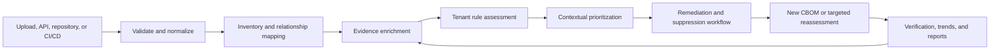

# ScoutGrid CBOM End-to-End Implementation Plan

Implementation status (2026-11-03): P0 and the deployable application scope through Milestone 5 are implemented on this branch with tenant migrations V11–V14. The separately gated runtime assurance collectors and external CI credential are intentionally not enabled; the authenticated internal gate evaluator is available. Release sequencing and gates are defined in `docs/runbooks/cbom-release-readiness.md`.

**Status:** Accepted 
**Revision:** 10 — legacy suppression cutover and structural mutation controls added 
**Scope:** Customer CBOM ingestion, assessment, visibility, remediation, verification, and reporting 
**Primary format:** CycloneDX CBOM (JSON first; preserve existing supported ingestion paths) 
**Target users:** Security leaders, security analysts, application owners, engineers, auditors, and platform administrators

## Change log

| Revision | Main decision |
|---|---|
| 4 | Tenant control, canonical workflow ownership, and reuse of existing jobs/deltas |
| 5 | Application-packaged rules, explicit CBOM delta handling, dedicated executor, and ADR-0001 |
| 6 | Generic suppression-request schema, coordinated analyst path, package/evaluator retirement, fleet rollout controls, and M0a/M1 gate separation |
| 7 | Full ADR-0001 and ADR-0002 content embedded in Section 18 so this plan is self-contained |
| 8 | Standalone ADRs restored as authoritative sources; critical CRYPTO guard and suppression V11 track made explicit |
| 9 | Amended ADR-0001 and ADR-0002 merged into Section 18; implementation plan becomes the single authoritative document |
| 10 | Legacy null-expiry suppressions receive a governed cutover; structural mutation enforcement, batch-denial behavior, delta ownership, and embedded ADR amendment histories added |

## Implementation status (November 3, 2026)

Code status on `feat/bom-ingest-api-cbom-assets`; this is not release qualification. Deployment, canary, backfill execution and drifted-tenant reconciliation remain operator steps.

| Phase | Implemented | Not done / deliberately deferred |
|---|---|---|
| 1 — Milestone 1 operations | CBOM_DELTA producers and bounded repair; durable assessment backfill; worker fairness/retry/metrics; packaged rule registry (`cbom-rules/index.json`, digest verified at startup) with OBSERVE/CANARY/BATCHED/GENERAL rollout, fleet tenant/job ceilings and durable platform V10 lease; pinned deprecation notice, retirement final notice, forced compatible upgrade and fail-closed UNSUPPORTED (tenant V15); secret detector with detector codes, JSON pointers, structural blocking and warning-only heuristics plus the seeded GA corpus test; PostgreSQL RLS/migration ITs for V11–V19 | Heuristic secret detectors stay warning-only until the design-partner false-rejection sample (<0.5%) is collected; the rollout-stage telemetry dimension is not emitted |
| 2 — Customer visibility | Overview, trends and daily snapshots, analyst inventory filters and evidence drawer, semantic diff with distinct remediated/not-observed/withdrawn/accepted-risk/ambiguous outcomes, persisted report artifacts with generation jobs, retention, audited downloads and regeneration (tenant V16), 1M-component inventory and 10k-asset diff performance IT, in-test axe checks | The top-level `/crypto/*` workspace needs a UI-standard decision; views extend BOM Inventory and the CBOM document detail instead. Browser visual/affected-route gates were not run |
| 3 — Remediation operations | Crypto ticket template and recorded ticket attempts with retry, campaigns from findings with bulk assignment (tenant V17), verification/overdue/SLA queues, remediation effectiveness, accessible verification dialogs, tenant-admin rule preview/activation UI | — |
| 4 — Relationships and blast radius | Typed USES_ALGORITHM/SECURED_BY/CERTIFIES_KEY/APPLICATION_USES relationships, blast-radius API and view, contradiction detection and review (tenant V18), daily evidence-expiry re-evaluation, depth-3/500-node traversal performance IT | Data-classification relationships need data components the parser does not yet store; XML CBOMs contribute dependency edges only |
| 5 — Enterprise governance | Single-job CI gate token and status polling with environment gate policies (tenant V19), rule activation preview with rule/parameter diff and selection history, PQC migration campaigns and progress, portfolio rollups | Signed reports remain deferred per section 5.10; reports stay `UNSIGNED` |

## Architecture decisions incorporated in Revision 10

- Canonical findings are the only remediation, suppression, ticket, campaign, and resolution source of truth.
- `cbom_risk_findings` retain observation and source-evidence lifecycle only.
- Existing canonical statuses and VEX-style `decision_state` remain unchanged; finer progress uses a new generic workflow sub-state inside `OPEN`.
- `BomEvidenceState` presence and claim assurance are separate axes.
- Immutable CBOM rule definitions and safety metadata ship as versioned application packages. Tenant schemas own selection, parameters, pin/follow-latest mode, effective version, audit, and evaluation results. CBOM rules do not use the platform AI Grid policy catalog or require platform approval.
- Source identity, duplicate handling, deterministic supersession, and cross-version component identity precede semantic diff.
- Assessment becomes a new type in existing tenant-local `ingestion_jobs`, claimed through `claimPendingJobsByType` with an explicit per-tenant cap and executed on a CBOM-specific bounded executor.
- Full periodic mirror scans are replaced by a new `CBOM_DELTA` producer/handler built on the existing tenant-local `finding_delta_queue`, plus bounded repair reconciliation.
- Runtime collectors are a separately approved containment program.
- The first implementation slice stops at trusted assessment, explainability, backfill, and a canonical ticket.
- Validation outcome and asynchronous assessment lifecycle are separate state fields.
- `TENANT_ADMIN` is the CBOM administrative authority. For `CRYPTO` findings, single-admin suppression is the default below critical severity; critical findings always require a distinct second `TENANT_ADMIN`, and tenants may enable maker-checker for all CRYPTO severities. Requests use a new generic canonical suppression-request table; no platform approval or fine-grained permission framework is introduced.
- Accepted source artifacts are preserved exactly; artifacts suspected of containing reusable secrets are rejected before persistence in the first release.

## 1. Outcome

ScoutGrid will turn a customer CBOM from a static uploaded document into a continuous cryptographic-risk workflow:

1. Ingest and validate the CBOM.
2. Normalize cryptographic assets without losing the original evidence.
3. Enrich declarations with source, configuration, and runtime evidence.
4. Assess assets using versioned tenant rules.
5. Prioritize findings using exposure, business context, and claim assurance.
6. Assign and track remediation work.
7. Reassess new CBOM versions and verify outcomes.
8. Produce reproducible customer and audit reports.

The product must keep three concepts separate throughout the workflow:

- **Risk:** How harmful the observed cryptographic condition could be.
- **Assurance:** How a claim was established (`VERIFIED`, `DECLARED`, `INFERRED`, `UNKNOWN`, or `CONTRADICTED`) and the confidence ScoutGrid assigns to it.
- **Completeness:** How much required information is present or verified.

An unknown control must not be presented as a confirmed security failure.

## 2. Customer journey

### Definition of a successful experience

Within five minutes of ingestion, a customer should be able to answer:

- Was the CBOM accepted, and what needs correction?
- What cryptographic assets were discovered?
- Which risks are confirmed, inferred, declared, or unknown?
- Which applications, environments, and services are affected?
- What should be remediated first, by whom, and by when?
- What changed from the preceding CBOM?
- Can the assessment be reproduced for an auditor?

## 3. Existing ScoutGrid foundation

The implementation should extend the current architecture:

- `BomIngestionOrchestrator` already provides the common BOM lifecycle.
- `CbomComponentParser` and `CbomIngestionService` parse and persist cryptographic assets.
- `CbomRiskEngine` generates rule-based findings.
- `CbomPostureService` calculates asset posture summaries.
- `CbomFindingMirrorService` mirrors crypto findings into canonical findings.
- `CbomController` exposes posture, component, finding, and acceptance operations.
- `BomManagementPage` and `BomInventoryPage` already display CBOM inventory and findings.
- BOM source, lineage, supersession, and evidence withdrawal are already represented.
- Canonical finding ticketing and Jira integration can be reused for crypto findings.

### Principal gaps

| Area | Current capability | Required improvement |
|---|---|---|
| Validation | Document parsing and common ingestion validation | Formal schema results, field-level diagnostics, integrity checks, and validation report |
| Evidence and assurance | BOM evidence supported/withdrawn state | Separate presence and claim-assurance axes, including origin, method, confidence, observation time, and verification status |
| Assessment | Hard-coded crypto rules | Versioned tenant rule sets, applicability, effective dates, and explainable decisions |
| Prioritization | Component risk and posture score | Exposure, environment, business criticality, blast radius, confidence, and urgency |
| History | BOM lineage and supersession | Customer-visible CBOM semantic diff and risk trend |
| Remediation | Finding acceptance and canonical ticketing | Ownership, SLA, remediation plan, suppression expiry, and verification |
| Relationships | Source document dependency edges | Crypto-specific usage/custody graph and blast-radius queries |
| Reporting | UI posture and findings | Reproducible assessment report with artifact/rule-set hashes and limitations |
| PQC | Quantum-vulnerable rule | Migration inventory, data-lifetime context, readiness, and campaign tracking |

## 4. Product principles

1. **Preserve source truth safely.** For accepted artifacts, store the submitted bytes and checksum without rewriting them. For artifacts suspected of containing reusable secrets, compute the hash in bounded memory, reject the artifact, and do not retain the original.
2. **Explain every conclusion.** A finding must identify the tenant rule/version, input evidence, reasoning, confidence, and recommended outcome.
3. **No false verification.** `DECLARED` or `UNKNOWN` must never be rendered as `VERIFIED`.
4. **One workflow owner.** Canonical `findings` own status, decision state, workflow sub-state, owner, SLA, tickets, campaigns, suppressions, and resolution for every finding kind, including `CRYPTO`. `cbom_risk_findings` owns only the crypto observation and its source-evidence lifecycle.
5. **Treat withdrawal correctly.** Removal of source evidence is not proof of remediation.
6. **Make assessment reproducible.** Artifact checksum, parser version, tenant rule-set version/digest, evaluator version, tenant parameters, evidence snapshot, and assessment time must be recorded. Exact re-execution is guaranteed only while that evaluator remains supported; historical explainability persists after retirement.
7. **Gate regressions carefully.** CI/CD should block confirmed rule violations, not optional metadata omissions by default.
8. **Tenant isolation is mandatory.** Every new entity, query, export, job, and graph traversal must remain tenant-scoped.

## 5. Target capabilities

### 5.1 Guided ingestion and validation

Support the existing upload, URL, repository, and ingest API paths, then add a common CBOM preflight result.

Required behavior:

- Detect document type, CycloneDX specification version, encoding, and document checksum.
- Validate against the applicable CycloneDX schema.
- Perform semantic integrity checks:
  - duplicate or missing `bom-ref` values;
  - unresolved relationship references;
  - invalid or contradictory certificate dates;
  - algorithm/key-size combinations that cannot be interpreted;
  - missing application/environment ownership context;
  - accidental secret-like values in names, properties, or descriptions.
- Separate errors that block ingestion from warnings that reduce completeness.
- Return JSON-pointer paths and human-readable correction guidance.
- Preserve validation results with the ingestion record.
- Allow a permitted user to download the validation report.
- Secret-detection failures return a detector code and JSON pointer but never echo the matched value. Tune detectors against public-certificate/public-key and legitimate-identifier fixtures before enabling rejection.

GA secret-detector gate:

- 100% detection of the seeded forbidden-secret corpus;
- zero false rejections across the maintained valid/public-cryptographic-material fixture corpus; and
- below 0.5% adjudicated false-rejection rate across an opt-in design-partner validation sample of sufficient size to be meaningful.

Until this gate passes, run secret detection in warning-only mode while retaining the hard rejection of structurally recognized private-key and credential formats.

Persist two independent state fields:

**Validation outcome** — whether the submitted artifact can enter inventory:

- `REJECTED`: unsafe, unsupported, or unparseable; assessment cannot be queued.
- `ACCEPTED`: required validation passed without warnings.
- `ACCEPTED_WITH_WARNINGS`: inventory may be created, but completeness or assurance is limited.

**Assessment lifecycle** — asynchronous processing state:

- `NOT_QUEUED`: validation has not produced assessable input.
- `QUEUED`: durable work was admitted.
- `ASSESSING`: a worker owns the current attempt.
- `ASSESSED`: all required evaluators completed.
- `PARTIALLY_ASSESSED`: one or more evaluators/enrichments failed or were unavailable; retry is available.
- `FAILED`: the run produced no usable assessment; retry or operator action is required.

Do not derive one field from the other in UI or reporting. An `ACCEPTED_WITH_WARNINGS` document can still reach `ASSESSED`, and an `ACCEPTED` document can have a `FAILED` assessment.

`SUPERSEDED` belongs only to an individual `cbom_assessment_runs` row when a newer successful run becomes authoritative. It is not a per-document assessment-lifecycle value.

### 5.2 Evidence-aware inventory

Introduce a normalized evidence model instead of adding verification flags directly to every component field.

Keep two independent axes and name them consistently:

- **BOM evidence presence** uses the existing `BomEvidenceState`: `SUPPORTED`, `WITHDRAWN`, `CONFLICTING`, or `LEGACY_UNKNOWN`. This says whether an observation is currently supported by its source document.
- **Assurance level** describes how strongly ScoutGrid has verified a claim. It must not reuse the name `evidence_state`.

Recommended assurance levels:

- `VERIFIED`: confirmed through source, configuration, runtime, or authoritative service evidence.
- `DECLARED`: present in the submitted CBOM but not independently checked.
- `INFERRED`: derived from related assets or dependencies.
- `UNKNOWN`: required evidence is absent or insufficient.
- `CONTRADICTED`: two current evidence sources disagree. This maps to, but does not replace, the presence-level `CONFLICTING` state.

Limit claim-level assurance records to a governed catalog of important claims to avoid unbounded `components x fields x sources` growth. The first catalog should cover algorithm/parameter strength, protocol version, key custody, rotation/expiry, certificate validity, usage, environment, and public exposure.

Each assurance record should capture:

- tenant, component, and field/claim;
- source type and source reference;
- observation method;
- normalized value and optional protected raw value;
- confidence score and assurance level;
- observed, ingested, and expiry timestamps;
- collector/parser version;
- artifact checksum or runtime observation identifier.

The component detail page should show each important claim with its evidence badge and provenance, for example `TLS 1.3 — VERIFIED from runtime probe` versus `TLS 1.3 — DECLARED in CBOM`.

### 5.3 Application-packaged, tenant-controlled rule and assessment engine

CBOM rule definitions ship as versioned, immutable packages in application resources. Tenant schemas own which package version is effective, optional rule selection, supported parameters, pinning, audit, and results. Do not use the platform AI Grid policy catalog, platform distribution/rollout tables, answer-key approval flow, or platform policy team as a dependency. This preserves tenant control without using schema migrations as a content-delivery channel.

This deliberate third rule mechanism and its future convergence triggers are recorded in [Section 18, ADR-0001](#adr-0001-use-an-application-packaged-tenant-controlled-cbom-rule-system).

Implementation model:

- Add an application `CbomRulePackageRegistry` that loads immutable packages keyed by rule-set ID and semantic version, verifies their schema and digest at startup, and routes them to a versioned `CbomRuleEvaluator` implementation for the declared evaluator major.
- Add tenant-local `cbom_rule_config`, `cbom_rule_availability`, and `cbom_rule_selection_history` tables for mode (`FOLLOW_LATEST` or `PINNED`), pinned/effective version, optional-rule selection, parameters, discovered package digest, actor/reason, and audit. Tenant migrations create schema only; they do not carry rule content.
- The selected versioned `CbomRuleEvaluator` evaluates `cbom_components` and important claims directly using the tenant's effective application package; do not project CBOM data into `ai_grid_facts`.
- `TENANT_ADMIN` can enable/disable optional rules and configure supported thresholds directly. No platform approval or cross-tenant rollout is required.
- Mandatory-rule flags, non-editable defaults, parameter types, and hard safety bounds live in immutable package metadata, never tenant-editable rows. The evaluator rejects a tenant configuration that disables a mandatory rule or exceeds those bounds.
- A startup/scheduled tenant reconciler compares packaged versions with each tenant's recorded availability. In `FOLLOW_LATEST`, it records the new effective version and idempotently queues bounded reassessment for active CBOMs; in `PINNED`, it records that an upgrade is available without changing effective behavior.
- Package discovery is not permission to reassess the whole fleet at once. Application release configuration advances a package through `OBSERVE`, deterministic `CANARY`, `BATCHED`, and `GENERAL` stages, with global tenants-per-minute and jobs-per-minute ceilings, a durable lease row containing owner/expiry/heartbeat/stage/cursor, and existing per-tenant limits. A new owner resumes from the committed cursor after lease expiry and idempotency makes replay safe. The transaction-scoped `pg_try_advisory_xact_lock` pattern is not sufficient for the long-running reconciler. These are operational safety controls, not platform policy approval; tenant selection and pinning remain tenant-owned.
- Reassessment uses tenant-local `ingestion_jobs`, per-tenant admission limits, and dedupe keys based on tenant, CBOM, and rule-set digest.
- Emit active rule-set ID/version as an approved low-cardinality telemetry dimension without a tenant identifier.
- Slice 1 converts the current `CbomRiskEngine` checks into the initial application package: MD5/SHA-1, DES/3DES/RC4, undersized RSA, quantum-vulnerable algorithms, certificate expiry/signature weaknesses, deprecated protocols, compromised or environment-variable storage, and missing usage metadata. A golden fixture test must prove identical finding fingerprints, severities, explanations, and recommendations before cutover; the initial shadow comparison has zero expected differences.
- Support the current evaluator/package line plus the previous two major versions, or 12 months from supersession, whichever is longer, through side-by-side `CbomRuleEvaluator` implementations and an all-supported-majors CI matrix. Give pinned tenants at least 90 days' deprecation notice. At retirement, mark the pin `UPGRADE_REQUIRED`; after the grace period and final notice, an audited system action may move it to the lowest supported package on the same evaluator major whose parameter schema accepts the tenant configuration and whose mandatory rules are a superset. Queue reassessment and publish a before/after impact summary. If no compatible package exists or parameters violate its schema/bounds, fail closed without resetting parameters: retain the last assessment as stale/unsupported and surface remediation.

Each rule requires:

- stable rule ID and semantic version;
- title, risk class, default severity, and rationale;
- applicable asset types and environments;
- input fields and minimum evidence requirements;
- condition and configurable thresholds;
- remediation guidance and references;
- effective and retirement dates;
- tags such as `KEY_MANAGEMENT`, `TLS`, `CERTIFICATE`, `PQC`, or `COMPLETENESS`.

Initial application rule packages available for tenant control:

- ScoutGrid Recommended Cryptography Baseline.
- Post-Quantum Readiness.
- Optional organization baseline expressed through tenant selection/parameters and stored entirely within the tenant.

Do not label a compliance-specific pack as certified until its control mapping and claims have been independently reviewed.

Assessment outputs must record:

- tenant rule set and version;
- rule and evaluator version;
- applicability result;
- evidence snapshot used;
- risk result and confidence;
- deterministic finding fingerprint;
- assessment run ID and timestamps.

### 5.4 Contextual risk prioritization

Keep severity and priority distinct. Calculate remediation priority from explainable factors:

- tenant rule severity;
- internet exposure;
- production versus non-production environment;
- asset business criticality;
- protected-data sensitivity and confidentiality lifetime;
- key custody and rotation posture;
- number and criticality of dependent systems;
- claim assurance and confidence;
- exploitability or urgency, where applicable;
- compensating controls and active suppressions.

Expose the factor breakdown instead of only a composite score. Customers must be able to override business criticality and ownership without changing the underlying technical evidence.

Context must have explicit provenance because it is generally not supplied by a CBOM:

| Context | Authoritative/default source | Customer override ownership |
|---|---|---|
| Environment and application ownership | Existing ScoutGrid asset/CMDB mapping | Tenant asset metadata, audited |
| Business criticality | CMDB/business-service record; otherwise `UNKNOWN` | `INVENTORY_ADMIN` or `TENANT_ADMIN` |
| Internet exposure | Existing Exposure evidence/graph; never inferred from CBOM presence | Security analyst may propose; approved exposure workflow remains authoritative |
| Data sensitivity and confidentiality lifetime | Data-classification integration or tenant declaration | `TENANT_ADMIN` with reason and review date |
| Key custody and rotation | CBOM declaration plus approved assurance sources | Source-specific; manual assertion remains `DECLARED` |
| Dependent systems/blast radius | Provenance-aware relationship graph | Reviewed relationship correction, not score override |
| Compensating controls | Canonical suppression/review workflow | `TENANT_ADMIN` |

Store customer-owned values in existing tenant asset/configuration metadata where semantics already exist; add a tenant-scoped context-override record only for missing concepts. Every override requires actor, reason, source, effective time, review/expiry time, and audit history.

Default factor weights, mandatory flags, and hard safety bounds live in the immutable application rule package. `TENANT_ADMIN` owns supported tenant parameter changes, which require impact preview, reason, versioned history, and audit but no platform approval. Package validation protects mandatory rules and invalid configurations. The existing canonical `RiskPolicy` remains the only owner of severity-based SLA defaults and continues to populate canonical `due_at`; CBOM rules do not create a second SLA system.

### 5.5 Three customer views

#### Executive cryptographic posture

- overall risk, assurance, and completeness trend;
- production assets with critical/high crypto findings;
- verified inventory coverage and completeness;
- remediation SLA compliance;
- suppression count and upcoming expirations;
- certificate/key rotation outlook;
- post-quantum migration exposure.

#### Analyst workbench

- filterable crypto inventory and findings;
- filters for asset type, algorithm, environment, custody, evidence state, rule set, status, owner, and severity;
- evidence drawer with source provenance;
- relationship and blast-radius view;
- semantic CBOM diff;
- bulk ownership, campaign, ticket, and suppression actions.

#### Engineering remediation view

- affected service and environment;
- exact evidence and tenant-rule reasoning;
- target state and framework-specific guidance;
- linked ticket, pull request, campaign, and owner;
- verification steps and targeted reassessment action.

### 5.6 CBOM semantic diff and trends

Cross-version source and component identity are prerequisites, not part of the diff implementation. Before enabling diff:

- define the logical source identity used to determine successors;
- reject or explicitly classify duplicate submissions that reuse serial number, checksum, source, and asset;
- reconcile existing assets with multiple active copies of the same logical CBOM;
- make supersession deterministic and transactional;
- define a cross-document component identity independent of a source-BOM-scoped fingerprint;
- report ambiguous component matches rather than guessing.

After those controls are in place, compare the current active CBOM to its predecessor using stable cross-version identity rather than array position.

Diff categories:

- cryptographic asset added or removed;
- algorithm, key size, curve, mode, protocol, or certificate change;
- storage/custody or usage relationship change;
- claim assurance/confidence increased or decreased;
- finding introduced, resolved, reopened, or withdrawn;
- posture and priority movement;
- ownership/environment change.

The UI must distinguish:

- **Remediated:** new evidence proves the unsafe condition is gone.
- **Not observed:** the new document omitted the component or claim.
- **Withdrawn:** source was superseded or deleted.
- **Accepted risk:** condition remains but has a valid suppression.

### 5.7 Canonical remediation and suppression workflow

Do not add CBOM-specific remediation status or suppression records. The mirrored canonical finding is the sole workflow source of truth.

Preserve the canonical status constraint:

- `OPEN`
- `RESOLVED`
- `SUPPRESSED`
- `AUTO_CLOSED`

Represent `TRIAGED`, `PLANNED`, `IN_PROGRESS`, and `VERIFICATION_PENDING` in a new generic canonical `workflow_substate` column while status remains `OPEN`. Never map workflow progress onto `decision_state`; its existing values (`AFFECTED`, `NOT_AFFECTED`, `FIXED`, `UNDER_INVESTIGATION`, and `NEEDS_REVIEW`) retain their VEX-style impact semantics.

Canonical findings own:

- accountable owner and team through existing `assigned_to` and `owner_group`;
- target date and SLA through existing `due_at` and canonical `RiskPolicy`;
- existing `decision_state` plus the new workflow sub-state;
- implementation notes and target state;
- linked external ticket and pull request;
- campaign membership;
- suppression decision and expiry;
- resolution and audit history.

`cbom_risk_findings` continues to own rule observation, crypto evidence, first/last seen, and `BomEvidenceState`. Withdrawal changes evidence support and may drive canonical `AUTO_CLOSED`; it must not claim remediation.

Reuse `FindingTicketController` and configured ticket providers because CBOM findings are already mirrored into canonical findings. Add crypto-specific canonical ticket templates containing the rule, asset, evidence, target state, and verification instructions.

`POST /api/bom/cbom/findings/{findingId}/accept` currently suppresses immediately, without expiry or review, and permits `SECURITY_ANALYST`, `TENANT_ADMIN`, and `CREATOR`; changing it is a deliberate breaking product/security decision, not a transparent translation. After hardening, `SECURITY_ANALYST` may request suppression but cannot directly accept risk. The request endpoint and UI must ship in the same release that removes analyst direct acceptance, so analysts never lose their only safe workflow. This P0 security track has its own fixed ADR-0002 contract and V11 migration and is independent of the broader M0a assessment/rule sign-off; it does not wait for source identity, claim assurance, evaluator, or workflow-substate decisions.

- **By 2026-12-15 — owner: Tenant Schema Migration service owner (Backend Platform/Data):** resolve or explicitly quarantine `DRIFTED` tenants for the dedicated V11 rollout. The 2027-02-15 delivery date is contingent on this gate.
- **By 2027-02-15, in one coordinated backend/frontend release:** deploy V11; ship the analyst suppression-request endpoint and UI; restrict direct accept to `TENANT_ADMIN`; update `BomManagementPage.tsx` to present request or direct-suppression forms as authorized; update `api.acceptCbomFinding` to send reason/expiry; add component/API tests; emit `Deprecation`/`Sunset` headers; and return canonical request/suppression contracts.
- **On 2027-05-15:** stop accepting calls to the legacy accept route and return `410 Gone` with the canonical replacement endpoints.
- Remove the legacy route after the `410 Gone` period and usage telemetry confirms no active callers; this cleanup is not a Slice 1 gate.

Build risk acceptance on existing canonical suppression fields and `FindingWorkflowService.reopenExpiredSuppressions()`. Add a generic canonical `finding_suppression_requests` table because existing `finding_reviews` cannot represent requester, request/decision state, linked decision, proposed expiry, or optimistic version safely. Approved/rejected outcomes may also append the existing immutable `finding_reviews` audit record; the request table owns pending state and concurrency. Do not create a CBOM-specific exception table.

Add tenant setting `cbom.require-distinct-suppression-approver`, default `false`:

- The setting and mandatory critical rule apply to `CRYPTO` findings only; they do not change suppression governance for other finding kinds.
- When `false`, `TENANT_ADMIN` may directly suppress low/medium/high `CRYPTO` findings with reason and bounded expiry.
- Critical `CRYPTO` findings always require a request and a distinct second `TENANT_ADMIN`, regardless of the setting. A single-admin tenant cannot suppress them and must remediate.
- When `true`, direct suppression is disabled for every `CRYPTO` severity: a request enters `REQUESTED`, and a different `TENANT_ADMIN` records `APPROVED` or `REJECTED`; only approval applies canonical suppression.
- Whenever the request endpoint is used, its requester cannot approve that same request, even if maker-checker is otherwise disabled.

Proposed application maximum suppression periods are 365 days for low, 180 days for medium, 90 days for high, and 30 days for critical findings, subject to M1 suppression-GA confirmation. `TENANT_ADMIN` may configure shorter tenant limits but cannot extend the application maxima. Critical `CRYPTO` findings cannot be directly bulk-suppressed; each requires an individually reviewable request. This preserves a simple default for smaller tenants while enforcing maker-checker where consequence is highest.

The product and security rationale, state model, and critical-severity exception are recorded in [Section 18, ADR-0002](#adr-0002-use-severity-aware-canonical-suppression-governance).

Enforce the CRYPTO rule once at the canonical service boundary. All production suppression application, copying, expiry changes, and removal flow through `CanonicalSuppressionMutationService`, which invokes `CryptoSuppressionPolicyGuard` before applying a CRYPTO suppression. This includes `SuppressionRuleService`, `OrgCveRecordService`, `FindingWorkflowService`, `FindingWorkflowFacade`, `CbomFindingMirrorService`, `FindingComponentRecomputeService`, and every controller. Direct suppression-field repository/entity writes are prohibited outside the mutation service. A custom ArchUnit/Semgrep CI rule must fail when production code outside that service sets `SUPPRESSED`, calls `setSuppressedUntil`, or invokes a suppression-specific repository update; the allowlist is intentionally one mutation service rather than a list of current callers.

Use canonical severity read inside the decision transaction. The `CBOM_DELTA` branch in `FindingDeltaQueueService.processOwnedBatch`, through `CbomFindingMirrorService`, owns severity-transition detection: it compares the prior canonical severity with the reassessed severity in the same transaction and asks `CanonicalSuppressionMutationService` to reopen an active suppression on a transition to critical. A suppression ended by escalation is never restored from an old request, legacy accept flag, duplicate, or mirror state. Cancel open requests when the finding resolves or auto-closes; expire an undecided request after `decision_due_at` (default 14 days). Revalidate requester membership/role and decider `TENANT_ADMIN` at decision time, and exclude platform support-session actors from requesting or deciding.

#### V11 legacy suppression cutover

After V11 is applied and before the hardened routes are enabled, run an idempotent, resumable tenant-local `LegacyCryptoSuppressionCutoverService` over canonical findings where `finding_kind = CRYPTO`, status is `SUPPRESSED`, and `suppressed_until` is null:

- critical or unknown-severity findings are reopened, their legacy suppression is ended, and a new request with distinct `TENANT_ADMIN` approval is required;
- low, medium, and high findings remain suppressed but receive `suppressed_until = cutover_at + effective severity maximum`, where a tenant-configured shorter limit caps the application maximum;
- every mutation emits immutable audit event `LEGACY_CRYPTO_SUPPRESSION_V11_CUTOVER` with prior status/severity/reason, new state/expiry, cutover version, timestamp, and system actor;
- a per-finding cutover marker makes retries idempotent, and aggregate progress/error metrics make the backfill operable across tenants;
- existing finite-expiry suppressions are not extended or otherwise rewritten.

In the same release, remove the `CbomFindingMirrorService` behavior that turns a legacy accepted CBOM observation into canonical `SUPPRESSED` with `suppressed_until = null`. After cutover, the mirror may update observation and severity evidence but cannot manufacture or restore suppression; canonical suppression is created only through the guarded mutation service with a finite expiry.

When `SuppressionRuleService` receives policy denial such as `CRYPTO_SECOND_APPROVER_REQUIRED`, it skips only that finding, writes a structured audit event, increments a refusal counter by stable reason code, and continues the nightly batch. It reports aggregate attempted/applied/refused/failed counts. Policy refusal is not a job failure; unexpected technical errors retain the normal retry/failure behavior and must not be silently converted to skips.

Risk acceptance requires:

- reason and compensating control;
- `TENANT_ADMIN` authorization; no platform approval is required, and maker-checker uses `finding_suppression_requests` plus canonical audit;
- bounded expiry date;
- automatic reminders and reopening at expiry;
- immutable audit events.

Verification-before-resolution is a configurable rule for `CRYPTO` findings, not a global change to manual resolution behavior for all finding kinds.

### 5.8 Relationship graph and blast radius

Model customer-declared and independently observed relationships without conflating them.

Initial node types:

- application, service, endpoint, environment;
- cryptographic algorithm and protocol;
- key, credential, certificate, and secret;
- secret/KMS location;
- CBOM document and evidence source.

Initial edge types:

- `USES`, `SECURED_BY`, `SIGNS_WITH`, `ENCRYPTS_WITH`;
- `STORED_IN`, `ISSUED_BY`, `EXPOSED_BY`;
- `DECLARED_BY`, `VERIFIED_BY`, `DEPENDS_ON`.

Each edge must carry provenance, confidence, validity period, and tenant. Start with relational adjacency tables and bounded traversal APIs; introduce a separate graph store only if measured query or scale requirements justify it.

Primary questions:

- Which applications rely on this key or algorithm?
- What is affected if this certificate expires?
- Which public endpoints still permit this protocol?
- Which production systems require migration from this quantum-vulnerable primitive?

Runtime collectors are a separately gated program, not an implicit part of the relationship milestone. Any TLS, certificate, KMS, or secret-store collector requires outbound allowlisting, DNS/IP rebinding defenses, redirect controls, private/link-local address denial, time and response-size limits, mocked-provider tests, credential scoping, and the same containment review used by other runtime evidence integrations.

### 5.9 Post-quantum migration workspace

Build on the existing quantum-vulnerable finding, but avoid treating all RSA/ECC usage as an immediate high-severity defect.

Capture:

- algorithm and parameter set;
- use case: signing, key agreement, encryption, or authentication;
- data confidentiality lifetime;
- exposure and business criticality;
- library/vendor migration readiness;
- hybrid/PQC support status;
- target solution, owner, milestone, and blockers.

Provide migration campaigns grouped by shared library, certificate authority, protocol, vendor, or platform to reduce duplicate remediation work.

### 5.10 Reproducible reporting

Generate a downloadable JSON assessment record first, followed by an HTML/PDF presentation generated from the same data contract.

Every report must include:

- customer, asset, environment, and assessment time;
- source CBOM name, serial number, and SHA-256 checksum;
- parser/evaluator and tenant rule-set versions;
- validation status and completeness summary;
- verified, declared, inferred, unknown, and contradicted assurance counts, plus supported/withdrawn/conflicting presence counts;
- findings, priority, state, owner, and remediation status;
- suppressions with actor, reason, and expiry;
- changes from the preceding assessment;
- assumptions, limitations, and failed enrichment steps;
- report checksum and generation time.

The first release uses a checksum for reproducibility and accidental-corruption detection and explicitly does not claim cryptographic authenticity. JSON includes `signatureStatus: "UNSIGNED"`; HTML/PDF output and the report-download UI display **Unsigned report — checksum verifies content consistency, not authenticity**. Report signing is deferred until a customer requirement justifies signing-key custody and verification operations; if added later, prefer tenant-specific managed signing keys to limit cross-tenant blast radius.

Reports must distinguish permanent historical explainability from executable reproducibility. Retain recorded inputs, outputs, package metadata/digest, tenant parameters, and evaluator identity for the assessment retention period. Promise exact re-execution only inside the documented evaluator support window; after retirement, label the assessment historical and unsupported for re-execution rather than claiming that current code will reproduce it.

## 6. Data-model changes

Retain the existing `cbom_components`, `cbom_risk_findings`, and `cbom_posture_summary` tables. Use a dedicated `tenant/V11__finding_suppression_requests.sql` migration only for `finding_suppression_requests`, its CRYPTO-scoped tenant setting, indexes, constraints, and RLS so the P0 hardening can ship independently. Rule, assessment, assurance, relationship, and report schema begins at tenant V12 and later behind the broader migration gate. Revision 10 introduces no platform CBOM migration, and the next available platform migration number remains V10. Rule definitions are application resources, not migration content. Update `MigrationCatalogTest` and packaged migration-target tests with every added tenant migration. Deploy migrations through forward-fix plus backward-compatible application code; do not require a cross-line rollback mechanism that Flyway does not provide.

### Schema, ownership, retention, and purge matrix

Milestone 0a must set concrete retention periods and register every new table/object in a purge/export inventory with automated coverage tests. ScoutGrid does not currently have a general tenant export, and destructive tenant purge is contained to demo tenants; full export/purge integration is therefore an explicit external platform dependency with its own owner, not a false Slice 1 exit criterion.

| Table/object | Schema/store | Owning service | Retention and tenant purge rule |
|---|---|---|---|
| Application CBOM rule packages | Application resources | `CbomRulePackageRegistry` | Immutable ID/version/digest and safety metadata; delivered with application release, not tenant DDL |
| `cbom_rule_config` / `cbom_rule_availability` / `cbom_rule_selection_history` | Tenant | CBOM rule engine | Selection, parameters, pin/effective version, package digest and tenant audit; register for purge/export inventory |
| Existing `ingestion_jobs` with `CBOM_ASSESSMENT` job type | Tenant | Existing ingestion job service | `job_type` requires no schema constraint change; reuse claim token, attempts, recovery and retention; no second task table |
| Existing `finding_delta_queue` with new `CBOM_DELTA` producer/handler | Tenant | Finding delta service + CBOM mirror | Extend producers/consumers for crypto finding IDs; reuse queue dedupe, attempts, status and retry |
| `cbom_tenant_settings` | Tenant V11 | CBOM administration | CRYPTO-scoped maker-checker flag and shorter suppression/request limits; one tenant-scoped row with audit; register for purge/export inventory |
| `finding_suppression_requests` | Tenant V11/canonical Findings | Finding workflow | Generic pending request/decision state, severity snapshot, proposed expiry, decision deadline, requester/decider, reason, optimistic version, and linked canonical suppression; RLS and purge/export inventory required |
| `cbom_shadow_enrollments` | Tenant | CBOM release validation | Explicit consent, scope and expiry; register for purge/export inventory |
| `cbom_validation_runs` | Tenant | BOM validation | Tenant CBOM retention; register for purge/export inventory |
| `cbom_validation_issues` | Tenant | BOM validation | Same as parent run; echoed values redacted; register for purge/export inventory |
| `cbom_claim_assurance` | Tenant | CBOM assessment | Important claims only; expire stale observations per source policy; register for purge/export inventory |
| `cbom_context_overrides` (only for concepts not already in asset metadata) | Tenant | Asset/context governance | Actor, reason, source, effective/review/expiry times; register for purge/export inventory |
| `cbom_assessment_runs` | Tenant | CBOM assessment | Reproducibility/audit retention; `SUPERSEDED` applies here; register for purge/export inventory |
| `cbom_assessment_results` | Tenant | CBOM assessment | Same as assessment run; register for purge/export inventory |
| `cbom_shadow_comparison_runs` | Tenant | CBOM release validation | Design-partner comparison details only; bounded retention and no cross-tenant reads |
| `cbom_relationships` | Tenant | CBOM relationship service | Evidence validity plus audit retention; register for purge/export inventory |
| `cbom_diff_runs` / `cbom_diff_entries` | Tenant | CBOM history | Derived-data retention; reproducible or regenerable; register for purge/export inventory |
| `cbom_report_artifacts` and report objects | Tenant metadata + tenant-isolated object namespace | Reporting | Bounded retention; never cross-tenant deduplicate; register object deletion in purge inventory |
| Accepted source CBOM object | Tenant-isolated object namespace | BOM artifact storage | Existing source retention; exact accepted bytes; no cross-tenant hash deduplication or existence oracle |

Assessment reuses tenant-local `ingestion_jobs`. Add `CBOM_ASSESSMENT` to the explicit allowed-type branch in `IngestionJobService.claimPendingJobsByType`; otherwise the worker cannot claim the new job even when the row is valid. `TenantWorkRunner.forEachActiveTenant` only establishes tenant/schema context and iterates tenants sequentially; it does not provide fairness. The CBOM worker must call `claimPendingJobsByType(..., "CBOM_ASSESSMENT", perTenantClaimLimit, ...)` with an explicit cap, then dispatch to a dedicated bounded `cbomAssessmentExecutor`. This is required because the existing `sbomJobExecutor` aliases the shared `ingestionExecutor` (2–4 threads, queue 50); a 120-second CBOM assessment there would block SBOM and other ingestion work. A job's tenant comes from the active tenant context/table, never from payload data. Per-job-type concurrency, queue depth, rejection, recovery, and metrics prevent starvation. There is no cross-schema completion handshake.

Add `CBOM_DELTA` as a new logical event type in `FindingDeltaQueueService`, with producers on CBOM ingest, withdrawal, rule reassessment and legacy-accept/suppression changes. Add an explicit `CBOM_DELTA` switch branch in `FindingDeltaQueueService.processOwnedBatch`; the existing event-type column is already wide enough. The handler claims bounded tenant-local batches and invokes `CbomFindingMirrorService` for the referenced crypto finding/component rather than scanning every CBOM finding. Reuse the queue's persistence, dedupe key, attempts, status and retry mechanics, but implement and test the new producer and consumer paths explicitly. The periodic repair sweep becomes bounded and cursor-based only if reconciliation tests prove a cursor is necessary; any cursor remains tenant-local. Fairness comes from the per-tenant claim limit passed by each worker, not from `TenantWorkRunner` itself.

CBOM rule selection, parameters and pinning use the new tenant configuration tables while definitions remain in application packages. Remediation and suppressions continue to use canonical finding-owned structures rather than CBOM-owned copies.

`finding_suppression_requests` contains `id`, `tenant_id`, `finding_id`, `finding_kind`, `severity_at_request`, `requested_by`, `requested_at`, `decision_due_at`, `reason`, `compensating_control`, `proposed_suppressed_until`, status (`REQUESTED`, `APPROVED`, `REJECTED`, `CANCELLED`, or `EXPIRED`), `decided_by`, `decided_at`, `decision_reason`, a link to the applied canonical suppression/audit event, `version` for optimistic locking, and created/updated timestamps. Enforce one active request per finding unless the product explicitly allows replacement, and make request creation idempotent. The requester cannot decide the same request. Decision logic reads current canonical severity in the same transaction rather than trusting `severity_at_request`. `finding_reviews` remains an immutable review/audit record and is not used as the mutable request state machine.

### Existing-table additions

Add only fields that are intrinsic to the entity:

- `cbom_risk_findings`: `assessment_result_id` and observation confidence only; no owner, workflow, SLA, ticket, campaign, suppression, or remediation columns.
- `cbom_posture_summary`: assurance/confidence/completeness measures and last assessment run.
- `bom_ingestion_records`: latest validation run and assessment status if not already derivable efficiently.
- canonical findings: add generic `workflow_substate`, target state, and verification requirement/result; reuse existing `assigned_to`, `owner_group`, `due_at`, suppression fields, `finding_reviews`, and expired-suppression reopening; use the new generic `finding_suppression_requests` table for pending request state.

Do not place mutable ticket, suppression, or evidence history directly into `cbom_risk_findings` JSON fields.

## 7. API plan

Keep existing `/api/bom/cbom` reads backward compatible. Apply these routing rules:

- `/api/bom/inventory/{bomId}/...` is document/run scoped: validation, assessment, lineage, and diff for one ingested CBOM.
- `/api/bom/cbom/...` is tenant CBOM domain scoped: aggregate posture, components, relationships, trends, and reports across documents.
- `/api/findings/...` owns all finding workflow, ticket, campaign, suppression, verification, and resolution actions.
- `/api/platform/...` is limited to existing tenant-schema health and support-grant administration for this work; CBOM rule administration is tenant-scoped and it must not expose tenant evidence directly.

Add resource-oriented endpoints:

| Method | Endpoint | Purpose |
|---|---|---|
| GET | `/api/bom/inventory/{bomId}/validation` | Validation summary and issues |
| POST | `/api/bom/inventory/{bomId}/assessment` | Run/retry an authorized assessment |
| GET | `/api/bom/inventory/{bomId}/assessment` | Latest run and coverage |
| GET | `/api/bom/inventory/{bomId}/diff` | Compare with predecessor or requested baseline |
| GET | `/api/bom/cbom/components/{id}` | Component, claims, evidence, findings, relationships |
| GET | `/api/bom/cbom/findings/{id}` | Explainable finding detail |
| GET | `/api/findings?findingKind=CRYPTO` | Canonical crypto finding queue |
| PATCH | `/api/findings/{id}/workflow` | Canonical triage/remediation transition with optimistic locking |
| POST | `/api/findings/{id}/suppression-requests` | Create a generic suppression request in state `REQUESTED` |
| POST | `/api/findings/{id}/suppression-requests/{requestId}/decision` | For CRYPTO, a different active `TENANT_ADMIN` records `APPROVED`/`REJECTED`; approval rechecks current canonical severity and applies suppression atomically |
| POST | `/api/findings/{id}/suppress` | For low/medium/high CRYPTO when maker-checker is disabled, `TENANT_ADMIN` directly records reason and bounded suppression expiry; critical CRYPTO always uses a request |
| POST | `/api/findings/{id}/verify` | Start finding-kind-aware verification/reassessment |
| GET | `/api/bom/cbom/graph?startType={type}&startId={id}&depth={1..3}&relationshipType={type}&limit={1..500}&cursor={cursor}` | Bounded, tenant-scoped relationship traversal from an authorized start node |
| GET | `/api/bom/cbom/trends` | Posture, risk, assurance, completeness, and SLA time series |
| POST | `/api/bom/inventory/{bomId}/reports` | Generate a report for an assessment run belonging to this CBOM |
| GET | `/api/bom/inventory/{bomId}/reports/{id}` | Authenticated report metadata/download for this CBOM |

API requirements:

- enforce existing tenant roles and `@SensitiveTenantAction` for mutations;
- require idempotency keys for assessment, report, ticket, and verification jobs;
- use optimistic concurrency for workflow and suppression decisions;
- provide paginated/filterable list contracts;
- audit every mutation and report download;
- redact sensitive raw evidence by default;
- return stable error codes and retryability.
- apply per-tenant concurrency, rate, artifact-size, component-count, graph-cost, report, assessment, and verification quotas; idempotency does not replace abuse controls;
- stream report downloads only after current authenticated authorization; do not expose permanent or shareable bearer download URLs;
- escape customer strings for HTML, disable external-resource fetching in PDF rendering, neutralize CSV formula prefixes, sanitize/limit ticket text, and redact validation values that match secret detectors;
- preserve existing SSRF/redirect/DNS and repository-host controls on URL/repository ingestion and harden XML parsing against DTD/entity expansion and XXE;
- never let the existing ingest-only key read findings, reports, or general gate results.

The legacy CBOM `accept` write follows the dated breaking-change plan in Section 5.7. Do not describe the change as transparent translation. Before sunset it is restricted to `TENANT_ADMIN`, requires reason/expiry, and writes only canonical suppression/review fields.

### Authorization matrix

Exact method annotations are part of implementation review, but the minimum authorization model is:

| Capability | Allowed actor | Additional controls |
|---|---|---|
| Upload/fetch CBOM | `INVENTORY_ADMIN`, `TENANT_ADMIN`, or ingest-only machine key | Source/size/quota validation; machine key remains write/status only |
| Read redacted validation, inventory, posture, graph, findings, and reports | `SECURITY_ANALYST`, `INVENTORY_ADMIN`, `TENANT_ADMIN`, `READ_ONLY_AUDITOR` | Tenant membership or active support grant; report download audited |
| Retry assessment or request verification | `SECURITY_ANALYST`, `INVENTORY_ADMIN`, `TENANT_ADMIN` | `@SensitiveTenantAction`, quota, idempotency, audit |
| Update canonical workflow/create ticket | Existing canonical Findings role policy | Optimistic concurrency and audit |
| Request CRYPTO suppression/review | `SECURITY_ANALYST`, `INVENTORY_ADMIN`, `TENANT_ADMIN` | Active tenant membership, reason and proposed expiry; request alone does not change finding status; support-session actors excluded |
| Decide CRYPTO suppression request | Different active `TENANT_ADMIN` | Always required for critical CRYPTO; required for all CRYPTO severities when tenant maker-checker is enabled; requester and support-session actors cannot decide |
| Directly suppress/accept CRYPTO risk | `TENANT_ADMIN` | Low/medium/high only when CRYPTO maker-checker is disabled; support-session actors excluded; reason, bounded expiry and canonical audit required |
| Configure tenant crypto rules/parameters | `TENANT_ADMIN` | Application safety bounds, impact preview, reason and tenant audit; no platform approval |
| View CBOM evidence | Existing read roles receive the defined redacted representation | No unredaction API/UI in Slice 1; later introduction requires an explicit field allowlist and threat review |
| Platform-owner support access | Platform owner with active `tenant_support_grant` | Redacted access only; record support-session access; no CBOM unredaction capability |

`CREATOR` and `OPERATOR` machine/compatibility roles must not gain access to new CBOM endpoints merely because current `CbomController` admits them on legacy reads. Preserve legacy behavior only where compatibility requires it, document and review that exposure separately, and use explicitly scoped machine credentials for new capabilities.

For M5 CI gates, introduce a distinct least-privilege gate-result scope/credential or a one-job correlation token. Do not widen `platform.bom_ingest_api_keys`; a pipeline may read only the status/result of the job it submitted, with no general tenant findings access.

## 8. UI information architecture

Begin with CBOM detail views and canonical Findings filters. A dedicated top-level **Cryptographic Security** workspace and `/crypto/*` navigation require approval under the ScoutGrid UI development standard; they are a product information-architecture decision, not an assumed implementation detail.

Routes:

- `/crypto/overview` — executive posture, assurance, completeness, trends, and urgent work.
- `/crypto/inventory` — searchable algorithms, protocols, keys, certificates, and material.
- `/crypto/findings` — if approved, a saved view of the canonical queue filtered by `findingKind=CRYPTO`, never a second finding list.
- `/crypto/assets/:id` — evidence, usage graph, findings, and history.
- `/crypto/remediation` — ownership, SLA, campaigns, tickets, and verification.
- `/crypto/pqc` — migration readiness and campaigns.
- `/bom/inventory/:id` — validation, assessment, and semantic-diff tabs for a specific CBOM.

Interaction requirements:

- Evidence-presence and assurance badges remain visually distinct and always include accessible text and tooltips.
- Scores expose their factor breakdown.
- Empty and unknown states explain what evidence is needed next.
- Bulk operations show affected item counts and require confirmation for material changes.
- Deep links from dashboard cards preserve filters.
- All tables support server-side paging and URL-backed filters.
- CSV/JSON export uses the same authorization and redaction rules as the UI.
- Exposure dashboards must explicitly document whether and how open `CRYPTO` findings affect existing exposure counts, trends, and severity rollups; avoid silently changing established metrics.

## 9. Delivery roadmap

The sequence is milestone-based. Teams may run backend, frontend, and design tasks in parallel inside a milestone, but should not bypass its exit criteria.

### Initial performance budgets

Milestone 0a records the current-system baseline and approves these initial budgets; Milestone 1 validates them against the implemented workflow and revises them if evidence requires it:

- Accept and durably queue a valid upload/API ingestion within p95 2 seconds, excluding artifact transfer time.
- Validate and assess a 10,000-asset CBOM within p95 120 seconds asynchronously.
- Return paginated inventory/finding queries within p95 750 ms for a tenant with 1 million CBOM components.
- Produce a 10,000-asset semantic diff within p95 30 seconds asynchronously.
- Return a bounded relationship traversal within p95 2 seconds at depth <= 3 and <= 500 returned nodes.
- Generate a standard assessment report within p95 60 seconds asynchronously.
- Prevent scheduled mirror reconciliation from scanning every finding; process deltas with bounded batches and less than 5 minutes p95 propagation lag.

### Parallel P0 — Legacy accept and CRYPTO suppression hardening

**Goal:** Close the unsafe legacy acceptance path without waiting for the broader assessment design milestone.

Fixed inputs are ADR-0002, the existing role matrix, canonical finding severity/status semantics, and the V11 schema contract. This track does not depend on M0a decisions for source identity, assurance claims, workflow sub-state, evaluator sizing, or rule parameters.

Deliverables:

- `tenant/V11__finding_suppression_requests.sql` containing the request state machine and CRYPTO-scoped setting only;
- `MigrationCatalogTest`, RLS, tenant-isolation, purge/export-inventory, and rollback-compatible application changes for V11;
- `CanonicalSuppressionMutationService` plus `CryptoSuppressionPolicyGuard`, with structural CI enforcement that no other production class writes suppression fields;
- resumable `LegacyCryptoSuppressionCutoverService` and removal of null-expiry suppression writes from `CbomFindingMirrorService`;
- coordinated analyst request and tenant-admin decision/direct-suppression API and UI;
- legacy accept restriction, deprecation, `410 Gone`, and removal telemetry.

Exit criteria:

- by 2026-12-15, the Tenant Schema Migration service owner has resolved or explicitly quarantined `DRIFTED` tenants for V11 rollout;
- every critical `CRYPTO` suppression path requires a request and distinct active tenant administrator;
- every legacy null-expiry CRYPTO suppression is reopened or given a bounded expiry according to canonical severity, with idempotent migration audit;
- service-path, duplicate-merge, structural mutation, severity-escalation, request-expiry/cancellation, role-loss, support-session, nightly-rule continuation, concurrency, audit, and UI/API tests pass;
- no analyst direct-accept capability is removed before the replacement request workflow is available.

### Milestone 0a — Slice 1 foundation

**Goal:** Agree on semantics before expanding the workflow.

Deliverables:

- product vocabulary for risk, assurance, confidence, completeness, evidence presence, withdrawal, and remediation;
- explicit distinction between `BomEvidenceState` presence and claim assurance;
- separate validation-outcome and assessment-lifecycle contracts;
- documented current-state API and data-flow baseline;
- threat model and tenant-isolation review, including platform-owner support access, tenant-local workers, artifact existence oracles, output injection, and destructive tenant purge;
- representative CBOM fixture corpus: valid, invalid, incomplete, contradictory, superseded, and large;
- feature flags and operational metrics for the new workflow;
- architecture decision that canonical findings own workflow, suppressions, tickets, campaigns, and resolution;
- [Section 18, ADR-0001](#adr-0001-use-an-application-packaged-tenant-controlled-cbom-rule-system), application rule-package contract, tenant configuration schema, reconciler behavior, direct-CBOM evaluation, and `TENANT_ADMIN` boundaries;
- logical source identity, duplicate handling, deterministic supersession, and cross-version component identity design;
- design for `CBOM_ASSESSMENT` in existing `ingestion_jobs`, explicit claim caps, and dedicated executor isolation;
- design for new `CBOM_DELTA` producers/handler on existing `finding_delta_queue`;
- tenant schema ownership, service owner, retention, and purge/export inventory entry for each Slice 1 table/object;
- endpoint role matrix using existing roles, with `TENANT_ADMIN` as the administrative authority;
- additive tenant V12+ assessment/rule schema plan and corresponding `MigrationCatalogTest` updates; the independent suppression V11 track is not gated on M0a and no platform migration is required;
- decision that Slice 1 exposes no evidence-unredaction path;
- reject-before-persistence rule for secret-bearing uploads; no quarantine subsystem in Slice 1;
- secret-detector fixture corpus and measurable false-rejection GA gate;
- schema-rollout gate that resolves or quarantines `DRIFTED` tenants before new tenant migrations;
- performance budgets and data-retention estimates.

Exit criteria:

- product, security, backend, frontend, and data owners agree on the contracts;
- no ambiguous mapping between evidence withdrawal and remediation;
- package, tenant-configuration, evaluator, job, delta, and API contracts are approved and versioned;
- M0a canonical Findings changes are limited to generic workflow fields; the suppression-request entity is governed by the parallel P0 track;
- source identity/supersession, migration-drift, rollout, package-retirement, and purge/export prerequisites have named owners and written acceptance-test plans;
- every Slice 1 table/object has a documented purge/export inventory entry; implementation and coverage tests are Milestone 1 acceptance work, while general export/purge remains a named external dependency;
- performance and retention targets are documented.

### Milestone 1 — Trusted ingestion and explainable assessment

**Goal:** Give customers a dependable assessment immediately after ingestion.

Deliverables:

- formal schema and semantic validation pipeline;
- field-level validation UI;
- `CBOM_ASSESSMENT` jobs in existing tenant-local `ingestion_jobs`, the required `IngestionJobService.claimPendingJobsByType` allowlist change, explicit per-tenant claim limits, dedicated `cbomAssessmentExecutor`, and assessment-run persistence;
- important-claim assurance model for declared CBOM claims;
- versioned ScoutGrid baseline crypto package with tenant-owned selection, parameters, pin/effective version, and audit;
- explainable finding detail and assurance/confidence/completeness rollups;
- asynchronous assessment retry and failure visibility;
- backfill of existing active CBOM findings into assessment runs without changing canonical workflow state;
- new `CBOM_DELTA` producers and per-finding handler on existing `finding_delta_queue`, plus a bounded repair sweep only where needed;
- entitlement checks for assessment capabilities;

Exit criteria:

- the golden fixture corpus proves the initial package produces the current engine's exact finding fingerprints, severities, explanations, and recommendations, with zero expected shadow differences;
- the same artifact, evidence snapshot, tenant rule-set version, and evaluator version reproduce the same assessment while that evaluator remains in the supported execution window;
- unsupported/unknown evidence is not rendered as a failed control;
- ingestion and assessment remain tenant-isolated under integration tests;
- tenant context is established before every worker transaction;
- CBOM assessments use the dedicated executor and cannot consume SBOM worker capacity;
- every mirrorable CBOM change produces a deduplicated `CBOM_DELTA` handled without a full scan;
- mandatory package rules and hard bounds cannot be overridden by tenant rows;
- `FOLLOW_LATEST` rollout obeys observe/canary/batched/general stages, global fleet rate limits, multi-instance lease safety, and tenant-local admission controls;
- pinned-package deprecation, forced-upgrade audit, and unsupported fail-closed behavior pass lifecycle tests;
- the secret detector satisfies the defined GA detection/false-rejection budget before blocking mode is enabled;
- no healthy tenant requires an all-findings five-minute scan;
- new migrations deploy cleanly to eligible tenants and safely skip/flag drifted tenants.

### Milestone 2 — Visibility, history, and customer reporting

**Goal:** Make posture and change visible to executives, analysts, and engineers.

Deliverables:

- UI-standard decision for a top-level `/crypto/*` workspace versus BOM Inventory/canonical Findings extensions;
- cryptographic overview and inventory workspace;
- analyst filters and evidence drawer;
- source identity/supersession repair and semantic CBOM diff;
- posture, assurance, completeness, and risk trend APIs;
- documented effect of `CRYPTO` findings on existing Exposure counts and projections;
- versioned assessment/report JSON contract and output-sanitization tests;
- JSON and HTML assessment reports;
- report provenance, checksum, audit trail, and visible/API `UNSIGNED` labeling.

Exit criteria:

- a customer can trace every displayed finding to evidence and tenant rule version;
- supersession, omission, withdrawal, and remediation display distinctly;
- accessibility and responsive-layout checks pass;
- large-tenant list and diff queries meet agreed performance budgets.

### Milestone 3 — Remediation operations

**Goal:** Move from assessment to accountable risk reduction.

Deliverables:

- generic canonical `workflow_substate`, target state, and verification requirement/result;
- reuse of existing `assigned_to`, `owner_group`, `due_at`, `RiskPolicy`, suppression fields, `finding_reviews`, the P0 `finding_suppression_requests` state machine, and expired-suppression reopening;
- canonical ticket integration and crypto ticket templates;
- build remediation operations on the already-hardened CRYPTO suppression service; do not introduce another request or maker-checker path;
- remediation campaigns and bulk assignment;
- targeted verification and new-CBOM reassessment;
- SLA and remediation effectiveness dashboards.

Exit criteria:

- all state transitions are authorized and audited;
- request/decision state is explicit, and a requester can never decide their own request;
- suppression expiry automatically returns unresolved risk to active attention;
- tenant CBOM rules can require accepted verification evidence before resolution without changing other finding kinds by default;
- external ticket retries are idempotent and observable.

### Milestone 4 — Relationships and blast radius

**Goal:** Show real operational impact using declared and already-approved evidence sources.

Deliverables:

- cryptographic relationship model and bounded graph APIs;
- usage/custody graph and blast-radius UI;
- evidence contradiction workflow;
- scheduled evidence expiry and reassessment.

Exit criteria:

- declared and observed relationships remain distinguishable;
- graph traversal is tenant-scoped, bounded, and performance-tested;
- stale evidence changes confidence without manufacturing a remediation claim.

### Separately gated program — Runtime assurance collectors

**Goal:** Verify selected claims through controlled outbound integrations without expanding M4 implicitly.

Entry criteria:

- approved product scope and named Connector Security owner;
- outbound allowlist and SSRF/redirect/DNS-rebinding containment design;
- least-privilege credential, secret custody, and rotation design;
- mocked-provider, negative-network, timeout, response-size, and audit tests;
- per-collector tenant opt-in, kill switch, entitlement, and cost/rate budgets.

Begin with one collector only after containment approval, preferably TLS/certificate observation or managed KMS metadata. Never retrieve or persist private key or secret values.

### Milestone 5 — Tenant rule customization, PQC, and CI/CD gates

**Goal:** Support enterprise governance and proactive cryptographic migration.

Deliverables:

- tenant rule-set selection and threshold customization within application-enforced safety bounds;
- tenant-admin impact preview before activation;
- PQC readiness workspace and migration campaigns;
- CI/CD assessment result and configurable tenant-rule gates;
- release-to-release cryptographic regression summary;
- portfolio and business-unit rollups.

Exit criteria:

- tenant rule changes show their projected impact before activation;
- CI gates distinguish confirmed violations from incomplete optional evidence;
- `TENANT_ADMIN` can configure gate behavior by environment and tenant rule set within safety bounds, with reason and audit history but no platform approval;
- PQC priority incorporates use case, exposure, data lifetime, and migration readiness.

## 10. Prioritized backlog

| Priority | Epic | Main deliverable | Dependency |
|---|---|---|---|
| P0 | Source identity and supersession | Duplicate handling, deterministic successor selection, cross-version identity | Existing BOM lineage |
| P0 | Schema-rollout hygiene | Resolve/quarantine drift and gate tenant migrations | Tenant migration service |
| P0 | CBOM validation contract | Persistent schema/semantic diagnostics | Existing ingestion |
| P0 | Assessment-run provenance | Reproducible artifact + tenant rule-set + evaluator snapshot | Validation contract |
| P0 | Durable assessment job type | `CBOM_ASSESSMENT`, explicit per-tenant claim cap and dedicated bounded executor | Existing ingestion jobs |
| P0 | Claim assurance | Important-claim assurance level and UI badges | Data migration |
| P0 | Packaged tenant-controlled rules | Application packages, tenant config/pins, reconciler and direct-CBOM evaluation | ADR-0001 + tenant config migration |
| P0 | Rule rollout and retirement | Fleet canary/rate controls, evaluator support window, deprecation and fail-closed retirement | ADR-0001 + reconciler |
| P0 | Explainable finding detail | Evidence presence, assurance, reasoning, confidence, target state | Assurance model |
| P0 | Mirror delta processing | New `CBOM_DELTA` producers/handler on `finding_delta_queue`, plus bounded repair | Finding delta queue |
| P0 | Legacy accept and suppression hardening | V11 request state, legacy null-expiry cutover, centralized mutation service/CRYPTO guard, structural CI rule, coordinated API/UI, audit and sunset | ADR-0002 + Tenant Schema Migration owner gate by 2026-12-15 |
| P0 | Existing-data backfill | Assessment runs for active crypto observations without workflow mutation | Assessment runs |
| P1 | Semantic CBOM diff | Added/removed/changed/risk-state comparison | Stable identity and lineage |
| P1 | Crypto workspace | Executive, analyst, and engineering views | Read APIs |
| P1 | Assessment reports | JSON/HTML with checksums and limitations | Assessment provenance |
| P1 | Canonical workflow extension | Generic sub-state, target state and verification; reuse owner/SLA fields | Canonical Findings |
| P1 | Ticket templates | Jira/external issues for crypto findings | Canonical ticketing |
| P2 | Relationship graph | Usage/custody graph and blast radius | Evidence and components |
| Separate gate | Runtime collectors | TLS/certificate or key-custody verification after containment review | Assurance model + network approval |
| P2 | PQC workspace | Contextual migration campaigns | Relationships/tenant rules |
| P2 | CI/CD gates | Configurable regression rules | Diff and tenant rule engine |

## 11. Testing strategy

### Unit and contract tests

- parser coverage for all supported cryptographic asset types and optional fields;
- schema and semantic validation issue mapping;
- tenant rule applicability, threshold boundaries, and deterministic fingerprints;
- package schema/digest validation, duplicate ID/version rejection, missing pinned-version behavior, and reconciler idempotency;
- golden equivalence of the first application package to every current inline `CbomRiskEngine` check;
- proof that tenant configuration cannot disable mandatory rules or exceed immutable package safety bounds;
- confidence, completeness, priority, and posture calculations;
- remediation and suppression transition rules;
- stable API/report contract snapshots;
- source identity collision, duplicate, and ambiguous cross-version matching cases;

### Integration tests

- ingest -> validate -> assess -> mirror -> display;
- supersede -> diff -> withdraw evidence without false resolution;
- assign -> ticket -> remediate -> verify -> resolve;
- tenant-admin suppression -> expire -> reopen;
- maker-checker off -> direct tenant-admin suppression; maker-checker on -> request -> different tenant-admin approve/reject; same-actor decision denied;
- critical -> request and distinct tenant-admin decision regardless of setting; optimistic request-version conflict and atomic approval/suppression behavior;
- critical `CRYPTO` suppression denial through `SuppressionRuleService`, `OrgCveRecordService`, `FindingWorkflowService`, `FindingWorkflowFacade`, `CbomFindingMirrorService`, `FindingComponentRecomputeService`, and every controller;
- structural CI test proving only `CanonicalSuppressionMutationService` can set `SUPPRESSED`, write `suppressed_until`, or call suppression-specific repository updates;
- duplicate merge attempts to copy suppression through `FindingComponentRecomputeService` -> centralized guard decision, with no direct field copy;
- V11 fixture containing legacy null-expiry low/medium/high/critical/unknown CRYPTO suppressions -> bounded expiries for non-critical and reopen for critical/unknown, immutable audit and idempotent rerun;
- post-cutover mirror of a legacy accepted observation -> no null-expiry or restored canonical suppression;
- nightly suppression-rule policy denial -> finding skipped/audited/counted while later findings continue; unexpected technical failure retains retry/failure behavior;
- canonical severity escalation to critical -> suppression ends -> finding reopens -> new distinct-admin review required;
- approved suppression with severity `CRITICAL -> HIGH -> CRITICAL` -> active suppression reopens only on the rise back to critical and is never restored automatically by later deltas;
- request deadline expiry, resolution/auto-close cancellation, requester/decider role revalidation, and platform support-session decision denial;
- legacy CBOM accept -> restricted breaking contract -> sunset/410 response;
- coordinated `BomManagementPage` suppression form and `api.acceptCbomFinding` request-body contract;
- existing-observation backfill without canonical workflow mutation;
- `CBOM_DELTA` producer -> queue dedupe/retry -> per-finding mirror handler -> bounded repair after missed events;
- report generation and authorization;
- tenant isolation for every repository and endpoint;
- assessment/report idempotency and concurrent workflow updates;
- tenant-context-before-transaction behavior for durable workers;
- drifted-tenant migration quarantine and healthy-tenant rollout;
- support-grant redaction and proof that no Slice 1 unredaction path exists;
- tenant migration forward-fix and backward-compatible application behavior;
- purge/export inventory registration and coverage tests for every new table/object;
- fair scheduling when one tenant has a large assessment or mirror backlog;
- separate-executor isolation proving a long CBOM assessment cannot consume `sbomJobExecutor` capacity;
- explicit `claimPendingJobsByType` per-tenant cap and per-job-type concurrency enforcement;
- tenant-local reassessment rate limiting, pause, and recovery;
- `FOLLOW_LATEST` package discovery queues bounded reassessment while `PINNED` only reports upgrade availability;
- fleet rollout stages, deterministic canary selection, global enqueue limits, multi-instance lease behavior, evaluator N-2/12-month support, deprecation and fail-closed retirement;
- durable reconciler lease heartbeat/expiry/takeover, committed-cursor batch resumption, and idempotent replay after holder failure;
- golden/compatibility corpus against every supported `CbomRuleEvaluator` major and package-to-evaluator routing;
- forced-upgrade notice, same-major/parameter/mandatory-rule compatibility, before/after impact report, parameter incompatibility fail-closed, and audit reason;

### End-to-end journeys

1. New customer uploads a valid but incomplete CBOM and receives actionable warnings.
2. Analyst traces a high-risk finding to source evidence and creates a ticket.
3. Engineer uploads a corrected CBOM and requests verification.
4. ScoutGrid marks the issue resolved only after evidence confirms the target state.
5. Auditor downloads a reproducible unsigned report and verifies its artifact/rule-set references and checksum.
6. A suppression expires and the finding returns to the active remediation queue.

### Non-functional tests

- large CBOM and high-cardinality tenant performance;
- malformed/decompression-bomb and oversized input handling;
- secret-detector forbidden corpus, legitimate public-material corpus, JSON-pointer/redaction contract, and measured false-rejection GA budget;
- duplicate active CBOM and reused serial-number handling;
- accessibility, keyboard navigation, screen-reader labels, and color contrast;
- sensitive-data redaction in API, logs, tickets, reports, and exports;
- HTML/script injection, PDF external-resource fetch, CSV formula injection, and ticket-content injection cases;
- URL/repository SSRF, redirect, DNS rebinding, private/link-local targets, and XML XXE/entity-expansion cases;
- background-job retry, dead-letter visibility, and operational alerts;
- bounded graph traversal and export limits;
- quota enforcement for assessment, verification, diff, graph, report, and export operations;
- cross-tenant artifact-hash existence-oracle and deduplication tests;

## 12. Security and privacy requirements

- Define secret material as private keys, symmetric key bytes, passwords, bearer/API tokens, session secrets, seed phrases, and other reusable credentials. Public certificates, public keys, fingerprints, key identifiers, and certificate chains are permitted after size and format validation.
- Hash and inspect an upload before normal artifact persistence. On suspected secret material, reject and do not retain the original; retain only the artifact hash and a redacted diagnostic. The first release has no quarantine subsystem.
- Encrypt stored source artifacts and reports according to ScoutGrid data-classification policy.
- Redact sensitive evidence in logs and default API responses.
- Apply retention and deletion policies to source artifacts, evidence, reports, tenant-local jobs/deltas, and shadow-program records. Register every new table/object in the purge/export inventory with automated coverage; full tenant export/purge remains an external platform dependency.
- Require tenant-aware authorization at service and repository layers.
- Platform-owner access requires an active tenant support grant, is redacted by default, and records support-session access. Slice 1 has no unredaction API or UI for any role. A later proposal must enumerate the exact eligible fields (for example source URLs, hostnames, and internal identifiers), exclude secrets, and pass a threat review before `TENANT_ADMIN` access is added.
- Stream reports from an authenticated, currently authorized endpoint. Do not return permanent/shareable bearer links; if an internal object-store URL is necessary, keep it server-side or use a narrowly bound, one-time, very short-lived mechanism after authorization.
- Verify uploaded size, media type, encoding, nesting depth, and decompression limits.
- Apply outbound allowlists, redirect limits, DNS/IP rebinding checks, and private/link-local address denial to URL and repository ingestion as well as runtime collectors. Disable DTDs and external entities and bound XML expansion.
- Treat every customer string as untrusted at every sink: contextually escape HTML, prohibit PDF renderer network access, neutralize spreadsheet formula prefixes, sanitize and length-limit ticket payloads, and redact secret-like values in validation messages.
- Enforce per-tenant admission, concurrency, rate, storage, graph-cost, report, and assessment quotas with observable rejection codes.
- For `CRYPTO` findings, `TENANT_ADMIN` may directly suppress low/medium/high risk without platform or second-admin approval only when the tenant has not enabled CRYPTO maker-checker. Critical CRYPTO risk always requires a request and a distinct active tenant administrator; support-session actors are excluded. Reason, compensating control, bounded expiry, optimistic concurrency, and canonical audit are mandatory.
- Tenant rule customization cannot disable mandatory safety rules or exceed bounds embedded in immutable application package metadata; changes require impact preview, reason, and tenant audit, but no platform approval.
- Never deduplicate source artifacts or reports across tenant security boundaries, and never expose hash-presence behavior that reveals another tenant's upload.
- Audit ingestion, tenant rule change, workflow mutation, suppression decision, export, and report download.
- Checksum exported assessment artifacts for reproducibility and label them unsigned. Do not claim tamper-proof authenticity in the first release.

## 13. Observability and operations

Track:

- ingestion and assessment success/failure/latency;
- validation error rates by generator and specification version;
- evaluator and collector failures;
- assessment queue age and retry count;
- active findings by severity, confidence, and workflow state;
- assurance freshness and contradiction rate;
- ticket creation failures and reconciliation lag;
- finding-delta backlog/age, repair-sweep volume, and full-scan count;
- tenant migration eligibility, drift/quarantine count, and rollout failures;
- report generation latency and failure;
- graph query duration and traversal limits;
- suppression expiry and reminder delivery;
- legacy CRYPTO suppression cutover scanned/reopened/bounded/skipped/error counts and remaining null-expiry count;
- suppression policy refusals by stable reason code and nightly rule attempted/applied/refused/failed totals;
- CRYPTO severity-transition reopen count and duplicate/mirror suppression-restore denial count.

Use correlation IDs across ingestion job, BOM record, validation run, assessment run, finding mirror, ticket, verification, and report generation.

Shared platform telemetry must not use tenant ID, tenant name, artifact/component names, source URL, serial number, or raw validation values as metric labels. Export aggregate low-cardinality dimensions only (format version, generator family from an approved normalization list, active rule-set ID/version, status, error code, and size bucket). Tenant-specific diagnostics remain access-controlled logs/traces with retention and support-access auditing.

## 14. Success metrics

Initial product metrics:

- percentage of CBOMs with a completed assessment;
- median time from ingestion to visible assessment;
- percentage of important claims independently verified by assurance level;
- percentage of findings with an accountable owner and due date;
- median time to triage and remediate by severity;
- percentage of resolved findings with verification evidence;
- recurrence rate after resolution;
- expired-suppression backlog;
- customer use of diff, report, ticket, and verification capabilities;
- reduction in unknown key custody, TLS, and rotation state over time.

Guardrail metrics:

- false-positive/false-resolution rate;
- cross-tenant authorization failures;
- assessment nondeterminism;
- ingestion regressions for non-CBOM BOM types;
- CI gate overrides and incorrectly blocked builds.
- canonical-versus-CBOM workflow divergence, which must remain zero;
- duplicate active logical CBOMs and ambiguous successor/component matches;

## 15. Rollout approach

1. Place new CBOM assessment features behind tenant feature flags.
2. Gate migrations on tenant-schema health; do not advance `DRIFTED` tenants until reconciled or explicitly quarantined.
3. Deploy the application rule-package registry, tenant configuration tables and reconciler in observation mode; verify `FOLLOW_LATEST`/`PINNED` decisions before queuing work.
4. Repair duplicate active logical CBOMs and deploy deterministic source identity/supersession.
5. Backfill active CBOM observations into assessment runs without changing canonical finding workflow.
6. Enroll design-partner tenants in shadow mode through explicit, scoped, expiring `TENANT_ADMIN` consent; keep comparison inputs/results in that tenant's schema and expose no cross-tenant raw comparison view.
7. Compare findings and posture against the existing engine inside each enrolled tenant; investigate every material divergence. Shared release reporting uses anonymized aggregates only.
8. Enable read-only validation, assurance, and explainability views for design partners.
9. Ship the coordinated `BomManagementPage`/API/backend legacy-accept hardening and publish deprecation headers/documentation.
10. Enable canonical remediation writes, tickets, and suppressions after authorization/audit testing.
11. Enable semantic diff only after identity and supersession acceptance tests pass.
12. Enable runtime collectors through their separate program with explicit tenant configuration, network containment, and least-privilege credentials.
13. Offer CI blocking only after customers have observed advisory results and configured tenant-rule/environment scope.
14. Retain a rollback path to the existing read experience while preserving new assessment history.

## 16. Decisions required before implementation

- **[M0a — blocks Slice 1]** Which CycloneDX versions and document encodings are release-blocking for the first milestone?
- **[M0a — blocks Slice 1]** Which evidence fields may retain raw values, and what redaction/retention policy applies?
- **[M0a — blocks Slice 1]** What are the approved retention periods for validation, assurance, assessment, suppression requests, tenant jobs/deltas, shadow comparison, diff, and report data?
- **[M0a — blocks Slice 1]** Which short list of important claims receives claim-level assurance records in the first release?
- **[M0a — blocks Slice 1]** What column types and allowed values should the new generic `workflow_substate`, target state, and verification fields use? Suppression-request status and deadlines are fixed separately by ADR-0002/V11.
- **[M1 — blocks suppression GA]** Confirm or shorten the proposed maximum suppression periods of low 365, medium 180, high 90, and critical 30 days. Canonical `RiskPolicy` already owns SLA defaults.
- **[M0a — blocks Slice 1]** Which tenant rule parameters are adjustable, and what immutable package safety bounds apply?
- **[M0a — blocks Slice 1]** What per-tenant claim limit, CBOM executor pool/queue size, and rejection/backpressure behavior meet the performance budgets without reducing SBOM capacity?
- **[M1 — blocks detector enforcement]** What design-partner sample size is sufficient to enforce the secret-detector false-rejection GA budget?
- **[M0a — blocks Slice 2 design]** What logical source key and component identity rules resolve duplicate/successor ambiguity?
- **[Parallel P0 — blocks V11 on 2026-12-15; M0a — blocks V12+]** Which tenants are `DRIFTED`, how will they be reconciled or quarantined, and what is the migration rollout gate?
- **[Runtime program — blocks first collector only]** Which runtime evidence collector, if any, is approved as the first separately gated production integration?
- **[M0a — blocks capacity sign-off]** What scale targets apply to CBOM size, tenant asset count, and relationship traversal?
- **[M2 — does not block Slice 1]** Is HTML sufficient for the first report release, or is PDF required at launch?
- **[M5 — blocks external compliance claims]** Which tenant rule sets can ScoutGrid describe as internal baselines versus externally mapped compliance packs?
- **[M2 — blocks top-level navigation only]** Does a top-level `/crypto/*` workspace pass UI-standard and navigation review, or should the first release remain within BOM Inventory and canonical Findings?
- **[External dependency — does not block Slice 1]** Who owns the external full tenant export/purge capability and its delivery dependency?
- **[M5 — blocks CI gate launch]** What least-privilege credential/correlation-token design will expose only one submitted CI job's gate result in M5?

## 17. Recommended implementation slices

### Slice 1 — Trusted assessment foundation

Keep the first slice within Milestones 0a–1:

1. Upload one CycloneDX CBOM through the existing ingestion path.
2. Persist formal validation issues and artifact checksum.
3. Queue a `CBOM_ASSESSMENT` job through existing tenant-local `ingestion_jobs`, claim it with an explicit per-tenant limit, and execute it on `cbomAssessmentExecutor`.
4. Load the tenant's effective application rule package and configuration, then create a versioned assessment run evaluated directly against CBOM projections.
5. Store assurance for the selected important claims while retaining the existing `BomEvidenceState` axis.
6. Display validation, assurance, explainable finding detail, and assessment provenance on the BOM detail and canonical finding pages.
7. Create one canonical ticket from the mirrored crypto finding using the existing ticketing workflow.
8. Enqueue and handle `CBOM_DELTA` for the resulting crypto finding without a full-tenant scan.
9. Backfill an existing active CBOM finding into an assessment run without changing its canonical status, decision state, owner, or ticket.

Slice 1 excludes semantic diff, verification-based resolution, new remediation states, reports, relationship graphs, runtime collectors, and PQC campaigns.

### Slice 2 — Identity, diff, and verified outcome

Start only after source identity and supersession acceptance tests pass:

1. Ingest a successor CBOM and deterministically supersede its predecessor.
2. Display a semantic diff using cross-version component identity.
3. Distinguish remediated, not observed, withdrawn, and ambiguous changes.
4. Request crypto-specific verification through the canonical finding workflow.
5. Resolve the canonical finding only when the applicable tenant crypto rule requires and accepts verification evidence.
6. Generate an unsigned JSON/HTML report linked to the exact assessment run and artifact checksum.

These slices validate the architecture and customer experience before adding relationship graphs, separately gated runtime collectors, custom tenant rules, or advanced PQC campaigns.

## 18. Architecture decision records

This section is the authoritative source for ScoutGrid CBOM architecture decisions. Amend decisions here and record the change in the plan revision log; no separate ADR copies are maintained.

### ADR-0001: Use an application-packaged, tenant-controlled CBOM rule system

**Status:** Accepted 
**Date:** 2026-11-02 
**Owners:** CBOM backend and tenant administration

#### Amendment history

| Date | Plan revision | Change |
|---|---:|---|
| 2026-11-02 | 5 | Initial application-packaged, tenant-controlled rule-system decision |
| 2026-11-02 | 6 | Added evaluator/package support window, retirement, fail-closed behavior, and fleet pacing |
| 2026-11-02 | 8 | Defined versioned evaluators, compatibility rules, forced-upgrade impact reporting, and durable resumable lease |
| 2026-11-02 | 9 | Consolidated the amended ADR into the implementation plan |

#### Context

ScoutGrid already has two related but different rule mechanisms:

- The AI Grid policy catalog governs shared AI-security policy definitions, certification, distribution, and rollout.
- Canonical `RiskPolicy` supplies finding severity/SLA behavior such as `due_at`.

CBOM assessment evaluates cryptographic components and claim assurance directly. Reusing the AI Grid catalog would add a platform approval and rollout dependency, while storing complete rule definitions through tenant schema migrations would turn DDL into a content-delivery channel, prevent rule-only hotfixes, and leave `DRIFTED` tenants on outdated rule content.

The product decision is that CBOM rule configuration is controlled by `TENANT_ADMIN` without platform approval.

#### Decision

Create a deliberately separate CBOM rule system with these boundaries:

1. Immutable rule definitions ship as versioned application packages loaded by `CbomRulePackageRegistry`.
2. Packages are keyed by stable rule-set ID and semantic version and include a deterministic digest.
3. Mandatory-rule flags, parameter types, default values, and hard safety bounds live in package metadata and cannot be changed through tenant rows.
4. Tenant tables store selection, supported parameter values, `FOLLOW_LATEST` or `PINNED` mode, effective/pinned version, discovered package digest, actor/reason, and audit history.
5. `TENANT_ADMIN` controls optional rules, supported parameters, and pinning. No platform policy approval or distribution workflow is used.
6. The versioned `CbomRuleEvaluator` selected by the registry evaluates CBOM projections and important claims directly; CBOM data is not copied into `ai_grid_facts`.
7. A tenant reconciler discovers newly packaged versions. `FOLLOW_LATEST` tenants move to the new effective version and receive idempotent, admission-controlled reassessment jobs. `PINNED` tenants receive an upgrade-available state without behavior change.
8. Canonical `RiskPolicy` remains the sole SLA/default-due-date authority. CBOM rules do not duplicate SLA configuration.
9. Assessment runs record package ID, semantic version, digest, evaluator version, tenant parameters, and evidence snapshot for reproducibility.
10. Package rollout advances through application-configured `OBSERVE`, deterministic `CANARY`, `BATCHED`, and `GENERAL` stages. Global tenant/job enqueue rates, a durable lease row with owner, expiry, heartbeat, stage, and cursor, and tenant-local limits prevent a `FOLLOW_LATEST` fleet stampede. A successor resumes a `BATCHED` stage from the committed cursor after an expired lease; idempotency keys make replay safe. These are operational release controls, not platform approval. Do not use the transaction-scoped `pg_try_advisory_xact_lock` pattern for this long-running reconciler.
11. ScoutGrid supports the current evaluator/package line plus the previous two major versions, or 12 months after supersession, whichever is longer. Pinned tenants receive at least 90 days' deprecation notice.
12. When a package retires, the pin becomes `UPGRADE_REQUIRED`. After the grace period and a final notice, an audited system action may move the tenant to the minimum compatible supported package: the lowest supported version on the same evaluator major whose parameter schema accepts the tenant configuration and whose mandatory-rule set is a superset of the retired package. If no such package exists, or tenant parameters violate the target schema or bounds, evaluation fails closed and the last assessment remains visible as stale/unsupported; ScoutGrid never resets tenant parameters or substitutes an evaluator silently. A forced move queues reassessment and produces a before/after impact summary, with the retirement reason and system actor recorded in tenant audit.
13. Introduce a versioned `CbomRuleEvaluator` interface with one implementation per supported evaluator major. `CbomRulePackageRegistry` routes each package to its declared evaluator major; there is no single mutable evaluator whose behavior changes underneath an old package.

#### Consequences

##### Positive

- Tenant control does not depend on a platform policy team or approval workflow.
- Rule fixes can ship with an application release without requiring a schema migration.
- `DRIFTED` schema state does not by itself block delivery of rule content after the supporting tenant tables exist.
- Mandatory rules and safety bounds cannot be weakened by editing tenant configuration rows.
- Rule version, evaluator version, digest, tenant configuration, and evidence snapshot make assessments reproducible while the evaluator remains supported.

##### Negative

- ScoutGrid has a third rule mechanism alongside AI Grid policies and `RiskPolicy`.
- CBOM package compatibility, reconciliation, pinning, telemetry, and reassessment require dedicated code and tests.
- Supporting N-2 evaluator majors requires side-by-side evaluator implementations and increases release, security-fix, and CI cost.
- A rule-only correction still requires an application release unless a future authenticated package-delivery mechanism is introduced.
- Cross-product policy reporting must understand that CBOM rule versions are not AI Grid policy versions.
- Exact historical re-execution is guaranteed only during the evaluator support window. Permanent historical explainability comes from retained assessment inputs, outputs, package metadata, and evaluator identity, not indefinite executable retention.

#### Required controls

- Reject duplicate package ID/version pairs with different digests at startup.
- Fail closed when a tenant pins an unavailable or unsupported package/evaluator; retain the last assessment as stale/unsupported and surface tenant/operator remediation without silently evaluating under another version.
- Validate tenant parameters against immutable package types and bounds before activation and again during evaluation.
- Prove by automated test that mandatory rules cannot be disabled through tenant rows.
- Use per-tenant admission limits and idempotency keys when rule reconciliation queues reassessment.
- Enforce global tenants-per-minute and jobs-per-minute limits, deterministic canary selection, staged rollout, pause/rollback controls, and the durable heartbeat lease across application instances.
- Persist reconciler lease heartbeat, rollout stage, and last committed tenant cursor; prove lease expiry, takeover, replay safety, and mid-batch resumption in integration tests.
- Emit rule-set ID/version as low-cardinality telemetry without tenant-identifying labels.
- Preserve package backward compatibility for any version tenants are permitted to pin, and test the documented N-2/12-month support and 90-day deprecation policy.
- Golden-test the first packaged baseline against the current inline `CbomRiskEngine` fixture corpus with identical fingerprints, severities, explanations, and recommendations before activation.
- Run the golden and compatibility corpus against every supported `CbomRuleEvaluator` major in CI, including package-to-evaluator routing and parameter-schema compatibility.

#### Convergence triggers

Reconsider convergence with the AI Grid policy catalog only if one or more of these become material:

- customers require one cross-domain policy authoring and approval workflow;
- duplicate evaluator/governance maintenance becomes a measurable reliability burden;
- CBOM rules require platform-wide compliance certification or coordinated distribution;
- the AI Grid evaluator gains a direct, non-duplicating CBOM input model without imposing platform approval;
- shared policy reporting cannot be implemented safely through an aggregation layer.

Any convergence requires a new ADR and a migration plan that preserves tenant pins, rule digests, assessment reproducibility, and canonical finding history.

---

### ADR-0002: Use severity-aware canonical suppression governance

**Status:** Accepted 
**Date:** 2026-11-02 
**Owners:** Canonical Findings, CBOM security, and tenant administration

#### Amendment history

| Date | Plan revision | Change |
|---|---:|---|
| 2026-11-02 | 6 | Initial generic request schema and severity-aware suppression decision |
| 2026-11-02 | 8 | Scoped mandatory maker-checker to CRYPTO and defined lifecycle, role, support-session, and central-guard controls |
| 2026-11-02 | 9 | Consolidated the amended ADR into the implementation plan |
| 2026-11-02 | 10 | Added legacy null-expiry cutover, structural mutation enforcement, nightly-rule denial behavior, duplicate-merge coverage, and CBOM-delta escalation ownership |

#### Context

The legacy CBOM accept endpoint suppresses a finding immediately, permits analyst and compatibility roles, and does not require a reason, expiry, or independent decision. Canonical `finding_reviews` can retain an immutable review record but cannot safely model a pending request: it lacks a requester-owned lifecycle, proposed expiry, linked decision, and optimistic version.

ScoutGrid must support smaller tenants that may have only one administrator while protecting high-consequence decisions. The product decision remains that `TENANT_ADMIN` is sufficient tenant authority and no platform approval mechanism is required.

#### Decision

1. Canonical findings remain the sole owner of suppression and expiry; CBOM does not create a separate exception system.
2. Add a generic tenant-local `finding_suppression_requests` entity with requester, proposed expiry, reason, compensating control, status, decider, decision reason, canonical suppression/audit link, timestamps, and optimistic version.
3. Request states are `REQUESTED`, `APPROVED`, `REJECTED`, `CANCELLED`, and `EXPIRED`. `EXPIRED` means the request remained undecided beyond `decision_due_at`, which defaults to 14 days after request and may be shortened, but not extended, by tenant configuration. Approval and application of canonical suppression occur atomically.
4. The requester can never decide the same request. A decision requires a different `TENANT_ADMIN`.
5. This mandatory critical maker-checker rule applies to `CRYPTO` findings only. Use the canonical finding severity read inside the decision transaction. Every production suppression application, copy, expiry change, and removal must use `CanonicalSuppressionMutationService`, which invokes `CryptoSuppressionPolicyGuard` for CRYPTO findings. Callers include `SuppressionRuleService`, `OrgCveRecordService`, `FindingWorkflowService`, `FindingWorkflowFacade`, `CbomFindingMirrorService`, `FindingComponentRecomputeService`, and controllers; no rule, cascade, merge, mirror, controller, repository, or internal service may bypass the mutation boundary.
6. By default, a `TENANT_ADMIN` may directly suppress low, medium, or high `CRYPTO` findings. Critical `CRYPTO` findings always require a request and distinct `TENANT_ADMIN` approval. A single-admin tenant therefore cannot suppress critical crypto risk; remediation is its only path unless it adds a second tenant administrator.
7. The CRYPTO-scoped tenant setting `cbom.require-distinct-suppression-approver` may require request-and-distinct-approval for every `CRYPTO` severity. It defaults off to keep the workflow operable for single-admin tenants below critical severity. It does not alter other finding kinds.
8. Proposed application maximum suppression periods are low 365 days, medium 180 days, high 90 days, and critical 30 days; confirm them by the Milestone 1 suppression-GA gate. A `TENANT_ADMIN` may configure shorter tenant limits but cannot extend the application maxima.
9. Critical `CRYPTO` findings cannot be directly bulk-suppressed. Each critical request remains individually reviewable.
10. Analysts and inventory administrators may request suppression but never directly accept risk. The request API and UI ship in the same release that removes their legacy direct-accept capability.
11. If an open suppression request's finding resolves or auto-closes, cancel the request automatically. At decision time, the requester must still be an active tenant member with a role permitted to request, and the decider must currently be a distinct `TENANT_ADMIN`; otherwise block the decision.
12. Platform owners acting through a support session cannot request, decide, or serve as the second tenant administrator, even when the support grant permits other sensitive tenant actions.
13. If an already-suppressed `CRYPTO` finding's canonical severity rises to critical, atomically reopen it, end the suppression, cancel any incompatible pending request, and require a new critical request and distinct-admin decision.
14. No platform approval, new permission framework, or CBOM-specific exception table is introduced.
15. At V11 cutover, legacy canonical CRYPTO suppressions with null expiry are migrated idempotently: critical or unknown severity reopens; low/medium/high receives a finite expiry at cutover time plus the effective severity maximum; every mutation records `LEGACY_CRYPTO_SUPPRESSION_V11_CUTOVER`; existing finite expiries are not extended.
16. `CbomFindingMirrorService` no longer converts legacy acceptance into canonical suppression with null expiry and cannot restore a suppression ended by cutover or escalation.
17. The `CBOM_DELTA` handler owns severity-transition detection. It compares prior and reassessed canonical severity transactionally and calls the centralized mutation service. Old requests, mirror state, and duplicate merges never restore a suppression automatically.
18. A policy denial in nightly `SuppressionRuleService` processing skips, audits, and counts only that finding and does not fail the batch; unexpected technical failures retain normal retry/failure handling.

#### Rationale

Requiring two administrators for every decision would make suppression unusable for legitimate small tenants. Allowing one administrator to suppress critical risk would make the highest-impact acceptance too easy. Severity-aware governance provides a usable default and a non-optional control where consequence is greatest; larger tenants can enable maker-checker universally.

#### Required controls

- RLS and tenant-aware service/repository authorization on every request and decision.
- `TENANT_ADMIN` authorization for direct suppression and decisions; same-actor decisions are denied.
- Central `CanonicalSuppressionMutationService` and `CryptoSuppressionPolicyGuard` enforcement at the canonical service boundary; direct repository/entity writes to suppression fields are prohibited.
- Custom ArchUnit/Semgrep CI enforcement allows suppression-state and expiry mutations only inside `CanonicalSuppressionMutationService`; new writers fail the build without relying on a maintained class list.
- Idempotent request creation, one-active-request enforcement, optimistic locking, and atomic approval/suppression.
- Mandatory reason, compensating control, bounded expiry, actor, timestamps, and immutable audit events.
- Automatic request expiry/cancellation, reminders, and `FindingWorkflowService.reopenExpiredSuppressions()` behavior at suppression expiry.
- API, service, and UI tests for direct low/medium/high suppression, mandatory critical review, all-severity maker-checker, severity escalation including `CRITICAL -> HIGH -> CRITICAL`, role loss, support-session denial, concurrency conflict, request expiry, resolution cancellation, rejection, and unauthorized roles.
- Denial tests for critical `CRYPTO` suppression attempted through `SuppressionRuleService`, `OrgCveRecordService`, `FindingWorkflowService`, `FindingWorkflowFacade`, `CbomFindingMirrorService`, `FindingComponentRecomputeService`, and controller entry points.
- V11 legacy-suppression fixture tests covering each severity, null and finite expiries, audit/idempotency, post-cutover mirror behavior, and nightly-rule continuation after policy refusal.
- Migration through the next tenant migration line and registration in purge/export inventory; `finding_reviews` may receive immutable outcome entries but does not own pending state.

#### Consequences

- Single-admin tenants retain a practical path for non-critical risk acceptance.
- Critical risk and tenants opting into maker-checker require a second tenant administrator.
- The generic request entity can support canonical finding kinds beyond CBOM without duplicating workflow.
- The coordinated frontend/backend cutover is mandatory; role hardening cannot precede the request path.
