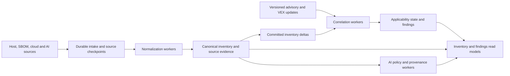
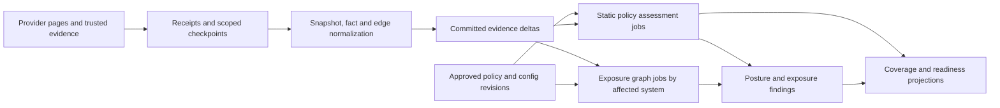

# ScoutGrid Inventory and Correlation Architecture Review

**I would keep ScoutGrid’s identity and vulnerability matching logic and redesign how work reaches it before qualifying one tenant for 100,000 assets and 50 million software observations.** AI Grid needs the same separation of jobs. Its bottlenecks are repeated tenant-wide policy reads, coverage rebuilds, and graph evaluations under a shared tenant lock.

This review covers the application and AWS Standard configuration at revision [`877e7ff7`](https://github.com/AxC-SG/SG/tree/877e7ff7c2a979a237dc76578d15ef5e8077fe01). The rates are calculated limits or proposed qualification targets. Production throughput and the effective deployment configuration require measurement.

## Bootstrap and first customer launch

The [implementation and qualification plan](first-customer-implementation-plan.md) groups the first-customer code changes into one PR and the local acceptance scenarios into one run.

Build the bounded processing path during bootstrap. Keep development and routine verification on local PostgreSQL and existing CI. Reserve AWS capacity tests for short, isolated runs and provision the customer environment close to onboarding. PostgreSQL remains the transactional store and durable batch queue. Independent API and worker roles can use the same application image. This preserves a path to add workers or upgrade the writer without changing connector contracts or finding semantics.

| When | Work and exit evidence |
| --- | --- |
| During bootstrap | Verify the host lookup index and query plans. Remove inline software summary and CVE rollups. Implement checkpointed connector pages, bounded normalization and advisory jobs, idempotent replay, and source-scoped retirement. Measure job age, accepted and changed rows, source and finding freshness, retries and transaction duration. Use synthetic distributions with shared packages and overlapping evidence. Start with functional tests, then grow the local dataset until plans and batch behavior are representative. Run the unchanged snapshot, partial snapshot, hot advisory and worker interruption cases through the normal entry points. |
| When the first customer scope is known | Record connector types, tenant and asset counts, software observations, refresh cadence and peak burst, AI artifacts and graph workload if offered, and expected finding freshness, retention and recovery. Run the release candidate in a disposable AWS environment sized for that envelope with realistic data distribution, UI traffic, retries and the agreed peak-load margin. Capture evidence and tear it down after the run. The existing AWS Standard launch fixture is up to 1,000 assets and 100,000 associations per customer. At 500 software observations per asset, 1,000 assets would yield 500,000 observations, so qualify the actual software density separately. [Standard launch fixture](https://github.com/AxC-SG/SG/blob/877e7ff7c2a979a237dc76578d15ef5e8077fe01/prototype-app/Working%20Knowledge/AWS/STANDARD_IMPLEMENTATION_READINESS.md#L30) |
| Before customer data | Start with the smallest qualified configuration of the approved Standard topology. Verify private data paths, tenant isolation, connector credentials, backups and a restore drill, and API and worker capacity during rollout. Set per-tenant and per-source admission and concurrency limits from the test. Use a supervised first import in waves. Expand each wave only after accepted work drains within the agreed freshness budget and inventory and findings reconcile. Hold new imports while investigating a breach of the qualification limits. [First customer rollout](https://github.com/AxC-SG/SG/blob/877e7ff7c2a979a237dc76578d15ef5e8077fe01/prototype-app/Working%20Knowledge/AWS/AWS_production-migration-backlog.md#L111) |

Treat **100,000 assets and 50 million software observations** as the engineering scale target. A customer who needs that volume on day one requires a full-scale, production-shaped qualification before onboarding. A smaller first customer can launch within a smaller measured envelope while the same architecture progresses to the enterprise test. Qualification at a lower volume leaves the enterprise capacity claim open.

For each AWS test, agree a maximum duration and spend estimate before provisioning. Use an isolated environment, tag the resources, verify teardown, and retain the test results and reproducible seed. Include storage, snapshots and networking in the cost estimate. Use AWS Budgets for alerts alongside the time limit and teardown checks. Avoid leaving the test database stopped between runs because storage charges continue and RDS can restart it after seven days. Add permanent writer capacity, additional worker pools, SQS, read replicas or partitioning when a measured bottleneck, customer envelope or availability requirement justifies each investment. [AWS Budgets](https://docs.aws.amazon.com/cost-management/latest/userguide/budgets-managing-costs.html) · [RDS temporary stop behavior](https://docs.aws.amazon.com/AmazonRDS/latest/UserGuide/USER_StopInstance.html)

## Inventory and vulnerability correlation

Host and SBOM ingestion normalize inventory in the intake job and enqueue software-to-CVE correlation for processing after commit. The production design should give durable intake, normalization, and correlation independent jobs. A committed normalized batch should be eligible for correlation while the rest of the source run continues. [Host inventory runner](https://github.com/AxC-SG/SG/blob/877e7ff7c2a979a237dc76578d15ef5e8077fe01/prototype-app/backend/src/main/java/com/prototype/vulnwatch/service/cmdbingestion/CmdbInventoryIngestionRunner.java#L316) · [SBOM ingestion](https://github.com/AxC-SG/SG/blob/877e7ff7c2a979a237dc76578d15ef5e8077fe01/prototype-app/backend/src/main/java/com/prototype/vulnwatch/service/sbomingestion/SbomContentIngestionService.java#L297)

### Current information flow

| Functionality | Current flow and scaling assessment |
| --- | --- |
| Host and CMDB | ServiceNow, SCCM, and host imports resolve assets and aliases, normalize publisher, product and version, resolve software identity and CPE, persist inventory, and enqueue component deltas. The runner retains resolved rows and preloaded inventory despite periodic ORM flushes. Its `findingsRecomputed` count represents queue inserts. [Host normalization](https://github.com/AxC-SG/SG/blob/877e7ff7c2a979a237dc76578d15ef5e8077fe01/prototype-app/backend/src/main/java/com/prototype/vulnwatch/service/cmdbingestion/CmdbInventoryIngestionRunner.java#L180) · [Queue counter](https://github.com/AxC-SG/SG/blob/877e7ff7c2a979a237dc76578d15ef5e8077fe01/prototype-app/backend/src/main/java/com/prototype/vulnwatch/service/cmdbingestion/CmdbInventoryIngestionRunner.java#L383) |
| SBOM and CI/CD | URL and GitHub paths can queue ingestion. The pipeline API also supports synchronous ingestion. Changed documents resolve package identity, materialize inventory and evidence, and enqueue correlation. Completeness governs retirement of omitted software. The object-storage upload path is a starting point for bulk intake. A changed document still triggers a tenant-wide software summary rebuild. [Pipeline API](https://github.com/AxC-SG/SG/blob/877e7ff7c2a979a237dc76578d15ef5e8077fe01/prototype-app/backend/src/main/java/com/prototype/vulnwatch/service/BomApiIngestService.java#L121) · [Queued upload](https://github.com/AxC-SG/SG/blob/877e7ff7c2a979a237dc76578d15ef5e8077fe01/prototype-app/backend/src/main/java/com/prototype/vulnwatch/service/BomUploadService.java#L116) · [Completeness](https://github.com/AxC-SG/SG/blob/877e7ff7c2a979a237dc76578d15ef5e8077fe01/prototype-app/backend/src/main/java/com/prototype/vulnwatch/service/BomIngestionOrchestrator.java#L490) |
| Cloud | AWS, GCP and Azure resource discovery write assets and lifecycle state. AWS SSM and GCP VM Manager packages feed host normalization. Azure discovery supplies resource metadata in the reviewed path. AWS SSM fetches inventory in a serial per-instance loop. Both AWS and GCP invoke host ingestion per instance, repeating summary work. Measure collection and provider throttling independently from internal pipeline throughput. [AWS packages](https://github.com/AxC-SG/SG/blob/877e7ff7c2a979a237dc76578d15ef5e8077fe01/prototype-app/backend/src/main/java/com/prototype/vulnwatch/service/AwsResourceIngestionService.java#L241) · [GCP packages](https://github.com/AxC-SG/SG/blob/877e7ff7c2a979a237dc76578d15ef5e8077fe01/prototype-app/backend/src/main/java/com/prototype/vulnwatch/service/GcpResourceIngestionService.java#L172) · [Azure discovery](https://github.com/AxC-SG/SG/blob/877e7ff7c2a979a237dc76578d15ef5e8077fe01/prototype-app/backend/src/main/java/com/prototype/vulnwatch/service/AzureDiscoverySyncService.java#L295) |
| AI inventory | AI-BOM software dependencies can enter common software correlation. Declared AI resources, static discovery, policy assessment, and exposure correlation follow AI-specific paths. The appendix details the boundaries, including the explicit deferral of execution telemetry in this revision. [AI-BOM orchestration](https://github.com/AxC-SG/SG/blob/877e7ff7c2a979a237dc76578d15ef5e8077fe01/prototype-app/backend/src/main/java/com/prototype/vulnwatch/service/BomIngestionOrchestrator.java#L490) · [AI Grid assessment worker](https://github.com/AxC-SG/SG/blob/877e7ff7c2a979a237dc76578d15ef5e8077fe01/prototype-app/backend/src/main/java/com/prototype/vulnwatch/aisecurity/service/AiGridAssessmentWorker.java#L197) |
| Advisory intelligence and findings | CPE, PURL, package coordinates and software identity narrow the candidate set. The matcher applies version applicability, VEX, source precedence and confidence before updating vulnerability state and findings. Advisory and VEX updates also look up affected installations in reverse. The reverse path collects all matching IDs before recomputing, so a widely installed package can produce a very large transaction. [Candidate lookup](https://github.com/AxC-SG/SG/blob/877e7ff7c2a979a237dc76578d15ef5e8077fe01/prototype-app/backend/src/main/java/com/prototype/vulnwatch/service/CorrelationCandidateService.java#L47) · [Finding creation](https://github.com/AxC-SG/SG/blob/877e7ff7c2a979a237dc76578d15ef5e8077fe01/prototype-app/backend/src/main/java/com/prototype/vulnwatch/service/FindingComponentRecomputeService.java#L298) · [Advisory fan-out](https://github.com/AxC-SG/SG/blob/877e7ff7c2a979a237dc76578d15ef5e8077fe01/prototype-app/backend/src/main/java/com/prototype/vulnwatch/service/FindingRecomputeService.java#L100) |

### Code-level bottlenecks before qualification

- **Missing index on the host lookup.** The checked-in tenant migrations have no index supporting `software_instances.inventory_component_id`, which candidate building queries for each nonempty component batch. Check the actual deployment schema and compare `EXPLAIN (ANALYZE, BUFFERS)` plans with and without the index on a representative dataset. A sequential scan is a credible risk whose cost depends on the populated host table and query selectivity. [Tenant indexes](https://github.com/AxC-SG/SG/blob/877e7ff7c2a979a237dc76578d15ef5e8077fe01/prototype-app/backend/src/main/resources/db/migration/tenant/V1__tenant_schema.sql#L7964) · [Host candidate lookup](https://github.com/AxC-SG/SG/blob/877e7ff7c2a979a237dc76578d15ef5e8077fe01/prototype-app/backend/src/main/java/com/prototype/vulnwatch/service/CorrelationCandidateService.java#L450)
- **Organization CVE rollups run inside each correlation batch.** The worker recomputes tenant aggregates for all touched CVEs, repeating work as batches encounter the same widely installed software. Commit findings and a deduplicated dirty-CVE marker together. Drain markers independently and track rollup freshness. Use tenant-scoped dirty keys for software summaries too. The existing public `refreshByNormalizedKey` visits every tenant. [Batch rollup call](https://github.com/AxC-SG/SG/blob/877e7ff7c2a979a237dc76578d15ef5e8077fe01/prototype-app/backend/src/main/java/com/prototype/vulnwatch/service/FindingComponentRecomputeService.java#L189) · [Aggregate queries](https://github.com/AxC-SG/SG/blob/877e7ff7c2a979a237dc76578d15ef5e8077fe01/prototype-app/backend/src/main/java/com/prototype/vulnwatch/service/OrgCveRecordService.java#L177) · [Summary refresh](https://github.com/AxC-SG/SG/blob/877e7ff7c2a979a237dc76578d15ef5e8077fe01/prototype-app/backend/src/main/java/com/prototype/vulnwatch/service/SoftwareIdentitySummaryProjectionService.java#L47)
- **Whole-feed collection and repeated identity writes.** ServiceNow accumulates pages, and SCCM appends the full result to a Java list despite setting a JDBC fetch size. Both need bounded collection and durable checkpoints. The host resolver updates the shared identity timestamp and calls `save` for every processed installation. The checked-in Hibernate configuration omits JDBC write batching. Measure statement counts and hot-key lock waits, deduplicate and skip unchanged identity writes, then compare JDBC batching and set-based merges. The row count that exhausts the worker heap depends on data shape, and the image is configured to exit if it runs out of memory. [ServiceNow collection](https://github.com/AxC-SG/SG/blob/877e7ff7c2a979a237dc76578d15ef5e8077fe01/prototype-app/backend/src/main/java/com/prototype/vulnwatch/service/ServiceNowCmdbSyncService.java#L416) · [SCCM buffering](https://github.com/AxC-SG/SG/blob/877e7ff7c2a979a237dc76578d15ef5e8077fe01/prototype-app/backend/src/main/java/com/prototype/vulnwatch/service/SccmQueryService.java#L184) · [Identity updates](https://github.com/AxC-SG/SG/blob/877e7ff7c2a979a237dc76578d15ef5e8077fe01/prototype-app/backend/src/main/java/com/prototype/vulnwatch/service/SoftwareIdentityService.java#L78) · [Hibernate configuration](https://github.com/AxC-SG/SG/blob/877e7ff7c2a979a237dc76578d15ef5e8077fe01/prototype-app/backend/src/main/resources/application.yml#L31) · [JVM settings](https://github.com/AxC-SG/SG/blob/877e7ff7c2a979a237dc76578d15ef5e8077fe01/prototype-app/backend/Dockerfile#L23)
- **Timeouts can leave work failed and findings stale.** The Standard JDBC URL sets a 30-second socket timeout. The finding queue separately defaults to a 15-second transaction timeout and uses bounded retry with terminal failure. Bound the amount of work before changing timeouts. Classify retries, track terminal failures, and resume oversized work from smaller checkpoints. [JDBC URL](https://github.com/AxC-SG/SG/blob/877e7ff7c2a979a237dc76578d15ef5e8077fe01/prototype-app/infrastructure/terraform/standard/runtime.tf#L102) · [Queue transaction timeout](https://github.com/AxC-SG/SG/blob/877e7ff7c2a979a237dc76578d15ef5e8077fe01/prototype-app/backend/src/main/java/com/prototype/vulnwatch/service/FindingDeltaQueueService.java#L100) · [Retry handling](https://github.com/AxC-SG/SG/blob/877e7ff7c2a979a237dc76578d15ef5e8077fe01/prototype-app/backend/src/main/java/com/prototype/vulnwatch/service/FindingDeltaQueueService.java#L661)
- **Host feeds need an explicit absence contract.** An explicit inactive install retires the component. The reviewed host runner does not retire an installation simply because a later feed omits it. Reconcile source evidence when the authoritative scope is complete and current, and retire the canonical installation only after its remaining support is withdrawn. [Host status update](https://github.com/AxC-SG/SG/blob/877e7ff7c2a979a237dc76578d15ef5e8077fe01/prototype-app/backend/src/main/java/com/prototype/vulnwatch/service/cmdbingestion/CmdbHostInventorySupportService.java#L210) · [Host run finalization](https://github.com/AxC-SG/SG/blob/877e7ff7c2a979a237dc76578d15ef5e8077fe01/prototype-app/backend/src/main/java/com/prototype/vulnwatch/service/cmdbingestion/CmdbInventoryIngestionRunner.java#L305)

### Capacity and latency

The baseline is 100,000 assets × 500 software observations, before any extra raw records from overlapping sources. Distinct installations, changed installations, and finding counts are separate sizing inputs.

| Workload | Minimum sustained rate |
| --- | ---: |
| 50 million observations in 24 hours | 579 observations/s |
| 50 million in 8 hours | 1,737 observations/s |
| 50 million in 4 hours | 3,473 observations/s |
| 1% change burst in 15 minutes | 556 changed observations/s |
| 10% change burst in 1 hour | 1,389 changed observations/s |

An initial 30–90 minute load would require about 9,300–27,800 observations/s through intake and normalization. The initial qualification objective is eight hours from staged data to visible findings. Measure the worker’s heap usage, SQL statements per installation and elapsed stage times on representative data before tightening that objective.

- **Software correlation.** At 100 claims per batch, five batches per tenant per poll and a two-second fixed delay, the default single poller has an ideal ceiling of 250 queue rows/s. If 50 million components each produce one event, polling alone imposes a 55.6-hour floor. Candidate queries, state and finding writes, rollups, enqueue time, other tenants and retries add to that floor. Actual completion time could be substantially longer and requires measurement. Each enqueue also issues an individual insert. [Queue producer](https://github.com/AxC-SG/SG/blob/877e7ff7c2a979a237dc76578d15ef5e8077fe01/prototype-app/backend/src/main/java/com/prototype/vulnwatch/service/FindingDeltaQueueService.java#L159) · [Poll limits](https://github.com/AxC-SG/SG/blob/877e7ff7c2a979a237dc76578d15ef5e8077fe01/prototype-app/backend/src/main/java/com/prototype/vulnwatch/service/FindingDeltaQueueService.java#L321)
- **Intelligence publication.** A full tenant evaluation advances by 100 components per pass on a three-second fixed delay. One effective poller requires at least 17.4 days at 50 million components, before matching work. A new revision or generation resets the cursor. Use target deltas for ordinary releases and a resumable, partitioned replay for changes requiring full evaluation. [Publication cursor](https://github.com/AxC-SG/SG/blob/877e7ff7c2a979a237dc76578d15ef5e8077fe01/prototype-app/backend/src/main/java/com/prototype/vulnwatch/service/TenantIntelligenceProcessingService.java#L27)

### Target architecture and qualification

1. **Evaluate shared package and build contexts once per advisory revision.** Reuse candidate and base applicability work across equivalent software identity, ecosystem, version, distro, build and matching evidence. Apply occurrence-specific VEX, tenant policy and finding lifecycle when writing outcomes. Measure the number of distinct contexts and the reuse rate on production-shaped data. The size of the reduction depends on the package and evidence distribution, while final state and finding writes still scale with affected installations.
2. **Make intake and normalization bounded.** Stage large source documents and pages in S3 with idempotent receipts and checkpoints. Bulk merge canonical assets, identities and installations, retain provenance, and emit deltas only for meaningful changes. Reconcile absence only after an authoritative scope completes. Replace inline software summary and CVE rollups with tenant-scoped dirty keys and bounded consumers.
3. **Use PostgreSQL batch references for the first qualification.** Page advisory reverse lookups at the source, then enqueue bounded work references with revision checks and reserve capacity for urgent advisories. Use the same durable database handoff for inventory and finding updates. Measure queue lag, polling cost, lock contention and delivery requirements after reducing database write work. Revisit SQS if that evidence warrants an independent delivery layer. Use a transactional outbox if publishing database-backed work to an external queue. [AWS transactional outbox](https://docs.aws.amazon.com/prescriptive-guidance/latest/cloud-design-patterns/transactional-outbox.html)
4. **Qualify database capacity and budget connections before autoscaling.** AWS Standard configures one 1-vCPU, 4-GiB worker with eight production pool connections and a production `db.m7g.large` instance with 100 GiB allocated and 400 GiB maximum storage. The configured production runtime budget is 20 steady connections, 40 during rollout and a 41-connection login limit. Derive per-role budgets and the login limit from maximum task counts and rollout surge, preserving API and administrative headroom within PostgreSQL `max_connections`. Then scale Fargate on pending work per task, monitor oldest job age and cap concurrency against writer saturation. ScoutGrid sets tenant-specific PostgreSQL session state. Measure RDS Proxy pinning before relying on it to multiplex connections. Compare representative writer and storage configurations using measured table and index sizes, retained history, WAL, I/O, lock waits and UI latency. The Standard footprint is a baseline configuration, and qualification must establish the production DB size and headroom. [ECS connection budget](https://github.com/AxC-SG/SG/blob/877e7ff7c2a979a237dc76578d15ef5e8077fe01/prototype-app/infrastructure/terraform/standard/runtime.tf#L84) · [RDS configuration](https://github.com/AxC-SG/SG/blob/877e7ff7c2a979a237dc76578d15ef5e8077fe01/prototype-app/infrastructure/terraform/standard/data.tf#L67) · [Tenant session state](https://github.com/AxC-SG/SG/blob/877e7ff7c2a979a237dc76578d15ef5e8077fe01/prototype-app/backend/src/main/java/com/prototype/vulnwatch/config/TenantAwareDataSource.java#L97) · [RDS Proxy pinning](https://docs.aws.amazon.com/AmazonRDS/latest/UserGuide/rds-proxy-pinning.html)

For large AWS fleets, evaluate Systems Manager Inventory Resource Data Sync to S3 as a bulk source. Data Sync preserves the inventory file for a deleted managed node. Use authoritative asset lifecycle evidence and a source watermark before retiring the node or withdrawing its software evidence. [SSM Resource Data Sync](https://docs.aws.amazon.com/systems-manager/latest/userguide/inventory-create-resource-data-sync.html)

**Implementation order.** Verify the missing-index query plan first and add the index if the plan shows a benefit. Move the software summary rebuild and CVE rollups off the write path. Then page advisory fan-out at the lookup and queue bounded work references. These changes come before committing to worker counts, an AWS instance class or a partitioning scheme.

Start qualification with an eight-hour initial load from staged data to visible findings, p95 under five minutes from intake to normalized inventory, and p95 under 15 minutes from intake to visible findings for routine deltas. Measure provider collection separately. Run the following scenarios with 50 million observations, overlapping sources, concurrent AI Grid policy and exposure processing, concurrent UI traffic and a second tenant. Capture per-stage throughput and latency, queue age and UI p95. Use CloudWatch Database Insights for database load and waits, and collect WAL, write I/O and query plans alongside those measurements. [CloudWatch Database Insights](https://docs.aws.amazon.com/AmazonCloudWatch/latest/monitoring/Database-Insights.html) · [Performance harness](https://github.com/AxC-SG/SG/blob/877e7ff7c2a979a237dc76578d15ef5e8077fe01/prototype-app/scripts/enterprise-performance-certification.sh#L87)

| Scenario | Pass criteria |
| --- | --- |
| Unchanged rediscovery | With unchanged evidence semantics and policy inputs, zero software correlation jobs and zero applicability or finding mutations. Report receipt and freshness bookkeeping separately. |
| 10% change burst | Meet the routine freshness objectives and account for every changed installation. Unchanged installations generate zero correlation work. |
| Advisory with 100,000 affected installations | Page candidates and finish all affected evaluations and finding updates. No correlation write transaction exceeds 10 seconds in the qualification run. Record time to the last visible finding. |
| Worker interruption, partial scope and older replay | No lost or duplicate findings, no stale overwrites, and no verified closure from partial, stale or capped evidence. |
| Concurrent traffic during an ECS rollout | Stay within each role’s measured connection budget with no connection-limit errors. Include actual rollout surge, API latency and second-tenant queue age in the results. |

## Appendix A AI Grid Inventory and Policy Validation

**Keep AI Grid’s versioned evidence, policy decisions, and finding lifecycle. Separate ingestion, snapshot normalization, policy assessment, graph correlation, and projections into independently runnable jobs.** A completed discovery scope currently triggers a tenant-wide assessment request, and the resulting work can run on the same thread that completed intake. The largest scaling gain comes from making work proportional to changed artifacts, facts, graph edges and policies.

### Current information flow

| Stage | Flow and assessment |
| --- | --- |
| Provider discovery | AWS Bedrock, AgentCore and related AWS resources, Azure Foundry, and Copilot Studio use queued discovery. They collect inventory and provider capabilities and emit `ObservationEnvelopeV1` with artifacts, relationships, scope, sequence, hash and completion. The envelope supports chunks. The AWS producer walks regions serially and emits one envelope per family scope after collection. Azure materializes a subscription snapshot before emitting payloads. Copilot constructs artifact and relationship lists from Dataverse discovery. Provider pagination bounds each remote response, while accumulated scope memory and retry units can still grow. [Discovery job worker](https://github.com/AxC-SG/SG/blob/877e7ff7c2a979a237dc76578d15ef5e8077fe01/prototype-app/backend/src/main/java/com/prototype/vulnwatch/aisecurity/service/AiSecurityJobWorkerService.java#L72) · [AWS collector](https://github.com/AxC-SG/SG/blob/877e7ff7c2a979a237dc76578d15ef5e8077fe01/prototype-app/backend/src/main/java/com/prototype/vulnwatch/aisecurity/aws/AwsBedrockDiscoveryService.java#L214) · [AWS envelope](https://github.com/AxC-SG/SG/blob/877e7ff7c2a979a237dc76578d15ef5e8077fe01/prototype-app/backend/src/main/java/com/prototype/vulnwatch/aisecurity/aws/AwsBedrockDiscoveryService.java#L1719) · [Azure collector](https://github.com/AxC-SG/SG/blob/877e7ff7c2a979a237dc76578d15ef5e8077fe01/prototype-app/backend/src/main/java/com/prototype/vulnwatch/aisecurity/azure/AzureAiDiscoveryService.java#L173) · [Copilot collector](https://github.com/AxC-SG/SG/blob/877e7ff7c2a979a237dc76578d15ef5e8077fe01/prototype-app/backend/src/main/java/com/prototype/vulnwatch/aisecurity/copilot/CopilotStudioDiscoveryService.java#L86) |
| Intake and snapshot normalization | Intake validates ownership, deduplicates chunks, sanitizes metadata, upserts artifacts and source links, resolves relationship endpoints and records scope completeness. A complete scope can retire absent records for that scope. It also materializes redacted, content-addressed snapshot bodies, manifests, typed facts and relationship snapshots, then enqueues assessment in the same transaction. This gives replayable evidence and atomic delivery intent. Scope finalization rereads the scope and writes artifacts and facts row by row while holding the tenant advisory lock. [Receipt and scope transaction](https://github.com/AxC-SG/SG/blob/877e7ff7c2a979a237dc76578d15ef5e8077fe01/prototype-app/backend/src/main/java/com/prototype/vulnwatch/aisecurity/service/AiSecurityObservationService.java#L86) · [Snapshot materialization](https://github.com/AxC-SG/SG/blob/877e7ff7c2a979a237dc76578d15ef5e8077fe01/prototype-app/backend/src/main/java/com/prototype/vulnwatch/aisecurity/service/AiGridSnapshotService.java#L53) · [Pipeline handoff](https://github.com/AxC-SG/SG/blob/877e7ff7c2a979a237dc76578d15ef5e8077fe01/prototype-app/backend/src/main/java/com/prototype/vulnwatch/aisecurity/service/AiGridPipelineService.java#L20) |
| Static policy assessment | The worker resolves published policy and tenant selection, checks scope, required capabilities and facts, and evaluates deterministic predicates over the latest complete scope snapshots. Direct relationship rules also consult graph evidence. Decisions record applicability, evidence readiness, reason and evidence links. Eligible `FAIL` opens or updates a posture finding, verified `PASS` can close it, and insufficient evidence is recorded as a gap or no decision. The assessment is durable with leases, heartbeats and commit fencing. Its after-commit callback calls evaluation synchronously, and the recovery poller processes claims serially. [Assessment delivery](https://github.com/AxC-SG/SG/blob/877e7ff7c2a979a237dc76578d15ef5e8077fe01/prototype-app/backend/src/main/java/com/prototype/vulnwatch/aisecurity/service/AiGridAssessmentWorker.java#L89) · [Policy checks](https://github.com/AxC-SG/SG/blob/877e7ff7c2a979a237dc76578d15ef5e8077fe01/prototype-app/backend/src/main/java/com/prototype/vulnwatch/aisecurity/service/AiGridAssessmentService.java#L286) · [Posture finding lifecycle](https://github.com/AxC-SG/SG/blob/877e7ff7c2a979a237dc76578d15ef5e8077fe01/prototype-app/backend/src/main/java/com/prototype/vulnwatch/aisecurity/service/AiGridFindingService.java#L54) |
| Coverage, exposure and findings | The worker refreshes current coverage, derives system memberships, reconciles evidence, traverses exposure templates, computes readiness, and refreshes findings. Graph correlation binds observations to versioned inputs, distinguishes hypotheses from validated exposures, and consolidates findings by template and root cause. A trusted CIEM, DSPM or ASM evidence write can synchronously refresh tenant coverage and systems before evaluating affected exposures. [Worker finalization](https://github.com/AxC-SG/SG/blob/877e7ff7c2a979a237dc76578d15ef5e8077fe01/prototype-app/backend/src/main/java/com/prototype/vulnwatch/aisecurity/service/AiGridAssessmentWorker.java#L219) · [Exposure reconciliation](https://github.com/AxC-SG/SG/blob/877e7ff7c2a979a237dc76578d15ef5e8077fe01/prototype-app/backend/src/main/java/com/prototype/vulnwatch/aisecurity/service/AiGridExposureService.java#L164) · [Trusted evidence intake](https://github.com/AxC-SG/SG/blob/877e7ff7c2a979a237dc76578d15ef5e8077fe01/prototype-app/backend/src/main/java/com/prototype/vulnwatch/aisecurity/service/AiGridApiService.java#L583) |
| Policy validation and release | Policy packages go through answer-key checks bound to actual run evidence and a catalog digest, precision review, approval, controlled publication and per-tenant rollout. Rollout records the exact accepted assessment request and only completes after that request succeeds and the release binding is still valid. Keep these governance controls. Track validation correctness, rollout progress and production processing capacity as separate measures. [Answer-key validation](https://github.com/AxC-SG/SG/blob/877e7ff7c2a979a237dc76578d15ef5e8077fe01/prototype-app/backend/src/main/java/com/prototype/vulnwatch/aisecurity/service/AiGridValidationGovernanceService.java#L153) · [Publication](https://github.com/AxC-SG/SG/blob/877e7ff7c2a979a237dc76578d15ef5e8077fe01/prototype-app/backend/src/main/java/com/prototype/vulnwatch/aisecurity/service/AiGridValidationGovernanceService.java#L615) · [Rollout completion](https://github.com/AxC-SG/SG/blob/877e7ff7c2a979a237dc76578d15ef5e8077fe01/prototype-app/backend/src/main/java/com/prototype/vulnwatch/aisecurity/service/AiGridPolicyRolloutService.java#L120) |

**Execution telemetry is deferred at this revision.** The first review described the implemented adapter without noting the global release guard. `AiRuntimeScope` returns excluded, the adapter API returns HTTP 410 through that guard, and the worker exits early. Trusted host-context production evidence has its own intake path. Before a future telemetry release, qualify adapter receipt and event throughput independently. The dormant adapter processes one batch per tenant per poll and persists events individually. The evaluator’s 2,000-execution cap in facts and sequence paths needs explicit coverage accounting or cursor-based processing at enterprise volume. [Runtime release guard](https://github.com/AxC-SG/SG/blob/877e7ff7c2a979a237dc76578d15ef5e8077fe01/prototype-app/backend/src/main/java/com/prototype/vulnwatch/aisecurity/service/AiRuntimeScope.java#L6) · [Runtime adapter worker](https://github.com/AxC-SG/SG/blob/877e7ff7c2a979a237dc76578d15ef5e8077fe01/prototype-app/backend/src/main/java/com/prototype/vulnwatch/aisecurity/service/AiGridRuntimeIngestionWorker.java#L44) · [Runtime fact evaluation](https://github.com/AxC-SG/SG/blob/877e7ff7c2a979a237dc76578d15ef5e8077fe01/prototype-app/backend/src/main/java/com/prototype/vulnwatch/aisecurity/service/AiGridRuntimeEvaluationService.java#L134)

### Priority findings

1. **P0 · One completed scope can trigger tenant-wide work.** `processCompleteScope` requests all policies for every completed scope. The outbox coalesces requests for the same run only while they are pending and unattempted. When inline dispatch runs immediately, successive scopes can cause successive evaluations of the current tenant-wide inventory. Assessment and finalization also take the same advisory lock as intake. A long policy transaction can delay independent provider scopes. Make `afterCommit` publish or wake a worker only. Coalesce committed changed keys across scopes and move processing to bounded worker jobs. Reserve short locks for publishing an authoritative scope or epoch. Fence writes using the input snapshot and policy/configuration revision. [Scope handoff](https://github.com/AxC-SG/SG/blob/877e7ff7c2a979a237dc76578d15ef5e8077fe01/prototype-app/backend/src/main/java/com/prototype/vulnwatch/aisecurity/service/AiGridPipelineService.java#L20) · [Dispatch and recovery](https://github.com/AxC-SG/SG/blob/877e7ff7c2a979a237dc76578d15ef5e8077fe01/prototype-app/backend/src/main/java/com/prototype/vulnwatch/aisecurity/service/AiGridAssessmentWorker.java#L89) · [Tenant lock](https://github.com/AxC-SG/SG/blob/877e7ff7c2a979a237dc76578d15ef5e8077fe01/prototype-app/backend/src/main/java/com/prototype/vulnwatch/aisecurity/service/AiGridAssessmentService.java#L103)
2. **P0 · Policy costs include repeated fact reads and per-subject writes.** Each policy runs in isolation. Applicable policies load a list of artifacts, and the per-policy cache can load the current tenant’s fact set and relationship index. Verdicts are upserted per artifact-policy pair. Coverage then deletes and reconstructs current artifacts and expected candidates under the tenant lock. The details API returns the whole candidate list, and finalization also loads that list for metrics. Index policy dependencies by provider, native kind, fact, edge type and capability. Read facts by bounded artifact set and required keys, bulk write changed verdicts, and apply coverage deltas. Publish a consistent coverage epoch with a short pointer update. Add keyset pagination for details and SQL aggregates for counts. [Policy artifact selection](https://github.com/AxC-SG/SG/blob/877e7ff7c2a979a237dc76578d15ef5e8077fe01/prototype-app/backend/src/main/java/com/prototype/vulnwatch/aisecurity/service/AiGridAssessmentService.java#L219) · [Fact cache](https://github.com/AxC-SG/SG/blob/877e7ff7c2a979a237dc76578d15ef5e8077fe01/prototype-app/backend/src/main/java/com/prototype/vulnwatch/aisecurity/service/AiGridAssessmentService.java#L813) · [Coverage rebuild](https://github.com/AxC-SG/SG/blob/877e7ff7c2a979a237dc76578d15ef5e8077fe01/prototype-app/backend/src/main/java/com/prototype/vulnwatch/aisecurity/service/AiGridCoverageService.java#L57) · [Coverage details](https://github.com/AxC-SG/SG/blob/877e7ff7c2a979a237dc76578d15ef5e8077fe01/prototype-app/backend/src/main/java/com/prototype/vulnwatch/aisecurity/service/AiGridCoverageService.java#L256)
3. **P0 · Graph limits need to bound total work and protect finding closure.** Exposure correlation loads artifact, edge and fact maps for the whole epoch before filtering to affected systems. It also serializes replay inputs for the epoch. The traversal caps depth, fan-out and returned paths per system/template, while the queued frontier and total work across roots remain separate costs. The closure flow receives observed fingerprints and an authoritative flag, with no traversal-truncation signal. A high-degree graph could omit a previously seen path and make absence look qualified. Test that case before enabling authoritative closure at scale. Traverse indexed neighborhoods for affected roots, cap frontier size and total work, record incomplete traversals as coverage gaps, and allow verified closure only for fully evaluated scopes and templates. Use per-shard input references and digests for replay. Schedule evidence expiry by affected root or fact key. [Epoch graph load](https://github.com/AxC-SG/SG/blob/877e7ff7c2a979a237dc76578d15ef5e8077fe01/prototype-app/backend/src/main/java/com/prototype/vulnwatch/aisecurity/service/AiGridExposureService.java#L74) · [Replay inputs](https://github.com/AxC-SG/SG/blob/877e7ff7c2a979a237dc76578d15ef5e8077fe01/prototype-app/backend/src/main/java/com/prototype/vulnwatch/aisecurity/service/AiGridExposureService.java#L372) · [Traversal limit](https://github.com/AxC-SG/SG/blob/877e7ff7c2a979a237dc76578d15ef5e8077fe01/prototype-app/backend/src/main/java/com/prototype/vulnwatch/aisecurity/service/AiGridExposureService.java#L469) · [Closure eligibility](https://github.com/AxC-SG/SG/blob/877e7ff7c2a979a237dc76578d15ef5e8077fe01/prototype-app/backend/src/main/java/com/prototype/vulnwatch/aisecurity/service/AiGridExposureService.java#L681)
4. **P1 · Give AI-BOM linking and policy releases explicit work units.** AI-BOM provenance has a separate projection worker, while its periodic reconciler still loads all declared resources and visits sources per resource. Use changed BOM revisions, dependency links and canonical software finding events to visit only affected declarations. For policy rollout, pin the approved policy digest, tenant configuration revision and snapshot inputs on the request. Evaluate one policy against paged eligible subjects, publish progress against the approved cohort, and keep governance and background replay off the discovery worker. [AI-BOM reconcile sweep](https://github.com/AxC-SG/SG/blob/877e7ff7c2a979a237dc76578d15ef5e8077fe01/prototype-app/backend/src/main/java/com/prototype/vulnwatch/service/AiBomResourceVulnerabilityCorrelationService.java#L20) · [Rollout task](https://github.com/AxC-SG/SG/blob/877e7ff7c2a979a237dc76578d15ef5e8077fe01/prototype-app/backend/src/main/java/com/prototype/vulnwatch/aisecurity/service/AiGridPolicyRolloutService.java#L120)

### Job boundaries and consistency

Use provider/account/region/family checkpoints for collection. Run concurrent provider work within explicit rate budgets with retry backoff. Persist only approved evidence fields in staged payloads. In a short finalization transaction, publish the authoritative scope head once all expected chunks are present. Independently queue artifact-policy and system-template batches with stable keys, pinned inputs and a job status. A host fact or expiring edge should invalidate just its dependent policies or systems. A shared artifact can invalidate many systems, so page that fan-out. Keep full replay as a separately budgeted job with visible progress and a completeness barrier before closure. Use S3 staging and durable PostgreSQL work references for the first qualification, with distinct concurrency limits for AI, CVE and read-path workloads. [AWS retry guidance](https://repost.aws/knowledge-center/bedrock-retry-exponential-backoff-api)

### Sizing and release criteria

Size AI Grid by AI artifacts and systems, applicable artifact-policy pairs, facts, edges, paths explored, provider calls and evidence history. The 50 million software observations in the main review size software correlation. The AI test below assumes **100,000 AI artifacts, 20 candidate policies and 20 facts per artifact, one million edges, and 10,000 system roots with 15 eligible templates each**. These are explicit qualification inputs pending a tenant-specific inventory distribution.

| Proposed workload | Minimum processing requirement |
| --- | ---: |
| 2 million artifact-policy pairs in 8 hours | 70 decisions/s |
| 2 million pairs in 4 hours | 139 decisions/s |
| 10% artifact change with 20 affected policies each in 15 minutes | 223 decisions/s |
| 10,000 roots × 15 templates | 150,000 root/template evaluations before traversal fan-out |

The graph figure is a work count. Capacity depends strongly on degree, shared dependencies, and evidence selectivity. Measure paths expanded and peak frontier size per root, persisted observations per finding, fact rows read per verdict, and database work per completed scope. With these assumptions, a full coverage rebuild can write about two million candidate rows per refresh. Repeating that refresh on each completed scope or trusted evidence batch defeats the economics of incremental discovery.

Proposed initial objectives are p95 under five minutes from durable chunk receipt to normalized evidence for complete scopes, p95 under 15 minutes from eligible evidence commit to visible posture results, and p95 under 30 minutes to visible exposure and coverage results for routine changed systems. Measure provider collection time separately. Use a four-hour evidence-ready static backlog test to establish the capacity baseline, and benchmark graph publishing with its own dataset and freshness objective.

Run initial load, unchanged rediscovery, 10% scope change, high-degree shared dependencies, one expiring evidence family, a policy rollout during active discovery, and a failure/retry of a partial scope. Keep the main review’s software correlation traffic and interactive reads running. Require no lost or duplicate decisions, no verified closure on partial or capped evidence, and identical outcomes when replaying a pinned snapshot, rule version and evaluation time. Compare p95 queue age and end-to-end visibility alongside heap, GC, tenant lock wait, WAL and row writes. The existing 246-case correctness gate and same-connector 20% duration/row regression gate should both continue. Neither establishes absolute capacity for this enterprise workload. [Correctness gate](https://github.com/AxC-SG/SG/blob/877e7ff7c2a979a237dc76578d15ef5e8077fe01/prototype-app/backend/src/main/java/com/prototype/vulnwatch/aisecurity/service/AiGridPhase1PreviewService.java#L94) · [Performance gate](https://github.com/AxC-SG/SG/blob/877e7ff7c2a979a237dc76578d15ef5e8077fe01/prototype-app/backend/src/main/java/com/prototype/vulnwatch/aisecurity/service/AiGridPhase1ReleaseBoardService.java#L74)

## Appendix B Vulnerability intelligence and local qualification

**Bootstrap the shared vulnerability catalog once before the first tenant imports inventory.** Test the application stages locally with fixed provider fixtures and disposable PostgreSQL. Time provider download, normalization and staging, review-candidate build, release publication, and tenant finding visibility as separate stages. The first customer should begin from a known approved release and an established incremental feed checkpoint.

**First fix.** Reject a malformed NVD success response before it can advance coverage. At offset zero, `{}` currently satisfies the loop’s empty-page checks and can skip an entire interval. At a later nonzero offset, the `totalResults < startIndex` check rejects it. The next run’s one-hour overlap cannot reliably recover a skipped interval. Add regression coverage through the HTTP parser and sync worker for malformed first responses, malformed later responses, and a correctly formed zero-result page. Assert the failed run leaves the prior watermark intact. [Response parser](https://github.com/AxC-SG/SG/blob/877e7ff7c2a979a237dc76578d15ef5e8077fe01/prototype-app/backend/src/main/java/com/prototype/vulnwatch/client/NvdApiClient.java#L242) · [Watermark advancement](https://github.com/AxC-SG/SG/blob/877e7ff7c2a979a237dc76578d15ef5e8077fe01/prototype-app/backend/src/main/java/com/prototype/vulnwatch/service/vulningestion/NvdSyncService.java#L177) · [Page checks](https://github.com/AxC-SG/SG/blob/877e7ff7c2a979a237dc76578d15ef5e8077fe01/prototype-app/backend/src/main/java/com/prototype/vulnwatch/service/vulningestion/NvdSyncService.java#L298)

### Current flow and capacity risks

1. **Schedule and fetch.** Most platform feeds enter a durable sync-run queue with attempt ownership and bounded retries. The worker claims runs before submitting them to a shared single-thread feed executor. A large backfill can delay KEV, VEX and other feeds. Queued executor entries may consume part of their lease before execution starts. Admit work to an available slot before claiming it, then reserve capacity for short incremental and urgent runs. Keep per-provider limits in place. [Feed worker](https://github.com/AxC-SG/SG/blob/877e7ff7c2a979a237dc76578d15ef5e8077fe01/prototype-app/backend/src/main/java/com/prototype/vulnwatch/service/vulningestion/VulnerabilityQueuedRunWorkerService.java#L75) · [Executor](https://github.com/AxC-SG/SG/blob/877e7ff7c2a979a237dc76578d15ef5e8077fe01/prototype-app/backend/src/main/java/com/prototype/vulnwatch/config/HttpClientConfig.java#L108)
2. **Normalize and stage.** The staging path records canonical IDs, source observations, structured aliases, target and version rules, configuration expressions, and withdrawals. Staged records cannot drive customer findings until approved. NVD writes several database rows per CVE and a variable number of target and configuration rows. Staging appends each record separately, so measure both CVEs/s and staged rows/s. Use bounded bulk writes and checkpoint only after the corresponding batch commits. Distinguish fetched, valid, rejected, and semantically changed counts. [NVD record processing](https://github.com/AxC-SG/SG/blob/877e7ff7c2a979a237dc76578d15ef5e8077fe01/prototype-app/backend/src/main/java/com/prototype/vulnwatch/service/vulningestion/NvdSyncService.java#L449) · [Staging writes](https://github.com/AxC-SG/SG/blob/877e7ff7c2a979a237dc76578d15ef5e8077fe01/prototype-app/backend/src/main/java/com/prototype/vulnwatch/service/IntelligenceStagingService.java#L103) · [Publication guard](https://github.com/AxC-SG/SG/blob/877e7ff7c2a979a237dc76578d15ef5e8077fe01/prototype-app/backend/src/main/java/com/prototype/vulnwatch/service/vulningestion/VulnerabilityIngestionEffectsService.java#L27)
3. **Review and publish.** A platform owner selects completed runs. Candidate build copies eligible staged payloads and computes a quality report and digest. Publication checks the expected digest and base release, locks the active release, applies all records, refreshes VEX, writes release history and switches the active release. The reads are paged, but the publish transaction covers the entire release and flushes the ORM per record. Finding evaluation also takes a shared lock on the active release. A large publish or withdrawal can therefore delay matching across tenants and replay substantial work after interruption. Retain digest checks and atomic visibility. Prepare versioned changes in resumable batches and make activation a short transaction. For bootstrap, measure the initial reviewed publication in an empty customer environment before deciding how much of the release refactor is required for launch. [Candidate build](https://github.com/AxC-SG/SG/blob/877e7ff7c2a979a237dc76578d15ef5e8077fe01/prototype-app/backend/src/main/java/com/prototype/vulnwatch/service/IntelligencePublicationService.java#L163) · [Publication and VEX](https://github.com/AxC-SG/SG/blob/877e7ff7c2a979a237dc76578d15ef5e8077fe01/prototype-app/backend/src/main/java/com/prototype/vulnwatch/service/IntelligencePublicationService.java#L219) · [Evaluation lock](https://github.com/AxC-SG/SG/blob/877e7ff7c2a979a237dc76578d15ef5e8077fe01/prototype-app/backend/src/main/java/com/prototype/vulnwatch/service/IntelligenceEvaluationFence.java#L15)
4. **Apply the release to tenants.** Publication queues fan-out and the tenant worker reevaluates the entire component table in batches of 100. A new revision or generation resets the cursor. A KEV or EPSS metadata change follows this publication path even though it does not normally change which package versions are affected. Publish a durable manifest of changed and removed targets, aliases, VEX and metadata. Use it to select affected installations and outcomes, page at the reverse lookup, and route ranking-only changes to targeted rescoring. Make full replays explicit and resumable. Preserve canonical identity and finding lifecycle on withdrawal and rollback. [Tenant fan-out and evaluation](https://github.com/AxC-SG/SG/blob/877e7ff7c2a979a237dc76578d15ef5e8077fe01/prototype-app/backend/src/main/java/com/prototype/vulnwatch/service/TenantIntelligenceProcessingService.java#L42)

### Connector findings

| Feed | Behavior to fix or qualify |
| --- | --- |
| NVD | Full sync uses API offset paging from zero with configured source filters and an API key. It does not persist a page checkpoint or establish the incremental watermark. Incremental sync uses a filter-specific watermark, one-hour overlap and intervals of at most 120 days. It advances the watermark after the entire run, so a failed later interval can replay earlier work. The client also defaults missing pagination fields to plausible values and can turn an HTTP 200 body such as `{}` into a valid-looking empty page. Reject malformed success responses and require a validated empty result before advancing coverage. Pin and persist the scope and verified bootstrap cutoff. [Full and incremental sync](https://github.com/AxC-SG/SG/blob/877e7ff7c2a979a237dc76578d15ef5e8077fe01/prototype-app/backend/src/main/java/com/prototype/vulnwatch/service/vulningestion/NvdSyncService.java#L177) · [Page handling](https://github.com/AxC-SG/SG/blob/877e7ff7c2a979a237dc76578d15ef5e8077fe01/prototype-app/backend/src/main/java/com/prototype/vulnwatch/service/vulningestion/NvdSyncService.java#L283) · [Response parsing](https://github.com/AxC-SG/SG/blob/877e7ff7c2a979a237dc76578d15ef5e8077fe01/prototype-app/backend/src/main/java/com/prototype/vulnwatch/client/NvdApiClient.java#L242) |
| GitHub Security Advisories | Follows provider next links and fails at the page cap if a next link remains. Retries start from a source-wide latest successful modification timestamp with overlap. Changing filters can leave older advisories outside the new scope. Persist a scope-specific window and continuation. Split oversized windows so a cap can be drained across runs. Preserve structured alias handling. [GHSA continuation](https://github.com/AxC-SG/SG/blob/877e7ff7c2a979a237dc76578d15ef5e8077fe01/prototype-app/backend/src/main/java/com/prototype/vulnwatch/service/vulningestion/GhsaSyncService.java#L147) |
| EUVD and JVN | Both start at the first page and can report completed after hitting the configured page cap. Completion therefore can mean that one bounded slice was read. Record exhausted versus incomplete coverage and persist a resumable cursor or time window. Add a test where data remains beyond the cap. [EUVD paging](https://github.com/AxC-SG/SG/blob/877e7ff7c2a979a237dc76578d15ef5e8077fe01/prototype-app/backend/src/main/java/com/prototype/vulnwatch/service/vulningestion/EuvdSyncService.java#L78) · [JVN paging](https://github.com/AxC-SG/SG/blob/877e7ff7c2a979a237dc76578d15ef5e8077fe01/prototype-app/backend/src/main/java/com/prototype/vulnwatch/service/vulningestion/JvnSyncService.java#L79) |
| Microsoft and Red Hat CSAF/VEX | Microsoft prioritizes documents using all catalog CVE IDs and can exceed the nominal document cap. Red Hat truncates the list to the cap. Individual document failures can still yield a completed run eligible for publication. Track document revisions, cap priority work and resume deferred documents. Make partial coverage explicit and retain previous assertions for missing or invalid documents. Bind replacement to a fully validated source record and distinguish verified withdrawal from missing data. [Document prioritization](https://github.com/AxC-SG/SG/blob/877e7ff7c2a979a237dc76578d15ef5e8077fe01/prototype-app/backend/src/main/java/com/prototype/vulnwatch/service/vulningestion/CsafSyncService.java#L123) · [Completion status](https://github.com/AxC-SG/SG/blob/877e7ff7c2a979a237dc76578d15ef5e8077fe01/prototype-app/backend/src/main/java/com/prototype/vulnwatch/service/vulningestion/CsafSyncService.java#L244) |
| OSV platform feed | Fetches OSV serially per package inside a transaction and reloads all software identities for each ecosystem. It groups package URLs by PURL type, then looks up OSV ecosystem labels such as `Python` and `Go`. Verify and map the naming contracts so ecosystem coverage does not silently disappear. Build a paged distinct package list once, normalize the provider keys, and use bounded requests and checkpoints outside long DB transactions. [OSV discovery and requests](https://github.com/AxC-SG/SG/blob/877e7ff7c2a979a237dc76578d15ef5e8077fe01/prototype-app/backend/src/main/java/com/prototype/vulnwatch/service/vulningestion/OsvPlatformService.java#L55) |
| CISA KEV and FIRST EPSS | Treat these as ranking and urgency signals. Validate the KEV response before declaring success and skip unchanged accepted catalogs. EPSS already pages stale CVEs and surfaces incomplete retrieval. Track fetched versus published freshness for both, reserve priority for KEV updates, and avoid a tenant-wide applicability replay for ranking-only changes. [KEV intake](https://github.com/AxC-SG/SG/blob/877e7ff7c2a979a237dc76578d15ef5e8077fe01/prototype-app/backend/src/main/java/com/prototype/vulnwatch/service/vulningestion/KevSyncService.java#L94) · [EPSS paging](https://github.com/AxC-SG/SG/blob/877e7ff7c2a979a237dc76578d15ef5e8077fe01/prototype-app/backend/src/main/java/com/prototype/vulnwatch/service/EpssRefreshService.java#L137) |

### NVD bootstrap and speed

Use **400,000 CVEs as the qualification workload**, with representative CPE rule and configuration distributions. The checked-in client requests up to 2,000 entries at a time. If all pages are full, 400,000 CVEs require 200 requests. Network time and rate limiting depend on the run. The number of published database rows, WAL and history writes depend on the rules per CVE. Page count alone cannot predict time to approved intelligence or findings. [NVD client configuration](https://github.com/AxC-SG/SG/blob/877e7ff7c2a979a237dc76578d15ef5e8077fe01/prototype-app/backend/src/main/java/com/prototype/vulnwatch/client/NvdApiClient.java#L107)

Qualification needs an initial reproducible baseline and a catch-up strategy. Use the existing paged API as an initial implementation path. Evaluate a streamed importer for NIST’s compressed JSON 2.0 year files if fetch time or reproducibility warrants it. Verify each `.meta` size and SHA-256, persist the manifest and a safe source cutoff, and feed the same parser, staging and review path. Catch up changes from that cutoff with overlapped API windows and persist a checkpoint only for verified coverage. Keep provider timestamp and source-record revision on replacement so a stale replay cannot overwrite newer targets. [NIST JSON 2.0 feed files and metadata](https://nvd.nist.gov/vuln/data-feeds?wptouch_preview_theme=enabled) · [NIST CVE API and bulk import guidance](https://nvlpubs.nist.gov/nistpubs/SpecialPublications/NIST.SP.800-126r4.pdf)

### Publication, retention and feed continuity decisions

- **Use reviewed release deltas with a stable read view.** The release lock blocks evaluators that acquire the shared fence. The observed duration and whether a waiting batch times out depend on workload and effective settings. For routine releases, record changed and removed rules, target keys, aliases and VEX, including the old keys and prior matches needed to resolve removals. Apply these through the bounded advisory lookup and coalesced rollups from the inventory plan. When preparing a release across transactions, write to versioned tables or an isolated namespace and have readers pin the approved generation for the full evaluation. An `APPLYING` status alone cannot hide partially committed changes in the live tables. Test that findings from in-flight older generations cannot overwrite newer ones. [Activation transaction](https://github.com/AxC-SG/SG/blob/877e7ff7c2a979a237dc76578d15ef5e8077fe01/prototype-app/backend/src/main/java/com/prototype/vulnwatch/service/IntelligencePublicationService.java#L219) · [Evaluation fence](https://github.com/AxC-SG/SG/blob/877e7ff7c2a979a237dc76578d15ef5e8077fe01/prototype-app/backend/src/main/java/com/prototype/vulnwatch/service/IntelligenceEvaluationFence.java#L15)
- **Measure and manage retained evidence.** The schema rejects updates and deletes on staging and candidate rows. Candidate rows reference the staged rows and contain a second payload copy. Measure heap, TOAST, indexes and release history separately, including failed runs and unpublished candidates. Define retention and a controlled archive or purge path that preserves evidence for active reviews, audit, and supported withdrawal and replay. Evaluate content-addressed raw payload storage and lighter candidate references if retained size warrants it. A partitioning decision follows measured growth and a design for the reference and retention constraints. Benchmark batched staging writes, including the per-row run-status lock, while preserving lease ownership and run immutability. [Immutable staging and candidate schema](https://github.com/AxC-SG/SG/blob/877e7ff7c2a979a237dc76578d15ef5e8077fe01/prototype-app/backend/src/main/resources/db/migration/postgres_reset/V8__reviewed_intelligence_publication.sql#L6)
- **Profile BUILD before prioritizing its rewrite.** A disposable PostgreSQL 16 test ran the candidate insert with 200,000 synthetic staged rows, 50,000 canonical IDs, one completed run and 500 invalid observations. PostgreSQL scanned the invalid-observation subplan once and inserted the candidates in about 0.32 seconds, with a temporary sort spill. The fixture used compact payloads and omitted shipping triggers. Capture `EXPLAIN (ANALYZE, BUFFERS)` with realistic payload sizes, multiple runs and higher invalid-record counts. Consider a precomputed invalid-key join or partial index where those plans show a benefit. [Candidate build query](https://github.com/AxC-SG/SG/blob/877e7ff7c2a979a237dc76578d15ef5e8077fe01/prototype-app/backend/src/main/java/com/prototype/vulnwatch/service/IntelligencePublicationService.java#L174)
- **Use a lean EPSS import and keep publication explicit.** Evaluate FIRST’s daily compressed CSV for joining scores in bulk to known CVEs. Record feed date, model and manifest, and audit validated changes. Retain owner review for applicability changes. An automated metadata-only path would require explicit approval of its allowed fields, validation, audit and rollback. The existing `CVE_METADATA_DELTA` updates organization CVE rollups. Define and test a separate targeted refresh for persisted finding scores or priority fields where required. Assign an owner and freshness objective for staged-to-published work during the pilot. [FIRST EPSS data](https://www.first.org/epss/data) · [Metadata delta handler](https://github.com/AxC-SG/SG/blob/877e7ff7c2a979a237dc76578d15ef5e8077fe01/prototype-app/backend/src/main/java/com/prototype/vulnwatch/service/FindingRecomputeService.java#L160) · [Finding score inputs](https://github.com/AxC-SG/SG/blob/877e7ff7c2a979a237dc76578d15ef5e8077fe01/prototype-app/backend/src/main/java/com/prototype/vulnwatch/service/FindingsScoreService.java#L142)
- **Resume CSAF by provider and distribution.** The default cap is 300 documents. Red Hat takes the first capped slice on each run. With a stable index, older documents can remain unvisited. Microsoft is the provider with priority handling, based on platform catalog CVEs, and it can exceed the cap. Persist a document manifest and a cursor such as modification time plus URL, retry gaps independently, and report when initial historical coverage is complete. For NVD, an offset checkpoint must also bind to a fixed query window or stable input snapshot, with deduplication and overlapping catch-up. [CSAF discovery](https://github.com/AxC-SG/SG/blob/877e7ff7c2a979a237dc76578d15ef5e8077fe01/prototype-app/backend/src/main/java/com/prototype/vulnwatch/service/vulningestion/CsafDiscoveryService.java#L98) · [CSAF cap and priority](https://github.com/AxC-SG/SG/blob/877e7ff7c2a979a237dc76578d15ef5e8077fe01/prototype-app/backend/src/main/java/com/prototype/vulnwatch/service/vulningestion/CsafSyncService.java#L127)

The EPSS API path issues the candidate query for each batch of at most 100 CVEs. The query combines identifiers and live vulnerabilities and checks completed staged observations for CVEs that are missing from the live catalog. The checked-in staging index starts with `sync_run_id`; the lookup checks `canonical_id`. Profile that lookup with a realistic staging history. A bulk daily score join can eliminate the repeated API discovery path. Request and storage totals depend on the number of eligible CVEs, score availability and retained history. [EPSS batch loop](https://github.com/AxC-SG/SG/blob/877e7ff7c2a979a237dc76578d15ef5e8077fe01/prototype-app/backend/src/main/java/com/prototype/vulnwatch/service/EpssRefreshService.java#L145) · [EPSS candidate query](https://github.com/AxC-SG/SG/blob/877e7ff7c2a979a237dc76578d15ef5e8077fe01/prototype-app/backend/src/main/java/com/prototype/vulnwatch/service/IntelligenceStagingService.java#L24)

### Local tests and first customer release gate

Use a fresh PostgreSQL 16 cluster and the repo’s PostgreSQL integration profile. The test helper creates and replaces databases whose names are derived from the test class. Point it at an isolated cluster. Existing tests cover NVD continuity, staged visibility and digest checks, publication recovery with 1,000 fixture advisories, and tenant fan-out replay. The unit tests cover provider parsing and dispatch. [Local database helper](https://github.com/AxC-SG/SG/blob/877e7ff7c2a979a237dc76578d15ef5e8077fe01/prototype-app/backend/src/test/java/com/prototype/vulnwatch/support/LocalPostgresTestDatabase.java#L26) · [NVD continuity tests](https://github.com/AxC-SG/SG/blob/877e7ff7c2a979a237dc76578d15ef5e8077fe01/prototype-app/backend/src/test/java/com/prototype/vulnwatch/service/vulningestion/NvdContinuityPostgresIntegrationTest.java#L40) · [Publication recovery test](https://github.com/AxC-SG/SG/blob/877e7ff7c2a979a237dc76578d15ef5e8077fe01/prototype-app/backend/src/test/java/com/prototype/vulnwatch/service/IntelligencePublicationRecoveryPostgresIntegrationTest.java#L37)

A local run against disposable PostgreSQL 16 passed 10 unit tests and nine PostgreSQL integration tests. In the recovery test, publication of 1,000 already-staged fixture advisories with one target each took 2.9 seconds after the injected failure was removed. That measurement covers the publication retry only. Benchmark 400,000 CVEs with representative payloads, rules and configurations, and report fixture advisories, staged rows and published rows separately. The one-target fixture cannot establish the full-catalog publication time or the duration of the release lock.

1. **Run fixture-driven correctness cases.** Exercise malformed initial and middle pages, transient errors and restart, capped feeds, same payload replay, overlapping modification windows, changed filters, out-of-order source revisions, rejected CVEs, conflicting aliases, and failed VEX replacements. Require that incomplete coverage does not advance a checkpoint or remove approved evidence. Verify visibility before and after approval and withdrawal with two tenants.
2. **Profile the real pipeline at 10,000, 100,000 and 400,000 fixture CVEs.** Those are proposed test tiers. Serve fixture pages locally through the provider boundary to test parsing and staging. Run candidate build and publication through their normal jobs. Record wall time, rows/s, peak heap, database growth, WAL, lock duration and time to the last visible finding. Exercise the initial publication before a tenant import, then publish a small NVD/KEV/VEX delta while correlation and UI reads are active. Test duplicate suppression and verdict correctness during replay.
3. **Qualify provider behavior and infrastructure separately.** Use a short, paced live provider smoke test for credentials, response contracts, and rate handling. Run the AWS test at the agreed first-customer volume once that scope is known. Use local data for application bottlenecks and correctness. Use AWS measurements for infrastructure capacity and cost. Before onboarding, record the approved catalog generation, verified provider checkpoint, publication and rollback timings, and the customer’s measured finding freshness.

**Launch gate.** With first-customer-shaped inventory, a second tenant, background correlation and UI traffic active, publish a routine applicability delta and a subsequent ranking-only update. Require the expected finding updates, including verified closures, to become visible within the agreed freshness window, zero terminal queue failures caused by publication lock waits, and no full-tenant sweep for the routine updates. Record release-lock duration, correlation queue age and storage growth accounting for staging, candidates and release history. Measure feed-to-approved freshness separately, including time waiting for the owner’s review. The initial catalog seed proves bootstrap and recovery. This concurrent test is the pass/fail check for routine operation. [Queue transaction budget](https://github.com/AxC-SG/SG/blob/877e7ff7c2a979a237dc76578d15ef5e8077fe01/prototype-app/backend/src/main/java/com/prototype/vulnwatch/service/FindingDeltaQueueService.java#L100) · [Terminal failure handling](https://github.com/AxC-SG/SG/blob/877e7ff7c2a979a237dc76578d15ef5e8077fe01/prototype-app/backend/src/main/java/com/prototype/vulnwatch/service/FindingDeltaQueueService.java#L661)
