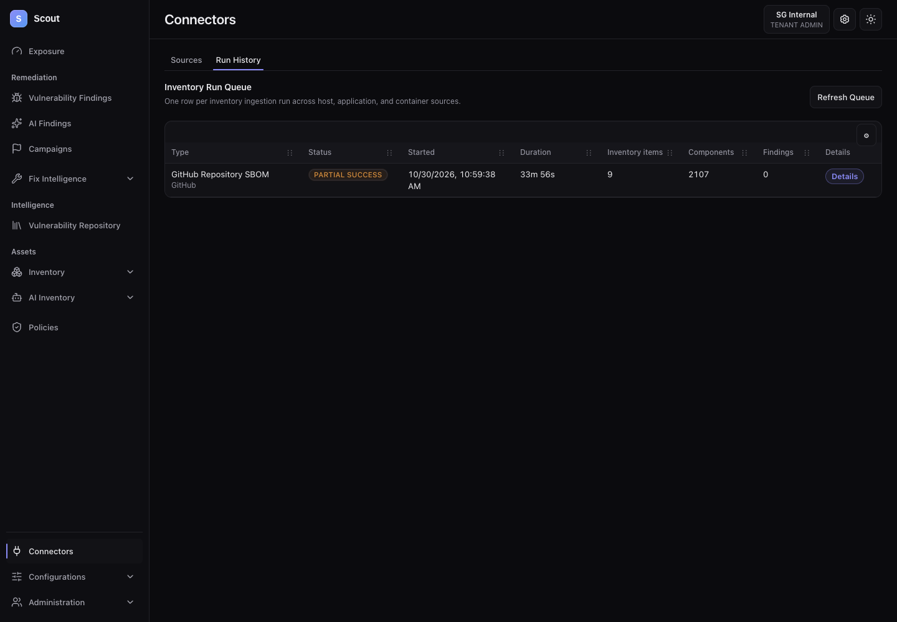

# UI 2.0 backend wiring verification — 30 October 2026

**Initial audit:** the main workflows were connected, with the gaps documented below. These findings have since been repaired locally; see [the fix and revalidation report](ui2-backend-wiring-fixes-2026-10-30.md). The original observations and evidence are retained here.

This is a local working-tree audit of `http://127.0.0.1:5173` against the Spring backend on port 8080 and its PostgreSQL database. It is not a production deployment certification. Existing UI edits were present before the audit and continued during it.

The story checked was: authenticated UI 2.0 navigation or action → frontend API client → Spring endpoint and tenant service → PostgreSQL or background job → response rendered in the UI. Static endpoint matching, tests using fixtures, and requests to the real backend are distinguished below.

## Findings

### 1. AWS Bedrock setup fails when no connector exists

Open `/connect?connectSource=ai-security-aws` as a tenant administrator with no saved AWS AI connector. The API returns **HTTP 200, zero body bytes, and no Content-Type**. The frontend request helper returns `undefined`; React Query rejects that result, and the page hides the connection form behind this error:

> The saved AWS Bedrock settings could not be loaded (["ai-security-connector"] data is undefined).

This prevents initial configuration even though the request itself succeeds.

Relevant code:

- `backend/src/main/java/com/prototype/vulnwatch/aisecurity/service/AiSecurityAwsConnectorService.java:59` returns `null` for an absent connector.
- `backend/src/main/java/com/prototype/vulnwatch/aisecurity/controller/AiSecurityConnectorController.java:49` returns that value directly.
- `frontend/src/api/client.ts:985` returns `undefined` for a non-JSON response.
- `frontend/src/pages/AiSecurityConnectorPage.tsx:13` passes the result directly to React Query; its error guard hides the form.

Repair: define the absent-configuration response explicitly, and normalize it to a valid query value such as JSON `null`. Add a real HTTP-response regression for the unconfigured state; the existing page tests mock the API function and do not exercise this boundary. Preserve the intended form protection on actual read failures.

### 2. Tenant Operations routes call platform-only APIs

A tenant administrator can open `/operations/pipeline` and `/operations/platform-health`. The pages request the following endpoints, all of which returned **403**:

- `/operations/ingestion-efficiency`
- `/operations/freshness-drift`
- `/operations/api-read-path`
- `/operations/metric-catalog`
- `/operations/performance-scorecard`
- `/slo/status`

`frontend/src/App.tsx:435` only redirects platform-scope owners from Operations; it mounts these pages for tenant users. `backend/src/main/java/com/prototype/vulnwatch/config/SecurityConfig.java:79` restricts general Operations endpoints to platform owners. The tenant-accessible quality endpoints have a separate rule and were successful.

Repair: make route access consistent with the backend's intended authority model, using a redirect or explicit access-denied state for unsupported roles. Do not weaken backend authorization merely to make the page load. These routes are reachable through direct URLs even though Operations is absent from the tenant sidebar.

### 3. GitHub partial-success metadata overstates successful ingestion

The resumed run discovered nine repositories and reported seven failures, yet its stored metadata says `assetsIngested: 9`. The batch DTO distinguishes `repositoriesProcessed` from `repositoriesSucceeded`; the source service writes the former into `assetsIngested`.

Both saved-source and standalone completion paths have this mapping in `backend/src/main/java/com/prototype/vulnwatch/service/GithubSbomSourceService.java:604` and `:679`. Use `repositoriesSucceeded` when reporting successfully ingested assets. The overall partial-success status and 2,107-component total are present in the UI.

### 4. Browser verification has stale expectations

The fixture browser suite passed **799 of 807 checks**, with **five of six journey suites passing**. The eight failures are all in the experience suite: root, unknown-route, legacy-query, and successful-login checks still expect the tenant-admin home to be `/configurations`. The current working-tree change in `App.tsx` deliberately routes tenant users to `/exposure`, and its unit test asserts that behavior.

The standalone live inventory script also still searches for host and software-identity **buttons**, while current list navigation renders **links**. Its initial run passed 78/80 checks but could not proceed through the inventory detail journey. In a temporary audit copy with only the host selector corrected, 20/26 checks passed: real host search, detail, tabs and return navigation worked in both themes. The software-identity step then clicked its first button, which navigates to associated hosts, rather than the identity link; its six subsequent assertions failed. The repository test source was left unchanged. These failures must remain visible until test selectors and home-route expectations are reconciled with the intended UI behavior; they are not evidence that the real endpoints are missing.

### 5. Two unused frontend methods target absent endpoints

Static inspection found no backend mapping for GET or POST `/platform/ai-grid/policies/portfolio/candidates`, exposed by `getPlatformAiGridPolicyCandidates` and `createPlatformAiGridPolicyCandidate` in `frontend/src/api/client.ts:1654`.

No callers were found outside their declarations, so this is stale client surface rather than a demonstrated broken screen. Remove the methods if the capability is retired, or restore the contract before adding a caller.

## Verification evidence

| Check | Result | What it establishes |
| --- | --- | --- |
| Frontend method/path inspection | 436 of 438 resolvable API call sites match backend mappings; 554 backend endpoint declarations inspected | Broad endpoint existence and HTTP-method alignment; not payload, authority, or provider correctness |
| Live tenant route sweep | 62 route visits, 445 API responses, 90 distinct GET paths | Main pages reach the actual backend; six 403 responses, no 5xx responses, no JavaScript page crashes |
| Frontend unit tests under Node 24 | 1,082 passed, zero failed | Existing unit and component assertions pass |
| Coverage | Lines 58.56%, statements 55.92%, functions 47.95%, branches 47.93%; configured gates pass | Measures the limits of automated coverage; not complete functional verification |
| Type checking | Passed | Frontend types compile |
| Lint | Zero errors, two warnings | Existing warnings in PageFreshnessStatus and ConfigurationsPage |
| Production UI build | Passed | Build and production bundle authentication checks pass |
| Built UI/public boundary browser checks | 15 direct routes and 20 public/history checks passed | App/auth use UI 2.0 and public pages retain their presentation boundary |
| Targeted backend unit tests | 38 passed, zero failures/errors/skips | Ingestion source, worker, execution, findings, authentication, and vulnerability dashboard tests |
| Fixture findings journey | 67/67 passed | UI interactions and expected request contracts using fixtures |
| Fixture CVE journey | 94/94 passed | Workbench, assessment and finding-creation interactions using fixtures |
| Fixture inventory journey | 108/108 passed | Host, identity, AI and inventory interactions using fixtures |
| Fixture policy/governance journey | 168/168 passed | Policy and authority interactions using fixtures |
| Fixture connector journey | 118/118 passed | Connector, run-history and configuration actions using fixtures |
| Fixture experience journey | 244/252 passed | Eight stale home-route expectations remain |
| Additional live host checks, both themes | Host detail, tabs, search and return navigation passed after selector correction | Temporary audit copy: 20/26 checks passed; remaining failures follow the stale software-identity selector |
| Original read-only live journeys, both themes | Findings 54/54; AI 20/20; inventory 4 passed, 2 journey failures | Findings and AI exercised with real data; inventory script stopped at outdated selectors |

The first test attempt used the host's unsupported Node 26 runtime and produced environment-related failures. The authoritative unit and coverage results above use the required Node 24 runtime. The missing declared browser dependencies were installed; package manifests and lockfile were not intentionally changed.

## Original queued SBOM issue — restored locally

The local `sg-ui-review-backend` container ran with `APP_RUNTIME_ROLE=api`; no worker container existed. Logs explicitly said the ingestion poller was skipped, and the accepted GitHub job remained `QUEUED` with `attempt_count=0`.

The backend was recreated with `APP_RUNTIME_ROLE=all`, retaining the workspace, Maven cache, database connection and existing PostgreSQL data. The old container had automatic removal enabled and removed itself when stopped; the replacement is retained when stopped. The replacement's role and running state were checked.

The same job was claimed on attempt one and finished. The sync run now shows **PARTIAL SUCCESS**, nine discovered repositories, seven failed repositories, and **2,107 ingested components**. GitHub returned 404 for some repository SBOM requests. The UI Run History renders the final status and component count. The job's terminal `SUCCEEDED` status denotes completion of the batch; the sync-run result carries the partial-success outcome.

## Remaining limits

- Real platform-owner browser flows were not run: usable local platform-owner credentials were absent from the local settings. Platform flows were exercised with fixtures and included in static inspection.
- Provider credentials and customer infrastructure were not supplied for a live success test of every cloud, CMDB, ticketing, registry, email or intelligence integration. No messages were sent and those external outcomes are not certified.
- The real-data interaction run was read-only. Fixture tests verify many write request contracts, but this audit did not execute every write operation against a live database.
- Full PostgreSQL integration suites and deployed-service tests were not run. The 38 backend tests are targeted unit tests.
- The production artifact was checked against fixture-backed browser journeys; the live backend sweep used the local development UI.
- Existing unit coverage and the findings above preclude a blanket claim that every function is working.

## Saved evidence

- [Machine-readable verification summary](verification/ui2-backend-2026-10-30/summary.json)
- [Frontend/backend endpoint mapping](verification/ui2-backend-2026-10-30/contracts.json)
- [Live route and API observations](verification/ui2-backend-2026-10-30/live.json)
- [Exact empty-response and authorization probes](verification/ui2-backend-2026-10-30/probes.json)
- [Stored SBOM completion result](verification/ui2-backend-2026-10-30/sbom-outcome.json)

The initial verification applied only the local backend runtime repair. The subsequent source fixes, test updates, local SBOM count correction, and revalidation are recorded in [the follow-up report](ui2-backend-wiring-fixes-2026-10-30.md).
