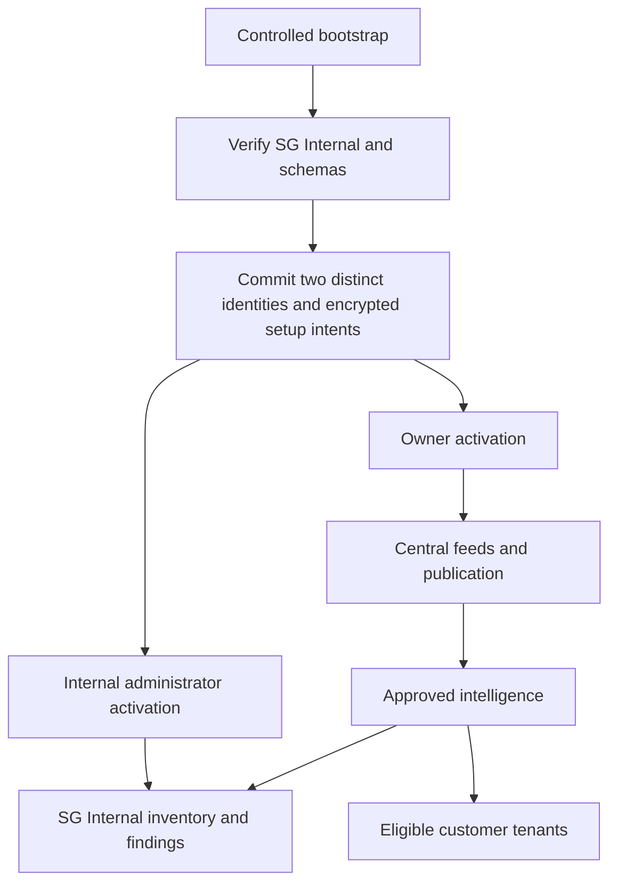

# Platform owner and tenant operating flow

Updated: 22 October 2026

This describes the implemented MVP. Verification and operational limits are recorded in [implementation evidence](implementation-evidence.md). The original implementation plan remains unchanged. MFA and historical integration migration are outside this release.

## Installation and separate authority

| Context | Identity | Authority |
| --- | --- | --- |
| Platform | Dedicated owner alias | PLATFORM_OWNER; central intelligence, tenant lifecycle, publication and operational health |
| SG Internal | Separate administrator alias | TENANT_ADMIN membership in SG Internal; normal tenant inventory, findings, integrations and administration |
| Customer | Explicitly provisioned member | Assigned roles in its own CUSTOMER tenant |

The installation control plane migrates and verifies schemas and runtime grants before provisioning both initial identities. Their authority records, token digests and encrypted delivery intents commit together. Delivery runs later under runtime credentials. Neither activation depends on the other.

SG Internal is the protected INTERNAL tenant mapped to `tenant_default`. Its UUID and existing slug remain stable; its display name is SG Internal. Customer creation cannot claim its classification, schema, reserved name or slug. It has Enterprise entitlements and quotas through normal authorization. Demo expiry, cleanup and ordinary deletion cannot remove it.

Platform ownership does not grant ordinary tenant membership. The historical playground membership bridge is revoked and denied. A platform owner uses explicit audited support authorization when tenant access is required. Missing tenant context does not select SG Internal in production; the explicit local API-key compatibility mode remains for development tests.

## Account setup and recovery

Configure two different email aliases that reach the intended operator. Both receive the same neutral message:

**Subject: Complete your SG account setup**

> Hello,
>
> You have been invited to set up an SG account.
>
> Complete account setup
>
> This link expires at {absolute UTC timestamp} and can be used once. Do not forward this email or share the link.
>
> If you were not expecting this invitation, leave the link unused and contact your administrator through your usual channel.
>
> SG

Roles, tenants, schema names and infrastructure metadata are absent from delivery content, URLs and provider tags. Links carry opaque fragment tokens. The existing CSRF-protected exchange moves setup authority into an HttpOnly, SameSite cookie; exchange preserves the original expiry. Password establishment consumes that authority. Tokens are hashed in authority records and encrypted inside frozen delivery payloads; raw tokens are excluded from logs and activity evidence. Click tracking is disabled.

Provider acceptance and account activation are separate states. Existing bounded retry, provider idempotency and UNKNOWN delivery reconciliation apply to both setup types. Normal bootstrap reruns preserve identities, passwords, invitation state and expired links. Recovery is explicit and independently scoped to one account.

The privileged CLI supports owner reissue and internal-admin reissue separately. An activated owner can also inspect `/api/platform/setup-deliveries`, explicitly reissue a selected identity with a reason, or reconcile an uncertain delivery. An expired first-owner invitation is recovered through the authorized control plane, not through internal-admin authority.

## Central ingestion and publication

Only platform owners configure or trigger central feeds. Owner navigation contains feed configuration, persisted schedules, run history, candidate review, release history and tenant processing health. Tenant inventory connector queries do not mount in platform connector scope. Tenant navigation retains supported inventory/BOM integrations and source preferences.

All normalized vulnerability/advisory paths stage their complete evidence: NVD including single-record refresh, KEV, GHSA, CSAF/VEX, EUVD, JVN, manual advisories, EPSS, OSV and VEX maintenance. EOL keeps its separate platform lifecycle. Successful fetching does not update approved intelligence or enqueue tenant recomputation.

Run evidence freezes after normalization. Failed and incomplete runs cannot be selected. Fetch checkpoints and published checkpoints are separate; incomplete pagination never certifies a completed checkpoint. A selected incremental run expands to include successful unpublished predecessors for that source, including empty checkpoints. Absence from an incremental response does not withdraw existing evidence.

Candidates contain immutable prepared observations, matching artifacts, expanded run IDs, base release, normalization policy, quality report and digest. The review shows additions, changes, withdrawals, exclusions, merges, aliases, version-rule quality and source freshness. Invalid records and ambiguous aliases are excluded visibly.

Deduplication uses authoritative identifiers and structured aliases. Incidental CVE text does not establish identity. A GHSA advisory containing several CVEs preserves distinct canonical identities and observations. Later verified aliases create redirects and consolidate approved evidence while retaining finding history. Compatibility GHSA reads use the approved observations and package targets; compatibility triggers enqueue the same durable GHSA run.

One owner selects **Approve and publish**. Approval requires the exact reviewed digest, base release and idempotency key. A stale base requires a new candidate and review. New ingestion cannot mutate an existing candidate.

Publication executes asynchronously in a locked, consistent PostgreSQL transaction. Prepared changes, immutable release evidence, active generation, audit and fan-out intent commit together. A crash or failed artifact update rolls everything back, preserving the previous approved projection. Duplicate approvals cannot create duplicate publication jobs. Processing starts after commit.

Only the active release can be withdrawn. Withdrawal creates another immutable corrective release, restores previous row images, and schedules reevaluation. The first release withdraws to empty approved intelligence while retaining canonical tombstones for history. Older errors require a corrective candidate; no arbitrary historical rollback UI is provided.

## Automatic tenant processing

Committed fan-out progresses in batches of 50 tenants. Evaluation processes at most 100 inventory components per transaction. Durable cursors, release generations and tenant input revisions permit restart and supersession. Release and input locks prevent an older evaluation from certifying newer settings or inventory. A failed tenant retries independently; suspended or incompatible tenants wait until ready.

Publication, inventory changes, source changes, tenant creation/activation/resumption and corrections schedule reevaluation automatically. No tenant approval or import step is required. Historical manual finding-generation settings do not gate this approved-intelligence path.

The source registry includes NVD, KEV, GHSA, Red Hat, Microsoft, EUVD, JVN, manual advisories and EPSS. Defaults are persisted enabled. KEV and EPSS enrich supported exposure but cannot establish applicability alone. Applicability, VEX, severity and risk inputs use only enabled approved source evidence. GHSA integration controls share the same source preference.

Finding intelligence eligibility is independent of workflow status:

| Eligibility | Meaning |
| --- | --- |
| ELIGIBLE | Current approved evidence from an enabled source supports exposure |
| SOURCE_DISABLED | Supporting approved source is disabled for this tenant |
| INTELLIGENCE_WITHDRAWN | Supporting approved evidence was withdrawn or consolidated |

Inactive findings leave actionable lists, dashboards, exports, notifications and downstream workflow reads through restrictive tenant RLS. Authorized history reads can opt in explicitly. Disable/re-enable reuses the finding identity and preserves analyst suppression, resolution, evidence and incident references. Alias consolidation retains secondary history with a merged-into reference. Disabling a source does not record remediation.

## Release operation

Append-only migrations advance the platform to V8 and tenants to V6. Feed schedules start disabled. The authorized release sequence is: inspect actual deployment histories, run the existing control plane with both aliases and matching runtime encryption key, verify readiness/grants, activate both accounts, ingest and review the first candidate, publish, confirm tenant findings, then enable the intended schedules.

The implementation task did not execute this sequence against a live deployment or send real activation emails. Globally unavailable capabilities remain unavailable.
