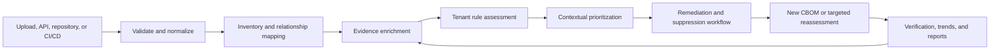

# ScoutGrid CBOM End-to-End Implementation Plan

**Status:** Proposed 
**Revision:** 5 — application-packaged rules and queue/executor corrections incorporated 
**Scope:** Customer CBOM ingestion, assessment, visibility, remediation, verification, and reporting 
**Primary format:** CycloneDX CBOM (JSON first; preserve existing supported ingestion paths) 
**Target users:** Security leaders, security analysts, application owners, engineers, auditors, and platform administrators

## Architecture decisions incorporated in Revision 5

- Canonical findings are the only remediation, suppression, ticket, campaign, and resolution source of truth.
- `cbom_risk_findings` retain observation and source-evidence lifecycle only.
- Existing canonical statuses and VEX-style `decision_state` remain unchanged; finer progress uses a new generic workflow sub-state inside `OPEN`.
- `BomEvidenceState` presence and claim assurance are separate axes.
- Immutable CBOM rule definitions and safety metadata ship as versioned application packages. Tenant schemas own selection, parameters, pin/follow-latest mode, effective version, audit, and evaluation results. CBOM rules do not use the platform AI Grid policy catalog or require platform approval.
- Source identity, duplicate handling, deterministic supersession, and cross-version component identity precede semantic diff.
- Assessment becomes a new type in existing tenant-local `ingestion_jobs`, claimed through `claimPendingJobsByType` with an explicit per-tenant cap and executed on a CBOM-specific bounded executor.
- Full periodic mirror scans are replaced by a new `CBOM_DELTA` producer/handler built on the existing tenant-local `finding_delta_queue`, plus bounded repair reconciliation.
- Runtime collectors are a separately approved containment program.
- The first implementation slice stops at trusted assessment, explainability, backfill, and a canonical ticket.
- Validation outcome and asynchronous assessment lifecycle are separate state fields.
- `TENANT_ADMIN` is the CBOM administrative authority. Single-admin suppression is the default, with an optional tenant maker-checker setting using a second `TENANT_ADMIN`; no platform approval or fine-grained permission framework is introduced.
- Accepted source artifacts are preserved exactly; artifacts suspected of containing reusable secrets are rejected before persistence in the first release.

## 1. Outcome

ScoutGrid will turn a customer CBOM from a static uploaded document into a continuous cryptographic-risk workflow:

1. Ingest and validate the CBOM.
2. Normalize cryptographic assets without losing the original evidence.
3. Enrich declarations with source, configuration, and runtime evidence.
4. Assess assets using versioned tenant rules.
5. Prioritize findings using exposure, business context, and claim assurance.
6. Assign and track remediation work.
7. Reassess new CBOM versions and verify outcomes.
8. Produce reproducible customer and audit reports.

The product must keep three concepts separate throughout the workflow:

- **Risk:** How harmful the observed cryptographic condition could be.
- **Assurance:** How a claim was established (`VERIFIED`, `DECLARED`, `INFERRED`, `UNKNOWN`, or `CONTRADICTED`) and the confidence ScoutGrid assigns to it.
- **Completeness:** How much required information is present or verified.

An unknown control must not be presented as a confirmed security failure.

## 2. Customer journey

### Definition of a successful experience

Within five minutes of ingestion, a customer should be able to answer:

- Was the CBOM accepted, and what needs correction?
- What cryptographic assets were discovered?
- Which risks are confirmed, inferred, declared, or unknown?
- Which applications, environments, and services are affected?
- What should be remediated first, by whom, and by when?
- What changed from the preceding CBOM?
- Can the assessment be reproduced for an auditor?

## 3. Existing ScoutGrid foundation

The implementation should extend the current architecture:

- `BomIngestionOrchestrator` already provides the common BOM lifecycle.
- `CbomComponentParser` and `CbomIngestionService` parse and persist cryptographic assets.
- `CbomRiskEngine` generates rule-based findings.
- `CbomPostureService` calculates asset posture summaries.
- `CbomFindingMirrorService` mirrors crypto findings into canonical findings.
- `CbomController` exposes posture, component, finding, and acceptance operations.
- `BomManagementPage` and `BomInventoryPage` already display CBOM inventory and findings.
- BOM source, lineage, supersession, and evidence withdrawal are already represented.
- Canonical finding ticketing and Jira integration can be reused for crypto findings.

### Principal gaps

| Area | Current capability | Required improvement |
|---|---|---|
| Validation | Document parsing and common ingestion validation | Formal schema results, field-level diagnostics, integrity checks, and validation report |
| Evidence and assurance | BOM evidence supported/withdrawn state | Separate presence and claim-assurance axes, including origin, method, confidence, observation time, and verification status |
| Assessment | Hard-coded crypto rules | Versioned tenant rule sets, applicability, effective dates, and explainable decisions |
| Prioritization | Component risk and posture score | Exposure, environment, business criticality, blast radius, confidence, and urgency |
| History | BOM lineage and supersession | Customer-visible CBOM semantic diff and risk trend |
| Remediation | Finding acceptance and canonical ticketing | Ownership, SLA, remediation plan, suppression expiry, and verification |
| Relationships | Source document dependency edges | Crypto-specific usage/custody graph and blast-radius queries |
| Reporting | UI posture and findings | Reproducible assessment report with artifact/rule-set hashes and limitations |
| PQC | Quantum-vulnerable rule | Migration inventory, data-lifetime context, readiness, and campaign tracking |

## 4. Product principles

1. **Preserve source truth safely.** For accepted artifacts, store the submitted bytes and checksum without rewriting them. For artifacts suspected of containing reusable secrets, compute the hash in bounded memory, reject the artifact, and do not retain the original.
2. **Explain every conclusion.** A finding must identify the tenant rule/version, input evidence, reasoning, confidence, and recommended outcome.
3. **No false verification.** `DECLARED` or `UNKNOWN` must never be rendered as `VERIFIED`.
4. **One workflow owner.** Canonical `findings` own status, decision state, workflow sub-state, owner, SLA, tickets, campaigns, suppressions, and resolution for every finding kind, including `CRYPTO`. `cbom_risk_findings` owns only the crypto observation and its source-evidence lifecycle.
5. **Treat withdrawal correctly.** Removal of source evidence is not proof of remediation.
6. **Make assessment reproducible.** Artifact checksum, parser version, tenant rule-set version, evidence snapshot, and assessment time must be recorded.
7. **Gate regressions carefully.** CI/CD should block confirmed rule violations, not optional metadata omissions by default.
8. **Tenant isolation is mandatory.** Every new entity, query, export, job, and graph traversal must remain tenant-scoped.

## 5. Target capabilities

### 5.1 Guided ingestion and validation

Support the existing upload, URL, repository, and ingest API paths, then add a common CBOM preflight result.

Required behavior:

- Detect document type, CycloneDX specification version, encoding, and document checksum.
- Validate against the applicable CycloneDX schema.
- Perform semantic integrity checks:
  - duplicate or missing `bom-ref` values;
  - unresolved relationship references;
  - invalid or contradictory certificate dates;
  - algorithm/key-size combinations that cannot be interpreted;
  - missing application/environment ownership context;
  - accidental secret-like values in names, properties, or descriptions.
- Separate errors that block ingestion from warnings that reduce completeness.
- Return JSON-pointer paths and human-readable correction guidance.
- Preserve validation results with the ingestion record.
- Allow a permitted user to download the validation report.
- Secret-detection failures return a detector code and JSON pointer but never echo the matched value. Tune detectors against public-certificate/public-key and legitimate-identifier fixtures before enabling rejection.

GA secret-detector gate:

- 100% detection of the seeded forbidden-secret corpus;
- zero false rejections across the maintained valid/public-cryptographic-material fixture corpus; and
- below 0.5% adjudicated false-rejection rate across an opt-in design-partner validation sample of sufficient size to be meaningful.

Until this gate passes, run secret detection in warning-only mode while retaining the hard rejection of structurally recognized private-key and credential formats.

Persist two independent state fields:

**Validation outcome** — whether the submitted artifact can enter inventory:

- `REJECTED`: unsafe, unsupported, or unparseable; assessment cannot be queued.
- `ACCEPTED`: required validation passed without warnings.
- `ACCEPTED_WITH_WARNINGS`: inventory may be created, but completeness or assurance is limited.

**Assessment lifecycle** — asynchronous processing state:

- `NOT_QUEUED`: validation has not produced assessable input.
- `QUEUED`: durable work was admitted.
- `ASSESSING`: a worker owns the current attempt.
- `ASSESSED`: all required evaluators completed.
- `PARTIALLY_ASSESSED`: one or more evaluators/enrichments failed or were unavailable; retry is available.
- `FAILED`: the run produced no usable assessment; retry or operator action is required.

Do not derive one field from the other in UI or reporting. An `ACCEPTED_WITH_WARNINGS` document can still reach `ASSESSED`, and an `ACCEPTED` document can have a `FAILED` assessment.

`SUPERSEDED` belongs only to an individual `cbom_assessment_runs` row when a newer successful run becomes authoritative. It is not a per-document assessment-lifecycle value.

### 5.2 Evidence-aware inventory

Introduce a normalized evidence model instead of adding verification flags directly to every component field.

Keep two independent axes and name them consistently:

- **BOM evidence presence** uses the existing `BomEvidenceState`: `SUPPORTED`, `WITHDRAWN`, `CONFLICTING`, or `LEGACY_UNKNOWN`. This says whether an observation is currently supported by its source document.
- **Assurance level** describes how strongly ScoutGrid has verified a claim. It must not reuse the name `evidence_state`.

Recommended assurance levels:

- `VERIFIED`: confirmed through source, configuration, runtime, or authoritative service evidence.
- `DECLARED`: present in the submitted CBOM but not independently checked.
- `INFERRED`: derived from related assets or dependencies.
- `UNKNOWN`: required evidence is absent or insufficient.
- `CONTRADICTED`: two current evidence sources disagree. This maps to, but does not replace, the presence-level `CONFLICTING` state.

Limit claim-level assurance records to a governed catalog of important claims to avoid unbounded `components x fields x sources` growth. The first catalog should cover algorithm/parameter strength, protocol version, key custody, rotation/expiry, certificate validity, usage, environment, and public exposure.

Each assurance record should capture:

- tenant, component, and field/claim;
- source type and source reference;
- observation method;
- normalized value and optional protected raw value;
- confidence score and assurance level;
- observed, ingested, and expiry timestamps;
- collector/parser version;
- artifact checksum or runtime observation identifier.

The component detail page should show each important claim with its evidence badge and provenance, for example `TLS 1.3 — VERIFIED from runtime probe` versus `TLS 1.3 — DECLARED in CBOM`.

### 5.3 Application-packaged, tenant-controlled rule and assessment engine

CBOM rule definitions ship as versioned, immutable packages in application resources. Tenant schemas own which package version is effective, optional rule selection, supported parameters, pinning, audit, and results. Do not use the platform AI Grid policy catalog, platform distribution/rollout tables, answer-key approval flow, or platform policy team as a dependency. This preserves tenant control without using schema migrations as a content-delivery channel.

This deliberate third rule mechanism and its future convergence triggers are recorded in [ADR-0001](adr/0001-cbom-tenant-controlled-rule-system.md).

Implementation model:

- Add an application `CbomRulePackageRegistry` that loads immutable packages keyed by rule-set ID and semantic version and verifies their schema and digest at startup.
- Add tenant-local `cbom_rule_config`, `cbom_rule_availability`, and `cbom_rule_selection_history` tables for mode (`FOLLOW_LATEST` or `PINNED`), pinned/effective version, optional-rule selection, parameters, discovered package digest, actor/reason, and audit. Tenant migrations create schema only; they do not carry rule content.
- `CbomRiskEngine` evaluates `cbom_components` and important claims directly using the tenant's effective application package; do not project CBOM data into `ai_grid_facts`.
- `TENANT_ADMIN` can enable/disable optional rules and configure supported thresholds directly. No platform approval or cross-tenant rollout is required.
- Mandatory-rule flags, non-editable defaults, parameter types, and hard safety bounds live in immutable package metadata, never tenant-editable rows. The evaluator rejects a tenant configuration that disables a mandatory rule or exceeds those bounds.
- A startup/scheduled tenant reconciler compares packaged versions with each tenant's recorded availability. In `FOLLOW_LATEST`, it records the new effective version and idempotently queues bounded reassessment for active CBOMs; in `PINNED`, it records that an upgrade is available without changing effective behavior.
- Reassessment uses tenant-local `ingestion_jobs`, per-tenant admission limits, and dedupe keys based on tenant, CBOM, and rule-set digest.
- Emit active rule-set ID/version as an approved low-cardinality telemetry dimension without a tenant identifier.
- Slice 1 converts the current `CbomRiskEngine` constants into the initial application package and records the exact package version and digest on every assessment; it has no platform catalog critical path.

Each rule requires:

- stable rule ID and semantic version;
- title, risk class, default severity, and rationale;
- applicable asset types and environments;
- input fields and minimum evidence requirements;
- condition and configurable thresholds;
- remediation guidance and references;
- effective and retirement dates;
- tags such as `KEY_MANAGEMENT`, `TLS`, `CERTIFICATE`, `PQC`, or `COMPLETENESS`.

Initial application rule packages available for tenant control:

- ScoutGrid Recommended Cryptography Baseline.
- Post-Quantum Readiness.
- Optional organization baseline expressed through tenant selection/parameters and stored entirely within the tenant.

Do not label a compliance-specific pack as certified until its control mapping and claims have been independently reviewed.

Assessment outputs must record:

- tenant rule set and version;
- rule and evaluator version;
- applicability result;
- evidence snapshot used;
- risk result and confidence;
- deterministic finding fingerprint;
- assessment run ID and timestamps.

### 5.4 Contextual risk prioritization

Keep severity and priority distinct. Calculate remediation priority from explainable factors:

- tenant rule severity;
- internet exposure;
- production versus non-production environment;
- asset business criticality;
- protected-data sensitivity and confidentiality lifetime;
- key custody and rotation posture;
- number and criticality of dependent systems;
- claim assurance and confidence;
- exploitability or urgency, where applicable;
- compensating controls and active suppressions.

Expose the factor breakdown instead of only a composite score. Customers must be able to override business criticality and ownership without changing the underlying technical evidence.

Context must have explicit provenance because it is generally not supplied by a CBOM:

| Context | Authoritative/default source | Customer override ownership |
|---|---|---|
| Environment and application ownership | Existing ScoutGrid asset/CMDB mapping | Tenant asset metadata, audited |
| Business criticality | CMDB/business-service record; otherwise `UNKNOWN` | `INVENTORY_ADMIN` or `TENANT_ADMIN` |
| Internet exposure | Existing Exposure evidence/graph; never inferred from CBOM presence | Security analyst may propose; approved exposure workflow remains authoritative |
| Data sensitivity and confidentiality lifetime | Data-classification integration or tenant declaration | `TENANT_ADMIN` with reason and review date |
| Key custody and rotation | CBOM declaration plus approved assurance sources | Source-specific; manual assertion remains `DECLARED` |
| Dependent systems/blast radius | Provenance-aware relationship graph | Reviewed relationship correction, not score override |
| Compensating controls | Canonical suppression/review workflow | `TENANT_ADMIN` |

Store customer-owned values in existing tenant asset/configuration metadata where semantics already exist; add a tenant-scoped context-override record only for missing concepts. Every override requires actor, reason, source, effective time, review/expiry time, and audit history.

Default factor weights, mandatory flags, and hard safety bounds live in the immutable application rule package. `TENANT_ADMIN` owns supported tenant parameter changes, which require impact preview, reason, versioned history, and audit but no platform approval. Package validation protects mandatory rules and invalid configurations. The existing canonical `RiskPolicy` remains the only owner of severity-based SLA defaults and continues to populate canonical `due_at`; CBOM rules do not create a second SLA system.

### 5.5 Three customer views

#### Executive cryptographic posture

- overall risk, assurance, and completeness trend;
- production assets with critical/high crypto findings;
- verified inventory coverage and completeness;
- remediation SLA compliance;
- suppression count and upcoming expirations;
- certificate/key rotation outlook;
- post-quantum migration exposure.

#### Analyst workbench

- filterable crypto inventory and findings;
- filters for asset type, algorithm, environment, custody, evidence state, rule set, status, owner, and severity;
- evidence drawer with source provenance;
- relationship and blast-radius view;
- semantic CBOM diff;
- bulk ownership, campaign, ticket, and suppression actions.

#### Engineering remediation view

- affected service and environment;
- exact evidence and tenant-rule reasoning;
- target state and framework-specific guidance;
- linked ticket, pull request, campaign, and owner;
- verification steps and targeted reassessment action.

### 5.6 CBOM semantic diff and trends

Cross-version source and component identity are prerequisites, not part of the diff implementation. Before enabling diff:

- define the logical source identity used to determine successors;
- reject or explicitly classify duplicate submissions that reuse serial number, checksum, source, and asset;
- reconcile existing assets with multiple active copies of the same logical CBOM;
- make supersession deterministic and transactional;
- define a cross-document component identity independent of a source-BOM-scoped fingerprint;
- report ambiguous component matches rather than guessing.

After those controls are in place, compare the current active CBOM to its predecessor using stable cross-version identity rather than array position.

Diff categories:

- cryptographic asset added or removed;
- algorithm, key size, curve, mode, protocol, or certificate change;
- storage/custody or usage relationship change;
- claim assurance/confidence increased or decreased;
- finding introduced, resolved, reopened, or withdrawn;
- posture and priority movement;
- ownership/environment change.

The UI must distinguish:

- **Remediated:** new evidence proves the unsafe condition is gone.
- **Not observed:** the new document omitted the component or claim.
- **Withdrawn:** source was superseded or deleted.
- **Accepted risk:** condition remains but has a valid suppression.

### 5.7 Canonical remediation and suppression workflow

Do not add CBOM-specific remediation status or suppression records. The mirrored canonical finding is the sole workflow source of truth.

Preserve the canonical status constraint:

- `OPEN`
- `RESOLVED`
- `SUPPRESSED`
- `AUTO_CLOSED`

Represent `TRIAGED`, `PLANNED`, `IN_PROGRESS`, and `VERIFICATION_PENDING` in a new generic canonical `workflow_substate` column while status remains `OPEN`. Never map workflow progress onto `decision_state`; its existing values (`AFFECTED`, `NOT_AFFECTED`, `FIXED`, `UNDER_INVESTIGATION`, and `NEEDS_REVIEW`) retain their VEX-style impact semantics.

Canonical findings own:

- accountable owner and team through existing `assigned_to` and `owner_group`;
- target date and SLA through existing `due_at` and canonical `RiskPolicy`;
- existing `decision_state` plus the new workflow sub-state;
- implementation notes and target state;
- linked external ticket and pull request;
- campaign membership;
- suppression decision and expiry;
- resolution and audit history.

`cbom_risk_findings` continues to own rule observation, crypto evidence, first/last seen, and `BomEvidenceState`. Withdrawal changes evidence support and may drive canonical `AUTO_CLOSED`; it must not claim remediation.

Reuse `FindingTicketController` and configured ticket providers because CBOM findings are already mirrored into canonical findings. Add crypto-specific canonical ticket templates containing the rule, asset, evidence, target state, and verification instructions.

`POST /api/bom/cbom/findings/{findingId}/accept` currently suppresses immediately, without expiry or review, and permits `SECURITY_ANALYST`, `TENANT_ADMIN`, and `CREATOR`; changing it is a deliberate breaking product/security decision, not a transparent translation. After hardening, `SECURITY_ANALYST` may request suppression but cannot directly accept risk.

- **By 2026-12-15, in one coordinated backend/frontend release:** restrict the endpoint to `TENANT_ADMIN`; update `BomManagementPage.tsx` to open a suppression form requiring reason and expiry; update `api.acceptCbomFinding` to send the new body; add component/API tests; emit `Deprecation`/`Sunset` headers; and return the canonical finding/suppression contract.
- **On 2027-03-15:** stop accepting new calls and return `410 Gone` with the canonical replacement endpoint.
- **On 2027-06-15:** remove the legacy route after usage telemetry confirms no active callers.

Build risk acceptance on existing canonical suppression/review mechanisms: `suppressed_until`, suppression reason fields, `finding_reviews`, and `FindingWorkflowService.reopenExpiredSuppressions()`. Do not create a new exception table.

Add tenant setting `cbom.require-distinct-suppression-approver`, default `false`:

- When `false`, `TENANT_ADMIN` may directly suppress with reason and bounded expiry.
- When `true`, direct suppression is disabled: a request creates a `finding_reviews` entry with logical state `REQUESTED`, and a different `TENANT_ADMIN` records `APPROVED` or `REJECTED`; only approval applies canonical suppression.
- Whenever the request endpoint is used, its requester cannot approve that same request, even if maker-checker is otherwise disabled.

Risk acceptance requires:

- reason and compensating control;
- `TENANT_ADMIN` authorization; no platform approval is required, and optional maker-checker uses existing `finding_reviews`;
- bounded expiry date;
- automatic reminders and reopening at expiry;
- immutable audit events.

Verification-before-resolution is a configurable rule for `CRYPTO` findings, not a global change to manual resolution behavior for all finding kinds.

### 5.8 Relationship graph and blast radius

Model customer-declared and independently observed relationships without conflating them.

Initial node types:

- application, service, endpoint, environment;
- cryptographic algorithm and protocol;
- key, credential, certificate, and secret;
- secret/KMS location;
- CBOM document and evidence source.

Initial edge types:

- `USES`, `SECURED_BY`, `SIGNS_WITH`, `ENCRYPTS_WITH`;
- `STORED_IN`, `ISSUED_BY`, `EXPOSED_BY`;
- `DECLARED_BY`, `VERIFIED_BY`, `DEPENDS_ON`.

Each edge must carry provenance, confidence, validity period, and tenant. Start with relational adjacency tables and bounded traversal APIs; introduce a separate graph store only if measured query or scale requirements justify it.

Primary questions:

- Which applications rely on this key or algorithm?
- What is affected if this certificate expires?
- Which public endpoints still permit this protocol?
- Which production systems require migration from this quantum-vulnerable primitive?

Runtime collectors are a separately gated program, not an implicit part of the relationship milestone. Any TLS, certificate, KMS, or secret-store collector requires outbound allowlisting, DNS/IP rebinding defenses, redirect controls, private/link-local address denial, time and response-size limits, mocked-provider tests, credential scoping, and the same containment review used by other runtime evidence integrations.

### 5.9 Post-quantum migration workspace

Build on the existing quantum-vulnerable finding, but avoid treating all RSA/ECC usage as an immediate high-severity defect.

Capture:

- algorithm and parameter set;
- use case: signing, key agreement, encryption, or authentication;
- data confidentiality lifetime;
- exposure and business criticality;
- library/vendor migration readiness;
- hybrid/PQC support status;
- target solution, owner, milestone, and blockers.

Provide migration campaigns grouped by shared library, certificate authority, protocol, vendor, or platform to reduce duplicate remediation work.

### 5.10 Reproducible reporting

Generate a downloadable JSON assessment record first, followed by an HTML/PDF presentation generated from the same data contract.

Every report must include:

- customer, asset, environment, and assessment time;
- source CBOM name, serial number, and SHA-256 checksum;
- parser/evaluator and tenant rule-set versions;
- validation status and completeness summary;
- verified, declared, inferred, unknown, and contradicted assurance counts, plus supported/withdrawn/conflicting presence counts;
- findings, priority, state, owner, and remediation status;
- suppressions with actor, reason, and expiry;
- changes from the preceding assessment;
- assumptions, limitations, and failed enrichment steps;
- report checksum and generation time.

The first release uses a checksum for reproducibility and accidental-corruption detection and explicitly does not claim cryptographic authenticity. JSON includes `signatureStatus: "UNSIGNED"`; HTML/PDF output and the report-download UI display **Unsigned report — checksum verifies content consistency, not authenticity**. Report signing is deferred until a customer requirement justifies signing-key custody and verification operations; if added later, prefer tenant-specific managed signing keys to limit cross-tenant blast radius.

## 6. Data-model changes

Retain the existing `cbom_components`, `cbom_risk_findings`, and `cbom_posture_summary` tables. New tenant configuration, assessment, assurance, relationship, and report metadata use additive tenant migrations with the tenant migration guard and RLS. Rule definitions are application resources, not migration content. Revision 5 introduces no new platform CBOM tables. Update the packaged tenant migration catalog and target tests. Deploy migrations through forward-fix plus backward-compatible application code; do not require a cross-line rollback mechanism that Flyway does not provide.

### Schema, ownership, retention, and purge matrix

Milestone 0a must set concrete retention periods and register every new table/object in a purge/export inventory with automated coverage tests. ScoutGrid does not currently have a general tenant export, and destructive tenant purge is contained to demo tenants; full export/purge integration is therefore an explicit external platform dependency with its own owner, not a false Slice 1 exit criterion.

| Table/object | Schema/store | Owning service | Retention and tenant purge rule |
|---|---|---|---|
| Application CBOM rule packages | Application resources | `CbomRulePackageRegistry` | Immutable ID/version/digest and safety metadata; delivered with application release, not tenant DDL |
| `cbom_rule_config` / `cbom_rule_availability` / `cbom_rule_selection_history` | Tenant | CBOM rule engine | Selection, parameters, pin/effective version, package digest and tenant audit; register for purge/export inventory |
| Existing `ingestion_jobs` with `CBOM_ASSESSMENT` job type | Tenant | Existing ingestion job service | `job_type` requires no schema constraint change; reuse claim token, attempts, recovery and retention; no second task table |
| Existing `finding_delta_queue` with new `CBOM_DELTA` producer/handler | Tenant | Finding delta service + CBOM mirror | Extend producers/consumers for crypto finding IDs; reuse queue dedupe, attempts, status and retry |
| `cbom_tenant_settings` | Tenant | CBOM administration | Maker-checker flag and future bounded CBOM settings; one tenant-scoped row with audit; register for purge/export inventory |
| `cbom_shadow_enrollments` | Tenant | CBOM release validation | Explicit consent, scope and expiry; register for purge/export inventory |
| `cbom_validation_runs` | Tenant | BOM validation | Tenant CBOM retention; register for purge/export inventory |
| `cbom_validation_issues` | Tenant | BOM validation | Same as parent run; echoed values redacted; register for purge/export inventory |
| `cbom_claim_assurance` | Tenant | CBOM assessment | Important claims only; expire stale observations per source policy; register for purge/export inventory |
| `cbom_context_overrides` (only for concepts not already in asset metadata) | Tenant | Asset/context governance | Actor, reason, source, effective/review/expiry times; register for purge/export inventory |
| `cbom_assessment_runs` | Tenant | CBOM assessment | Reproducibility/audit retention; `SUPERSEDED` applies here; register for purge/export inventory |
| `cbom_assessment_results` | Tenant | CBOM assessment | Same as assessment run; register for purge/export inventory |
| `cbom_shadow_comparison_runs` | Tenant | CBOM release validation | Design-partner comparison details only; bounded retention and no cross-tenant reads |
| `cbom_relationships` | Tenant | CBOM relationship service | Evidence validity plus audit retention; register for purge/export inventory |
| `cbom_diff_runs` / `cbom_diff_entries` | Tenant | CBOM history | Derived-data retention; reproducible or regenerable; register for purge/export inventory |
| `cbom_report_artifacts` and report objects | Tenant metadata + tenant-isolated object namespace | Reporting | Bounded retention; never cross-tenant deduplicate; register object deletion in purge inventory |
| Accepted source CBOM object | Tenant-isolated object namespace | BOM artifact storage | Existing source retention; exact accepted bytes; no cross-tenant hash deduplication or existence oracle |

Assessment reuses tenant-local `ingestion_jobs`. `TenantWorkRunner.forEachActiveTenant` only establishes tenant/schema context and iterates tenants sequentially; it does not provide fairness. The CBOM worker must call `claimPendingJobsByType(..., "CBOM_ASSESSMENT", perTenantClaimLimit, ...)` with an explicit cap, then dispatch to a dedicated bounded `cbomAssessmentExecutor` rather than `sbomJobExecutor`. A job's tenant comes from the active tenant context/table, never from payload data. Per-job-type concurrency, queue depth, rejection, recovery, and metrics prevent 120-second CBOM assessments from starving SBOM ingestion. There is no cross-schema completion handshake.

Add `CBOM_DELTA` as a new logical event type in `FindingDeltaQueueService`, with producers on CBOM ingest, withdrawal, rule reassessment and legacy-accept/suppression changes. The handler claims bounded tenant-local batches and invokes `CbomFindingMirrorService` for the referenced crypto finding/component rather than scanning every CBOM finding. Reuse the queue's persistence, dedupe key, attempts, status and retry mechanics, but implement and test the new producer and consumer paths explicitly. The periodic repair sweep becomes bounded and cursor-based only if reconciliation tests prove a cursor is necessary; any cursor remains tenant-local. Fairness comes from the per-tenant claim limit passed by each worker, not from `TenantWorkRunner` itself.

CBOM rule selection, parameters and pinning use the new tenant configuration tables while definitions remain in application packages. Remediation and suppressions continue to use canonical finding-owned structures rather than CBOM-owned copies.

### Existing-table additions

Add only fields that are intrinsic to the entity:

- `cbom_risk_findings`: `assessment_result_id` and observation confidence only; no owner, workflow, SLA, ticket, campaign, suppression, or remediation columns.
- `cbom_posture_summary`: assurance/confidence/completeness measures and last assessment run.
- `bom_ingestion_records`: latest validation run and assessment status if not already derivable efficiently.
- canonical findings: add generic `workflow_substate`, target state, and verification requirement/result; reuse existing `assigned_to`, `owner_group`, `due_at`, suppression fields, `finding_reviews`, and expired-suppression reopening.

Do not place mutable ticket, suppression, or evidence history directly into `cbom_risk_findings` JSON fields.

## 7. API plan

Keep existing `/api/bom/cbom` reads backward compatible. Apply these routing rules:

- `/api/bom/inventory/{bomId}/...` is document/run scoped: validation, assessment, lineage, and diff for one ingested CBOM.
- `/api/bom/cbom/...` is tenant CBOM domain scoped: aggregate posture, components, relationships, trends, and reports across documents.
- `/api/findings/...` owns all finding workflow, ticket, campaign, suppression, verification, and resolution actions.
- `/api/platform/...` is limited to existing tenant-schema health and support-grant administration for this work; CBOM rule administration is tenant-scoped and it must not expose tenant evidence directly.

Add resource-oriented endpoints:

| Method | Endpoint | Purpose |
|---|---|---|
| GET | `/api/bom/inventory/{bomId}/validation` | Validation summary and issues |
| POST | `/api/bom/inventory/{bomId}/assessment` | Run/retry an authorized assessment |
| GET | `/api/bom/inventory/{bomId}/assessment` | Latest run and coverage |
| GET | `/api/bom/inventory/{bomId}/diff` | Compare with predecessor or requested baseline |
| GET | `/api/bom/cbom/components/{id}` | Component, claims, evidence, findings, relationships |
| GET | `/api/bom/cbom/findings/{id}` | Explainable finding detail |
| GET | `/api/findings?findingKind=CRYPTO` | Canonical crypto finding queue |
| PATCH | `/api/findings/{id}/workflow` | Canonical triage/remediation transition with optimistic locking |
| POST | `/api/findings/{id}/suppression-requests` | Create a `finding_reviews` request in logical state `REQUESTED` |
| POST | `/api/findings/{id}/suppression-requests/{reviewId}/decision` | Different `TENANT_ADMIN` records `APPROVED`/`REJECTED`; approval applies suppression |
| POST | `/api/findings/{id}/suppress` | When maker-checker is disabled, `TENANT_ADMIN` directly records reason and bounded suppression expiry |
| POST | `/api/findings/{id}/verify` | Start finding-kind-aware verification/reassessment |
| GET | `/api/bom/cbom/graph?startType={type}&startId={id}&depth={1..3}&relationshipType={type}&limit={1..500}&cursor={cursor}` | Bounded, tenant-scoped relationship traversal from an authorized start node |
| GET | `/api/bom/cbom/trends` | Posture, risk, assurance, completeness, and SLA time series |
| POST | `/api/bom/inventory/{bomId}/reports` | Generate a report for an assessment run belonging to this CBOM |
| GET | `/api/bom/inventory/{bomId}/reports/{id}` | Authenticated report metadata/download for this CBOM |

API requirements:

- enforce existing tenant roles and `@SensitiveTenantAction` for mutations;
- require idempotency keys for assessment, report, ticket, and verification jobs;
- use optimistic concurrency for workflow and suppression decisions;
- provide paginated/filterable list contracts;
- audit every mutation and report download;
- redact sensitive raw evidence by default;
- return stable error codes and retryability.
- apply per-tenant concurrency, rate, artifact-size, component-count, graph-cost, report, assessment, and verification quotas; idempotency does not replace abuse controls;
- stream report downloads only after current authenticated authorization; do not expose permanent or shareable bearer download URLs;
- escape customer strings for HTML, disable external-resource fetching in PDF rendering, neutralize CSV formula prefixes, sanitize/limit ticket text, and redact validation values that match secret detectors;
- preserve existing SSRF/redirect/DNS and repository-host controls on URL/repository ingestion and harden XML parsing against DTD/entity expansion and XXE;
- never let the existing ingest-only key read findings, reports, or general gate results.

The legacy CBOM `accept` write follows the dated breaking-change plan in Section 5.7. Do not describe the change as transparent translation. Before sunset it is restricted to `TENANT_ADMIN`, requires reason/expiry, and writes only canonical suppression/review fields.

### Authorization matrix

Exact method annotations are part of implementation review, but the minimum authorization model is:

| Capability | Allowed actor | Additional controls |
|---|---|---|
| Upload/fetch CBOM | `INVENTORY_ADMIN`, `TENANT_ADMIN`, or ingest-only machine key | Source/size/quota validation; machine key remains write/status only |
| Read redacted validation, inventory, posture, graph, findings, and reports | `SECURITY_ANALYST`, `INVENTORY_ADMIN`, `TENANT_ADMIN`, `READ_ONLY_AUDITOR` | Tenant membership or active support grant; report download audited |
| Retry assessment or request verification | `SECURITY_ANALYST`, `INVENTORY_ADMIN`, `TENANT_ADMIN` | `@SensitiveTenantAction`, quota, idempotency, audit |
| Update canonical workflow/create ticket | Existing canonical Findings role policy | Optimistic concurrency and audit |
| Request suppression/review | `SECURITY_ANALYST`, `INVENTORY_ADMIN`, `TENANT_ADMIN` | Reason and proposed expiry; request alone does not change finding status |
| Decide suppression request | Different `TENANT_ADMIN` | Required only when request flow/maker-checker is used; requester cannot decide their own request |
| Directly suppress/accept risk | `TENANT_ADMIN` | Available only when maker-checker is disabled; reason, bounded expiry and canonical audit required |
| Configure tenant crypto rules/parameters | `TENANT_ADMIN` | Application safety bounds, impact preview, reason and tenant audit; no platform approval |
| View CBOM evidence | Existing read roles receive the defined redacted representation | No unredaction API/UI in Slice 1; later introduction requires an explicit field allowlist and threat review |
| Platform-owner support access | Platform owner with active `tenant_support_grant` | Redacted access only; record support-session access; no CBOM unredaction capability |

`CREATOR` and `OPERATOR` machine/compatibility roles must not gain access to new CBOM endpoints merely because current `CbomController` admits them on legacy reads. Preserve legacy behavior only where compatibility requires it, document and review that exposure separately, and use explicitly scoped machine credentials for new capabilities.

For M5 CI gates, introduce a distinct least-privilege gate-result scope/credential or a one-job correlation token. Do not widen `platform.bom_ingest_api_keys`; a pipeline may read only the status/result of the job it submitted, with no general tenant findings access.

## 8. UI information architecture

Begin with CBOM detail views and canonical Findings filters. A dedicated top-level **Cryptographic Security** workspace and `/crypto/*` navigation require approval under the ScoutGrid UI development standard; they are a product information-architecture decision, not an assumed implementation detail.

Routes:

- `/crypto/overview` — executive posture, assurance, completeness, trends, and urgent work.
- `/crypto/inventory` — searchable algorithms, protocols, keys, certificates, and material.
- `/crypto/findings` — if approved, a saved view of the canonical queue filtered by `findingKind=CRYPTO`, never a second finding list.
- `/crypto/assets/:id` — evidence, usage graph, findings, and history.
- `/crypto/remediation` — ownership, SLA, campaigns, tickets, and verification.
- `/crypto/pqc` — migration readiness and campaigns.
- `/bom/inventory/:id` — validation, assessment, and semantic-diff tabs for a specific CBOM.

Interaction requirements:

- Evidence-presence and assurance badges remain visually distinct and always include accessible text and tooltips.
- Scores expose their factor breakdown.
- Empty and unknown states explain what evidence is needed next.
- Bulk operations show affected item counts and require confirmation for material changes.
- Deep links from dashboard cards preserve filters.
- All tables support server-side paging and URL-backed filters.
- CSV/JSON export uses the same authorization and redaction rules as the UI.
- Exposure dashboards must explicitly document whether and how open `CRYPTO` findings affect existing exposure counts, trends, and severity rollups; avoid silently changing established metrics.

## 9. Delivery roadmap

The sequence is milestone-based. Teams may run backend, frontend, and design tasks in parallel inside a milestone, but should not bypass its exit criteria.

### Initial performance budgets

Milestone 0a must measure the baseline and revise these budgets if evidence requires it:

- Accept and durably queue a valid upload/API ingestion within p95 2 seconds, excluding artifact transfer time.
- Validate and assess a 10,000-asset CBOM within p95 120 seconds asynchronously.
- Return paginated inventory/finding queries within p95 750 ms for a tenant with 1 million CBOM components.
- Produce a 10,000-asset semantic diff within p95 30 seconds asynchronously.
- Return a bounded relationship traversal within p95 2 seconds at depth <= 3 and <= 500 returned nodes.
- Generate a standard assessment report within p95 60 seconds asynchronously.
- Prevent scheduled mirror reconciliation from scanning every finding; process deltas with bounded batches and less than 5 minutes p95 propagation lag.

### Milestone 0a — Slice 1 foundation

**Goal:** Agree on semantics before expanding the workflow.

Deliverables:

- product vocabulary for risk, assurance, confidence, completeness, evidence presence, withdrawal, and remediation;
- explicit distinction between `BomEvidenceState` presence and claim assurance;
- separate validation-outcome and assessment-lifecycle contracts;
- documented current-state API and data-flow baseline;
- threat model and tenant-isolation review, including platform-owner support access, tenant-local workers, artifact existence oracles, output injection, and destructive tenant purge;
- representative CBOM fixture corpus: valid, invalid, incomplete, contradictory, superseded, and large;
- feature flags and operational metrics for the new workflow;
- architecture decision that canonical findings own workflow, suppressions, tickets, campaigns, and resolution;
- [ADR-0001](adr/0001-cbom-tenant-controlled-rule-system.md), application rule-package contract, tenant configuration schema, reconciler behavior, direct-CBOM evaluation, and `TENANT_ADMIN` boundaries;
- logical source identity, duplicate handling, deterministic supersession, and cross-version component identity design;
- coordinated frontend/API deprecation plan for the CBOM `accept` write;
- design for `CBOM_ASSESSMENT` in existing `ingestion_jobs`, explicit claim caps, and dedicated executor isolation;
- design for new `CBOM_DELTA` producers/handler on existing `finding_delta_queue`;
- tenant schema ownership, service owner, retention, and purge/export inventory entry for each Slice 1 table/object;
- endpoint role matrix using existing roles, with `TENANT_ADMIN` as the administrative authority;
- maker-checker setting/state contract and explicit product decision that `SECURITY_ANALYST` may request but cannot directly accept risk;
- decision that Slice 1 exposes no evidence-unredaction path;
- reject-before-persistence rule for secret-bearing uploads; no quarantine subsystem in Slice 1;
- secret-detector fixture corpus and measurable false-rejection GA gate;
- schema-rollout gate that resolves or quarantines `DRIFTED` tenants before new tenant migrations;
- performance budgets and data-retention estimates.

Exit criteria:

- product, security, backend, frontend, and data owners agree on the contracts;
- no ambiguous mapping between evidence withdrawal and remediation;
- packaged rule evaluation reads CBOM projections directly and passes tenant-isolation, replay, lifecycle, volume, and performance tests;
- rule reconciliation correctly distinguishes `FOLLOW_LATEST` and `PINNED`, queues idempotent reassessment, and never relies on tenant DDL to deliver rule content;
- per-tenant claim caps and the dedicated CBOM executor pass SBOM-starvation tests;
- `CBOM_DELTA` producer/handler tests prove per-finding mirror behavior without a full tenant scan;
- canonical Findings changes are limited to the generic workflow sub-state, target state, and verification fields;
- source identity/supersession and migration-drift prerequisites have owners and acceptance tests;
- every Slice 1 table/object is registered in the purge/export inventory with an automated coverage test; general export/purge remains a named external dependency;
- performance and retention targets are documented.

### Milestone 1 — Trusted ingestion and explainable assessment

**Goal:** Give customers a dependable assessment immediately after ingestion.

Deliverables:

- formal schema and semantic validation pipeline;
- field-level validation UI;
- `CBOM_ASSESSMENT` jobs in existing tenant-local `ingestion_jobs`, explicit per-tenant claim limits, dedicated `cbomAssessmentExecutor`, and assessment-run persistence;
- important-claim assurance model for declared CBOM claims;
- versioned ScoutGrid baseline crypto package with tenant-owned selection, parameters, pin/effective version, and audit;
- explainable finding detail and assurance/confidence/completeness rollups;
- asynchronous assessment retry and failure visibility;
- backfill of existing active CBOM findings into assessment runs without changing canonical workflow state;
- new `CBOM_DELTA` producers and per-finding handler on existing `finding_delta_queue`, plus a bounded repair sweep only where needed;
- entitlement checks for assessment capabilities;

Exit criteria:

- the fixture corpus produces deterministic results;
- the same artifact and tenant rule-set version reproduce the same assessment;
- unsupported/unknown evidence is not rendered as a failed control;
- ingestion and assessment remain tenant-isolated under integration tests;
- tenant context is established before every worker transaction;
- CBOM assessments use the dedicated executor and cannot consume SBOM worker capacity;
- every mirrorable CBOM change produces a deduplicated `CBOM_DELTA` handled without a full scan;
- mandatory package rules and hard bounds cannot be overridden by tenant rows;
- the secret detector satisfies the defined GA detection/false-rejection budget before blocking mode is enabled;
- no healthy tenant requires an all-findings five-minute scan;
- new migrations deploy cleanly to eligible tenants and safely skip/flag drifted tenants.

### Milestone 2 — Visibility, history, and customer reporting

**Goal:** Make posture and change visible to executives, analysts, and engineers.

Deliverables:

- UI-standard decision for a top-level `/crypto/*` workspace versus BOM Inventory/canonical Findings extensions;
- cryptographic overview and inventory workspace;
- analyst filters and evidence drawer;
- source identity/supersession repair and semantic CBOM diff;
- posture, assurance, completeness, and risk trend APIs;
- documented effect of `CRYPTO` findings on existing Exposure counts and projections;
- versioned assessment/report JSON contract and output-sanitization tests;
- JSON and HTML assessment reports;
- report provenance, checksum, audit trail, and visible/API `UNSIGNED` labeling.

Exit criteria:

- a customer can trace every displayed finding to evidence and tenant rule version;
- supersession, omission, withdrawal, and remediation display distinctly;
- accessibility and responsive-layout checks pass;
- large-tenant list and diff queries meet agreed performance budgets.

### Milestone 3 — Remediation operations

**Goal:** Move from assessment to accountable risk reduction.

Deliverables:

- generic canonical `workflow_substate`, target state, and verification requirement/result;
- reuse of existing `assigned_to`, `owner_group`, `due_at`, `RiskPolicy`, suppression fields, `finding_reviews`, and expired-suppression reopening;
- canonical ticket integration and crypto ticket templates;
- single-admin suppression by default plus tenant-configurable maker-checker using `finding_reviews`; `SECURITY_ANALYST` may request but not directly suppress;
- remediation campaigns and bulk assignment;
- targeted verification and new-CBOM reassessment;
- SLA and remediation effectiveness dashboards.

Exit criteria:

- all state transitions are authorized and audited;
- request/decision state is explicit, and a requester can never decide their own request;
- suppression expiry automatically returns unresolved risk to active attention;
- tenant CBOM rules can require accepted verification evidence before resolution without changing other finding kinds by default;
- external ticket retries are idempotent and observable.

### Milestone 4 — Relationships and blast radius

**Goal:** Show real operational impact using declared and already-approved evidence sources.

Deliverables:

- cryptographic relationship model and bounded graph APIs;
- usage/custody graph and blast-radius UI;
- evidence contradiction workflow;
- scheduled evidence expiry and reassessment.

Exit criteria:

- declared and observed relationships remain distinguishable;
- graph traversal is tenant-scoped, bounded, and performance-tested;
- stale evidence changes confidence without manufacturing a remediation claim.

### Separately gated program — Runtime assurance collectors

**Goal:** Verify selected claims through controlled outbound integrations without expanding M4 implicitly.

Entry criteria:

- approved product scope and named Connector Security owner;
- outbound allowlist and SSRF/redirect/DNS-rebinding containment design;
- least-privilege credential, secret custody, and rotation design;
- mocked-provider, negative-network, timeout, response-size, and audit tests;
- per-collector tenant opt-in, kill switch, entitlement, and cost/rate budgets.

Begin with one collector only after containment approval, preferably TLS/certificate observation or managed KMS metadata. Never retrieve or persist private key or secret values.

### Milestone 5 — Tenant rule customization, PQC, and CI/CD gates

**Goal:** Support enterprise governance and proactive cryptographic migration.

Deliverables:

- tenant rule-set selection and threshold customization within application-enforced safety bounds;
- tenant-admin impact preview before activation;
- PQC readiness workspace and migration campaigns;
- CI/CD assessment result and configurable tenant-rule gates;
- release-to-release cryptographic regression summary;
- portfolio and business-unit rollups.

Exit criteria:

- tenant rule changes show their projected impact before activation;
- CI gates distinguish confirmed violations from incomplete optional evidence;
- `TENANT_ADMIN` can configure gate behavior by environment and tenant rule set within safety bounds, with reason and audit history but no platform approval;
- PQC priority incorporates use case, exposure, data lifetime, and migration readiness.

## 10. Prioritized backlog

| Priority | Epic | Main deliverable | Dependency |
|---|---|---|---|
| P0 | Source identity and supersession | Duplicate handling, deterministic successor selection, cross-version identity | Existing BOM lineage |
| P0 | Schema-rollout hygiene | Resolve/quarantine drift and gate tenant migrations | Tenant migration service |
| P0 | CBOM validation contract | Persistent schema/semantic diagnostics | Existing ingestion |
| P0 | Assessment-run provenance | Reproducible artifact + tenant rule-set + evaluator snapshot | Validation contract |
| P0 | Durable assessment job type | `CBOM_ASSESSMENT`, explicit per-tenant claim cap and dedicated bounded executor | Existing ingestion jobs |
| P0 | Claim assurance | Important-claim assurance level and UI badges | Data migration |
| P0 | Packaged tenant-controlled rules | Application packages, tenant config/pins, reconciler and direct-CBOM evaluation | ADR-0001 + tenant config migration |
| P0 | Explainable finding detail | Evidence presence, assurance, reasoning, confidence, target state | Assurance model |
| P0 | Mirror delta processing | New `CBOM_DELTA` producers/handler on `finding_delta_queue`, plus bounded repair | Finding delta queue |
| P0 | Legacy accept hardening | Coordinated `BomManagementPage`, API client, backend contract, role and sunset changes | Canonical suppression |
| P0 | Existing-data backfill | Assessment runs for active crypto observations without workflow mutation | Assessment runs |
| P1 | Semantic CBOM diff | Added/removed/changed/risk-state comparison | Stable identity and lineage |
| P1 | Crypto workspace | Executive, analyst, and engineering views | Read APIs |
| P1 | Assessment reports | JSON/HTML with checksums and limitations | Assessment provenance |
| P1 | Canonical workflow extension | Generic sub-state, target state and verification; reuse owner/SLA fields | Canonical Findings |
| P1 | Canonical expiring suppression | Reuse review, suppression expiry, audit/reopening and optional maker-checker | Canonical workflow |
| P1 | Ticket templates | Jira/external issues for crypto findings | Canonical ticketing |
| P2 | Relationship graph | Usage/custody graph and blast radius | Evidence and components |
| Separate gate | Runtime collectors | TLS/certificate or key-custody verification after containment review | Assurance model + network approval |
| P2 | PQC workspace | Contextual migration campaigns | Relationships/tenant rules |
| P2 | CI/CD gates | Configurable regression rules | Diff and tenant rule engine |

## 11. Testing strategy

### Unit and contract tests

- parser coverage for all supported cryptographic asset types and optional fields;
- schema and semantic validation issue mapping;
- tenant rule applicability, threshold boundaries, and deterministic fingerprints;
- package schema/digest validation, duplicate ID/version rejection, missing pinned-version behavior, and reconciler idempotency;
- proof that tenant configuration cannot disable mandatory rules or exceed immutable package safety bounds;
- confidence, completeness, priority, and posture calculations;
- remediation and suppression transition rules;
- stable API/report contract snapshots;
- source identity collision, duplicate, and ambiguous cross-version matching cases;

### Integration tests

- ingest -> validate -> assess -> mirror -> display;
- supersede -> diff -> withdraw evidence without false resolution;
- assign -> ticket -> remediate -> verify -> resolve;
- tenant-admin suppression -> expire -> reopen;
- maker-checker off -> direct tenant-admin suppression; maker-checker on -> request -> different tenant-admin approve/reject; same-actor decision denied;
- legacy CBOM accept -> restricted breaking contract -> sunset/410 response;
- coordinated `BomManagementPage` suppression form and `api.acceptCbomFinding` request-body contract;
- existing-observation backfill without canonical workflow mutation;
- `CBOM_DELTA` producer -> queue dedupe/retry -> per-finding mirror handler -> bounded repair after missed events;
- report generation and authorization;
- tenant isolation for every repository and endpoint;
- assessment/report idempotency and concurrent workflow updates;
- tenant-context-before-transaction behavior for durable workers;
- drifted-tenant migration quarantine and healthy-tenant rollout;
- support-grant redaction and proof that no Slice 1 unredaction path exists;
- tenant migration forward-fix and backward-compatible application behavior;
- purge/export inventory registration and coverage tests for every new table/object;
- fair scheduling when one tenant has a large assessment or mirror backlog;
- separate-executor isolation proving a long CBOM assessment cannot consume `sbomJobExecutor` capacity;
- explicit `claimPendingJobsByType` per-tenant cap and per-job-type concurrency enforcement;
- tenant-local reassessment rate limiting, pause, and recovery;
- `FOLLOW_LATEST` package discovery queues bounded reassessment while `PINNED` only reports upgrade availability;

### End-to-end journeys

1. New customer uploads a valid but incomplete CBOM and receives actionable warnings.
2. Analyst traces a high-risk finding to source evidence and creates a ticket.
3. Engineer uploads a corrected CBOM and requests verification.
4. ScoutGrid marks the issue resolved only after evidence confirms the target state.
5. Auditor downloads a reproducible unsigned report and verifies its artifact/rule-set references and checksum.
6. A suppression expires and the finding returns to the active remediation queue.

### Non-functional tests

- large CBOM and high-cardinality tenant performance;
- malformed/decompression-bomb and oversized input handling;
- secret-detector forbidden corpus, legitimate public-material corpus, JSON-pointer/redaction contract, and measured false-rejection GA budget;
- duplicate active CBOM and reused serial-number handling;
- accessibility, keyboard navigation, screen-reader labels, and color contrast;
- sensitive-data redaction in API, logs, tickets, reports, and exports;
- HTML/script injection, PDF external-resource fetch, CSV formula injection, and ticket-content injection cases;
- URL/repository SSRF, redirect, DNS rebinding, private/link-local targets, and XML XXE/entity-expansion cases;
- background-job retry, dead-letter visibility, and operational alerts;
- bounded graph traversal and export limits;
- quota enforcement for assessment, verification, diff, graph, report, and export operations;
- cross-tenant artifact-hash existence-oracle and deduplication tests;

## 12. Security and privacy requirements

- Define secret material as private keys, symmetric key bytes, passwords, bearer/API tokens, session secrets, seed phrases, and other reusable credentials. Public certificates, public keys, fingerprints, key identifiers, and certificate chains are permitted after size and format validation.
- Hash and inspect an upload before normal artifact persistence. On suspected secret material, reject and do not retain the original; retain only the artifact hash and a redacted diagnostic. The first release has no quarantine subsystem.
- Encrypt stored source artifacts and reports according to ScoutGrid data-classification policy.
- Redact sensitive evidence in logs and default API responses.
- Apply retention and deletion policies to source artifacts, evidence, reports, tenant-local jobs/deltas, and shadow-program records. Register every new table/object in the purge/export inventory with automated coverage; full tenant export/purge remains an external platform dependency.
- Require tenant-aware authorization at service and repository layers.
- Platform-owner access requires an active tenant support grant, is redacted by default, and records support-session access. Slice 1 has no unredaction API or UI for any role. A later proposal must enumerate the exact eligible fields (for example source URLs, hostnames, and internal identifiers), exclude secrets, and pass a threat review before `TENANT_ADMIN` access is added.
- Stream reports from an authenticated, currently authorized endpoint. Do not return permanent/shareable bearer links; if an internal object-store URL is necessary, keep it server-side or use a narrowly bound, one-time, very short-lived mechanism after authorization.
- Verify uploaded size, media type, encoding, nesting depth, and decompression limits.
- Apply outbound allowlists, redirect limits, DNS/IP rebinding checks, and private/link-local address denial to URL and repository ingestion as well as runtime collectors. Disable DTDs and external entities and bound XML expansion.
- Treat every customer string as untrusted at every sink: contextually escape HTML, prohibit PDF renderer network access, neutralize spreadsheet formula prefixes, sanitize and length-limit ticket payloads, and redact secret-like values in validation messages.
- Enforce per-tenant admission, concurrency, rate, storage, graph-cost, report, and assessment quotas with observable rejection codes.
- `TENANT_ADMIN` may suppress/accept risk without platform or second-admin approval, but reason, bounded expiry, and canonical audit are mandatory.
- Tenant rule customization cannot disable mandatory safety rules or exceed bounds embedded in immutable application package metadata; changes require impact preview, reason, and tenant audit, but no platform approval.
- Never deduplicate source artifacts or reports across tenant security boundaries, and never expose hash-presence behavior that reveals another tenant's upload.
- Audit ingestion, tenant rule change, workflow mutation, suppression decision, export, and report download.
- Checksum exported assessment artifacts for reproducibility and label them unsigned. Do not claim tamper-proof authenticity in the first release.

## 13. Observability and operations

Track:

- ingestion and assessment success/failure/latency;
- validation error rates by generator and specification version;
- evaluator and collector failures;
- assessment queue age and retry count;
- active findings by severity, confidence, and workflow state;
- assurance freshness and contradiction rate;
- ticket creation failures and reconciliation lag;
- finding-delta backlog/age, repair-sweep volume, and full-scan count;
- tenant migration eligibility, drift/quarantine count, and rollout failures;
- report generation latency and failure;
- graph query duration and traversal limits;
- suppression expiry and reminder delivery.

Use correlation IDs across ingestion job, BOM record, validation run, assessment run, finding mirror, ticket, verification, and report generation.

Shared platform telemetry must not use tenant ID, tenant name, artifact/component names, source URL, serial number, or raw validation values as metric labels. Export aggregate low-cardinality dimensions only (format version, generator family from an approved normalization list, active rule-set ID/version, status, error code, and size bucket). Tenant-specific diagnostics remain access-controlled logs/traces with retention and support-access auditing.

## 14. Success metrics

Initial product metrics:

- percentage of CBOMs with a completed assessment;
- median time from ingestion to visible assessment;
- percentage of important claims independently verified by assurance level;
- percentage of findings with an accountable owner and due date;
- median time to triage and remediate by severity;
- percentage of resolved findings with verification evidence;
- recurrence rate after resolution;
- expired-suppression backlog;
- customer use of diff, report, ticket, and verification capabilities;
- reduction in unknown key custody, TLS, and rotation state over time.

Guardrail metrics:

- false-positive/false-resolution rate;
- cross-tenant authorization failures;
- assessment nondeterminism;
- ingestion regressions for non-CBOM BOM types;
- CI gate overrides and incorrectly blocked builds.
- canonical-versus-CBOM workflow divergence, which must remain zero;
- duplicate active logical CBOMs and ambiguous successor/component matches;

## 15. Rollout approach

1. Place new CBOM assessment features behind tenant feature flags.
2. Gate migrations on tenant-schema health; do not advance `DRIFTED` tenants until reconciled or explicitly quarantined.
3. Deploy the application rule-package registry, tenant configuration tables and reconciler in observation mode; verify `FOLLOW_LATEST`/`PINNED` decisions before queuing work.
4. Repair duplicate active logical CBOMs and deploy deterministic source identity/supersession.
5. Backfill active CBOM observations into assessment runs without changing canonical finding workflow.
6. Enroll design-partner tenants in shadow mode through explicit, scoped, expiring `TENANT_ADMIN` consent; keep comparison inputs/results in that tenant's schema and expose no cross-tenant raw comparison view.
7. Compare findings and posture against the existing engine inside each enrolled tenant; investigate every material divergence. Shared release reporting uses anonymized aggregates only.
8. Enable read-only validation, assurance, and explainability views for design partners.
9. Ship the coordinated `BomManagementPage`/API/backend legacy-accept hardening and publish deprecation headers/documentation.
10. Enable canonical remediation writes, tickets, and suppressions after authorization/audit testing.
11. Enable semantic diff only after identity and supersession acceptance tests pass.
12. Enable runtime collectors through their separate program with explicit tenant configuration, network containment, and least-privilege credentials.
13. Offer CI blocking only after customers have observed advisory results and configured tenant-rule/environment scope.
14. Retain a rollback path to the existing read experience while preserving new assessment history.

## 16. Decisions required before implementation

- Which CycloneDX versions and document encodings are release-blocking for the first milestone?
- Which evidence fields may retain raw values, and what redaction/retention policy applies?
- What are the approved retention periods for validation, assurance, assessment, tenant jobs/deltas, shadow comparison, diff, and report data?
- Which short list of important claims receives claim-level assurance records in the first release?
- What column types and allowed values should the new generic `workflow_substate`, target state, and verification fields use?
- What are the default suppression-expiry limits by severity? Canonical `RiskPolicy` already owns SLA defaults.
- Which tenant rule parameters are adjustable, and what immutable package safety bounds apply?
- What per-tenant claim limit, CBOM executor pool/queue size, and rejection/backpressure behavior meet the performance budgets without reducing SBOM capacity?
- What design-partner sample size is sufficient to enforce the secret-detector false-rejection GA budget?
- What logical source key and component identity rules resolve duplicate/successor ambiguity?
- Which tenants are `DRIFTED`, how will they be reconciled, and what is the migration rollout gate?
- Which runtime evidence collector, if any, is approved as the first separately gated production integration?
- What scale targets apply to CBOM size, tenant asset count, and relationship traversal?
- Is HTML sufficient for the first report release, or is PDF required at launch?
- Which tenant rule sets can ScoutGrid describe as internal baselines versus externally mapped compliance packs?
- Does a top-level `/crypto/*` workspace pass UI-standard and navigation review, or should the first release remain within BOM Inventory and canonical Findings?
- Who owns the external full tenant export/purge capability and its delivery dependency?
- What least-privilege credential/correlation-token design will expose only one submitted CI job's gate result in M5?

## 17. Recommended implementation slices

### Slice 1 — Trusted assessment foundation

Keep the first slice within Milestones 0a–1:

1. Upload one CycloneDX CBOM through the existing ingestion path.
2. Persist formal validation issues and artifact checksum.
3. Queue a `CBOM_ASSESSMENT` job through existing tenant-local `ingestion_jobs`, claim it with an explicit per-tenant limit, and execute it on `cbomAssessmentExecutor`.
4. Load the tenant's effective application rule package and configuration, then create a versioned assessment run evaluated directly against CBOM projections.
5. Store assurance for the selected important claims while retaining the existing `BomEvidenceState` axis.
6. Display validation, assurance, explainable finding detail, and assessment provenance on the BOM detail and canonical finding pages.
7. Create one canonical ticket from the mirrored crypto finding using the existing ticketing workflow.
8. Enqueue and handle `CBOM_DELTA` for the resulting crypto finding without a full-tenant scan.
9. Backfill an existing active CBOM finding into an assessment run without changing its canonical status, decision state, owner, or ticket.

Slice 1 excludes semantic diff, verification-based resolution, new remediation states, reports, relationship graphs, runtime collectors, and PQC campaigns.

### Slice 2 — Identity, diff, and verified outcome

Start only after source identity and supersession acceptance tests pass:

1. Ingest a successor CBOM and deterministically supersede its predecessor.
2. Display a semantic diff using cross-version component identity.
3. Distinguish remediated, not observed, withdrawn, and ambiguous changes.
4. Request crypto-specific verification through the canonical finding workflow.
5. Resolve the canonical finding only when the applicable tenant crypto rule requires and accepts verification evidence.
6. Generate an unsigned JSON/HTML report linked to the exact assessment run and artifact checksum.

These slices validate the architecture and customer experience before adding relationship graphs, separately gated runtime collectors, custom tenant rules, or advanced PQC campaigns.
