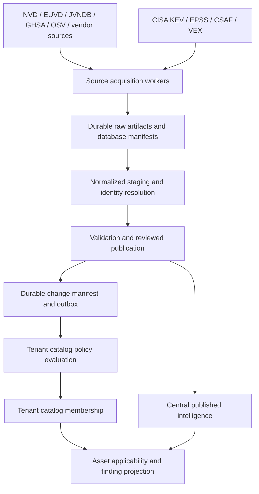

# Central intelligence architecture and decisions

Revision: 2026-11-14. Status: proposed. [Plan index](README.md).

Scope: application and database architecture independent of cloud provider. The [logical database design](logical-data-model.md) defines relationships and consistency contracts. AWS access and deployment choices are not implementation prerequisites.

## Existing architecture: retain and improve

| Area | Inspected implementation | Implication |
|---|---|---|
| Staging and governance | `IntelligencePublicationService` and migration V8 implement candidates, digests, reviewed releases, withdrawal, an outbox, and audit history. | Extend this workflow; do not introduce a competing publication path. |
| Identity | V8 defines identifiers and canonical redirects; publication handles alias consolidation. | Refine identity/relationship semantics rather than creating a second canonical registry. |
| Source evidence | Observations, summaries, targets, relations, and `TenantApprovedIntelligenceService` retain and resolve evidence. | Preserve source provenance and source-aware tenant scoring. |
| Incremental ingestion | `FeedWatermarkService` records completed intervals; `NvdSyncService` uses catch-up windows. | Add coverage manifests and publication checkpoints, not a replacement basic watermark mechanism. |
| Tenant preferences | `VulnerabilitySourceFilterConfigService` supports source enablement and source-specific filters. | Add a unified catalog policy; current NVD filters are not the requested general year/numeric-CVSS expression language. |
| Tenant processing | `TenantIntelligenceProcessingService` fans out publication work and evaluates inventory in batches of 100. | Improve selective processing and progress under frequent publications. |
| Query path | `PlatformVulnRepoService` loads source-matching IDs into Java and queries tenant findings in the central list. | Use indexed database filtering and remove tenant-table dependencies from platform catalog reads. |

Source references: [publication](../../backend/src/main/java/com/prototype/vulnwatch/service/IntelligencePublicationService.java), [migration V8](../../backend/src/main/resources/db/migration/postgres_reset/V8__reviewed_intelligence_publication.sql), [tenant processing](../../backend/src/main/java/com/prototype/vulnwatch/service/TenantIntelligenceProcessingService.java), [filters](../../backend/src/main/java/com/prototype/vulnwatch/service/VulnerabilitySourceFilterConfigService.java), [query service](../../backend/src/main/java/com/prototype/vulnwatch/service/PlatformVulnRepoService.java).

These are source observations, not measured production bottlenecks. Existing publication applies paged records inside an encompassing transaction; paging does not bound transaction duration. Tenant evaluation resets its component cursor when the target revision/generation changes, creating a potential repeated-work problem under sustained publication load.

## Target flow



The full acquired corpus includes staged or quarantined evidence. Tenant processing consumes approved published intelligence only. Publication approval remains the default; automated approval is a separate future policy decision.

## Multi-source model

Retain central canonical IDs, observations, identifiers, targets, summaries, releases, and redirects. Extend them only after a schema inventory establishes missing fields.

| Source class | Evidence role |
|---|---|
| NVD, EUVD, JVN/JVNDB | Vulnerability identity, description, scores, references, applicability evidence |
| GHSA, OSV | Package advisory identity and ecosystem/version ranges |
| CISA KEV | Known exploitation evidence and associated action information |
| EPSS | Dated exploitation probability and percentile |
| Microsoft, Red Hat, other vendors | Vendor advisories, affected versions, fixes |
| CSAF/VEX | Structured advisory and product-specific applicability assertions |

The existing registry uses `jvn`, with `japan-vulndb` normalization. Use JVN/JVNDB consistently in the UI while retaining legacy identifier compatibility. OSV services exist but OSV is absent from the inspected shared source registry: audit that integration before enabling general source-policy support.

Keep equivalence, advisory-to-vulnerability relationships, and product applicability separate. A bulletin referencing ten CVEs must not merge those CVEs. Persist score authority, CVSS version/vector, source timestamp, ingestion timestamp, source record ID, and resolution-policy version. Preserve conflicting evidence and show which value won; do not use last-arrival-wins resolution.

EPSS predicts exploitation over the next 30 days; it is not confirmed exploitation. See [FIRST EPSS](https://www.first.org/epss/). Model KEV membership, verified exploitation claims, exploit availability, and EPSS independently. VEX decisions remain scoped to the asserted product/version and trusted authority.

## Tenant catalog contract

Tenant ingestion means selecting central published records into a tenant catalog. Existing tenant schemas store compact memberships, policy versions, overrides, and tenant workflow state. Shared descriptions and raw evidence remain central.

Proposed additions, subject to schema reconciliation:

| Entity | Responsibility |
|---|---|
| `intelligence_catalog_policy_versions` | Immutable validated rule tree, evidence preferences, creator, version |
| `intelligence_catalog_builds` | Policy version, target central generation, checkpoint, counts, status |
| `intelligence_catalog_members` | Tenant/build and canonical ID, inclusion reason, evaluation timestamp; shadow-only until activation is designed and qualified |
| `intelligence_catalog_overrides` | Explicit include/exclude, reason, actor, optional expiry |

Compile a bounded typed rule tree into parameterized queries. Reject arbitrary SQL, unbounded nesting, unsupported fields, and invalid ranges. Reuse the same evaluator semantics for preview, backfill, incremental updates, and exports.

Example rule:

```text
(publication_year >= 2020 AND selected_cvss_base_score > 6.0)
OR cisa_kev_member = true
```

| Policy decision | Required behavior |
|---|---|
| Year | Explicit publication year or CVE identifier year; publication year is the default. |
| CVSS | Select version/authority precedence and fallback; `> 6` differs from `>= 6`. |
| Missing score/date | Unknown, not zero; explicit inclusion/exclusion behavior. |
| Exploitation | Explicit evidence category; no EPSS-to-confirmed-exploitation conversion. |
| Evidence sources | Evaluate using allowed observations, including score resolution. |
| Non-CVE records | Explicit option and stable canonical ID; do not require a CVE prefix. |
| Overrides | Proposed precedence: explicit exclusion, explicit inclusion, rule match; audit every override. |
| Product relevance | Separate filter/matching stage; missing inventory is not proof of no exposure. |

Policy activation builds against a fixed published generation. Keep the old catalog active, atomically switch the active build pointer on success, then replay subsequent changes. Preview records its policy hash and generation; report drift before activation. Failed builds are resumable and never expose partial membership.

When a record falls outside policy, stop active membership but preserve findings and history. Mark existing findings outside current policy; do not auto-resolve them. Withdrawn or merged central records need explicit membership reconciliation and canonical redirects. Finding eligibility continues to use established applicability rules.

## Logical ownership and tenant isolation

Retain shared platform intelligence and existing tenant schemas/RLS. A tenant cannot alter central evidence or another tenant's policy/catalog. Background jobs resolve tenant identity before opening transactions, validate tenant lifecycle, and reset connection context on completion/failure.

Define a common intelligence access interface so physical placement can change later without rewriting policy semantics. Replicated read models, if introduced, must include evidence required for deterministic matching, track generation/completeness, and reconcile lifecycle events. Physical database separation is not required by this plan. Never publish customer-private observations globally by default.

## Performance and consistency

- Replace source-ID materialization in Java with indexed joins/`EXISTS`; use stable cursor pagination and batch observation reads.
- Separate central catalog reads from tenant findings. Authorized fleet exposure belongs in a dedicated aggregate view.
- Keep PostgreSQL as the starting database. Partitioning, OpenSearch, replicas, and SQS are measurement-driven additions.
- Store raw artifacts compressed behind a durable artifact-store interface. Define retention for raw files, staging, candidate payloads, release journals, and rebuild generations; immutable evidence requires an explicit archival design. Storage-provider selection is outside scope.
- Publish changed canonical IDs, changed field categories, and affected product/package keys in a durable manifest.
- Description changes refresh presentation; score/KEV/EPSS changes evaluate policy/priority; applicability changes rematch affected products; inventory changes evaluate affected assets.
- Retain removals as well as additions in change routing. Unknown dependency mappings use a bounded fallback scan to avoid missing tenant updates.
- Finish a fixed target generation before catching up; coalesce pending work without losing newer changes. Use fair tenant scheduling and bounded worker slots.
- For large baselines, prepare unpublished generation data in chunks and activate in a short transaction. This requires generation-aware reads, withdrawal compatibility, and reader-safe garbage collection; do not merely split existing publication commits.

Illustrative scale: 1,000 tenants selecting 50,000 vulnerabilities produces 50 million memberships. Benchmark memberships, observations, applicability rules, and asset matches independently of the headline CVE count. Consider reusable policy-cohort projections only if repeated identical policies become a measured cost.

## Completeness and acceptance

The [removal and retention contract](removal-and-retention.md) governs platform and tenant lifecycle changes. Preserve the complete historical central corpus by default; age/severity filtering removes tenant membership only. Model source withdrawal, canonical withdrawal, tenant exclusion, and eligible payload purge separately. Keep durable tombstones, audited reasons, and dependency-safe reconciliation across tenant read models. No removal operation implicitly resolves findings or cascades into tenant evidence.

Maintain distinct checkpoints for acquisition, publication, tenant catalog activation, and asset evaluation. Baseline manifests record expected scope and acquired partitions per source. Reconcile upstream totals where meaningful; source observation totals are not canonical CVE totals. Incremental success alone does not establish historical completeness.

Measure browsing latency, preview latency, publication duration, oldest pending work, tenant catch-up time, DB connections/IO, and storage growth. Set numeric targets after measuring the deployed baseline and agreed tenant/asset volumes; do not present unmeasured targets as SLAs.
