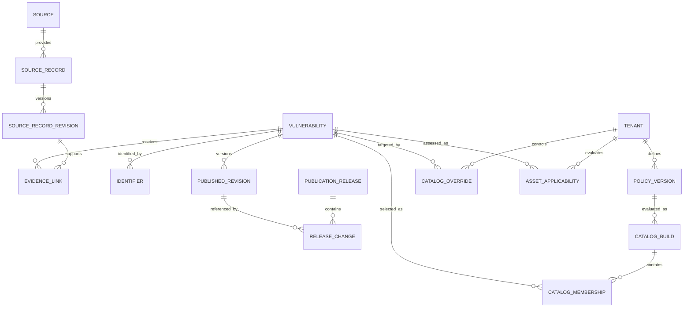

# Central vulnerability database: logical design

Revision: 2026-11-14. Status: proposed deployment-independent redesign. [Plan index](README.md).

## Architectural boundary

Keep the Java modular application and PostgreSQL. Establish module boundaries for acquisition, publication, central query, tenant catalog selection, applicability, and lifecycle management. These are logical modules, not a requirement for separate microservices. Use existing database jobs/outbox for durable execution initially.

The central repository stores complete acquired intelligence across sources. Its published view contains approved evidence. A tenant catalog records selected published vulnerabilities. Asset exposure records applicability to tenant inventory. Findings store actionable workflow state. These four counts and lifecycles are distinct.

## Logical relationships

These are logical concepts, not a wholesale table replacement. Existing vulnerabilities, observations, identifiers, relations, targets, summaries, release journals and outbox implement parts of them. Applicability/history can outlive catalog membership and must not be cascade-deleted with it.

## Central data responsibilities

| Concept | Keys / contents | Reuse and extension |
|---|---|---|
| Source registry | Stable ID, display aliases, adapter capabilities, resolution settings | Extend `IntelligenceSourceRegistry`; reconcile OSV and JVN names. |
| Source record and revision | `(source_id, source_record_id)`; revision hash, source modified time, observed time, status, raw artifact, parser version | Map observations/staging; add revision history only where journals cannot meet replay requirements. |
| Canonical vulnerability | Stable UUID, lifecycle state, preferred identifier | Retain `vulnerabilities`; NVD ownership and a CVE identifier are not prerequisites for other vulnerabilities. |
| Identifier | Namespace/value, canonical UUID, verified equivalence, redirect history | Retain identifiers/redirects; distinguish equivalent IDs from cross-references. |
| Advisory relationships | A source advisory references zero/one/multiple vulnerabilities | Use relations/evidence links; a multi-CVE bulletin is not an equivalent alias for all listed CVEs. |
| Scores/signals | CVSS version/vector/authority, value, observation date and validity | Preserve observations; derive effective values using a versioned resolution policy. Keep EPSS and exploitation evidence distinct. |
| Applicability | Product/package, version scheme/ranges, CPE expression tree, source and VEX scope | Reuse targets/rules/configuration expressions; preserve Boolean configuration semantics and ecosystem version comparison. |
| Published revision | Immutable effective content or reconstructable revision, provenance, resolution version | Start with release journals; define as-of reads before chunked large-generation publication. |
| Artifact manifest | Content hash, immutable reference, acquisition scope, parser version, size, checkpoint | Durable artifact interface; no required storage vendor. |
| Change manifest | Generation, canonical IDs, field categories, affected product keys, retirement/redirect information | Extend publication outbox and release changes. |

A source revision may support several vulnerabilities; a vulnerability may have many sources. Ambiguous equivalence enters review. Preserve disputed evidence and indicate whether it contributes to published summaries. Source observation IDs and unique canonical IDs must have separate counts.

## Tenant ownership and selection

Tenant schemas own policy versions, catalog builds, membership, overrides, inventory and findings. Central evidence is shared; do not copy full source payloads per tenant.

Proposed tenant tables:

- `intelligence_catalog_policy_versions`: immutable rule tree, source preferences, score-resolution selection, actor and timestamps.
- `intelligence_catalog_builds`: policy version, central generation, resolution version, processing cursor, counts and status.
- `intelligence_catalog_members`: tenant/build ID plus canonical ID (unique within build), inclusion reason and evaluation timestamp. Currently a shadow table, not an active membership pointer.
- `intelligence_catalog_overrides`: canonical ID, include/exclude, reason, actor and optional expiry.
- Active catalog state: one active build pointer per tenant; reconcile with existing tenant processing state before adding a separate table.

Example selection: `(publication_year >= 2020 AND selected_cvss > 6.0) OR cisa_kev = true`. The typed expression defines score authority/version, missing-value handling, year semantics and source eligibility. Reuse one evaluator contract for previews, builds, updates and exports.

Evaluate using allowed-source evidence. Cache resolved evidence by canonical revision and evidence-preference signature if needed. A global score must not be reused blindly when the tenant excludes the source that supplied it.

Each build pins `(policy_version, central_generation, resolution_version)`. Activate only after validation; keep the old build readable during failure/retry. After activation, catch up from its generation. Findings retain independent identity/revision references or approved evidence snapshots when membership disappears.

Historical reads must agree with the pinned generation. Until immutable/as-of reads exist, use the existing publication fence and invalidate/restart builds if the generation changes; never claim a stable snapshot while reading mutable rows across unrelated transactions. Validate this bounded interim approach before Phase 2 release. Phase 5 adds immutable revision reads and chunked preparation; if restart behavior prevents progress at measured publication rates, pull that dependency forward.

Product relevance is separate from generic policy filtering. Completed matching with no products differs from missing/stale inventory. Manual inclusion can bypass selection filters but not central withdrawal; explicit exclusion takes precedence. See [removal rules](removal-and-retention.md).

## Module contracts

| Module | Contract |
|---|---|
| Acquisition | Queue source operation; inspect coverage/progress; retry bounded partitions; preserve source-specific cursor semantics. |
| Publication | Build candidate, verify digest/base generation, publish or withdraw with stable idempotency key. |
| Central query | Read published records/evidence and lifecycle filters without implicit tenant findings joins. |
| Tenant catalog | Preview, save policy, activate build, inspect status, list members and reasons. |
| Overrides | Tenant-authorized include/exclude/expiry with reason and version guard. |
| Applicability | Match selected evidence to inventory; preserve version semantics and confidence/unknown states. |
| Lifecycle | Preview withdrawal, publish retirement, review reinstatement, dependency-check eligible payload purge. |

Introduce central DTOs separate from tenant exposure DTOs while preserving current clients through additive/versioned API changes. Unknown asset exposure must not become an authoritative zero. Add non-CVE record types explicitly; do not silently change a CVE-only count into an all-advisory count.

Use stable sorting and database predicates. Cursor paging should bind filter hash and generation, rejecting stale/mismatched cursors. Exports pin the same selection generation. Counts identify scope and whether exact or estimated.

## Reliability and performance

- Acquisition checkpoints advance after durable staging; published and tenant-applied checkpoints are separate.
- Commit release and change intent atomically through the existing outbox; consumers tolerate duplicate delivery and enforce generation order.
- Use positive lifecycle evidence for retirement. Fetch failure or missing incremental results cannot imply deletion.
- Route score/KEV/EPSS changes to policy evaluation and priority updates; route applicability changes to affected product groups; description changes do not rematch all assets.
- Track removal deltas, not only additions. Unknown dependency mappings fall back to a bounded scan to preserve correctness.
- Finish a fixed work generation before catch-up; use fair tenant scheduling and source rate limits. Do not iterate the full corpus across every tenant and asset for routine changes.
- Keep raw payloads out of list queries. Batch evidence reads; avoid transferring unbounded ID lists into Java.
- Benchmark canonical rows, observations, targets, memberships, revision history and asset matches separately. Introduce partitioning or external search only with measured need.
- Retain RLS, explicit tenant authorization, connection-context reset and worker isolation tests. Customer-private intelligence never becomes public evidence by default.

## Scope and unresolved decisions

Infrastructure service selection, AWS accounts, deployment topology and resource provisioning are excluded. Numeric retention/grace periods, target tenant/asset volumes, latency budgets, revision-storage details and index choices require application measurements and product policy. Permanent purge stays disabled until its retention/dependency contract is configured and tested. No existing data is deleted by adopting this design.
